# Tema 2.1 - Fundamentos del lenguaje Kotlin

Kotlin es el lenguaje recomendado por Google para Android. En este tema aprendes sus fundamentos **ejecutando código de verdad**: los 14 bloques *Código N* son escenas de una app real (`FumetoPMDM`) y cada captura muestra la salida que Kotlin imprimió de verdad, no un deseo.

**Materiales**: [Sintaxis completa](https://kotlinlang.org/docs/basic-syntax.html) · [Guía para Java devs](https://kotlinlang.org/docs/java-to-kotlin-idioms.html)

<div style="background-color:#a5d6a7; border-radius:8px; padding:10px 14px; margin:14px 0;">
<strong>🟢 Leyenda de repaso obligatorio:</strong> los textos con <span style="background-color:#a5d6a7;padding:0 3px;border-radius:3px;">este fondo verde</span> son imprescindibles: hay que repasarlos <strong>cada semana</strong>, porque entrarán en todas las evaluaciones del módulo.</div>

**Deberías saber ya**: programación estructurada (bucles, condiciones, funciones) y, si vienes de Java, sus colecciones —este tema hace continuas comparaciones con Java porque es la vía más rápida para entender por qué Kotlin es como es.

## 0. Por qué Kotlin y no seguir en Java

Kotlin es un lenguaje **de propósito general, multiplataforma, tipado estáticamente y compilado** (a bytecode JVM). Google lo admite oficialmente en Android desde 2017 y desde 2019 es su lenguaje preferido («Kotlin-first») y hoy el desarrollo nativo Android se escribe en Kotlin.

Comparad el mismo "hola mundo" en los dos lenguajes:

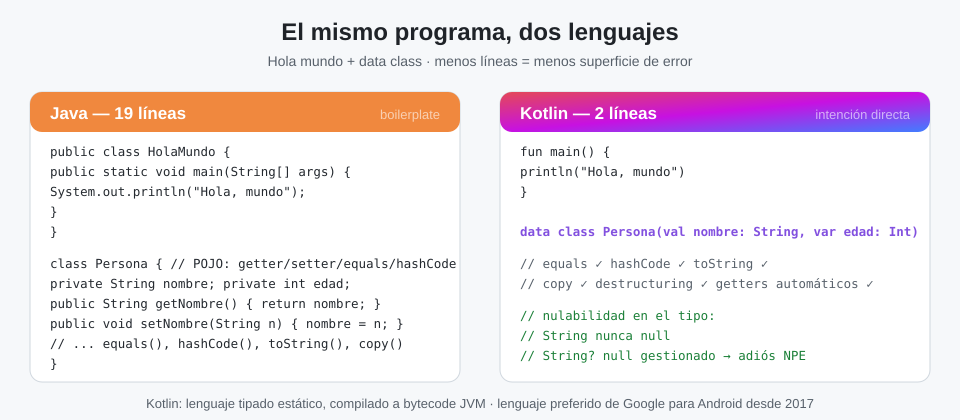

Sus ventajas reales, una por una:

- **Sintaxis concisa y expresiva**: menos plantillas (boilerplate), más intenciones. Un `data class` de una línea sustituye 60 líneas de POJO Java.
- **Seguridad de tipos mejorada**: <span style="background-color:#a5d6a7;padding:0 3px;border-radius:3px;">la nulabilidad se declara en el tipo (`String?`), lo que elimina de raíz el error más caro de Java: el `NullPointerException` sorpresa</span>.
- **Interoperabilidad total con Java**: puedes llamar código Java desde Kotlin y viceversa, y migrar archivo a archivo.
- **Inferencia de tipos**: escribes el tipo cuando aporta información; el compilador hace el resto.
- **Menos verbosidad en cosas simples**: funciones de una línea, expresiones `when` en lugar de cadenas de `else-if`, cadenas multilínea naturales, getters/setters automáticos.
- **Enfoque moderno**: funciones de orden superior, lambdas, expresiones lambda, colecciones con operaciones funcionales (`filter`, `map`...).

Y su coste honesto: si vienes de Java, la sintaxis te va a parecer "demasiado limpia" una semana, y luego no vas a querer volver.

**Cómo funciona esta lección**: los 14 bloques marcados como *Código N* son **exactamente** las funciones de la app de escenas `FumetoPMDM` (misma mecánica que en DI: `am start --ei codigo N`). El proyecto envuelve cada escena en un arnés de laboratorio que redirige `System.out` para pintar los `println` en pantalla:

```kotlin
// Arnés de laboratorio: ejecuta el bloque capturando su stdout.
fun consola(bloque: () -> Unit): List<String> {
    val buf = ByteArrayOutputStream()               // Buffer donde irá a parar el stdout
    val viejo = System.out                          // Guardamos el stdout original
    System.setOut(PrintStream(buf))                 // Redirigimos System.out al buffer
    bloque()                                        // EJECUTAMOS el código didáctico
    System.setOut(viejo)                            // Restauramos el stdout
    return String(buf.toByteArray()).lines().filter { it.isNotBlank() }
}
```

Todo lo demás (cada escena completa, comentada línea a línea) es el código que ves tal cual.

## 1. Estructura de un programa Kotlin

Un programa Kotlin es una **sucesión de sentencias u operadores**, cada uno en su línea (el punto y coma es opcional). El ejecutable arranca siempre en `main()`, que pertenece a un fichero `.kt` y puede vivir dentro o fuera de una clase.

```kotlin
fun main() {                 // punto de entrada del programa
    println("Hola, mundo")   // imprime una línea en la salida estándar
}
```

| Elemento | Descripción |
| -------- | ----------- |
| Palabras clave | Palabras especiales del lenguaje: `val`, `fun`, `if` |
| Identificadores | Nombres de variables, funciones, clases... |
| Literales | Valores fijos: `1.3`, `true`, `"Hola"` |
| Operadores | `+`, `==`, `&&`... |
| Comentarios | Notas que el compilador ignora |

Para ejecutar el código tienes dos caminos: **Android Studio** (proyecto o Scratch) o el **Playground online** (<https://play.kotlinlang.org/>), que además enseña el bytecode generado —útil para ver que tu `data class` se traduce a cientos de líneas de bytecode JVM.

Los **comentarios** documentan sin afectar a la ejecución:

```kotlin
// Comentario de una sola línea
/* Comentario de
   bloque */
/** Comentario de documentación (KDoc): genera documentación como Javadoc. */
```

!!! tip "Comenta el porqué, no el qué"
    El qué ya lo dice el código; el porqué no. `// precio con IVA` aporta más que `// suma 21%`.

## 2. Variables y constantes: var y val

<div style="background-color:#a5d6a7; border-radius:8px; padding:10px 14px; margin:14px 0;">
<strong>Regla de oro Kotlin</strong>: declara todo con <code>val</code> y solo cambia a <code>var</code> cuando demuestres que necesitas reasignar. El compilador te avisa si te pasas.</div>

| | `val` | `var` |
| --- | --- | --- |
| Palabra del lenguaje | value | variable |
| Cambiables tras la asignación | **No** | Sí |
| Equivalente Java | `final` | variable normal |
| Uso | Por defecto, siempre que puedas | Acumuladores, bucles, estado |

```kotlin
val msg: String = "Hello, World"  // inmutable
var count: Int = 0                // mutable
count += 1                        // var: se puede reasignar
val x = 10                        // inferencia: el compilador deduce Int
val y = 10.2                      // Double inferido
```

!!! warning "Que `val` sea inmutable es una promesa *fino a un punto*"
    `val` impide **reasignar la referencia**, no mutar el objeto apuntado: `val lista = mutableListOf(1)` te deja hacer `lista.add(2)`. La referencia no se mueve; el contenido, sí. En el examen esto pregunta mucho.

Razones de la regla de oro: **menos bugs** (lo inmutable no cambia a tus espaldas), **más legibilidad** (lo que ves es lo que hay), **fácil razonamiento** y **más seguro en concurrencia** (un `val` no necesita locks).

**📺 Escena — Código 1** (función `esc01` exacta de la app):

```kotlin
fun esc01(): List<String> = consola {
    // Un programa Kotlin arranca en main(); aquí simulamos ese cuerpo.
    println("Hola, Kotlin")                        // salida estándar
    val pi = 3.14                                 // val: inmutable, Double inferido
    var contador: Int = 0                         // var: mutable, tipo anotado
    contador += 1                                 // los var sí se reasignan
    println("pi=$pi   contador=$contador")
    // En Kotlin no hace falta punto y coma al final de línea
    println("regla de oro: val por defecto; var solo si hace falta")
}
```

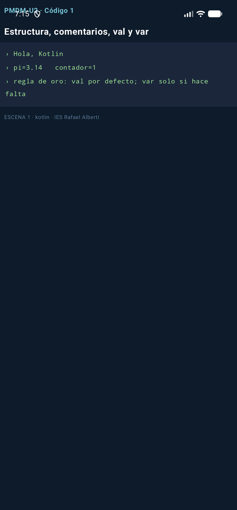

*Qué imprime y por qué*: `Hola, Kotlin`, luego `pi=3.14   contador=1` (el `+= 1` mutó el `var`) y la línea de la regla de oro. Fíjate: `$pi` es un *string template* —Sección 6—.

## 3. Null-safety: el fin del NullPointerException

En Java, cualquier referencia puede valer `null` y solo descubres dónde al estrellarse en tiempo de ejecución. En Kotlin <span style="background-color:#a5d6a7;padding:0 3px;border-radius:3px;">**el sistema de tipos distingue `String` (nunca null) de `String?` (nullable)**: si una función puede devolver null, está *obligada* a decirlo en su firma, y el compilador no te deja usar el resultado sin manejarlo</span>.

```kotlin
// Java: la NPE aparece al ejecutar
String m = null;
System.out.println(m.length());          // 💥 NullPointerException

// Kotlin: el tipo declara la nulabilidad y el compilador corta
val m: String? = null
println(m?.length ?: 0)                  // → 0  (nunca llega a romper)
```

Las tres herramientas que se usan el 100% de las veces:

| Operador | Nombre | Qué hace |
| --- | --- | --- |
| `?.` | safe call | Aplica el acceso **solo si no es null**; si no, toda la expresión vale null |
| `?:` | Elvis | Valor de **reserva** cuando la parte izquierda es null |
| `!!` | aserción nula | "Aposto a que no es null" — si pierdes la apuesta, `NPE` |

**📺 Escena — Código 2** (función `esc02` + auxiliar, exactas):

```kotlin
fun puedeSerNulo(caso: Int): String? = if (caso % 2 == 0) "par" else null

fun esc02(): List<String> = consola {
    val s: String? = puedeSerNulo(3)              // String? admite null
    val len = s?.length ?: 0                      // safe call + elvis: si null, 0
    println("s=$s  →  s?.length ?: 0  da $len")
    val t: String? = puedeSerNulo(4)              // ahora sí trae valor
    println("t=$t  →  longitud ${t?.length ?: 0}")
    val forzado = t!!                             // !! afirma que no es null (NPE si miente)
    println("con !! (sabiendo que t no es null): \"$forzado\"")
    println("Java usaba ternarios y NPEs sorpresa; Kotlin lo declara en el tipo")
}
```

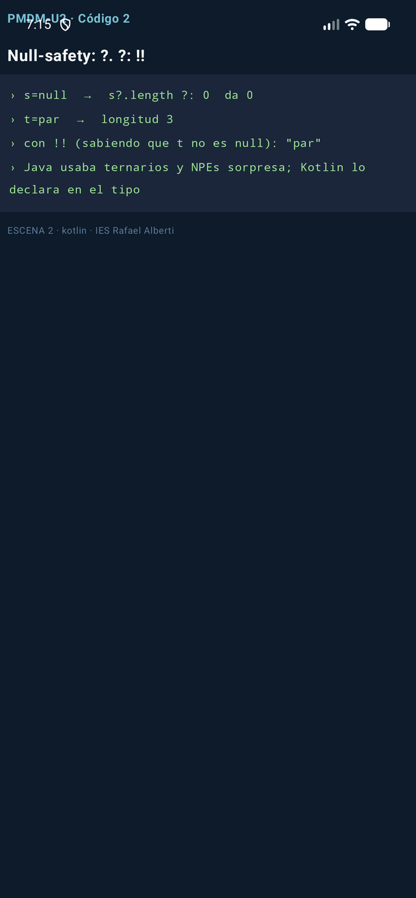

*Con `caso=3` la función devuelve `null`*: `s?.length` no ejecuta `length` y Elvis da `0`. Con `caso=4`, `t` vale `"par"` y el `!!` es seguro porque *tú* lo sabes —y el compilador te cree—.

## 4. Tipos básicos

Todos los tipos **son objetos** (nada de primitivos sueltos a lo Java) y **las conversiones numéricas son explícitas**: no existe la coerción implícita.

| Tipo | Tamaño | Rango |
| ---- | ------ | ----- |
| `Long` | 64 bits | -2⁶³ … 2⁶³-1 |
| `Int` | 32 bits | -2³¹ … 2³¹-1 |
| `Short` | 16 bits | -32768 … 32767 |
| `Byte` | 8 bits | -128 … 127 |
| `Double` | 64 bits (IEEE 754) | ±4.9e-324 … ±1.7e+308 |
| `Float` | 32 bits (IEEE 754) | ±1.4e-45 … ±3.4e+38 |
| `Char` | 16 bits | cualquier carácter Unicode |
| `Boolean` | 8 bits | `true` / `false` |
| `String` | — | secuencia inmutable de caracteres |

```kotlin
val maximo: Int = Int.MAX_VALUE       // 2147483647
val minimo: Int = Int.MIN_VALUE       // -2147483648
val grande: Long = 150_000_000_000    // sufijo implícito por el tipo; guiones bajos legibles
val pi = 3.14159                      // Double inferido
val letra: Char = 'A'                 // ¡comilla simple! "A" sería String
val ok: Boolean = true
```

## 5. Operadores

Funcionan como en Java/C, con dos diferencias notables: **no hay operador de incremento para asignar** (`x++` existe, pero en expresiones devuelve el valor viejo como siempre) y <span style="background-color:#a5d6a7;padding:0 3px;border-radius:3px;">`==` compara **contenidos** (equivale al `.equals()` de Java); para comparar referencias se usa `===`</span>.

| Tipo | Operadores |
| ---- | ---------- |
| Aritméticos | `+`  `-`  `*`  `/`  `%` |
| Relacionales | `<`  `<=`  `>`  `>=`  `==`  `!=`  `===` |
| Lógicos | `&&`  `\|\|`  `!` |

Precedencia (de mayor a menor):

| Precedencia | Operadores |
| ----------- | ---------- |
| Mayor | `( )` |
| | `x++`  `x--` |
| | `+x`  `-x`  `++x`  `--x`  `!` |
| | `*`  `/`  `%` |
| | `+`  `-` |
| | `<<`  `>>`  `>>>` |
| | `..`  `..<`  `..=` |
| | `is`  `as` |
| | `>`  `>=`  `<`  `<=` |
| | `in`  `!in` |
| Menor | `==`  `!=`  `===`  `!==` |

**📺 Escena — Código 3** (función `esc03` exacta):

```kotlin
fun esc03(): List<String> = consola {
    val a = 10                                    // Int inferido
    val b = 3
    val ratio = a.toDouble() / b                  // conversión EXPLÍCITA: sin ella, 3
    println("10/3 entero=3, pero toDouble()/3 = $ratio")
    var x = 5
    x++                                           // incremento postfijo
    val ok = (10 % 3 == 1) && (2 * 2 == 4)        // % resto, && lógico
    println("x tras x++ → $x     ok=$ok")
    val n: Long = 7
    val d = n.toFloat()                           // sin coerción implícita: toFloat()
    println("Long $n → Float $d (Kotlin NO convierte tipos sin preguntar)")
    val dos: Int = 'A'.code                       // Char → su código
    println("'A'.code = $dos   y comparar == compara CONTENIDO, no referencia")
}
```

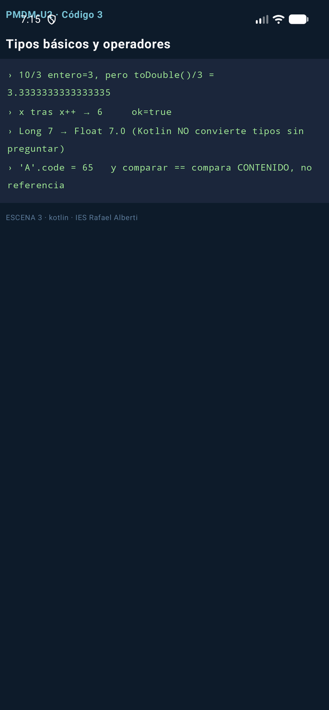

## 6. Cadenas de caracteres

Las `String` son **inmutables**: cada operación devuelve una cadena nueva; la original no se toca. La interpolación `$variable` y `${expresión}` sustituye a la concatenación con `+` de Java.

```kotlin
val nombre = "Ana"
val s = "Hola, $nombre. Dentro de un año: ${2026 + 1}"   // templates

val multilinea = """
    Multilínea "literal"
    sin escapar comillas
""".trimIndent()                               // raw string + reindentado
```

| Método | Qué devuelve |
| --- | --- |
| `length` | Longitud de la cadena |
| `get(i)` / `[i]` | Carácter en la posición i |
| `substring(i, j)` | Subcadena de i a j (sin incluir j) |
| `uppercase()` / `lowercase()` | Copia en mayúsculas / minúsculas |
| `trim()` | Copia sin espacios de borde |
| `split(delim)` | Lista de trozos al partir por delimitador |
| `replace(a, b)` | Copia con `a` sustituido por `b` |
| `contains(s)` / `in` | `true` si la contiene |
| `isEmpty()` / `isBlank()` | Vacía / vacía o solo espacios |
| `startsWith(s)` / `endsWith(s)` | Prefijo / sufijo |
| `indexOf(s)` / `lastIndexOf(s)` | Primera / última posición |

**📺 Escena — Código 4** (función `esc04` exacta):

```kotlin
fun esc04(): List<String> = consola {
    val nombre = "Ana"
    println("Hola, $nombre. Año que viene: ${2026 + 1}")      // interpolación + expresión
    val s = " Kotlin "
    val t = s.trim().uppercase()                              // las String son inmutables: devuelven nuevas
    println("""trim().uppercase() → "$t"""")
    val ok = "ko" in t.lowercase()                            // in = contains, case-sensitive
    println("\"ko\" en \"${t.lowercase()}\" → $ok")
    val sub = "Kotlin".substring(0, 3)                        // subcadena [0,3)
    println("substring(0,3) → \"$sub\"")
    val partes = "uno;dos;tres".split(";")                    // partir
    println("split(\";\") → ${partes.joinToString(" | ")}")   // unir con joinToString
    println("isBlank() en \"   \" → ${"   ".isBlank()}   isEmpty() en \"\" → ${"".isEmpty()}")
    val multi = """
        Multilínea "literal"
        sin escapar comillas
    """.trimIndent()
    println("raw string con ${multi.lines().size} líneas")
}
```


## 7. Funciones

Una función es un bloque de código que resuelve una tarea. La sintaxis mínima: `fun nombre(param: Tipo): Retorno = expresión`.

```kotlin
fun suma(a: Int, b: Int): Int = a + b           // cuerpo-expresión: return implícito
fun maxDe(a: Int, b: Int) = if (a > b) a else b // el tipo de retorno se infiere
fun despedirse() = println("Adiós")             // devuelve Unit (≈ void)
```

Parámetros **con nombre, en el orden que quieras**, y **por defecto**:

```kotlin
fun saludar(nombre: String, titulo: String = "Sr./Sra.") = println("Hola, $titulo $nombre")
saludar("Ana")                                  // usa el default
saludar(nombre = "Ana", titulo = "Dra.")        // nombrados: el orden da igual
```

`vararg` admite N argumentos del mismo tipo, y las funciones pueden anidarse (solo existen dentro de su contenedora):

```kotlin
fun media(vararg notas: Double) = notas.average()
fun procesar(nums: List<Int>): Int {
    fun esPar(n: Int) = n % 2 == 0              // función local
    return nums.filter(::esPar).sum()
}
```

**📺 Escena — Código 5** (las cuatro funciones anteriores + `esc05`, todas exactas):

```kotlin
fun suma(a: Int, b: Int): Int = a + b             // cuerpo-expresión, sin return

fun sumaConReturn(a: Int, b: Int): Int { return a + b }  // forma clásica, equivalente

fun media(vararg notas: Double) = notas.average() // vararg: N argumentos

fun <T> primero(lista: List<T>): T? = lista.firstOrNull()   // genérica

fun procesar(nums: List<Int>): Int {              // local function
    fun esPar(n: Int) = n % 2 == 0                //   solo visible aquí dentro
    return nums.filter(::esPar).sum()
}

fun saludar(nombre: String, titulo: String = "Sr./Sra.") =
    println("Hola, $titulo $nombre")              // parámetro por defecto

fun esc05(): List<String> = consola {
    println("suma(2,3) = ${suma(2, 3)}   sumaConReturn(2,3) = ${sumaConReturn(2, 3)}")
    println("media(1.0, 2.0, 3.0) = ${media(1.0, 2.0, 3.0)}")
    println("primero(listOf(7,9)) = ${primero(listOf(7, 9))}   primero(vacía) = ${primero(emptyList<Int>())}")
    println("procesar([1..6]) = ${procesar(listOf(1, 2, 3, 4, 5, 6))}   ← usó la función local esPar")
    saludar("Ana")                                // usa el valor por defecto
    saludar(nombre = "Ana", titulo = "Dra.")      // argumentos NOMBREADOS (orden libre)
    saludar(titulo = "Dr.", nombre = "Luis")
}
```

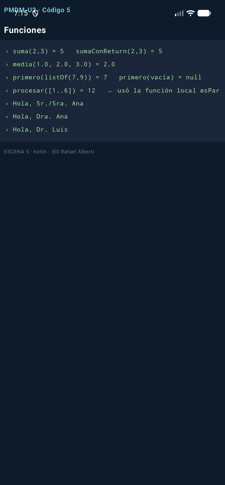

### 7.1. Funciones de orden superior y lambdas

Una función de **alto nivel** (HOF) es la que toma otra función como parámetro o la devuelve —la base de la programación funcional en Kotlin—.

```kotlin
fun aplicaDosVeces(x: Int, f: (Int) -> Int): Int = f(f(x))   // f es un parámetro-FUNCIÓN
```

Una **lambda** es una función anónima que se puede asignar a una variable o pasar como argumento. Sintaxis: `{ parámetros -> cuerpo }`; si tiene un único parámetro se llama `it`; y **si el último parámetro de la función es una lambda, se puede sacar de los paréntesis** (trailing):

```kotlin
val cuadrado = { n: Int -> n * n }
aplicaDosVeces(2, cuadrado)          // 16: cuadrado(cuadrado(2))
aplicaDosVeces(3) { it + 1 }         // 5:  trailing lambda + it implícito
```

Una **referencia** (`::nombre`) usa una función nombrada donde se espera una lambda sin envolverla:

```kotlin
val pares = listOf(1, 2, 3, 4).filter(::esPar)   // idéntico a filter { esPar(it) }, más directo
```

Los tipos de función se escriben `(Entrada) -> Salida`: `(Int) -> Int`, `(String, String) -> Boolean`, `() -> Unit`.

**📺 Escena — Código 6** (función `esc06` + auxiliares, exactas):

```kotlin
fun aplicaDosVeces(x: Int, f: (Int) -> Int): Int = f(f(x))   // HOF: recibe una función

fun esParNum(n: Int) = n % 2 == 0

fun esc06(): List<String> = consola {
    val cuadrado = { n: Int -> n * n }            // lambda con parámetro tipado
    println("aplicaDosVeces(2, cuadrado) = ${aplicaDosVeces(2, cuadrado)}   ← (2²)² = 16")
    println("aplicaDosVeces(3) { it + 1 } = ${aplicaDosVeces(3) { it + 1 }}   ← trailing lambda + it")
    val nums = listOf(1, 2, 3, 4)
    println("nums.filter(::esParNum) = ${nums.filter(::esParNum)}   ← referencia a función")
    val transformador: (Int) -> String = { n -> "n=$n" }      // una función es un VALOR
    println("lambda en variable: ${transformador(42)}")
    println("tipos de función: (Int) -> Int · (String, String) -> Boolean · () -> Unit")
}
```

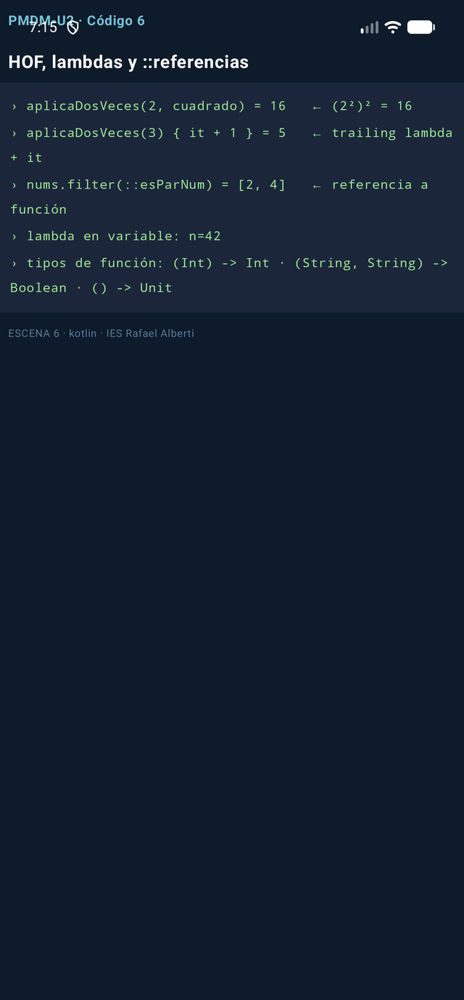

## 8. Estructuras de control

### if / else: es una expresión

En Kotlin `if` **devuelve un valor** —adiós al ternario `?:` de Java (que en Kotlin significa otra cosa)—:

```kotlin
val mayor = if (a > b) a else b      // if como expresión: asignable
```

### when: el switch potenciado

`when` sustituye a `switch`. <span style="background-color:#a5d6a7;padding:0 3px;border-radius:3px;">Se ejecuta el **primer** caso que coincida; los `when` que devuelven valor obligan a `else`, y si el sujeto es un enum no hace falta porque el compilador comprueba que los cubres todos</span>:

```kotlin
val mensaje = when (opcion) {
    1, 2 -> "baja"                  // varios valores por rama
    in 3..10 -> "media"             // rangos
    !in 10..20 -> "alta"            // y negaciones
    else -> "invalid option"
}
when {                              // sin sujeto: condiciones arbitrarias
    x !is Int    -> println("no es Int")
    x == 5       -> println("smart cast: aquí x ya es Int sin casteos")
}
```

### Bucles

`for` recorre **rangos** (`a..b` inclusivo, `a until b` exclusivo, `downTo`, `step`) e **iterables**; `withIndex` da posición y valor; `while` y `do-while` funcionan como siempre, con `break` y `continue`:

```kotlin
for (i in 1..5) { }                 // 1 2 3 4 5
for (i in 10 downTo 0 step 2) { }   // 10 8 6 4 2 0
for ((i, v) in lista.withIndex()) { }
while (x < 3) { }
do { } while (x < 3)
```

**📺 Escena — Código 7** (función `esc07` exacta):

```kotlin
fun esc07(): List<String> = consola {
    val a = 7; val b = 9
    val mayor = if (a > b) a else b               // if como EXPRESIÓN que devuelve valor
    println("if expresión: mayor de $a y $b → $mayor")
    val op = 2
    val mensaje = when (op) {                     // when: el primer caso que encaja gana
        1 -> "Alta"; 2 -> "Baja"; 3 -> "Consulta"
        else -> "opción inválida"
    }
    println("when(op=$op) → $mensaje")
    val x = 5
    val y: Any = "hola"
    when {                                        // when sin sujeto: rangos y smart cast
        x in 1..10 -> println("when: $x está en 1..10")
        y is String -> println("smart cast: kotlin lo trata como String, len=${y.length}")
        else -> println("otro caso")
    }
    var suma = 0
    for (i in 1..5) suma += i                     // rango inclusivo
    println("for 1..5 → suma=$suma")
    println("for 10 downTo 0 step 2 → " + (10 downTo 0 step 2).joinToString(","))
    val items = listOf("a", "b", "c")
    println("withIndex → " + items.withIndex().joinToString { (i, v) -> "$i→$v" })
    var k = 0
    while (k < 3) k++                             // while/do-while/break/continue: como en Java
    println("while → k=$k")
}
```


## 9. Practica: mini-testing con require()

`require(condición) { "mensaje" }` lanza `IllegalArgumentException` si la condición falla: es la forma más rápida de **autoverificar un ejercicio** sin montar un framework de tests.

**Ejercicio resuelto (mejorado sobre el PDF)**: implementa `areaTriangulo` y `cuadrado`, y autoverifícate con `require`:

**📺 Escena — Código 8** (funciones `esc08` + auxiliares, exactas):

```kotlin
fun cuadrado(n: Int) = n * n

fun areaTriangulo(base: Double, altura: Double): Double {
    require(base > 0 && altura > 0) { "base y altura deben ser positivas" }  // precondición
    return base * altura / 2
}

fun esc08(): List<String> = consola {
    require(cuadrado(3) == 9) { "3² debe ser 9" } // si falla: IllegalArgumentException
    println("require pasado: cuadrado(3)=${cuadrado(3)}")
    try {
        areaTriangulo(-2.0, 3.0)                  // precondición rota a propósito
    } catch (e: IllegalArgumentException) {
        println("require lanza IllegalArgumentException: ${e.message}")
    }
    println("Tests OK  ← así se autoverifica un ejercicio sin framework")
}
```


El PDF proponía escribir tu propio `assertEquals` en Java. Comparad: Kotlin ya trae la precondición en el contrato de la función (`require`), y el `try/catch` demuestra que el mecanismo de fallo funciona. *Bonus*: implementad el `assertEquals` de toda la vida y sustituid los `require` por él.

## 10. Arrays

Un `Array<T>` es una **colección ordenada de tamaño fijo** (se crea con un tamaño o con literales) pero de **contenido mutable**. Hay variantes primitivas (`IntArray`, `CharArray`...) que evitan el boxing.

```kotlin
val a = arrayOf(1, 2, 3)              // Array<Int>
val b = Array(3) { i -> i * 2 }       // [0, 2, 4] — inicializado por lambda
val c = IntArray(3) { it * 2 }        // variante primitiva: más ligera
a[0] = 10                             // contenido mutable; el tamaño, no
val matriz = Array(3) { IntArray(3) } // arrays de arrays (matrices)
```

| Operación | Array | List |
| --------- | ----- | ---- |
| Cambiar tamaño | ✗ | ✓ |
| Cambiar contenido | ✓ | en `MutableList`, ✓ |
| `contentToString()` / `toString()` | `contentToString()` (o sale el hash) | `toString()` pinta `[1, 2, 3]` |

**📺 Escena — Código 9** (función `esc09` exacta —cubre además el mapa mental de inmutabilidad de colecciones):

```kotlin
fun esc09(): List<String> = consola {
    val a = arrayOf(1, 2, 3)                      // Array<Int>: tamaño FIJO, contenido mutable
    a[0] = 10
    println("arrayOf → ${a.contentToString()} (a[0]=10)  → a.toList() = ${a.toList()}")
    val b = IntArray(3) { it * 2 }                // primitivo especializado, sin boxing
    println("IntArray(3) { it*2 } = ${b.contentToString()}")
    val nums = listOf(5, 2, 8, 2)                 // colección inmutable
    val paresOrdenados = nums.filter { it % 2 == 0 }.sorted()   // funcional: NO muta
    println("filter+sorted → $paresOrdenados   original intacto: $nums")
    println("inmutables: List/Set/Map · mutables: MutableList/MutableSet/MutableMap")
}
```

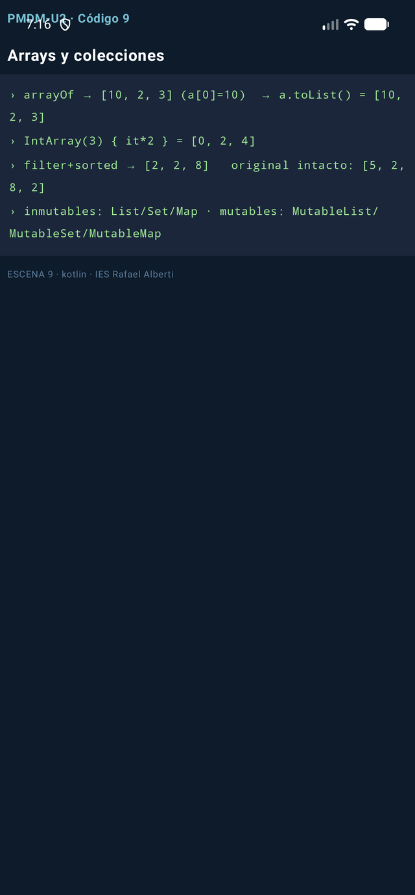

## 11. Colecciones: el mapa mental

Una colección es un contenedor de elementos para almacenar, recuperar y procesar datos. Kotlin divide las cabeceras en **inmutables** (interfaz de solo lectura) y **mutables** (añaden operaciones de cambio):

| Interfaz | Qué es | Crear | Mutar |
| -------- | ------ | ----- | ----- |
| `List<T>` | Ordenada, duplicados permitidos | `listOf(...)`, `List(5){...}` | `add` `set` `removeAt` `clear` (Mutable) |
| `Set<T>` | Sin duplicados | `setOf(...)`, `sortedSetOf(...)` | `add` `remove` `clear` (Mutable) |
| `Map<K,V>` | Pares clave→valor | `mapOf("a" to 1)`, `toMap()` | `put` `set` `remove` `clear` (Mutable) |

Y sobre **cualquiera** funcionan las operaciones funcionales (devuelven resultados nuevos, no tocan el original): `filter`, `map`, `sorted`, `distinct`, `any`/`all`, `sum`/`max`, `slice`, `chunked`, `partition`...

!!! warning "El error de concepto nº1 del tema"
    `filter` **no elimina** elementos de la lista: devuelve **otra** lista. La original queda intacta. Confundir `sortedBy` (copia nueva) con `sortBy` (en sitio, solo mutable) es el fallo que más se repite en los exámenes —Sección 18—.

## 12. Listas: el tour completo

**Crear**: `listOf(1,2,3)` · `mutableListOf(...)` · `List(5) { it*it }` (tamaño + lambda) · `(1..5).toList()`.

**Acceder**: `size`, `first()`/`last()` (y sus variantes `OrNull` que no revientan), `xs[2]`, `getOrNull(9)`, `slice(1..2)`, `take(2)`, `isEmpty()`.

**Mutar** (solo `MutableList`): `add(4)`, `removeAt(0)`, `xs[0] = 100`, `remove(2)`, `clear()` —y `+=`/`-=` que devuelven listas nuevas incluso en las inmutables—.

**Transformar** (inmutables siempre): `filter`, `map`, `mapIndexed`, `filterIsInstance`, `filterNotNull` (ojo: la nullabilidad tiene *dos niveles*: la lista y sus elementos), `distinct`, `flatten`, `sorted`, `reversed`, `zip`, `associate`.

**Consultar**: `any`/`all`, `find`/`findLast`, `count`, `sum`/`average`/`max`.

**Convertir**: `toSet()`, `toMutableList()`, `toTypedArray()`, `toIntArray()`.

**📺 Escena — Código 10** (función `esc10` exacta):

```kotlin
fun esc10(): List<String> = consola {
    println("List(5){it*it} → ${List(5) { it * it }}   (1..5).toList() → ${(1..5).toList()}")
    val xs = listOf(10, 20, 30, 40)
    println("size=${xs.size} first=${xs.first()} xs[2]=${xs[2]} slice(1..2)=${xs.slice(1..2)}")
    println("firstOrNull en vacía → ${emptyList<Int>().firstOrNull()} (first lanzaría)")
    val ms = mutableListOf(1, 2, 3)               // MutableList: sí se modifica
    ms.add(99); ms.removeAt(0); ms[0] = 100
    println("mutable add/removeAt/[0]=100 → $ms")
    println("sin mutar: listOf(1,2)+3 → ${listOf(1, 2) + 3} · listOf(1,2,2)-2 → ${listOf(1, 2, 2) - 2}")
    val ns = listOf(1, 2, 3, 4, 5)
    println("map x2 → ${ns.map { it * 2 }}   filter pares → ${ns.filter { it % 2 == 0 }}")
    println("distinct → ${listOf(1, 2, 2, 3).distinct()}   flatten → ${listOf(listOf(1, 2), listOf(3)).flatten()}")
    println("sorted → ${listOf(5, 3, 9, 1).sorted()}   any>4 → ${ns.any { it > 4 }}   find>3 → ${ns.find { it > 3 }}")
    val conNulos: List<Int?> = listOf(1, null, 3) // nullabilidad en DOS niveles
    println("List<Int?> $conNulos → filterNotNull → ${conNulos.filterNotNull()}")
    println("convertir: toSet() → ${listOf(1, 2, 2).toSet()}   toIntArray() OK")
}
```


## 13. Mapas

Colecciones de **pares clave→valor**. <span style="background-color:#a5d6a7;padding:0 3px;border-radius:3px;">Las claves son únicas; pedir una clave inexistente con corchetes devuelve **null** (no excepción) en los mapas inmutables, y `getOrDefault`/`getOrElse` te dan la vía cortés</span>. `mapOf` conserva el orden de inserción (`LinkedHashMap`).

```kotlin
val precios = mapOf("pan" to 1.2, "leche" to 1.1)   // inmutable: NO se puede put
val m = mutableMapOf("pan" to 1.2)                  // mutable
m["leche"] = 1.1                                    // añadir/actualizar con corchetes
val p: Double? = m["huevos"]                        // clave desconocida → null
val par = listOf("A", "B").zip(listOf(1, 2)).toMap()  // construir desde listas
for ((k, v) in m) { }                               // desestructuración al iterar
```

**📺 Escena — Código 11** (función `esc11` exacta):

```kotlin
fun esc11(): List<String> = consola {
    val precios = mutableMapOf("pan" to 1.2, "leche" to 1.1)
    precios["leche"] = 1.25                       // actualizar con corchetes
    println("mutableMapOf → $precios")
    println("\"huevos\" in precios → ${"huevos" in precios}   containsKey(pan) → ${precios.containsKey("pan")}")
    val x1: Double? = precios["huevos"]           // clave inexistente → null, NO excepción
    println("m[clave inexistente] → $x1   getOrDefault → ${precios.getOrDefault("huevos", 0.0)}")
    println("getOrElse (cálculo diferido) → ${precios.getOrElse("huevos") { 0.0 * 99 }}")
    println("total = values.sum() → ${precios.values.sum()}")
    val mZip = listOf("A", "B", "C").zip(listOf(1, 2, 3)).toMap()
    println("zip().toMap() → $mZip")
    for ((k, v) in precios) println("destructuring: $k ⇒ $v")
    println("mapOf devuelve LinkedHashMap: conserva el ORDEN de inserción")
}
```

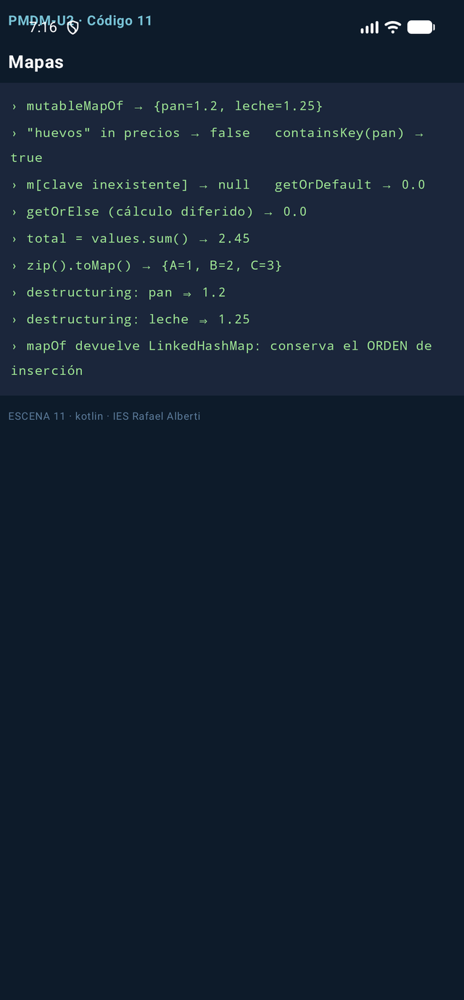

## 14. Enumeraciones

Un `enum class` define un **conjunto cerrado de constantes con nombre**: estados, roles, tipos. Cada constante es un singleton y puede llevar **propiedades y funciones**.

```kotlin
enum class Rol { ADMIN, EDITOR, LECTOR }              // simple

enum class Nivel(val prioridad: Int) {                // con datos
    BAJO(1), MEDIO(2), ALTO(3);                       // el punto y coma abre el cuerpo
    fun esCritico() = this == ALTO
}
println(Nivel.ALTO.name)        // "ALTO"   (nombre)
println(Nivel.ALTO.ordinal)     // 2        (posición)
Nivel.entries                   // todas las constantes (sustituye al values() clásico)
```

**📺 Escena — Código 12** (función `esc12` + enums, exactas):

```kotlin
enum class Rol { ADMIN, EDITOR, LECTOR }

enum class Nivel(val prioridad: Int) {            // enum con propiedad y función
    BAJO(1), MEDIO(2), ALTO(3);                   //  el punto y coma abre el cuerpo
    fun esCritico() = this == ALTO
}

fun esc12(): List<String> = consola {
    val r = Rol.ADMIN
    println("role=$r  name=\"${r.name}\"  ordinal=${r.ordinal}")
    println("Nivel.ALTO.prioridad=${Nivel.ALTO.prioridad}   esCritico()=${Nivel.ALTO.esCritico()}")
    println("todas las constantes: ${Nivel.entries.joinToString { "${it.name}(${it.prioridad})" }}")
    val permiso = when (r) {                      // when EXHAUSTIVO sobre enum: sin else
        Rol.ADMIN -> "puede todo"
        Rol.EDITOR -> "escribir"
        Rol.LECTOR -> "solo leer"
    }
    println("when sobre enum (sin else): ADMIN → $permiso")
    println("cada constante es un singleton: útil para estados, roles y tipos cerrados")
}
```

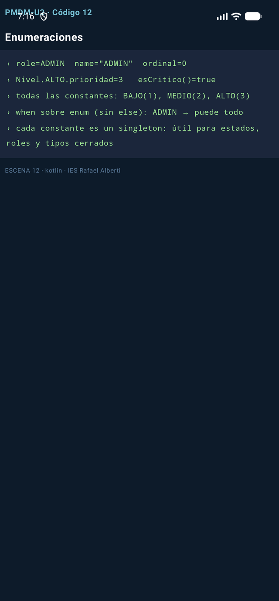

## 15. Programación orientada a objetos

Un **objeto** = estado (propiedades) + comportamiento (métodos); una **clase** = su plano de fabricación.

```kotlin
class Usuario(val id: Int, var nombre: String)    // el constructor primario DECLARA propiedades
```

Con `init` para validar y **constructor secundario** que delega en el primario:

```kotlin
class Producto(val id: Int, val nombre: String, var precio: Double) {
    init { require(precio >= 0) { "Precio negativo" } }             // validación al construir
    constructor(id: Int, nombre: String) : this(id, nombre, 0.0)   // secundario → this(...)
}
```

**Getters automáticos** —y propiedades calculadas con `get()` que se evalúan en cada lectura—:

```kotlin
class Rectangulo(var ancho: Int, var alto: Int) {
    val area: Int get() = ancho * alto            // calculada al leerla, no cacheada
    fun escalar(k: Int) { ancho *= k; alto *= k }
}
```

Las **data classes** le piden al compilador el trabajo pesado (`equals`, `hashCode`, `toString`, `copy`, desestructuración). La diferencia entre una clase normal y una `data` es la que hay entre comparar punteros y comparar contenidos:

```kotlin
class PersonaNormal(val nombre: String, var edad: Int)
data class Persona(val nombre: String, var edad: Int)   // una línea = 60 líneas de Java

val a = Persona("Ana", 30); val b = Persona("Ana", 30)
a == b                    // true  (equals estructural)
val c = a.copy(edad = 31) // copia cambiando solo un campo
val (n, e) = a            // desestructuración vía component1/component2
```

**Herencia**: en Kotlin <span style="background-color:#a5d6a7;padding:0 3px;border-radius:3px;">todo es **final y no heredable por defecto**; hay que marcar `open` en la base y `override` en la derivada</span>. Las `interface` se implementan con la misma sintaxis que la herencia:

```kotlin
open class Animal(open val nombre: String) { open fun sonido() = "..." }
class Perro(override val nombre: String) : Animal(nombre) {     // : = "hereda de"
    override fun sonido() = "guau"
}
interface Volador { fun volar(): String }
class Pajaro(override val nombre: String) : Animal(nombre), Volador {
    override fun volar() = "aleteo"
}
```

**📺 Escena — Código 13** (todas las clases anteriores + `esc13`, exactas):

```kotlin
class Usuario(val id: Int, var nombre: String)    // constructor primario en la cabecera

class Producto(val id: Int, val nombre: String, var precio: Double) {
    init { require(precio >= 0) { "Precio negativo" } }        // bloque de validación
    constructor(id: Int, nombre: String) : this(id, nombre, 0.0)  // secundario → delega
}

class Rectangulo(var ancho: Int, var alto: Int) {
    val area: Int get() = ancho * alto            // propiedad CALCULADA
    fun escalar(k: Int) { ancho *= k; alto *= k } // método miembro
}

class PersonaNormal(val nombre: String, var edad: Int)          // clase al uso

data class Persona(val nombre: String, var edad: Int)           // data: añade mucho gratis

open class Animal(open val nombre: String) { open fun sonido() = "..." }

class Perro(override val nombre: String) : Animal(nombre) {     // herencia: open/override
    override fun sonido() = "guau"
}

interface Volador { fun volar(): String }

class Pajaro(override val nombre: String) : Animal(nombre), Volador {
    override fun volar() = "aleteo"
}

fun esc13(): List<String> = consola {
    val u = Usuario(1, "Ana")
    u.nombre = "Ana María"                        // var sí, val no
    println("Usuario → ${u.nombre} (val id inmutable, var nombre editable)")
    val p = Producto(1, "Teclado")                // usa el constructor secundario
    println("secundario delega en primario: precio=${p.precio}")
    val r = Rectangulo(2, 3); r.escalar(2)
    println("Rectangulo(2,3).escalar(2) → area=${r.area}  (get() calcula al leer)")
    val a1 = PersonaNormal("Ana", 30); val a2 = PersonaNormal("Ana", 30)
    println("class normal: a == b → ${a1 == a2}   toString → ${a1.javaClass.simpleName}@${a1.hashCode().toString(16)}")
    val b1 = Persona("Ana", 30); val b2 = Persona("Ana", 30)
    println("data class: b == b → ${b1 == b2}   toString → $b1")
    val copia = b1.copy(edad = 31)                // copia cambiando un campo
    val (n, e) = b1                               // desestructuración por componentN()
    println("copy(edad=31) → $copia   y (n,e) → $n, $e")
    println("herencia: Perro → ${Perro("Luna").sonido()}   Pajaro → ${Pajaro("Pio").sonido()}/${Pajaro("Pio").volar()}")
    println("Kotlin es final por defecto: hereda solo de open/abstract")
}
```

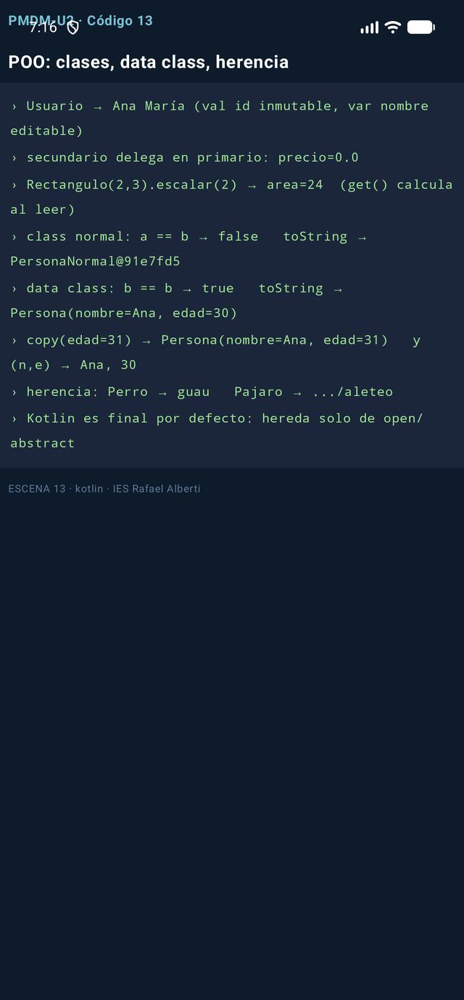

## 16. Colecciones de objetos: el CRUD completo

La técnica que vais a usar en cada práctica: una `data class` como modelo y `MutableList` como almacén, más las consultas funcionales del tema.

**📺 Escena — Código 14** (función `esc14` + modelo, exactas):

```kotlin
data class Libro(val id: Int, val titulo: String, val paginas: Int, val autor: String)

fun esc14(): List<String> = consola {
    val libros = mutableListOf(
        Libro(1, "Kotlin 101", 180, "Ana"),
        Libro(2, "Compose", 220, "Luis"),
    )
    libros += Libro(3, "Coroutines", 200, "Ana")  // += en mutableList
    libros[0] = libros[0].copy(paginas = 190)     // data class: copiar corregida
    println("${libros.size} libros · el 1º con ${libros[0].paginas} págs (tras copy)")
    println("filtrar por autor → ${libros.filter { it.autor == "Ana" }.map { it.titulo }}")
    println("primero >200 págs → ${libros.firstOrNull { it.paginas > 200 }?.titulo}")
    println("any con Compose → ${libros.any { it.titulo.contains("Compose") }}")
    println("indexOfFirst Coroutines → ${libros.indexOfFirst { it.titulo == "Coroutines" }} (o -1)")
    println("sortedBy págs → ${libros.sortedBy { it.paginas }.joinToString { it.titulo }}")
    val orden = libros.sortedWith(compareBy<Libro> { it.autor }.thenBy { it.titulo })
    println("autor↑ título↑ → ${orden.joinToString { "${it.autor}:${it.titulo}" }}")
    libros.sortByDescending { it.paginas }        // en sitio (solo MutableList)
    println("sortByDescending en sitio → ${libros.joinToString { it.titulo }}")
    println("total páginas → ${libros.sumOf { it.paginas }}")
}
```

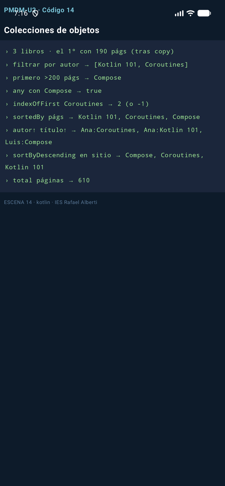

Fíjate en el patrón `filter → map → joinToString`: **filtrar, transformar, presentar**. Es la columna vertebral de cualquier pantalla de listado Android (RecyclerView/LazyColumn) que montaréis este curso.

## 17. Buenas prácticas de estilo

| Aspecto | Convención | Ejemplo |
| ------- | ----------- | ------- |
| Nombre de variables | sustantivo, minúsculas, camelCase | `velocidad`, `numeroCuentas` |
| Nombres booleanos | adjetivo, o sufijos `is`/`has`/`can` | `isReady`, `hasPermisos` |
| Funciones | verbo en infinitivo | `calcularMedia()`, `validarDatos()` |
| Números mágicos | en constante nombrada | `private val IVA = 1.21` |
| Nulabilidad | preferir no-nullable; manejar antes de usar | `val x: String? = ...; x?.uso() ?: defecto` |
| Constantes reales | `const val` en mayúsculas | `const val MAX_INTENTOS = 3` |
| Comentarios | explican el **porqué**, no el qué | `// margen legal: art. X` |

## 18. Errores frecuentes

| Error | Síntoma | Arreglo |
| ----- | ------- | ------- |
| Confundir `?` con `!!` | `NPE` pese al `?` | el `?` protege; el `!!` apuesta |
| `filter` esperando mutación | "no me ha quitado nada" | `filter` devuelve **otra** lista |
| Usar `values()` en enums nuevos | deprecado | `entries` |
| Olvidar `open` | "abrir de... es final" | `open` en base, `override` en derivada |
| `==` pensando en referencias | compara contenidos | `===` para identidad |
| Comparar con `equals` en `sortedBy` | orden lexicográfico sorpresivo | `compareBy(...)thenBy(...)`, `compareTo` |
| `sortedBy` vs `sortBy` | `sortBy` no existe en inmutables | `sortedBy` devuelve copia |
| Puntos y comas "a lo Java" | ruido | línea = sentencia; `;` solo para partir líneas |

## 19. Test de autoevaluación

1. ¿Qué imprime `val x: Int? = null; println(x?.toString() ?: "nada")`?
2. Diferencia entre `sortedBy` y `sortBy`: ¿cuál existe en una `List` inmutable?
3. ¿Por qué `mapOf("a" to 1)["z"]` no lanza excepción pero `listOf(1)[9]` sí?
4. ¿Qué te da `data class` que una clase normal no tiene?
5. ¿Cuándo un `when` no necesita `else`?
6. `::esPar` dentro de `filter` — ¿qué es y qué alternativa equivalente hay?
7. ¿Qué hace `require(condición) { msg }` y qué lanza?
8. ¿Por qué la regla de oro es `val` por defecto?

!!! info "Respuestas"
    1. `nada` (safe call → null; Elvis activa el rescate). 2. `sortedBy` devuelve una copia ordenada —existe en inmutables—; `sortBy` ordena en sitio y **solo** existe en `MutableList`. 3. Los mapas devuelven `null` ante clave inexistente; las listas lanzan `IndexOutOfBounds`. 4. `equals`/`hashCode`/`toString`/`copy`/`componentN` generados. 5. Cuando el compilador puede probar que cubres todos los casos (enums con todas sus constantes, o sellados). 6. Una referencia a función; la alternativa es `filter { esPar(it) }`. 7. Comprueba la precondición y lanza `IllegalArgumentException` con el mensaje si falla. 8. Porque lo inmutable es más seguro, legible y trivialmente concurrente.

## 20. Para terminar

<div style="background-color:#a5d6a7; border-radius:8px; padding:10px 14px; margin:14px 0;">
Este tema es <strong>la base de todo lo que viene</strong>: cada tema de la UD3 (actividades, Compose, Room…) usa estos mismos fundamentos. El repaso semanal del verde no es opcional: entra en todas las evaluaciones.</div>

**Siguiente**: **Tema 3.1 - Ciclo de vida de las aplicaciones** (próxima unidad) — dónde vive realmente una app Android y qué pasa cuando alguien te llama por teléfono a mitad.

**Recursos**: [Sintaxis](https://kotlinlang.org/docs/basic-syntax.html) · [Null-safety](https://kotlinlang.org/docs/null-safety.html) · [Colecciones](https://kotlinlang.org/docs/collections.html) · [Guía Java→Kotlin](https://kotlinlang.org/docs/java-to-kotlin-idioms.html)

<div class="grid cards" markdown>

-   :octicons-book-24{ .lg } **Ampliación**

    ---

    Repasa el [Tema 1](../../u01/teoria/PMDM-U1.1.-AnalisisTecnologiasDispositivosMoviles.md) para poner el lenguaje en contexto: dónde corre Kotlin dentro del sistema Android.

</div>
