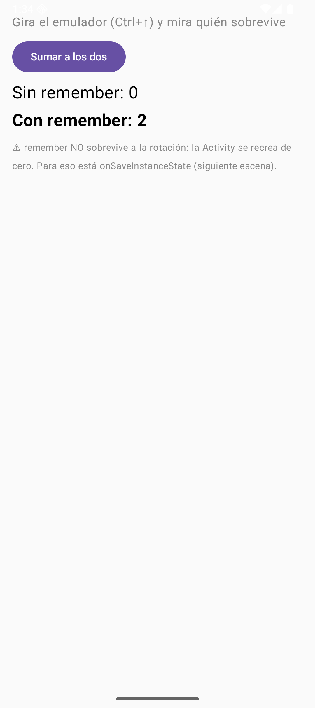
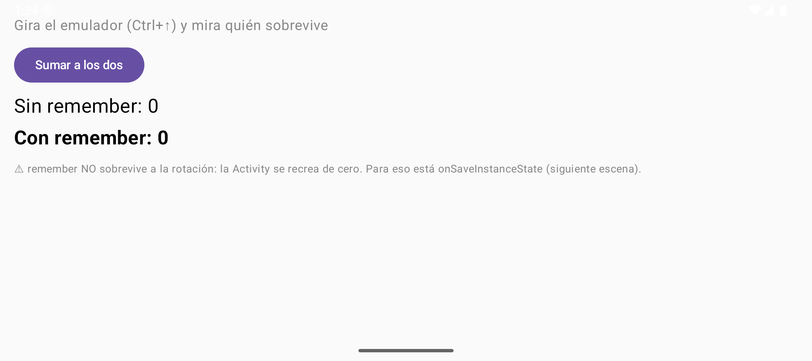
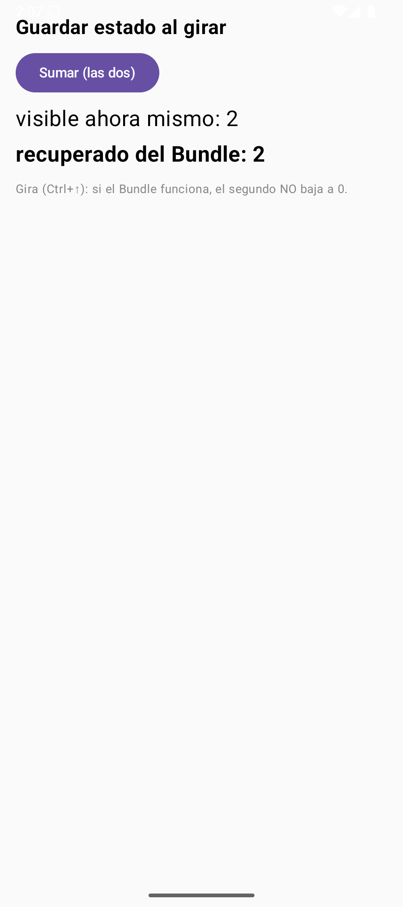
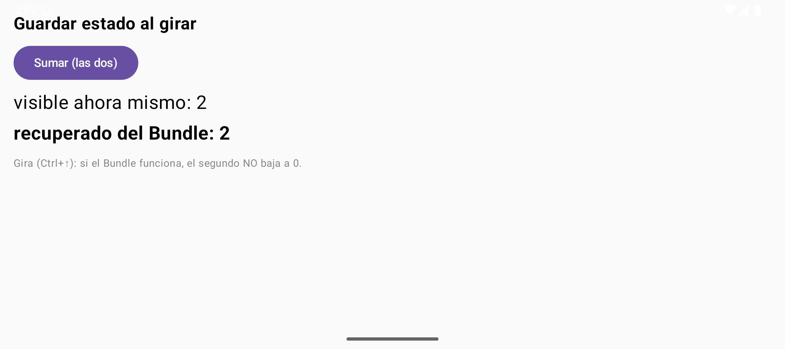
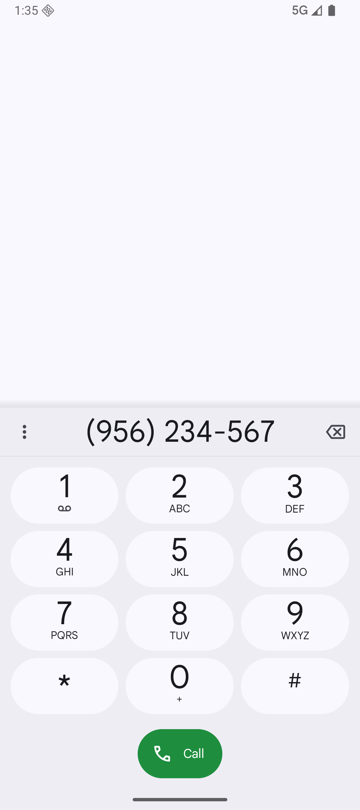
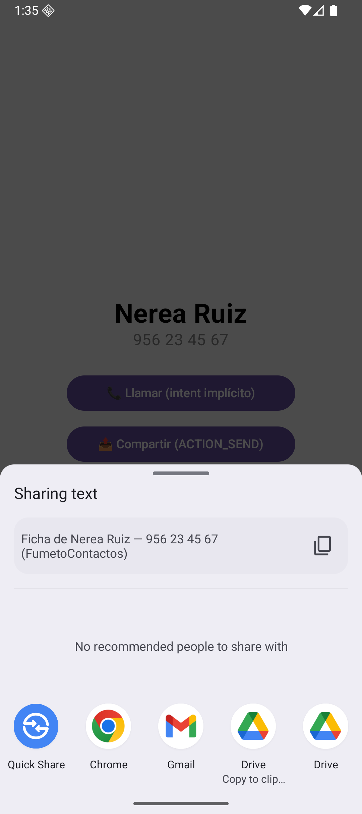
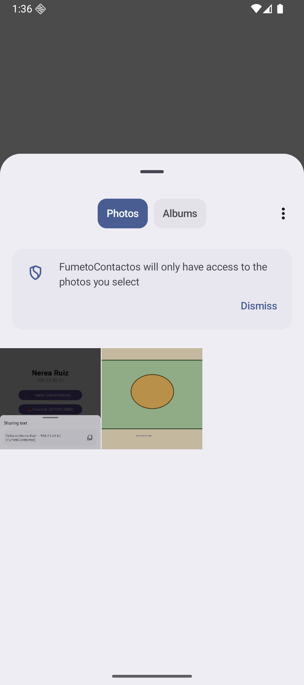
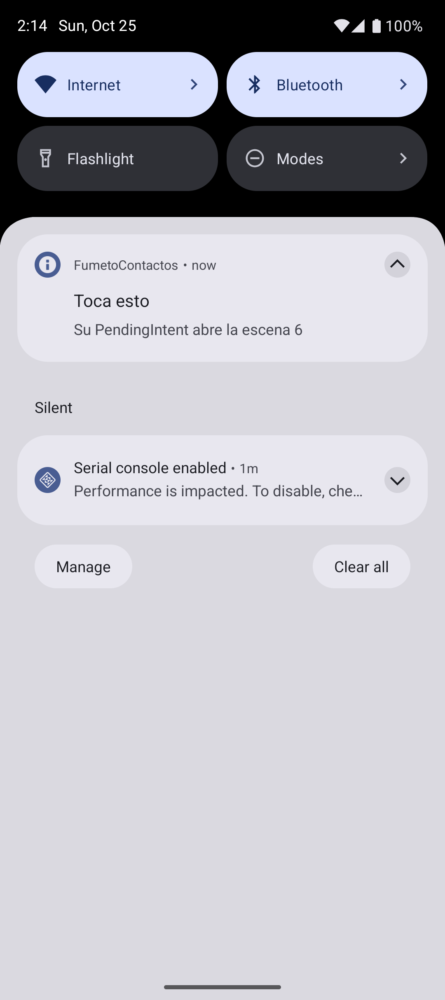
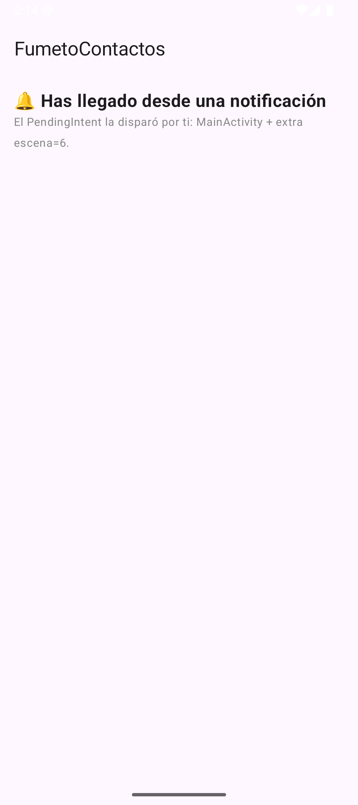

# Tema 2.2 - Actividades e Intents: la anatomía de una app Android

Hasta ahora tus apps Compose han sido **una sola pantalla bonita**. En este tema aprendes qué es *eso* que hay debajo de `setContent`: la **Activity** (con su ciclo de vida, que el sistema controla) y los **Intents** (el correo postal de Android: la única forma legal de que una pantalla hable con otra, o tu app con las 300 apps del móvil).

**Deberías saber ya**: los fundamentos de Kotlin del [apartado 2.1](./PMDM-U2.1.-FundamentosLenguajeKotlin.md) y los fundamentos de Compose de *Desarrollo de Interfaces* (Column, Button, estado con `remember`). Aquí no enseñamos Compose: aquí enseñamos **la app** que lo aloja.

<div style="background-color:#a5d6a7; border-radius:8px; padding:10px 14px; margin:14px 0;">
<strong>🟢 Leyenda de repaso obligatorio:</strong> los textos con <span style="background-color:#a5d6a7;padding:0 3px;border-radius:3px;">este fondo verde</span> son imprescindibles: hay que repasarlos <strong>cada semana</strong>, porque entrarán en todas las evaluaciones del módulo.</div>

La app de referencia del tema es **FumetoContactos**: una libreta de contactos que empieza siendo una pantalla y acaba siendo una app multi-pantalla que llama, comparte fotos y contesta a URLs propias. Todas las capturas están hechas ejecutando ese código en un emulador real.

## 1. ¿Qué es una Activity?

Una **Activity es una pantalla de tu app** — pero no "una pantalla" en el sentido de un dibujo: es un **objeto con ciclo de vida** que el sistema operativo nace, pausa, detiene y mata cuando le da la gana (al girar el móvil, al faltarte memoria, al pulsar el botón de inicio). Tú escribes qué pasa en cada estación; **quién decide cuándo** es Android.

Toda Activity se declara en el `AndroidManifest.xml` — el DNI de tu app. El nuestro, tal cual está en el proyecto:

=== "Código 1 — El Manifest que declara nuestras tres pantallas"

    ```xml
    <?xml version="1.0" encoding="utf-8"?>
    <manifest xmlns:android="http://schemas.android.com/apk/res/android">

        <application                                          // la app entera
            android:label="FumetoContactos"                   // el nombre que ve el usuario
            android:icon="@mipmap/ic_launcher"                // su icono
            android:theme="@style/Theme.MyApplication">       // su tema base

            <activity
                android:name=".MainActivity"                  // pantalla 1: la libreta
                android:exported="true"                       // el launcher (de fuera) puede arrancarla
                android:windowSoftInputMode="adjustResize">   // el teclado no tapa el formulario
                <intent-filter>                               // POR QUÉ aparece en el cajón
                    <action android:name="android.intent.action.MAIN" />      <!-- la entrada principal -->
                    <category android:name="android.intent.category.LAUNCHER" /> <!-- la pinta en el launcher -->
                </intent-filter>
            </activity>

            <activity android:name=".FichaActivity"           // pantalla 2: la ficha de un contacto
                android:exported="false" />                   <!-- solo mi app la abre: no la ve nadie -->

            <activity android:name=".FichaWebActivity"         // pantalla 3: contesta a mi URL
                android:exported="true">                       <!-- la abrirá el navegador: de fuera -->
                <intent-filter>
                    <action android:name="android.intent.action.VIEW" />                <!-- "ver esto" -->
                    <category android:name="android.intent.category.DEFAULT" />          <!-- obligatoria en VIEW -->
                    <category android:name="android.intent.category.BROWSABLE" />        <!-- desde navegador -->
                    <data android:scheme="https" android:host="fumeto.dev" />            <!-- mi dominio -->
                </intent-filter>
            </activity>

        </application>
    </manifest>
    ```

Fíjate en `android:exported`: <span style="background-color:#a5d6a7;padding:0 3px;border-radius:3px;">`exported="true"` significa "cualquier app (o el launcher o el navegador) puede lanzar esta Activity"; `exported="false"` significa "solo yo misma"</span>. Es la primera línea de seguridad de tu app: nada que no necesites hacia fuera, expuesto.

El código que *pinta* esa pantalla de casa (la verás entera y comentada en el [apartado 2.3](./PMDM-U2.3.-AppComposeListasYFormulario.md)): `MainActivity` extiende `ComponentActivity`, y en `onCreate` llama a `setContent { ... }` — el punto exacto donde Android le cede el micro a Compose.

## 2. El ciclo de vida: las siete estaciones


*Figura 2. La escena «vigía» anotando el ciclo en vivo: nací (onCreate → onStart → onResume), el usuario abrió Ajustes (onPause → onStop) y volvió con ATRÁS (onRestart → onStart → onResume).*

`MainActivity` no vive a su aire: el sistema la va llamando por teléfono en cada cambio de estado. El orden canónico — <span style="background-color:#a5d6a7;padding:0 3px;border-radius:3px;">y pregunta fija de examen — es:</span>

```
nace ──▶ onCreate ▶ onStart ▶ onResume ──▶ (interactuando)
al tapar otra app ─▶ onPause ▶ onStop ─ (⚫ en segundo plano)
al volver ─▶ onRestart ▶ onStart ▶ onResume
al morir ─▶ onPause ▶ onStop ▶ onDestroy
```

| Estación | Qué haces aquí en la vida real |
|---|---|
| `onCreate` | Inflar UI (`setContent`), leer extras, crear el estado. **Una sola vez** por vida de la Activity |
| `onStart` | Ya es visible: suscribir escuchas de UI, sincronizar datos ligeros |
| `onResume` | Foco de interacción: arrancar cámara, reanudar animaciones, sonar |
| `onPause` | **Soy interactiva aún pero a medias**: parar cámara, silenciar. Rápido: el sistema te espera |
| `onStop` | Ya no me ven: soltar recursos gordos, guardar borradores |
| `onDestroy` | Me borran: liberar hasta el的最后 un hilo suelto |

Como en Compose solo escribes `onCreate` (dentro de `setContent`), para **observar** el resto usamos un `LifecycleEventObserver` enganchado a la Activity:

=== "Código 2 — Vigía del ciclo de vida (escena `--ei escena 2`)"

    ```kotlin
    @Composable
    fun EscenaCiclo() {                                         // pantallita que apunta TODO lo del ciclo
        val eventos = remember { mutableStateListOf<String>() } // el diario de a bordo
        val lanzador = androidx.activity.compose.rememberLauncherForActivityResult(
            ActivityResultContracts.StartActivityForResult()    // lanzamos y esperamos la vuelta
        ) { eventos.add("◀ onActivityResult: hemos vuelto") }   // al volver se anota
        val observador = LifecycleEventObserver { _, ev ->      // micro que escucha eventos del ciclo
            if (ev.event == Lifecycle.Event.ON_CREATE) eventos.add("onCreate  ✔ nace (una vez)")
            if (ev.event == Lifecycle.Event.ON_START)  eventos.add("onStart   ✔ ya se ve")
            if (ev.event == Lifecycle.Event.ON_RESUME) eventos.add("onResume  ✔ con la interacción")
            if (ev.event == Lifecycle.Event.ON_PAUSE)  eventos.add("onPause   ⏸ otra app delante")
            if (ev.event == Lifecycle.Event.ON_STOP)   eventos.add("onStop    ⬛ dejó de verse")
        }
        val dueno = LocalLifecycleOwner.current                 // la actividad que nos aloja
        DisposableEffect(dueno) {                               // suscripción mientras exista el composable
            dueno.lifecycle.addObserver(observador)             // nos enganchamos al ciclo
            onDispose { dueno.lifecycle.removeObserver(observador) } // y nos desenganchamos al morir
        }
        Column(Modifier.fillMaxSize().padding(16.dp), Arrangement.spacedBy(8.dp)) {
            Text("Vigía del ciclo de vida", fontWeight = FontWeight.Bold, fontSize = 20.sp)
            Text("Pulsa el botón, abre Ajustes y vuelve con ATRÁS:", color = Color.Gray, fontSize = 13.sp)
            Button(onClick = {                                  // intent IMPLÍCITO: quien abra Ajustes da igual
                lanzador.launch(Intent(Settings.ACTION_SETTINGS))   // el sistema busca quién responde
            }) { Text("Abrir Ajustes del sistema") }
            eventos.reversed().forEach {                        // lo más nuevo arriba
                Text(it, fontSize = 14.sp)                      // cada línea, una estación del ciclo
            }
        }
    }
    ```

Practica con esto hasta que lo sientas: abre Ajustes, vuelve, gira el emulador. <span style="background-color:#a5d6a7;padding:0 3px;border-radius:3px;">`onPause` salta cuando dejas de estar en primer plano pero sigues visible (otra Activity translúcida encima, modo multiventana); `onStop` solo si dejas de ser visible</span>. Ojo: un `AlertDialog` o un `Dialog` de tu propia Activity **no** la pausa. Y recuerda que `onDestroy` no es una promesa: <span style="background-color:#a5d6a7;padding:0 3px;border-radius:3px;">Android puede matar tu proceso sin avisar desde `onStop`; todo lo guardable se guarda ANTES de que te pregunten</span>.

## 3. Sobrevivir a la rotación: `remember` no es suficiente

Gira el emulador (Ctrl+↑) y miramos qué pasa con dos contadores:





*Figura 3. Antes y después de rotar: <code>remember</code> sobrevive a recomposiciones, pero la rotación <strong>recrea la Activity entera</strong> — y los dos contadores vuelven a nacer a 0.*

=== "Código 3 — Dos contadores, el mismo destino (escena `--ei escena 3`)"

    ```kotlin
    @Composable
    fun EscenaRotador() {                                       // demuestra remember con dos contadores
        var sinRecordar by mutableStateOf(0)                    // SIN remember: nace en cada recomposición
        var conRecordar by remember { mutableStateOf(0) }       // CON remember: sobrevive a recomposiciones
        Column(Modifier.fillMaxSize().padding(16.dp), Arrangement.spacedBy(10.dp)) {
            Text("Gira el emulador (Ctrl+↑) y mira quién sobrevive", color = Color.Gray)
            Button(onClick = { sinRecordar++; conRecordar++ }) { Text("Sumar a los dos") }
            Text("Sin remember: $sinRecordar", fontSize = 22.sp)   // se reinicia al girar (se recrea TODO)
            Text("Con remember: $conRecordar", fontSize = 22.sp, fontWeight = FontWeight.Bold) // también se recrea…
            Text("⚠ remember NO sobrevive a la rotación: la Activity se recrea de cero. " +
                 "Para eso está onSaveInstanceState (siguiente escena).", fontSize = 12.sp, color = Color.Gray)
        }
    }
    ```

La rotación (o que te coman la memoria) dispara **destrucción + creación completa**: `onDestroy` → `onCreate`. ¿Dónde se guarda lo importante entonces? En el **Bundle** — un paquetito clave→valor que el sistema te devuelve en el `onCreate` siguiente:





*Figura 4. Con <code>onSaveInstanceState</code>: el contador se pierde al girar, pero <code>savedInstanceState</code> nos lo devuelve intacto.*

=== "Código 4 — El Bundle que sube al ático (Activity dedicada, escena `--ei escena 4`)"

    ```kotlin
    class EscenaGuardaActivity : ComponentActivity() {    // Activity dedicada: tiene onSaveInstanceState

        private var visitas by mutableStateOf(0)          // SE RECREA a cero en cada rotación…
        private var guardado = 0                          // …pero ESTO lo devuelve el Bundle

        companion object { private const val CLAVE = "visitas_guardadas" }  // clave del Bundle

        override fun onCreate(savedInstanceState: Bundle?) {
            super.onCreate(savedInstanceState)
            // si el sistema nos devuelve Bundle, es que venimos de una rotación
            guardado = savedInstanceState?.getInt(CLAVE) ?: 0   // null = arranque limpio
            visitas = guardado                                   // y recuperamos el dato
            setContent {
                MaterialTheme {
                    Column(Modifier.fillMaxSize().padding(16.dp), Arrangement.spacedBy(10.dp)) {
                        Text("Guardar estado al girar", fontWeight = FontWeight.Bold, fontSize = 20.sp)
                        Button(onClick = { visitas++; guardado++ }) { Text("Sumar (las dos)") }
                        Text("visible ahora mismo: $visitas", fontSize = 22.sp)
                        Text("recuperado del Bundle: $guardado", fontSize = 22.sp, fontWeight = FontWeight.Bold)
                        Text("Gira (Ctrl+↑): si el Bundle funciona, el segundo NO baja a 0.",
                             fontSize = 12.sp, color = androidx.compose.ui.graphics.Color.Gray)
                    }
                }
            }
        }

        // EL MOMENTO CLAVE: el sistema avisa de que va a matarnos → guardamos lo que importa
        override fun onSaveInstanceState(outState: Bundle) {   // el Bundle que sube al ático
            super.onSaveInstanceState(outState)
            outState.putInt(CLAVE, guardado)                    // solo lo mínimo: no serialices el mundo
        }
    }
    ```

Reglas de oro del estado: <span style="background-color:#a5d6a7;padding:0 3px;border-radius:3px;">el Bundle es para el estado de la INTERFAZ (scroll, texto a medio teclear, un contador) y tiene límite de tamaño (el búfer de la transacción IPC es de 1 MB compartido por todo el proceso; Android recomienda no pasar de unos 50 KB); los datos de verdad van a disco (Room, en el tema 3)</span>. Si alguien te dice "lo guardo todo en el Bundle", pregúntale por una foto de 3 MB.

!!! tip "En Compose: `rememberSaveable` y ViewModel"
    No hace falta escribir `onSaveInstanceState` a mano para cada valor: `rememberSaveable { mutableStateOf(0) }` guarda el valor en ese mismo Bundle y lo recupera tras el giro (y tras la muerte del proceso). Para el estado de una pantalla completa se usa un **ViewModel** (tema 3), que sobrevive al giro sin pasar por el Bundle, pero **no** a que el sistema mate el proceso.

## 4. Intents: el correo postal de Android

Un **Intent es un objeto que describe una acción** — no "abre la pantalla X", sino *"quiero VER esta URL"*, *"quiero MANDAR este texto"*, *"quiero la Activity FichaActivity con estos datos"*. El sistema lo reparte. Sus tres piezas:

| Pieza | Qué es | Ejemplos reales de esta app |
|---|---|---|
| **action** | El verbo | `ACTION_VIEW` (ver), `ACTION_DIAL` (marcar), `ACTION_SEND` (compartir) |
| **data** | El dato (URI) | `tel:956 12 34 56`, `content://media/images/42`, `https://fumeto.dev/ficha/nerea` |
| **categories** | Requisitos | `DEFAULT` (me vale un respondedor normal), `BROWSABLE` (desde navegador) |

Y la distinción que hay que tener clara desde el minuto uno: <span style="background-color:#a5d6a7;padding:0 3px;border-radius:3px;">un intent EXPLÍCITO nombra a quién se lo mandas (una clase de Activity tuya); un intent IMPLÍCITO solo describe la acción y deja que el sistema busque quién la sabe hacer</span>.

## 5. Intent explícito: tu pantalla llama a la tuya

Pulsamos cualquier tarjeta de la lista y `MainActivity` lanza `FichaActivity` **a dedo**, nombrándola:


*Figura 5. FichaActivity: los datos viajaron dentro del intent como <em>extras</em> (parejas clave→valor) y aquí los leemos y pintamos.*

=== "Código 5 — El sobre (emisor) y la carta (receptor)"

    ```kotlin
    // — EMISOR: en la lista, la tarjeta entera es pulsable —
    Card(                                           // tarjeta Material con sombra
        modifier = Modifier                         // el traje de la tarjeta:
            .fillMaxWidth()                         // ancha como la pantalla
            .clickable { alAbrir(c) }               // y pulsable por TODO: abre la ficha
    ) { /* fila con nombre, teléfono, switch y papelera (ver 2.3) */ }

    // — y en EscenaCasa, el callback que dispara el envío —
    alAbrir = { c ->                            // C5: intent EXPLÍCITO a mi propia Activity
        contexto.startActivity(                 // "quién" lo arreglo yo, sin preguntas
            Intent(contexto, FichaActivity::class.java)   // destino: clase concreta
                .putExtra(FichaActivity.EXTRA_NOMBRE, c.nombre)     // extra del nombre
                .putExtra(FichaActivity.EXTRA_TELEFONO, c.telefono) // extra del teléfono
        )
    },

    // — RECEPTOR: FichaActivity lee las extras en su onCreate —
    val nombre = intent.getStringExtra(EXTRA_NOMBRE) ?: "Desconocido" // null → "Desconocido"
    val telefono = intent.getStringExtra(EXTRA_TELEFONO) ?: "sin número"

    companion object {                                    // claves públicas: las usa el emisor
        const val EXTRA_NOMBRE = "nombre"                 // string de clave, el de verdad
        const val EXTRA_TELEFONO = "telefono"             // y el del teléfono
    }
    ```


Las extras son un Bundle con nombre: <span style="background-color:#a5d6a7;padding:0 3px;border-radius:3px;">viajan tipos primitivos yParcelable (el heredero moderno de Serializable, serializado de verdad); y se leen SIEMPRE con nulabilidad obligada — <code>getStringExtra(...) ?: default</code> — porque si te saltan la Activity a mano con adb, las extras simplemente no están</span>. Compruébalo: `adb shell am start -n com.example.fumetocontactos/.FichaActivity` → verás la ficha de "Desconocido".

## 6. Intent implícito: que lo haga quien sepa

`FichaActivity` tiene tres botones que **no saben** qué app los responderá:



*Figura 7. ACTION_DIAL: nuestro intent decía «marcador con este número»; el Dialer del emulador se ofreció y lo abrió. Ojo: DIAL no llama, deja el número escrito — para disparar la llamada hace falta ACTION_CALL… y permiso.*

=== "Código 6 — Llamar sin conocer al marcador"

    ```kotlin
    Button(onClick = alLlamar, modifier = Modifier.fillMaxWidth(0.7f)) {
        Text("📞 Llamar (intent implícito)")           // ACTION_DIAL
    }
    // …y alLlamar, en el onCreate de FichaActivity:
    alLlamar = {                          // INTENT IMPLÍCITO con dato:
        startActivity(Intent(Intent.ACTION_DIAL, Uri.parse("tel:$telefono")))
    },                                    // quien responda (el marcador) decide
    ```

Compartir es igual de delegón: construimos el intent, le metemos el texto, y `createChooser` fuerza **nuestro** diálogo de elección (sin él, Android recuerda tu última app y ya no te pregunta más, que es una UX muy borde):



*Figura 8. <code>ACTION_SEND</code> + <code>createChooser</code>: el sistema busca quién declara poder recibir <code>text/plain</code> y deja al usuario elegir SIEMPRE.*

=== "Código 7 — Compartir (ACTION_SEND + chooser)"

    ```kotlin
    alCompartir = {                       // ACTION_SEND: compartimos la ficha
        val i = Intent(Intent.ACTION_SEND).apply {   // construimos el intent
            type = "text/plain"                       // MIME: texto plano
            putExtra(Intent.EXTRA_TEXT,               // el contenido a compartir
                "Ficha de $nombre — $telefono (FumetoContactos)")
        }
        startActivity(Intent.createChooser(i, "Compartir ficha con…")) // nuestro chooser
    },
    ```

El tercero pide una foto a la galería con el lanzador moderno (nada de `startActivityForResult` a mano):


=== "Código 8 — Galería: el sistema elige, nosotros pintamos"

    ```kotlin
    // en FichaActivity: lanzador registrado ANTES de que la Activity esté creada (así lo exige el ciclo)
    private val pickImagen = registerForActivityResult(
        ActivityResultContracts.GetContent()              // "dame contenido de un fichero"
    ) { uri -> if (uri != null) rutaFoto = uri }          // si no cancela, guardamos el Uri

    // el botón:
    alGaleria = { pickImagen.launch("image/*") }          // "cualquier imagen vale"

    // y en el composable Ficha, pintar lo elegido:
    if (foto != null) {                               // si ya hay foto elegida…
        Spacer(Modifier.height(16.dp))
        val ctx = androidx.compose.ui.platform.LocalContext.current      // el Context real de la pantalla
        val bitmap = remember(foto) {                 // la decodificamos UNA vez por Uri
            ctx.contentResolver.openInputStream(foto)?.use { input ->    // abrimos el content://
                BitmapFactory.decodeStream(input)     // stream → Bitmap
            }
        }
        bitmap?.let {                                 // si se pudo leer:
            Image(                                    // la pintamos en Compose
                bitmap = it.asImageBitmap(),          // Bitmap del sistema → ImageBitmap
                contentDescription = "Foto de $nombre",  // accesibilidad: qué es la imagen
                modifier = Modifier.size(180.dp)      // tamaño fijo, cuadradita
            )
        }
    }
    ```



*Figura 10. El selector del sistema con nuestra playa de prueba en DCIM. Con <code>GetContent</code> no hacen falta permisos: préstamo de acceso puntual sobre ESE fichero — la filosofía de Android en miniatura.*

## 7. Intent filter: cuando el mundo te llama a ti

Hasta aquí nosotros llamábamos. Un `<intent-filter>` es **publicarse en las páginas amarillas del móvil**: "si alguien quiere VIEW esta URL, aquí tiene quién". Nuestra `FichaWebActivity` se apunta a `https://fumeto.dev`:


=== "Código 9 — Recibir una URL y interpretarla"

    ```kotlin
    class FichaWebActivity : ComponentActivity() {    // registrada en el Manifest con intent-filter
        override fun onCreate(savedInstanceState: Bundle?) {
            super.onCreate(savedInstanceState)
            val uri = intent.data                              // la URL que nos trajeron: https://fumeto.dev/…
            val secciones = uri?.pathSegments ?: listOf("(sin ruta)") // /ficha/nerea → [ficha, nerea]
            setContent {
                MaterialTheme {
                    Surface(Modifier.fillMaxSize()) {          // superficie Material vacía
                        Column(Modifier.padding(20.dp), Arrangement.spacedBy(8.dp)) {
                            Text("🌐 ¡Me han abierto con una URL!", fontWeight = FontWeight.Bold, fontSize = 20.sp)
                            Text("URL recibida: $uri", fontSize = 14.sp)          // tal cual
                            Text("Ruta interpretada:", color = androidx.compose.ui.graphics.Color.Gray, fontSize = 13.sp)
                            secciones.forEachIndexed { i, s ->                    // segmento a segmento
                                Text("  segmento $i → $s", fontSize = 14.sp)      // cada trozo de la ruta
                            }
                            Text("Este lo contesta SOLO mi app: lo dice mi intent-filter.",
                                 fontSize = 12.sp, color = androidx.compose.ui.graphics.Color(0xFF008248))
                        }
                    }
                }
            }
        }
    }
    ```

Tres verdades del filtro: <span style="background-color:#a5d6a7;padding:0 3px;border-radius:3px;">un filtro coincide si la action, las categories y el data del intent encajan TODOS; la categoría DEFAULT es obligatoria en filtros que no sean MAIN/LAUNCHER (sin ella tu app aparece en la lista pero nadie puede lanzarla); y dos apps con el mismo filtro pelean con un chooser — por eso tu dominio (o App Links verificados) es tu territorio</span>.

!!! warning "Enlaces `https` desde Android 12"
    Desde Android 12, un enlace web `https://` solo abre tu app si es un **App Link verificado**: el filtro lleva `android:autoVerify="true"` y el dominio publica el fichero `/.well-known/assetlinks.json` con la huella de tu app. Si no, el enlace se abre en el navegador. Para practicar sin dominio propio, usa un esquema propio (`fumeto://ficha/nerea`), como haremos en el tema 3, o pruébalo con `adb shell am start -a android.intent.action.VIEW -d "https://fumeto.dev/ficha/nerea"`.

## 8. PendingIntent: un intent con reserva

A veces quien dispara el intent **no eres tú**: es el sistema, minutos después, cuando el usuario toca tu notificación. No puedes pasarle un `Intent` cualquiera (lo manejaría otro proceso con tus permisos… peligroso); le pasas un **PendingIntent**: "cuando toque, ejecuta ESTO, y con mi identidad".



*Figura 12. La escena 5 crea canal, notifica con id 42 y su <code>setContentIntent(tap)</code>: al tocar, el sistema dispara nuestro getActivity (y la notificación se auto-quita).*

=== "Código 10 — Notificación con testigo (escena `--ei escena 5`)"

    ```kotlin
    val notificar = {                                     // lambda con todo el ritual de notificar
        val nm = contexto.getSystemService(NotificationManager::class.java) // el sistema de notifs
        val canal = NotificationChannel("fumeto_tap",      // id del canal (el que sea, estable)
            "Canal Fumeto",                               // nombre que ve el usuario en Ajustes
            NotificationManager.IMPORTANCE_DEFAULT)       // importancia: silbato normal
        nm.createNotificationChannel(canal)               // idempotente: crearlo cada vez no molesta
        val destino = Intent(contexto, MainActivity::class.java)  // qué abrirá al tocar
            .putExtra("escena", 6)                        // escena 6 = la pantalla de "te hemos traído"
            .addFlags(Intent.FLAG_ACTIVITY_CLEAR_TOP)     // si ya existía, traemos su pila arriba
        // el PendingIntent: "este intent lo disparará OTRO (el sistema al tocar)"
        val tap = PendingIntent.getActivity(              // getActivity = abrirá una Activity
            contexto, 0,                                  // contexto + código de petición
            destino,                                      // el intent a disparar
            PendingIntent.FLAG_UPDATE_CURRENT or PendingIntent.FLAG_IMMUTABLE) // actualiza y no deja que otro lo mutile
        nm.notify(42, NotificationCompat.Builder(contexto, "fumeto_tap")  // id 42: re-notify = reemplaza
            .setSmallIcon(android.R.drawable.ic_dialog_info)              // iconito blanco del sistema
            .setContentTitle("Toca esto")                                 // línea gruesa
            .setContentText("Su PendingIntent abre la escena 6")          // línea fina
            .setContentIntent(tap)                                        // ⭐ su PendingIntent
            .setAutoCancel(true)                                          // al tocar, se quita sola
            .build())                                                     // a la calle
        Unit
    }
    ```



*Figura 13. El destino del PendingIntent: MainActivity con la extra escena=6. La notificación fue el mensajero; el intent lo ejecutó el sistema.*

<span style="background-color:#a5d6a7;padding:0 3px;border-radius:3px;">Desde Android 12 es obligatorio declarar la mutabilidad de cada PendingIntent (`FLAG_IMMUTABLE` o `FLAG_MUTABLE`; si no, se lanza una excepción), y la opción segura por defecto es `FLAG_IMMUTABLE`: con ella nadie que reciba el PendingIntent puede reescribir el intent</span>. Y desde Android 13, notificar exige el permiso runtime `POST_NOTIFICATIONS` — lo pediremos de verdad cuando montemos notificaciones de verdad (práctica 2.3).

## 9. Autoevaluación

> **[!] Pregunta 1** — Ordena las estaciones que se saltan al abrir otra Activity translúcida (con tema de diálogo) encima de la tuya. ¿Y si lo que abres es un `AlertDialog` de tu propia Activity?
>> [!answer]
>> Con la Activity translúcida: solo `onPause` (sigues visible → no hay `onStop`); al cerrarla, directo `onResume`. Con un `AlertDialog` propio: ninguno, porque tu Activity sigue en primer plano.

> **[!] Pregunta 2** — Rotas con 400 KB de texto en el Bundle y una foto de 4 MB en otra extra. ¿Qué revienta y por qué?
>> [!answer]
>> La foto: el Bundle viaja por una transacción IPC (búfer de 1 MB compartido por todo el proceso) → `TransactionTooLargeException` (o la app muere). Y los 400 KB de texto tampoco son buena idea: Android recomienda no pasar de unos 50 KB. El Bundle es para estado de UI, no para datos.

> **[!] Pregunta 3** — ¿Qué dos cosas le faltan a este filtro para que tu app aparezca como opción del navegador? `<intent-filter><action android:name="android.intent.action.VIEW"/><data android:scheme="https"/></intent-filter>`
>> [!answer]
>> Las categorías `DEFAULT` y `BROWSABLE` (y si quieres ser LA opción sin chooser, verificar el dominio con App Links: `assetlinks.json` servido por ti).

> **[!] Pregunta 4** — ¿Por qué un `PendingIntent` y no un `Intent` a secas en una notificación?
>> [!answer]
>> Porque lo va a disparar OTRO proceso (system_server) en otro momento: el PendingIntent congela acción, datos e identidad del emisor, y la flag `IMMUTABLE` impide que el receptor lo deforme.

> **[!] Pregunta 5** — Tu compañero lanza `FichaActivity` con adb sin extras y peta al leer `getStringExtra("nombre")!!.¿Por qué y con qué se arregla?
>> [!answer]
>> Porque las extras no garantizadas llegan null y el `!!` convierte el null en excepción. Con nulabilidad en el sitio de lectura: `?: "Desconocido"` — tal como hacemos en el Código 5.

---
**Materiales**: [Documentación oficial de Activities](https://developer.android.com/guide/components/activities/intro-activities) · [Referencia de Intents y filtros](https://developer.android.com/guide/components/intents-filters) · **Presentación**: [diapositivas del tema 2.2](https://revilofe.github.io/slides/section1-pmdm/PM-U2.2.-ActividadesIntents.html) · Siguiente: [2.3 — La app Compose: Scaffold, listas Lazy y formulario](./PMDM-U2.3.-AppComposeListasYFormulario.md)
