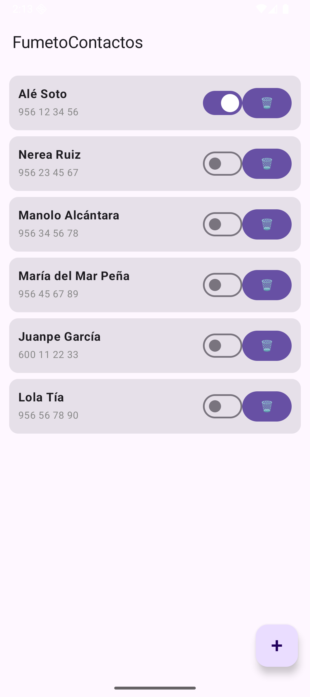
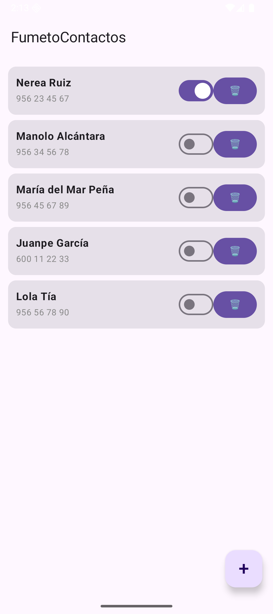

# Tema 2.3 - La app Compose: Scaffold, listas Lazy y formulario

En *Desarrollo de Interfaces* ya aprendisteis a **componer interfaces**: Column, Row, estado, recomposición. Ese saber se da por bueno aquí. Este apartado cambia la mirada: ya no "la interfaz" sino **la app** que la aloja — su estructura Material, su lista que tiene que escalar a 5.000 elementos sin lagrimear, su formulario que no puede tapar el teclado y su ciclo de vida que puede morir en cualquier `onStop`.

<div style="background-color:#a5d6a7; border-radius:8px; padding:10px 14px; margin:14px 0;">
<strong>🟢 Leyenda de repaso obligatorio:</strong> los textos con <span style="background-color:#a5d6a7;padding:0 3px;border-radius:3px;">este fondo verde</span> son imprescindibles: hay que repasarlos <strong>cada semana</strong>, porque entrarán en todas las evaluaciones del módulo.</div>

## 1. Scaffold: el andamio estándar de una pantalla Android

Toda app "seria" que habéis instalado (WhatsApp, Spotify…) usa la misma estructura: barra arriba, contenido en medio y un botón de acción principal flotando. Material 3 lo llama **Scaffold** y no es decoración: <span style="background-color:#a5d6a7;padding:0 3px;border-radius:3px;">el lambda de contenido recibe un `PaddingValues` (el hueco que ocupan barra y FAB) que ESTÁ OBLIGADO aplicarse; si lo ignoras, tu primera fila nace escondida debajo de la barra</span>.



*Figura 1. La casa de FumetoContactos: TopAppBar, lista de contactos y FAB que alterna lista ⇄ formulario. Todo ello montado por un solo Scaffold.*

=== "Código 1 — La pantalla de casa (función completa, tal cual compila)"

    ```kotlin
        @OptIn(ExperimentalMaterial3Api::class)                  // TopAppBar es API experimental en M3
    @Composable
    fun EscenaCasa() {                                          // la home de la app: estructura Scaffold
        var nombreFormulario by remember { mutableStateOf("Escribe un nombre…") } // texto del campo (C12)
        var telefonoFormulario by remember { mutableStateOf("") }                 // teléfono (C12)
        val lista = remember { mutableStateListOf(*contactosIniciales.toTypedArray()) } // lista mutable en memoria
        var escena by remember { mutableStateOf(0) }            // 0 = lista | 1 = alta
        val contexto = LocalContext.current                     // para lanzar otras Activities

        Scaffold(                                               // andamio Material: barra + contenido + FAB
            topBar = {                                          // la barra de arriba
                TopAppBar(                                      // barra de título Material 3
                    title = { Text("FumetoContactos") }         // nombre que ve el usuario
                )
            },
            floatingActionButton = {                            // el botón redondo flotante
                FloatingActionButton(                           // FAB de Material
                    onClick = { escena = if (escena == 0) 1 else 0 }   // alterna lista ⇄ formulario
                ) {                                             // dentro del botón va su contenido
                    Text(text = if (escena == 0) "+" else "✕",   // "+" para alta, "✕" para volver
                         fontSize = 28.sp)                        // grande y centrado
                }
            }
        ) { margen ->                                           // 'margen' = huecos que dejan barra y FAB
            when (escena) {
                1 -> FormularioAlta(                            // la pantalla de alta (C12)
                    nombre = nombreFormulario,                  // estado del campo nombre
                    telefono = telefonoFormulario,              // estado del campo teléfono
                    onNombre = { nombreFormulario = it },        // el formulario NO posee el dato
                    onTelefono = { telefonoFormulario = it },   // solo informa de cambios (hoisting)
                    alGuardar = {                               // al pulsar Guardar:
                        lista.add(0, Contacto(nombreFormulario, telefonoFormulario)) // nuevo arriba
                        nombreFormulario = "Escribe un nombre…"  // limpiamos campos
                        telefonoFormulario = ""                  // y volvemos a la lista
                        escena = 0                               // pantalla de lista otra vez
                    },
                    margen = margen                             // respetamos el hueco de la barra
                )
                else -> ListaContactos(                         // la libreta (C10 y C11)
                    lista = lista,                              // la pintamos desde el estado
                    alMarcar = { i -> lista[i] = lista[i].copy(favorita = !lista[i].favorita) }, // toggle estrella
                    alBorrar = { i -> lista.removeAt(i) },      // borrar de la lista = desaparece
                    alAbrir = { c ->                            // C5: intent EXPLÍCITO a mi propia Activity
                        contexto.startActivity(                 // "quién" lo arreglo yo, sin preguntas
                            Intent(contexto, FichaActivity::class.java)   // destino: clase concreta
                                .putExtra(FichaActivity.EXTRA_NOMBRE, c.nombre)     // extra del nombre
                                .putExtra(FichaActivity.EXTRA_TELEFONO, c.telefono) // extra del teléfono
                        )
                    },
                    margen = margen
                )
            }
        }
    }
    ```

Tres cosas de esta función que son de examen:

1. **`mutableStateListOf`** guarda la lista como estado observable: <span style="background-color:#a5d6a7;padding:0 3px;border-radius:3px;">añadir o borrar un elemento recompongo solo las filas afectadas — no un `List` normal dentro de un `var`, que no avisa a nadie</span>.
2. El formulario **no posee** los textos: recibe `nombre`/`telefono` y callbacks (`onNombre`). Eso es *state hoisting*, y aquí lo usamos por un motivo de app, no de estética: <span style="background-color:#a5d6a7;padding:0 3px;border-radius:3px;">el dueño del estado es la pantalla (y tras rotación… ya sabéis quién manda: el Bundle del 2.2)</span>.
3. El FAB no navega a otra Activity: cambia un modo interno. <span style="background-color:#a5d6a7;padding:0 3px;border-radius:3px;">Multi-pantalla con Activities = tema 2.2; modos dentro de la misma Activity = esta app. La frontera la marca si la pantalla nueva merece su propia entrada al historial del BACK</span>.

## 2. LazyColumn: la lista que no se lo traga todo

Con 6 contactos da igual todo. Con 6.000, una `Column` con `verticalScroll` se muere: compone las 6.000 filas al nacer. `LazyColumn` compone **solo las visibles** y recicla al hacer scroll.


*Figura 2. La libreta: cada tarjeta se genera con <code>items()</code>; al hacer scroll, las filas que salen de pantalla se reciclan.*

=== "Código 2 — La libreta Lazy (función completa)"

    ```kotlin
        @Composable
    fun ListaContactos(
        lista: List<Contacto>,                                  // desde fuera: solo lectura
        alMarcar: (Int) -> Unit,                                // callback: "me han marcado la i"
        alBorrar: (Int) -> Unit,                                // callback: "han borrado la i"
        alAbrir: (Contacto) -> Unit,                            // callback: "quiero la ficha de este"
        margen: PaddingValues                                   // el margen del Scaffold
    ) {
        LazyColumn(                                             // LA lista: pinta solo lo que cabe en pantalla
            modifier = Modifier.fillMaxSize().padding(margen),  // ocupa todo + respeta barra/FAB
            contentPadding = PaddingValues(12.dp),              // aire alrededor del contenido
            verticalArrangement = Arrangement.spacedBy(8.dp)    // separación entre tarjetas
        ) {
            items(items = lista, key = { it.telefono }) { c ->  // una fila por contacto; clave = teléfono
                Card(                                           // tarjeta Material con sombra
                    modifier = Modifier                         // el traje de la tarjeta:
                        .fillMaxWidth()                         // ancha como la pantalla
                        .clickable { alAbrir(c) }               // y pulsable por TODO: abre la ficha
                ) {
                    Row(                                        // dentro: fila nombre+teléfono | acciones
                        modifier = Modifier.padding(12.dp),     // aire interior de la tarjeta
                        verticalAlignment = Alignment.CenterVertically // centrado vertical
                    ) {
                        Column(Modifier.weight(1f)) {           // columna que ocupa el espacio que sobra
                            Text(c.nombre, fontWeight = FontWeight.Bold)          // nombre en negrita
                            Text(c.telefono, color = Color.Gray, fontSize = 13.sp) // teléfono discreto
                        }
                        Switch(                                 // la estrella en modo interruptor
                            checked = c.favorita,               // refleja el estado del dato
                            onCheckedChange = { alMarcar(lista.indexOf(c)) }      // avisa a la dueña del estado
                        )
                        Button(onClick = { alBorrar(lista.indexOf(c)) }) {        // botón borrar
                            Text("🗑")                                            // papelera, sin letra
                        }
                    }
                }
            }
        }
    }
    ```

Detalles de producción, no de juguete:

- <span style="background-color:#a5d6a7;padding:0 3px;border-radius:3px;">`key = { it.telefono }` identifica cada fila entre recomposiciones: sin clave, al borrar una fila el sistema "descoloca" los estados internos (switches que cambian de dueño) y el scroll se vuelve loco</span>. Es el error más caro de esta pantalla.
- `contentPadding` (dentro de Lazy) ≠ `padding` (fuera): el primero deja aire **dentro del área scroll**, el segundo recorta el sitio donde puede pintar. Con `PaddingValues(12.dp)` la última tarjeta no se pega al FAB.
- La tarjeta entera es `clickable` (abre la ficha → 2.2) **y encima** hay switches/botones: <span style="background-color:#a5d6a7;padding:0 3px;border-radius:3px;">un hijo clicable consume el evento antes que el padre — por eso el Switch hace su `onCheckedChange` sin abrir la ficha de rebote</span>.



*Figura 3. Interacción real: la favorita marcada y un contacto borrado de la lista (que es el estado, no la captura: al volver de la ficha la lista sigue sin él).*

## 3. Formulario: validar en una línea, habilitar en otra


*Figura 4. Alta con <code>adjustResize</code>: el teclado sube, el formulario se recoloca y el botón sigue alcanzable. El teléfono corto se marca en rojo y el botón, apagado.*

=== "Código 3 — El formulario de alta (función completa)"

    ```kotlin
        @Composable
    fun FormularioAlta(
        nombre: String,                                         // el texto actual del campo
        telefono: String,                                       // el texto del teléfono
        onNombre: (String) -> Unit,                             // "el usuario ha tecleado X"
        onTelefono: (String) -> Unit,                           // ídem teléfono
        alGuardar: () -> Unit,                                  // pulsar Guardar
        margen: PaddingValues
    ) {
        val telefonoValido = telefono.length >= 9               // validación de una frase: 9 dígitos mínimo
        Column(                                                 // campos apilados
            modifier = Modifier.fillMaxSize().padding(margen).padding(16.dp)
                .verticalScroll(rememberScrollState()),         // por si el teclado tapa algo
            verticalArrangement = Arrangement.spacedBy(12.dp)   // respiro entre campos
        ) {
            Text("Nueva ficha", style = MaterialTheme.typography.headlineSmall) // cabecera del alta
            OutlinedTextField(                                  // campo con borde, estilo Material
                value = nombre,                                 // controlado por el estado de fuera
                onValueChange = onNombre,                       // cada tecla avisa
                label = { Text("Nombre") },                     // flotante por defecto
                isError = nombre.isBlank()                      // rojo si está vacío (sin sermones)
            )
            OutlinedTextField(
                value = telefono,
                onValueChange = onTelefono,
                label = { Text("Teléfono") },
                isError = telefono.isNotEmpty() && !telefonoValido // solo riñe si han escrito algo mal
            )
            Button(                                             // el disparo del alta
                onClick = alGuardar,                            // pide permiso a la dueña de la lista
                enabled = nombre.isNotBlank() && telefonoValido // sin nombre o teléfono corto: apagado
            ) { Text("Guardar contacto") }
        }
    }
    ```

Decisiones de diseño con nombre y apellidos:

- <span style="background-color:#a5d6a7;padding:0 3px;border-radius:3px;">`isError` en el campo + `enabled` en el botón es la pareja canónica de validación: el campo informa, el botón decide. Nunca un `Toast` que grita cuando alguien pulsa "Guardar" a medias</span>.
- La validación es **de una frase** (9 dígitos): a partir de ahí, dominio (DNI, email oficial) se trata en su módulo, no aquí.
- El `Manifest` declara `android:windowSoftInputMode="adjustResize"`: eso, y no un parche de Compose, <span style="background-color:#a5d6a7;padding:0 3px;border-radius:3px;">es lo que hace que el teclado no tape el botón. Es configuración de la Activity — territorio PMDM, no de DI</span>.

## 4. Lo que este tema NO es de Desarrollo de Interfaces

Para que nadie (ni el tribunal) se confunda:

| Pregunta | Territorio DI | Territorio PMDM (este tema) |
|---|---|---|
| ¿Dónde encaja un Button en una Row? | ✔ DI | — |
| ¿Qué pasa en el proceso al pulsar HOME? | — | ✔ `onPause → onStop` |
| ¿Cómo se llama un estado compartido? | ✔ DI (hoisting) | ✔ lo usamos, no lo enseñamos |
| ¿Quién responde a un `ACTION_SEND`? | — | ✔ filtros, chooser |
| ¿Cómo escala la lista a 5.000 filas? | — (diseño) | ✔ Lazy + clave |
| ¿Cómo se prueba esto en el emulador? | ✔ diseño | ✔ ciclo, intents, uiautomator |

## 5. Autoevaluación

> **[!] Pregunta 1** — Borras una fila del medio y, sin `key`, los switches "saltan" de contacto. Explica en dos líneas por qué.
>> [!answer]
>> Sin clave, Compose identifica las filas por posición: al borrar, todo sube un índice y los estados internos (el switch componiéndose) se reasocian a la fila equivocada. La clave (el teléfono) fija la identidad real.

> **[!] Pregunta 2** — ¿Por qué el botón de Guardar usa `enabled` en vez de validar en `onClick` con un mensaje?
>> [!answer]
>> Porque el botón apagado ES el mensaje: el usuario ve que falta algo ANTES de pulsar (feedback inmediato), y el código del click deja de tener camino de error. El `isError` del campo dice DÓNDE falta.

> **[!] Pregunta 3** — El FAB podría abrir la pantalla de alta como Activity. ¿Cuándo lo harías así?
>> [!answer]
>> Cuando la pantalla nueva deba tener su propia entrada en el historial de BACK o sea reutilizable desde otros sitios (otras apps con intent explícito). Para un modo temporal de la misma pantalla, un estado interno basta — y no pagas ni transición ni ciclo extra.

> **[!] Pregunta 4** — Sin `verticalScroll` en el formulario, con teclado abierto el botón queda inalcanzable. ¿Dos arreglos y cuál es el de producción?
>> [!answer]
>> `verticalScroll(rememberScrollState())` en la Column y `windowSoftInputMode="adjustResize"` en el Manifest (o `enableEdgeToEdge` + insets modernos). El de producción es el Manifest: lo resuelve el sistema para todas las pantallas, no parche a parche.

---
**Cumplimiento**: este apartado trabaja los criterios RA2.a (estructura de clases de la aplicación), RA2.b (clases que modelan ventanas, menús, alertas y controles) y RA2.g (pruebas de interacción usuario-aplicación en emulador) del RD 405/2023 — el resto de RA2 se cierra con la práctica del mini-proyecto y el tema 3.

**Materiales**: [Docs de Scaffold y listas](https://developer.android.com/develop/ui/compose/layouts) · **Presentación**: [diapositivas del tema 2.3](https://revilofe.github.io/slides/section1-pmdm/PM-U2.3.-AppComposeListasYFormulario.html) · Anterior: [2.2 — Actividades e Intents](./PMDM-U2.2.-ActividadesEIntents.md) · Práctica: [2.4 — Mini-proyecto](../../u02/practica/PMDM-U2.-MiniProyectoContactos.md)
