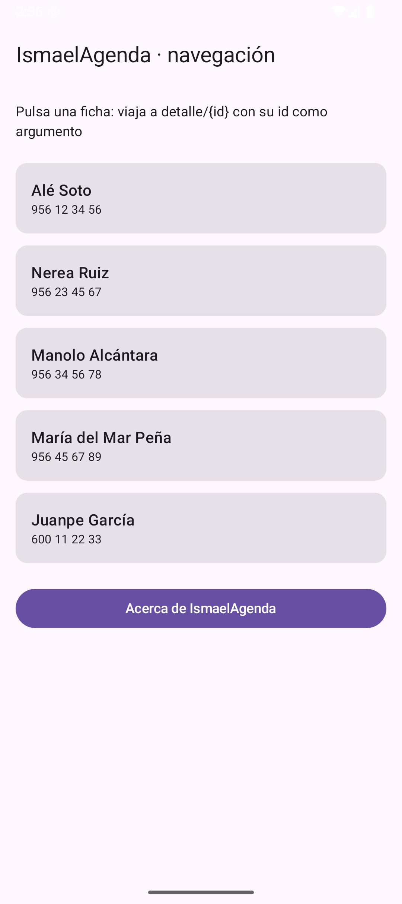
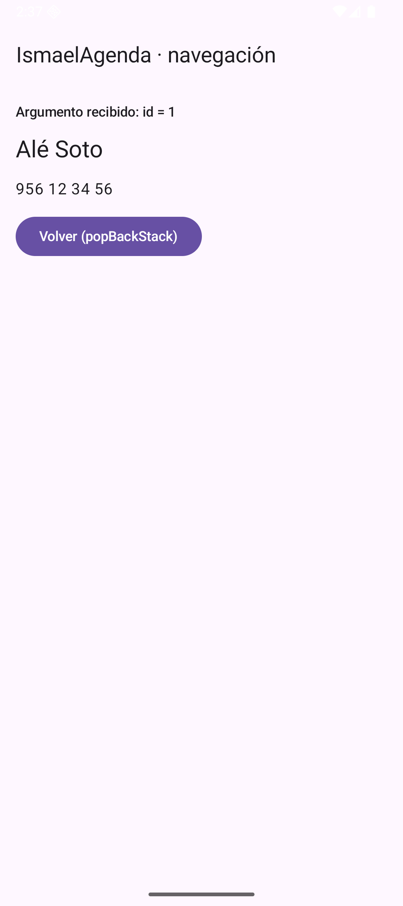
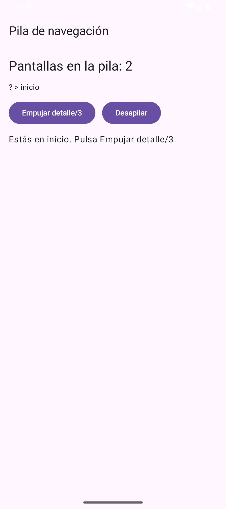
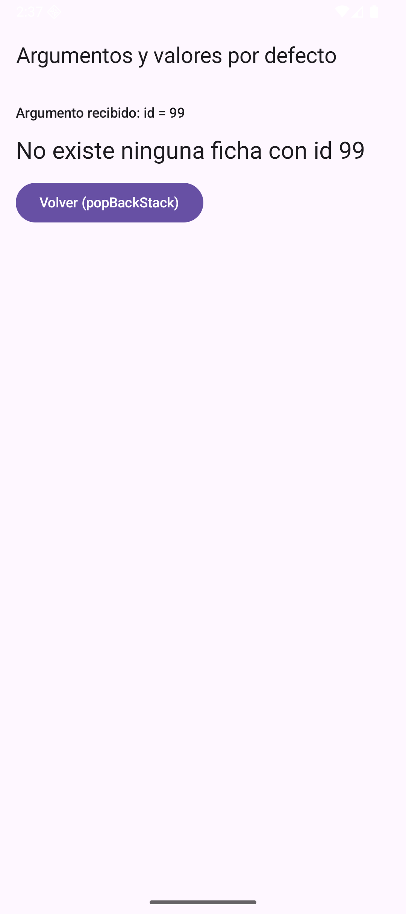
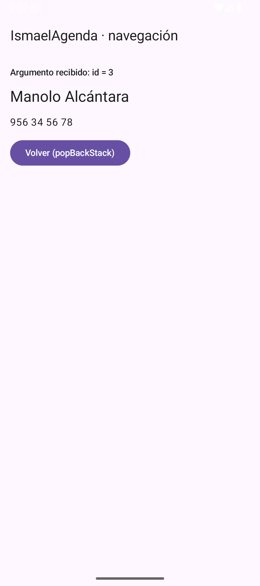

# Tema 3.1 - Navegación: grafo, argumentos y enlaces profundos

En *Desarrollo de Interfaces* ya montaste un `NavHost` con dos pantallas y un `navigate()`: eso es la navegación **básica**. Aquí damos el salto a la navegación de una app **con datos**: la pantalla de destino necesita saber **qué** ficha mostrar (un argumento), la app tiene que **sobrevivir** a que el argumento no exista, y un enlace externo (`ismaelagenda://ficha/3`) tiene que abrir la app directamente en esa ficha.

**Deberías saber ya**: [DI-U2.1 §6 Conexión entre pantallas](https://revilofe.github.io/section6/u02/teoria/DI-U2.1.-ClasesYComponentes/#6-conexion-entre-pantallas-navegacion-y-eventos) — `NavHost`, `rememberNavController()`, `navigate()` y `popBackStack()`. Si no lo tienes claro, vuelve allí antes de seguir: aquí no lo repetimos.

<div style="background-color:#a5d6a7; border-radius:8px; padding:10px 14px; margin:14px 0;">
<strong>🟢 Leyenda de repaso obligatorio:</strong> los textos con <span style="background-color:#a5d6a7;padding:0 3px;border-radius:3px;">este fondo verde</span> son imprescindibles: hay que repasarlos <strong>cada semana</strong>, porque entrarán en todas las evaluaciones del módulo.</div>

La app de referencia del tema es **IsmaelAgenda**: la agenda que iremos llenando de datos (primero en memoria, luego en Room y por último contra un servidor). Todas las capturas están hechas ejecutando el código que aparece en este tema en un emulador real.

## 1. Qué añade este tema a lo que ya viste en DI

| Pieza | En DI (U2.1 §6) | Aquí (3.1) |
|---|---|---|
| Grafo | dos rutas fijas | rutas **con argumento**: `detalle/{id}` |
| Navegar | `navigate("bienvenida")` | `navigate("detalle/${ficha.id}")` |
| Volver | `popBackStack()` | lo mismo, pero mirando **cuántas pantallas quedan** |
| Datos | ninguno | el argumento **decide qué ficha se pinta** |
| Entrada | solo desde la app | también **desde fuera**: deep link |

<span style="background-color:#a5d6a7;padding:0 3px;border-radius:3px;">Un argumento de ruta es la única forma limpia de decirle a una pantalla QUÉ datos mostrar: la ruta es el contrato, no una variable global.</span>

## 2. El grafo: rutas con argumento

El `NavHost` es el mapa de la app. Cada `composable` registra una ruta; la que lleva `{id}` está declarando un **hueco** que hay que rellenar al navegar, y `navArgument` fija su **tipo** (aquí `IntType`):

=== "Código 1 — El grafo con una ruta que lleva argumento"

    ```kotlin
    val nav = rememberNavController()                       // mando de navegación que sobrevive a recomposiciones
    Scaffold(                                              // andamio Material: barra + contenido
        topBar = { TopAppBar(title = { Text("IsmaelAgenda · navegación") }) }
    ) { relleno ->                                        // relleno = hueco que ocupa la barra
        NavHost(                                           // aquí se declaran todas las pantallas
            navController = nav,                           // el mando
            startDestination = "inicio",                    // primera pantalla al abrir
            modifier = Modifier.padding(relleno)            // respeta la barra superior
        ) {
            composable("inicio") {                          // pantalla de la lista
                PantallaInicio(nav)                         // recibe el mando para poder navegar
            }
            composable(                                     // pantalla de detalle con argumento
                route = "detalle/{id}",                     // {id} es el hueco del argumento
                arguments = listOf(navArgument("id") { type = NavType.IntType }), // se exige entero
                deepLinks = listOf(navDeepLink { uriPattern = "ismaelagenda://ficha/{id}" }) // enlace externo
            ) { entrada ->                                  // entrada = back stack entry de esta pantalla
                val id = entrada.arguments?.getInt("id") ?: 0 // argumento leído con valor por defecto
                PantallaDetalle(nav, id)                    // pinta la ficha pedida
            }
            composable("acerca") {                          // pantalla estática sin argumentos
                PantallaAcerca(nav)                         // demuestra que también se navega a lo simple
            }
        }
    }
    ```

<span style="background-color:#a5d6a7;padding:0 3px;border-radius:3px;">`navArgument("id") {{ type = NavType.IntType }}` obliga a que el argumento sea un entero: si llega otra cosa, la navegación falla en vez de reventar dentro de la pantalla.</span>

Al pulsar una ficha navegamos metiendo el id **dentro de la ruta**:

```kotlin
.clickable { nav.navigate("detalle/${ficha.id}") }
```



*Figura 1. El inicio de IsmaelAgenda: cada tarjeta es un `clickable` que navega a `detalle/{id}` con el id de esa ficha.*



*Figura 2. El detalle recibiendo el argumento: `id = 1` y, con ese id, la ficha de Alé Soto. La ruta llevaba el dato; la pantalla no ha consultado nada global.*

## 3. La pila: empujar y desapilar

Cada `navigate()` **empuja** una entrada en la pila (back stack) y `popBackStack()` **desapila** la de arriba. El botón Atrás del sistema hace exactamente eso: por eso tu app "vuelve" sin que programes nada.

=== "Código 2 — Leer la pila en vivo y empujar/desapilar a mano"

    ```kotlin
    fun EscenaPila() {                                         // 3.1b: la pila de navegación
        val nav = rememberNavController()                       // mando de navegación
        val pila by nav.currentBackStack.collectAsState()      // lista viva de entradas de la pila
        Scaffold(topBar = { TopAppBar(title = { Text("Pila de navegación") }) }) { relleno ->
            Column(
                Modifier.fillMaxSize().padding(relleno).padding(16.dp),
                verticalArrangement = Arrangement.spacedBy(12.dp)
            ) {
                Text("Pantallas en la pila: ${pila.size}", style = MaterialTheme.typography.headlineSmall)
                Text(
                    pila.joinToString(" > ") { it.destination.route ?: "?" }, // ruta de cada entrada
                    style = MaterialTheme.typography.bodyMedium
                )
                Row(horizontalArrangement = Arrangement.spacedBy(12.dp)) {
                    Button(onClick = { nav.navigate("detalle/3") }) { Text("Empujar detalle/3") }
                    Button(onClick = { nav.popBackStack() }) { Text("Desapilar") }
                }
                NavHost(                                        // el grafo real: sin él, navegar revienta
                    navController = nav,
                    startDestination = "inicio",
                    modifier = Modifier.weight(1f)              // ocupa el resto de la pantalla
                ) {
                    composable("inicio") {                      // pantalla inicial del grafo
                        Text("Estás en inicio. Pulsa Empujar detalle/3.")
                    }
                    composable(
                        route = "detalle/{id}",
                        arguments = listOf(navArgument("id") { type = NavType.IntType })
                    ) { entrada ->
                        val id = entrada.arguments?.getInt("id") ?: 0
                        Text("Detalle $id dentro del grafo", style = MaterialTheme.typography.titleMedium)
                    }
                }
            }
        }
    }

    @OptIn(ExperimentalMaterial3Api::class)
    @Composable
    ```

<span style="background-color:#a5d6a7;padding:0 3px;border-radius:3px;">`nav.currentBackStack` es un Flow: con `collectAsState()` la pantalla se redibuja sola cada vez que la pila cambia. Es la forma de depurar navegación sin adivinar.</span>



*Figura 3. La pila en vivo: dos entradas (el grafo y `inicio`) con sus rutas. Al empujar `detalle/3`, el contador sube a 3; al desapilar, baja.*

## 4. Argumentos que no existen: nulabilidad

Un deep link, un test o un compañero pueden navegar a `detalle/99`. Si tu código hace `AGENDA[99]`, la app **revienta**. La regla es la misma del Tema 2: **toda extra y todo argumento se leen con valor por defecto**.

=== "Código 3 — Leer el argumento y resolver la ficha sin reventar"

    ```kotlin
    fun PantallaDetalle(nav: NavController, id: Int) {          // detalle: recibe el id de la ruta
        val ficha = AGENDA.firstOrNull { it.id == id }          // busca la ficha o null si el id no existe
        Column(Modifier.fillMaxSize().padding(16.dp), verticalArrangement = Arrangement.spacedBy(12.dp)) {
            Text(                                              // el argumento, tal cual llegó
                "Argumento recibido: id = $id",
                style = MaterialTheme.typography.labelLarge
            )
            Text(
                ficha?.nombre ?: "No existe ninguna ficha con id $id", // valor por defecto si no hay ficha
                style = MaterialTheme.typography.headlineSmall
            )
            ficha?.let { Text(it.telefono, style = MaterialTheme.typography.bodyLarge) }
            Button(onClick = { nav.popBackStack() }) { Text("Volver (popBackStack)") } // desapila
        }
    }

    @Composable
    ```

<span style="background-color:#a5d6a7;padding:0 3px;border-radius:3px;">`entrada.arguments?.getInt("id") ?: 0` y `firstOrNull {{ it.id == id }}` son las dos barreras: si el id no existe, la pantalla informa en vez de cerrarse.</span>



*Figura 4. `detalle/99`: el argumento llegó, la ficha no existe y la app lo cuenta en pantalla. Ni un crash ni una pantalla en blanco.*

## 5. Deep links: que la app se abra desde fuera

Un **deep link** es una URL que abre tu app en una pantalla concreta. Se declaran en dos sitios: en el `AndroidManifest.xml` (para que Android sepa que tu app responde a ese esquema) y en el grafo (`navDeepLink`, para que Navigation sepa a qué pantalla llevarla).

=== "Código 4 — El intent-filter del Manifest: la app responde a ismaelagenda://ficha/…"

                <intent-filter>
                    <action android:name="android.intent.action.MAIN" />
                    <category android:name="android.intent.category.LAUNCHER" />
                </intent-filter>

=== "Código 5 — La Activity que declara ese filtro"

            <activity
                android:name=".MainActivity"
                android:exported="true"
                android:label="@string/app_name"
                android:theme="@style/Theme.MyApplication"
                android:windowSoftInputMode="adjustResize">
                <intent-filter>
                    <action android:name="android.intent.action.MAIN" />
                    <category android:name="android.intent.category.LAUNCHER" />
                </intent-filter>
                <intent-filter>
                    <action android:name="android.intent.action.VIEW" />
                    <category android:name="android.intent.category.DEFAULT" />
                    <category android:name="android.intent.category.BROWSABLE" />
                    <data android:scheme="ismaelagenda" android:host="ficha" />
                </intent-filter>
            </activity>

<span style="background-color:#a5d6a7;padding:0 3px;border-radius:3px;">El esquema `ismaelagenda` y el host `ficha` son un contrato público: cualquier app, QR o correo puede abrir `ismaelagenda://ficha/3` y aterrizar en tu pantalla de detalle.</span>



*Figura 5. `adb shell am start -a android.intent.action.VIEW -d ismaelagenda://ficha/3`: la app se abre directamente en Manolo Alcántara, sin pasar por la lista.*

## 6. Rutas type-safe: el siguiente escalón

Desde Navigation 2.8 puedes declarar las rutas como **clases serializables** en vez de cadenas: `@Serializable object Inicio` y `composable<Inicio> { }`. Ventajas: el compilador te avisa si un argumento no encaja y desaparecen los `"detalle/${id}"` escritos a mano.

<span style="background-color:#a5d6a7;padding:0 3px;border-radius:3px;">En este tema usamos rutas de texto porque son las que funcionan en cualquier versión y las que te vas a encontrar en proyectos reales; las type-safe son la evolución, no un requisito para aprobar.</span>

## 7. Errores típicos (y cómo se ven)

| Error | Qué pasa | Solución |
|---|---|---|
| Navegar sin `NavHost` montado | `IllegalStateException`: no hay grafo | el `NavHost` debe envolver a la pantalla que navega |
| Ruta mal escrita (`detalle/abc`) | la navegación no encuentra destino | tipo del argumento + ruta exacta |
| Leer el argumento sin `?` | `NullPointerException` al abrir por deep link | `?: valorPorDefecto` |
| `popBackStack()` en la raíz | desapila la pantalla inicial y el `NavHost` se queda en blanco | comprobar antes `previousBackStackEntry != null` (o dejar que el botón Atrás cierre la app) |
| Deep link sin `navDeepLink` | Android abre la app pero se queda en inicio | declararlo en el grafo, no solo en el Manifest |

## 8. Resumen y qué entra en la práctica

- La ruta es el **contrato**: `detalle/{id}` dice qué necesita la pantalla.
- `navArgument` fija el **tipo**; el argumento se lee **siempre** con valor por defecto.
- La **pila** se puede leer (`currentBackStack`) y manipular (`popBackStack`).
- Un **deep link** se declara en Manifest **y** en el grafo.

**En la práctica** de esta unidad construirás el grafo de una agenda con tres destinos, argumento tipado, control de la pila y un deep link propio; las capturas de tu entrega tienen que demostrar los cinco comportamientos de las figuras 1 a 5.

## Lo que tienes que llevarte de este apartado

- <span style="background-color:#a5d6a7;padding:0 3px;border-radius:3px;">Toda ruta con argumento se declara con plantilla (`detalle/{id}`) y se navega con la ruta resuelta (`detalle/3`): si navegas a la plantilla literal, el argumento no llega.</span>
- <span style="background-color:#a5d6a7;padding:0 3px;border-radius:3px;">Los argumentos viajan en un `Bundle`, así que solo caben tipos simples (`Int`, `Long`, `String`, `Boolean`). Un objeto completo se pasa por su `id` y se vuelve a leer.</span>
- <span style="background-color:#a5d6a7;padding:0 3px;border-radius:3px;">Un deep link no funciona solo: necesita su `intent-filter` en el `AndroidManifest.xml`. Sin esa declaración, el enlace abre el navegador, no tu app.</span>
- <span style="background-color:#a5d6a7;padding:0 3px;border-radius:3px;">El botón atrás del sistema ya hace `popBackStack()`: no lo interceptes ni lo reimplementes, o el usuario pierde la navegación esperada.</span>

## Presentación

- [PM-U3 - Navegación, estado y red](https://revilofe.github.io/slides/section1-pmdm/PM-U3.-NavegacionEstadoYRed.html)
