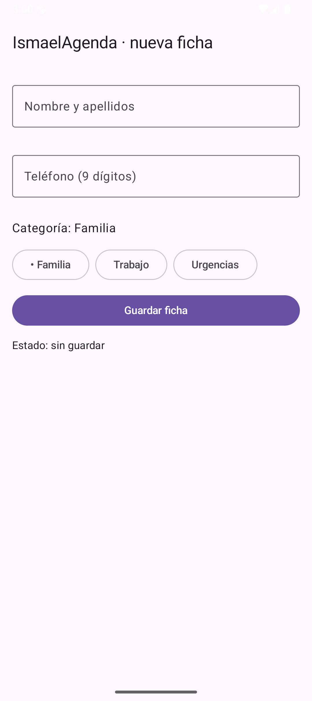
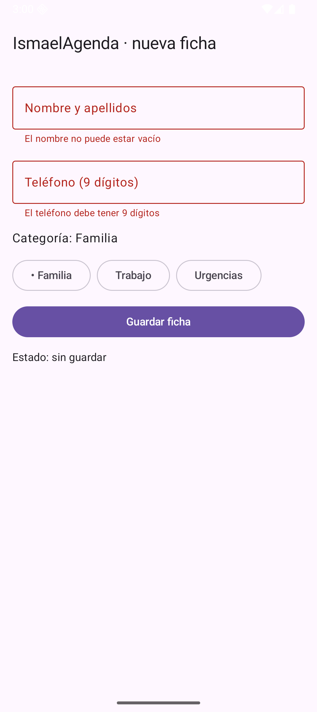
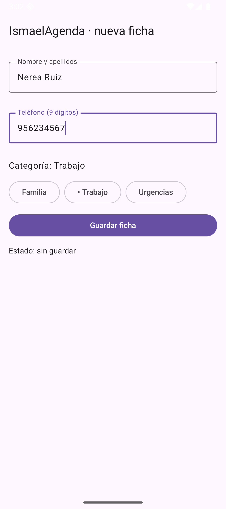
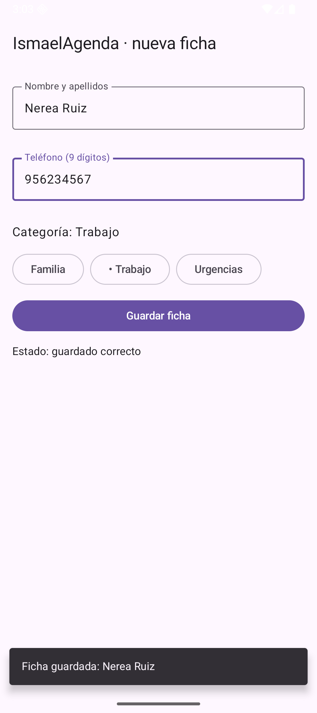

# Tema 3.2 - Estado y formularios: ViewModel, StateFlow y validación

En *Desarrollo de Interfaces* guardabas el texto de un campo con `remember { mutableStateOf("") }`. Eso funciona mientras la pantalla no se destruya, y la pantalla **se destruye** al girar el móvil, al cambiar de idioma o al volver del fondo. Aquí el estado sale de la pantalla y se muda a un **ViewModel**, que sobrevive a todo eso.

**Deberías saber ya**: [DI-U2.1 §5 Formularios y §7 Diálogos](https://revilofe.github.io/section6/u02/teoria/DI-U2.1.-ClasesYComponentes/#5-formularios-y-campos-de-texto) — `TextField`, `OutlinedTextField`, `AlertDialog` y el estado con `remember`. Aquí no se repiten los componentes: se cambia **dónde** vive el estado y **quién** valida.

<div style="background-color:#a5d6a7; border-radius:8px; padding:10px 14px; margin:14px 0;">
<strong>🟢 Leyenda de repaso obligatorio:</strong> los textos con <span style="background-color:#a5d6a7;padding:0 3px;border-radius:3px;">este fondo verde</span> son imprescindibles y entran en todas las evaluaciones del módulo.</div>

Seguimos con **IsmaelAgenda**: la pantalla «nueva ficha» que añade contactos a la agenda. Todas las capturas están hechas ejecutando el código de este tema en el emulador.

## 1. El problema: el estado dentro de la pantalla se muere

| Dónde guardas el estado | Sobrevive a recomponer | Sobrevive a girar el móvil | Sobrevive a volver del fondo |
|---|---|---|---|
| Variable normal de la función | ❌ | ❌ | ❌ |
| `remember { mutableStateOf(...) }` | ✅ | ❌ | ❌ |
| `rememberSaveable` | ✅ | ✅ | ✅ (solo tipos simples) |
| **`ViewModel` + `StateFlow`** | ✅ | ✅ | ✅ (hasta que el sistema mata el proceso) |

<span style="background-color:#a5d6a7;padding:0 3px;border-radius:3px;">`remember` sobrevive a una recomposición, NO a un cambio de configuración: al girar el móvil la Activity se destruye y se vuelve a crear. El ViewModel se conserva entre esas dos.</span>

## 2. El estado y el ViewModel

Todo lo que la pantalla necesita pintar vive en **una sola clase de estado** (`EstadoFormulario`) y se modifica **solo** desde el ViewModel. La pantalla no tiene variables propias: lee y pide cambios.

=== "Código 1 — Estado del formulario y ViewModel"

    data class EstadoFormulario(                                // todo lo que la pantalla necesita pintar
        val nombre: String = "",                                // texto del campo nombre
        val telefono: String = "",                              // texto del campo teléfono
        val categoria: String = "Familia",                      // categoría elegida (una sola)
        val errorNombre: String? = null,                        // mensaje de error del nombre (null = sin error)
        val errorTelefono: String? = null,                      // mensaje de error del teléfono
        val guardado: Boolean = false                           // true cuando la última pulsación fue válida
    )

    class FormularioViewModel : ViewModel() {                   // ViewModel: sobrevive a la rotación de pantalla
        private val _estado = MutableStateFlow(EstadoFormulario()) // estado privado y modificable
        val estado: StateFlow<EstadoFormulario> = _estado.asStateFlow() // hacia fuera, solo lectura

        fun cambiarNombre(valor: String) {                      // cada tecla del campo nombre
            _estado.update { it.copy(nombre = valor, errorNombre = null, guardado = false) } // limpia el error al escribir
        }

        fun cambiarTelefono(valor: String) {                    // cada tecla del campo teléfono
            val soloDigitos = valor.filter { c -> c.isDigit() } // el campo solo acepta números
            _estado.update { it.copy(telefono = soloDigitos, errorTelefono = null, guardado = false) }
        }

        fun cambiarCategoria(valor: String) {                   // al pulsar una categoría
            _estado.update { it.copy(categoria = valor) }        // cambia la elegida
        }

        fun guardar(): Boolean {                                // valida y decide si se guarda
            val actual = _estado.value                          // foto del estado en este instante
            val errNombre = if (actual.nombre.isBlank()) "El nombre no puede estar vacío" else null
            val errTelefono = if (actual.telefono.length != 9) "El teléfono debe tener 9 dígitos" else null
            val correcto = errNombre == null && errTelefono == null // solo si no hay ningún error
            _estado.update { it.copy(errorNombre = errNombre, errorTelefono = errTelefono, guardado = correcto) }
            return correcto                                     // la pantalla usa el resultado para el aviso
        }
    }

<span style="background-color:#a5d6a7;padding:0 3px;border-radius:3px;">El patrón es siempre el mismo: `MutableStateFlow` privado + `StateFlow` público de solo lectura. La pantalla no puede escribir el estado a mano: tiene que llamar a un método del ViewModel.</span>

Fíjate en dos detalles que valen examen:

- `_estado.update { it.copy(...) }` crea una **copia** con el campo cambiado. No se muta el objeto: se sustituye por otro estado. Así Compose detecta el cambio.
- Al escribir se **limpia el error** de ese campo (`errorNombre = null`): el mensaje rojo desaparece en cuanto el usuario corrige.

## 3. La pantalla que observa el estado

`viewModel()` crea el ViewModel la primera vez y devuelve **el mismo** en las siguientes recomposiciones y rotaciones. `collectAsState()` convierte el `StateFlow` en un `State` de Compose, y con `by` se lee directamente.

=== "Código 2 — La pantalla: campos conectados al estado"

    fun EscenaFormulario() {                                    // 3.2: el formulario completo
        val vm: FormularioViewModel = viewModel()               // se crea una vez y sobrevive a la rotación
        val estado by vm.estado.collectAsState()                // el estado llega como State de Compose
        val aviso = remember { SnackbarHostState() }            // cola de avisos flotantes
        val alcance = rememberCoroutineScope()                  // para lanzar el aviso desde un clic
        Scaffold(
            topBar = { TopAppBar(title = { Text("IsmaelAgenda · nueva ficha") }) },
            snackbarHost = { SnackbarHost(aviso) }              // el aviso se pinta sobre el contenido
        ) { relleno ->
            Column(
                Modifier.fillMaxSize().padding(relleno).padding(16.dp),
                verticalArrangement = Arrangement.spacedBy(12.dp)
            ) {
                OutlinedTextField(
                    value = estado.nombre,                      // lo que muestra el campo
                    onValueChange = { vm.cambiarNombre(it) },    // lo que hace al escribir
                    label = { Text("Nombre y apellidos") },
                    isError = estado.errorNombre != null,        // borde rojo si hay error
                    supportingText = { estado.errorNombre?.let { Text(it) } }, // mensaje bajo el campo
                    singleLine = true,
                    modifier = Modifier.fillMaxWidth()
                )
                OutlinedTextField(
                    value = estado.telefono,
                    onValueChange = { vm.cambiarTelefono(it) },
                    label = { Text("Teléfono (9 dígitos)") },
                    isError = estado.errorTelefono != null,
                    supportingText = { estado.errorTelefono?.let { Text(it) } },
                    singleLine = true,
                    modifier = Modifier.fillMaxWidth()
                )
                Text("Categoría: ${estado.categoria}", style = MaterialTheme.typography.bodyLarge)
                Row(horizontalArrangement = Arrangement.spacedBy(8.dp)) {
                    listOf("Familia", "Trabajo", "Urgencias").forEach { opcion ->
                        OutlinedButton(onClick = { vm.cambiarCategoria(opcion) }) {
                            Text(if (estado.categoria == opcion) "• $opcion" else opcion) // punto = elegida
                        }
                    }
                }

<span style="background-color:#a5d6a7;padding:0 3px;border-radius:3px;">`isError` pinta el borde rojo y `supportingText` el mensaje de debajo: los dos se alimentan del mismo campo del estado, así que la validación se ve sin escribir ni una línea de UI extra.</span>

<figure>

<figcaption>Figura 1. Estado inicial: nombre y teléfono vacíos, categoría «Familia» por defecto, «Estado: sin guardar».</figcaption>
</figure>

## 4. La validación va en el ViewModel, no en el botón

Si validas dentro del `onClick`, esa regla no se puede reutilizar, ni probar, ni aplicar desde otra pantalla. La validación es **lógica de negocio**: va en el ViewModel y devuelve si se puede guardar.

=== "Código 3 — Validación y decisión de guardado"

                Button(
                    onClick = {
                        val correcto = vm.guardar()             // valida dentro del ViewModel
                        if (correcto) {
                            alcance.launch { aviso.showSnackbar("Ficha guardada: ${estado.nombre}") }
                        }
                    },
                    modifier = Modifier.fillMaxWidth()
                ) { Text("Guardar ficha") }
                Text(
                    if (estado.guardado) "Estado: guardado correcto" else "Estado: sin guardar",
                    style = MaterialTheme.typography.bodyMedium
                )
            }
        }
    }

<span style="background-color:#a5d6a7;padding:0 3px;border-radius:3px;">`guardar()` devuelve `true` solo si no hay ningún error, y deja los mensajes en el estado. La pantalla no decide nada: solo pregunta y reacciona.</span>

<figure>

<figcaption>Figura 2. Pulsar «Guardar ficha» con todo vacío: dos errores a la vez, cada uno bajo su campo, y el estado sigue «sin guardar».</figcaption>
</figure>

<figure>

<figcaption>Figura 3. Al escribir, los errores desaparecen solos: el ViewModel los limpia en cada pulsación. Categoría cambiada a «Trabajo».</figcaption>
</figure>

## 5. El aviso: Snackbar

El `Snackbar` es el aviso flotante de Material. Se pide desde un `SnackbarHostState` y se lanza en una corrutina, porque mostrarlo es una operación que **espera** (dura unos segundos y se puede descartar).

```kotlin
val aviso = remember { SnackbarHostState() }          // cola de avisos
val alcance = rememberCoroutineScope()             // para lanzar desde un clic
alcance.launch { aviso.showSnackbar("Ficha guardada: ${estado.nombre}") }
```

<span style="background-color:#a5d6a7;padding:0 3px;border-radius:3px;">Un Snackbar nunca se lanza desde el `onClick` a pelo: `showSnackbar` es `suspend`, así que necesita `rememberCoroutineScope()` o un `LaunchedEffect`.</span>

<figure>

<figcaption>Figura 4. Guardado correcto: el aviso «Ficha guardada: Nerea Ruiz» y la línea de estado cambian a la vez, porque los dos leen del mismo estado.</figcaption>
</figure>

## 6. Comprobarlo tú mismo (esto entra en la práctica)

1. Rellena el formulario y **gira el emulador** con `Ctrl + ←` (o `Ctrl + →`). Los datos siguen ahí: el ViewModel ha sobrevivido a la destrucción de la Activity.
2. Cambia `viewModel()` por `remember { mutableStateOf(EstadoFormulario()) }` y repite: al girar, el formulario se vacía. Esa es la diferencia exacta entre las dos formas de guardar estado.
3. Escribe 8 dígitos en el teléfono y pulsa guardar: el error aparece solo en ese campo.

## 7. Errores típicos

| Error | Qué pasa | Solución |
|---|---|---|
| `remember` para el formulario | al girar se pierden los datos | `ViewModel` + `StateFlow` |
| Validar en el `onClick` | la regla no se reutiliza ni se prueba | método `guardar()` en el ViewModel |
| Mutar el estado (`estado.nombre = x`) | Compose no se entera del cambio | `update { it.copy(...) }` |
| `showSnackbar` fuera de corrutina | no compila (`suspend`) | `rememberCoroutineScope().launch` |
| Un `StateFlow` por campo | la pantalla se recompone por partes y se desincroniza | **un** estado con todos los campos |

## 8. Resumen

- El estado de una pantalla va en un **ViewModel**, no en la pantalla.
- Se expone como **`StateFlow` de solo lectura** y se modifica con métodos.
- Los cambios se hacen con **`copy`**, nunca mutando.
- La **validación** es lógica de negocio: vive en el ViewModel y devuelve el resultado.
- El **Snackbar** es `suspend`: se lanza con un `rememberCoroutineScope()`.

## Lo que tienes que llevarte de este apartado

- <span style="background-color:#a5d6a7;padding:0 3px;border-radius:3px;">La validación es lógica de negocio, no pintura: vive en el `ViewModel` y así la puedes probar, reutilizar y mantener.</span>
- <span style="background-color:#a5d6a7;padding:0 3px;border-radius:3px;">La `data class` de estado es inmutable y se cambia con `copy(...)`: por eso nunca quedan campos a medias tras una actualización.</span>
- <span style="background-color:#a5d6a7;padding:0 3px;border-radius:3px;">Se validan todas las reglas a la vez y se muestran todos los errores a la vez: un error por pulsación alarga el tiempo de corrección.</span>
- <span style="background-color:#a5d6a7;padding:0 3px;border-radius:3px;">Un mensaje de error que vive en un `Toast` no se puede probar; uno que vive en el estado se pinta, se comprueba y se repite.</span>
