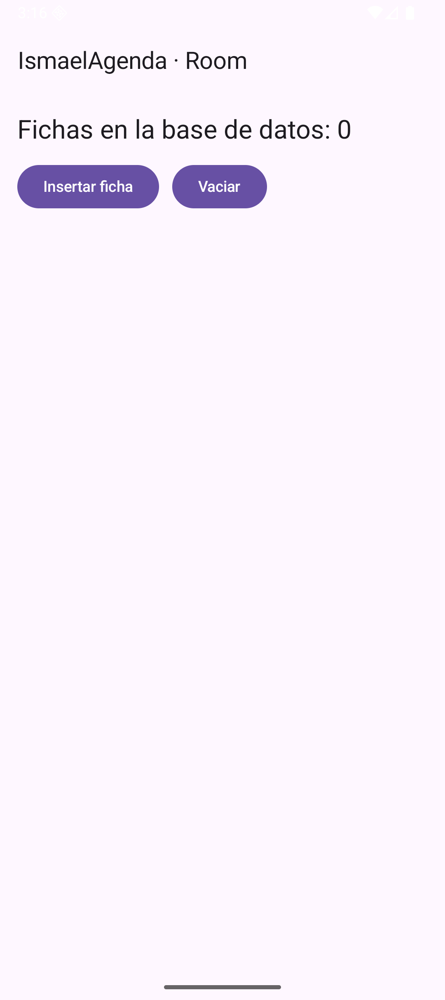
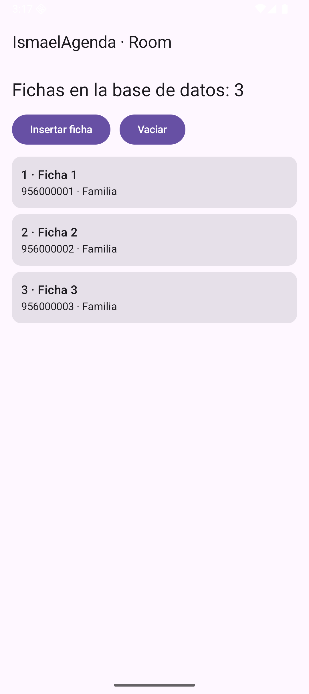

# Tema 3.3 - Room: persistencia local

Hasta ahora los datos vivían en memoria: al cerrar la app, adiós. **Room** es la capa oficial de Android sobre SQLite: convierte tus clases en tablas, tus métodos en consultas y te avisa en compilación si el SQL está mal escrito.

<div style="background-color:#a5d6a7; border-radius:8px; padding:10px 14px; margin:14px 0;">
<strong>🟢 Leyenda de repaso obligatorio:</strong> los textos con <span style="background-color:#a5d6a7;padding:0 3px;border-radius:3px;">este fondo verde</span> son imprescindibles y entran en todas las evaluaciones del módulo.</div>

## 1. Por qué Room y no SQLite a pelo

| Sin Room (`SQLiteOpenHelper`) | Con Room |
|---|---|
| Escribes el `CREATE TABLE` a mano | La tabla sale de una **clase** anotada |
| El SQL se rompe en ejecución | El SQL se comprueba **al compilar** |
| Conviertes `Cursor` a objetos tú | Room devuelve **objetos** |
| No hay aviso de cambios | `Flow` avisa a la pantalla **solo** |

<span style="background-color:#a5d6a7;padding:0 3px;border-radius:3px;">Room no sustituye a SQLite: lo envuelve. Por debajo sigue habiendo un archivo SQLite, y eso significa que los datos sobreviven a cerrar la app y a reiniciar el móvil.</span>

## 2. La entidad: una clase = una tabla

=== "Código 1 — Entidad `FichaEntity`"

    ```kotlin
    @Entity(tableName = "fichas")                               // esta clase es una tabla llamada fichas
    data class FichaEntity(
        @PrimaryKey(autoGenerate = true) val id: Long = 0,      // id autonumérico: lo pone SQLite
        val nombre: String,                                     // columna nombre
        val telefono: String,                                   // columna teléfono
        val categoria: String                                   // columna categoría
    )
    ```

<span style="background-color:#a5d6a7;padding:0 3px;border-radius:3px;">`@PrimaryKey(autoGenerate = true)` deja que SQLite asigne el id (1, 2, 3…). Si pones tú el id, tienes que garantizar que no se repite.</span>

## 3. El DAO: métodos = consultas

=== "Código 2 — DAO con Flow y funciones suspend"

    ```kotlin
    @Dao                                                        // interfaz de acceso a datos
    interface FichaDao {
        @Query("SELECT * FROM fichas ORDER BY nombre")          // SQL que devuelve todas las fichas
        fun observar(): Flow<List<FichaEntity>>                 // Flow: la lista se refresca sola al cambiar la tabla

        @Insert                                                 // INSERT generado por Room
        suspend fun insertar(ficha: FichaEntity): Long          // suspend: no bloquea el hilo principal

        @Query("DELETE FROM fichas")                            // borra todas las filas
        suspend fun borrarTodo()
    }
    ```

Dos decisiones que hay que saber justificar:

- **`Flow<List<FichaEntity>>`** en la lectura: cada vez que la tabla cambia, Room emite la lista nueva y la pantalla se redibuja. No hay que refrescar a mano.
- **`suspend`** en las escrituras: insertar toca disco y no puede bloquear el hilo de la interfaz.

<span style="background-color:#a5d6a7;padding:0 3px;border-radius:3px;">Las consultas de lectura devuelven `Flow` (se refrescan solas) y las de escritura son `suspend` (no bloquean la UI). Si te olvidas del `suspend`, la app se queja en ejecución.</span>

## 4. La base de datos y su única instancia

=== "Código 3 — `AgendaDatabase` con singleton"

    ```kotlin
    @Database(entities = [FichaEntity::class], version = 1)     // base de datos con una tabla y versión 1
    abstract class AgendaDatabase : RoomDatabase() {
        abstract fun fichas(): FichaDao                         // Room implementa este DAO por nosotros

        companion object {
            @Volatile private var instancia: AgendaDatabase? = null // una sola instancia en toda la app
            fun obtener(contexto: Context): AgendaDatabase =        // patrón singleton
                instancia ?: synchronized(this) {                   // doble comprobación
                    instancia ?: Room.databaseBuilder(              // crea el archivo agenda.db
                        contexto.applicationContext,                // contexto de aplicación (no de Activity)
                        AgendaDatabase::class.java,
                        "agenda.db"
                    ).build().also { instancia = it }               // guarda la instancia
                }
        }
    }
    ```

<span style="background-color:#a5d6a7;padding:0 3px;border-radius:3px;">La base de datos se crea UNA vez en toda la app: abrir varias instancias del mismo archivo provoca bloqueos y corrupción. De ahí el `@Volatile` + `synchronized`.</span>

### Requisitos en Gradle (esto te lo vas a encontrar)

```kotlin
// app/build.gradle.kts
implementation(libs.androidx.room.runtime)
implementation(libs.androidx.room.ktx)
ksp(libs.androidx.room.compiler)      // KSP genera el código de Room
```

Y si tu proyecto usa AGP 9 o superior, KSP necesita permiso para registrar sus carpetas generadas:

```properties
# gradle.properties
android.disallowKotlinSourceSets=false
```

Sin esa línea el build falla con *«Using kotlin.sourceSets DSL to add Kotlin sources is not allowed with built-in Kotlin»*.

## 5. La pantalla que observa la base de datos

=== "Código 4 — Leer, insertar y vaciar desde Compose"

    ```kotlin
    fun EscenaRoom() {                                          // 3.3: leer y escribir en la base de datos
        val contexto = LocalContext.current                      // contexto para abrir la BD
        val dao = remember { AgendaDatabase.obtener(contexto).fichas() } // DAO una sola vez
        val fichas by dao.observar().collectAsState(initial = emptyList()) // lista viva desde Room
        val alcance = rememberCoroutineScope()                   // para lanzar las escrituras
        Scaffold(topBar = { TopAppBar(title = { Text("IsmaelAgenda · Room") }) }) { relleno ->
            Column(
                Modifier.fillMaxSize().padding(relleno).padding(16.dp),
                verticalArrangement = Arrangement.spacedBy(12.dp)
            ) {
                Text("Fichas en la base de datos: ${fichas.size}", style = MaterialTheme.typography.headlineSmall)
                Row(horizontalArrangement = Arrangement.spacedBy(12.dp)) {
                    Button(onClick = {
                        alcance.launch {                         // las escrituras van en corrutina
                            dao.insertar(
                                FichaEntity(
                                    nombre = "Ficha ${fichas.size + 1}",
                                    telefono = "95600000${fichas.size + 1}",
                                    categoria = "Familia"
                                )
                            )
                        }
                    }) { Text("Insertar ficha") }
                    Button(onClick = { alcance.launch { dao.borrarTodo() } }) { Text("Vaciar") }
                }
                LazyColumn(Modifier.weight(1f), verticalArrangement = Arrangement.spacedBy(8.dp)) {
                    items(fichas) { ficha ->                     // una fila por ficha de la BD
                        Card(Modifier.fillMaxWidth()) {
                            Column(Modifier.padding(12.dp)) {
                                Text("${ficha.id} · ${ficha.nombre}", style = MaterialTheme.typography.titleMedium)
                                Text("${ficha.telefono} · ${ficha.categoria}", style = MaterialTheme.typography.bodyMedium)
                            }
                        }
                    }
                }
            }
        }
    }
    ```



*Figura 1. Base de datos recién creada: «Fichas en la base de datos: 0». El archivo `agenda.db` ya existe en el móvil.*


*Figura 2. Tres inserciones: el contador sube a 3 y las tarjetas aparecen **sin refrescar nada a mano** — el `Flow` del DAO avisa a Compose.*



*Figura 3. Prueba de persistencia: se cierra la app por completo (`am force-stop`) y se vuelve a abrir. Las tres fichas siguen ahí: están en disco, no en memoria.*

## 6. Migraciones: cambiar la tabla sin perder datos

Cuando añadas una columna, sube `version` y escribe la migración:

```kotlin
val MIGRACION_1_2 = object : Migration(1, 2) {
    override fun migrate(db: SupportSQLiteDatabase) {
        db.execSQL("ALTER TABLE fichas ADD COLUMN email TEXT NOT NULL DEFAULT ''")
    }
}
```

<span style="background-color:#a5d6a7;padding:0 3px;border-radius:3px;">Nunca uses `fallbackToDestructiveMigration()` en una app real: borra la base de datos del usuario cuando cambias la versión. Se usa en clase y en prototipos, no en producción.</span>

## 7. Errores típicos

| Error | Qué pasa | Solución |
|---|---|---|
| Tocar la BD en el hilo principal | `IllegalStateException` / UI congelada | `suspend` + `launch` |
| Dos instancias de `RoomDatabase` | bloqueos y datos inconsistentes | singleton |
| Cambiar la entidad sin subir `version` | la app revienta al abrir | `version = 2` + `Migration` |
| `Flow` recogido con `collect` a pelo en Compose | no se cancela al salir | `collectAsState()` |
| Consulta con nombre de columna mal | error de compilación de Room | el compilador te dice la línea |

## 8. Resumen

- **Entidad** = tabla; **DAO** = consultas; **Database** = el archivo.
- Lecturas con **`Flow`** (se refrescan solas), escrituras **`suspend`**.
- La base de datos es **única** en toda la app.
- Los datos **sobreviven** a cerrar la app: eso es persistencia.
- Cambiar el esquema exige **subir versión y migrar**.

## Lo que tienes que llevarte de este apartado

- <span style="background-color:#a5d6a7;padding:0 3px;border-radius:3px;">Toda entidad necesita `@PrimaryKey`: sin clave, Room no construye la base de datos ni compila.</span>
- <span style="background-color:#a5d6a7;padding:0 3px;border-radius:3px;">El DAO es una interfaz: la implementación la genera KSP al compilar, por eso no escribes SQLite a mano.</span>
- <span style="background-color:#a5d6a7;padding:0 3px;border-radius:3px;">Si cambias una entidad sin subir `version`, Room lanza `IllegalStateException` al abrir: el número de versión es el contrato del esquema.</span>
- <span style="background-color:#a5d6a7;padding:0 3px;border-radius:3px;">Toda escritura va en `suspend` (o en un `@Transaction`): en el hilo principal, SQLite bloquea la interfaz y se nota en el tacto.</span>

## Presentación

- [PM-U3 - Navegación, estado y red](https://revilofe.github.io/slides/section1-pmdm/PM-U3.-NavegacionEstadoYRed.html)
