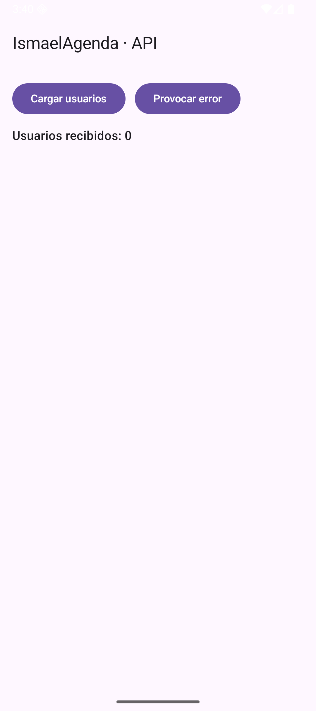
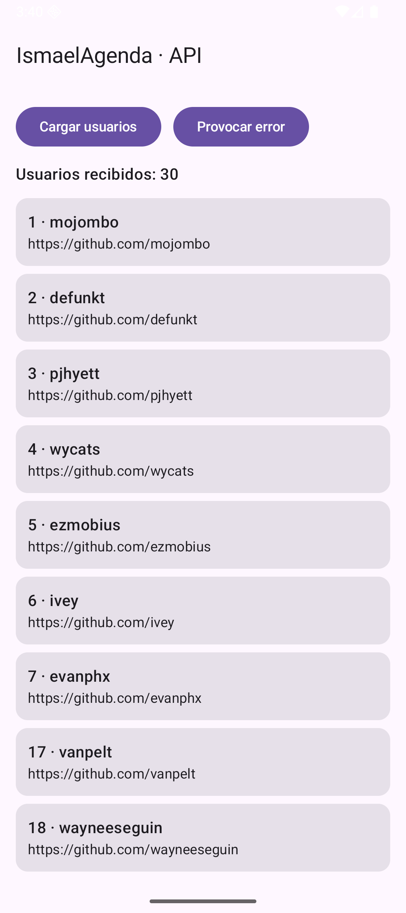
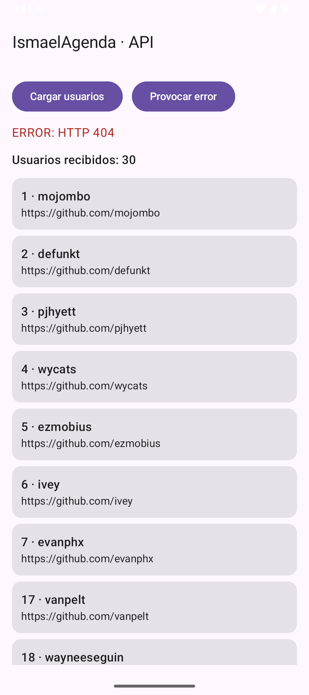

# Tema 3.4 - Retrofit: red, DTOs y errores

La app ya guarda en el móvil. Ahora tiene que **hablar con un servidor**: pedir datos por HTTPS, convertirlos de JSON a objetos y comportarse bien cuando la red falla.

<div style="background-color:#a5d6a7; border-radius:8px; padding:10px 14px; margin:14px 0;">
<strong>🟢 Leyenda de repaso obligatorio:</strong> los textos con <span style="background-color:#a5d6a7;padding:0 3px;border-radius:3px;">este fondo verde</span> son imprescindibles y entran en todas las evaluaciones del módulo.</div>

## 1. Las tres piezas (y quién hace qué)

| Pieza | Qué hace |
|---|---|
| **DTO** | Clase que representa **exactamente** lo que devuelve el servidor |
| **Interfaz del API** | Declara las llamadas (`@GET`, `@POST`…) sin implementarlas |
| **Retrofit** | Genera la implementación, hace la petición y convierte el JSON |

<span style="background-color:#a5d6a7;padding:0 3px;border-radius:3px;">Retrofit no hace magia: por debajo usa OkHttp para la conexión. Tú solo declaras la interfaz y él genera el código que lanza la petición y parsea la respuesta.</span>

## 2. El DTO: lo que devuelve el servidor

=== "Código 1 — DTO serializable"

    ```kotlin
    @Serializable                                               // genera el parser a partir de la clase
    data class UsuarioRemoto(                                   // lo que devuelve el servidor
        val id: Int,                                            // campo id del JSON
        val login: String,                                      // campo login del JSON
        val html_url: String                                    // campo html_url del JSON
    )
    ```

<span style="background-color:#a5d6a7;padding:0 3px;border-radius:3px;">El DTO copia el JSON del servidor, no tu modelo de negocio. Si el servidor llama `login`, tu DTO tiene `login`; la conversión a tu modelo se hace después.</span>

## 3. La interfaz: declarar la llamada

=== "Código 2 — Interfaz con `suspend`"

    ```kotlin
    interface AgendaApi {                                       // contrato del servidor
        @GET("users")                                           // GET https://api.github.com/users
        suspend fun usuarios(): List<UsuarioRemoto>              // suspend: la llamada no bloquea la UI
    }
    ```

<span style="background-color:#a5d6a7;padding:0 3px;border-radius:3px;">`suspend` es obligatorio: la petición se hace en segundo plano y la función se reanuda cuando llega la respuesta, sin bloquear la interfaz.</span>

## 4. El cliente: Retrofit + JSON

=== "Código 3 — Construcción del cliente"

    ```kotlin
    object RetrofitCliente {                                    // una sola instancia del cliente
        private val json = Json { ignoreUnknownKeys = true }     // si el servidor añade campos, no revienta
        private val retrofit = Retrofit.Builder()
            .baseUrl("https://api.github.com/")                 // URL base (termina en /)
            .addConverterFactory(json.asConverterFactory("application/json".toMediaType()))
            .build()
        val api: AgendaApi = retrofit.create(AgendaApi::class.java) // implementación generada
    }
    ```

Dos detalles que cuestan puntos en el examen:

- **`baseUrl` termina en `/`** y la ruta del `@GET` no empieza por `/`. Si no, Retrofit monta una URL distinta de la que crees.
- **`ignoreUnknownKeys = true`**: si el servidor añade un campo nuevo, tu app **no revienta**. Sin eso, cualquier cambio del backend rompe el parseo.

<span style="background-color:#a5d6a7;padding:0 3px;border-radius:3px;">`Json {{ ignoreUnknownKeys = true }}` es la diferencia entre aguantar un cambio del servidor y crashear en producción.</span>

### Permisos: sin esto no hay red

```xml
<uses-permission android:name="android.permission.INTERNET" />
```

Sin esa línea, cualquier petición falla con `EPERM (Operation not permitted)` en `getaddrinfo` — un error que parece de red y en realidad es de permisos.

## 5. La pantalla: tres estados, no uno

Una pantalla que llama a un servidor tiene **tres estados**: cargando, error y datos. Si solo pintas el bueno, la app parece rota cuando la red falla.

=== "Código 4 — Estados de carga, error y datos"

    ```kotlin
    fun EscenaApi() {                                           // 3.4: pedir datos a un servidor
        val alcance = rememberCoroutineScope()
        var usuarios by remember { mutableStateOf<List<UsuarioRemoto>>(emptyList()) }
        var error by remember { mutableStateOf<String?>(null) }
        var cargando by remember { mutableStateOf(false) }
        Scaffold(topBar = { TopAppBar(title = { Text("IsmaelAgenda · API") }) }) { relleno ->
            Column(
                Modifier.fillMaxSize().padding(relleno).padding(16.dp),
                verticalArrangement = Arrangement.spacedBy(12.dp)
            ) {
                Row(horizontalArrangement = Arrangement.spacedBy(12.dp)) {
                    Button(onClick = {
                        alcance.launch {
                            cargando = true; error = null             // estado de carga
                            try {
                                usuarios = RetrofitCliente.api.usuarios() // llamada real por HTTPS
                            } catch (e: Exception) {                  // sin red, timeout, 404...
                                error = e.message ?: "Error desconocido"
                            } finally {
                                cargando = false                      // pase lo que pase, quita la rueda
                            }
                        }
                    }) { Text("Cargar usuarios") }
                    Button(onClick = {
                        alcance.launch {
                            cargando = true; error = null
                            try {
                                usuarios = Retrofit.Builder()        // cliente MAL configurado a propósito
                                    .baseUrl("https://api.github.com/noexiste/")
                                    .addConverterFactory(json2().asConverterFactory("application/json".toMediaType()))
                                    .build()
                                    .create(AgendaApi::class.java)
                                    .usuarios()
                            } catch (e: Exception) {
                                error = e.message ?: "Error desconocido" // 404 del servidor
                            } finally {
                                cargando = false
                            }
                        }
                    }) { Text("Provocar error") }
                }
                if (cargando) CircularProgressIndicator()          // rueda mientras espera
                error?.let { Text("ERROR: $it", color = MaterialTheme.colorScheme.error) }
                Text("Usuarios recibidos: ${usuarios.size}", style = MaterialTheme.typography.titleMedium)
                LazyColumn(Modifier.weight(1f), verticalArrangement = Arrangement.spacedBy(8.dp)) {
                    items(usuarios) { u ->
                        Card(Modifier.fillMaxWidth()) {
                            Column(Modifier.padding(12.dp)) {
                                Text("${u.id} · ${u.login}", style = MaterialTheme.typography.titleMedium)
                                Text(u.html_url, style = MaterialTheme.typography.bodyMedium)
                            }
                        }
                    }
                }
            }
        }
    }
    ```



*Figura 1. Estado inicial: sin petición, «Usuarios recibidos: 0», sin error.*



*Figura 2. Petición correcta por HTTPS: **30 usuarios** y la lista pintada. El `try/catch` no ha tenido nada que atrapar.*



*Figura 3. Error controlado: el servidor responde **404**, la app lo muestra en rojo y **no pierde** los datos que ya tenía. Eso es manejo de errores, no un crash.*

<span style="background-color:#a5d6a7;padding:0 3px;border-radius:3px;">Un error de red no es una excepción que se ignora: es un estado más de la pantalla. Se muestra, se explica y se permite reintentar.</span>

## 6. Los fallos reales (los que me pasaron a mí)

| Síntoma | Causa | Solución |
|---|---|---|
| `EPERM` en `getaddrinfo` | falta el permiso INTERNET | añadirlo al Manifest y **recompilar** |
| `CertPathValidatorException: Trust anchor not found` | el certificado del dominio no encadena con una CA del móvil | usar un dominio con cadena válida o instalar la CA (solo en desarrollo) |
| `HTTP 404` | la ruta no existe | revisar `baseUrl` + `@GET` |
| `HTTP 401/403` | falta token o permisos | cabecera `Authorization` |
| `SocketTimeoutException` | el servidor no responde | timeouts y reintento |
| La app se cierra al pedir | excepción no capturada | `try/catch/finally` alrededor de la llamada |

<span style="background-color:#a5d6a7;padding:0 3px;border-radius:3px;">`finally {{ cargando = false }}` no es opcional: si la petición falla y no lo pones, la rueda de carga se queda girando para siempre y el usuario cree que la app está colgada.</span>

## 7. Errores típicos de examen

| Error | Por qué está mal |
|---|---|
| Llamar a Retrofit en el hilo principal | bloquea la UI; `suspend` lo evita |
| Un DTO con nombres inventados | el parseo falla en ejecución |
| No capturar excepciones | la app se cierra con cualquier fallo de red |
| `baseUrl` sin `/` final | la URL se monta mal |
| Devolver la lista sin estado de error | el usuario no sabe qué ha pasado |

## 8. Resumen

- **DTO** = forma del JSON; **interfaz** = llamadas; **Retrofit** = implementación + parseo.
- Las llamadas son **`suspend`** y se lanzan desde una corrutina.
- **`ignoreUnknownKeys`** te protege de cambios del servidor.
- **Permiso INTERNET** obligatorio.
- Una pantalla con red tiene **tres estados**: cargando, error, datos.

## Lo que tienes que llevarte de este apartado

- <span style="background-color:#a5d6a7;padding:0 3px;border-radius:3px;">Sin el permiso `INTERNET` en el `AndroidManifest.xml` la petición muere con `EPERM` antes de salir del teléfono: parece red y es declaración.</span>
- <span style="background-color:#a5d6a7;padding:0 3px;border-radius:3px;">`baseUrl` termina en `/` y la ruta del `@GET` no empieza por `/`: si no respetas esa convención, la URL sale mal y el error es un 404 despistado.</span>
- <span style="background-color:#a5d6a7;padding:0 3px;border-radius:3px;">El tiempo de espera también es configurable: sin `callTimeout`, un servidor colgado deja la pantalla con la rueda girando para siempre.</span>
- <span style="background-color:#a5d6a7;padding:0 3px;border-radius:3px;">Un `401` y un `404` se tratan distinto: el primero pide renovar la sesión, el segundo avisar y salir de la pantalla.</span>

## Presentación

- [PM-U3 - Navegación, estado y red](https://revilofe.github.io/slides/section1-pmdm/PM-U3.-NavegacionEstadoYRed.html)
