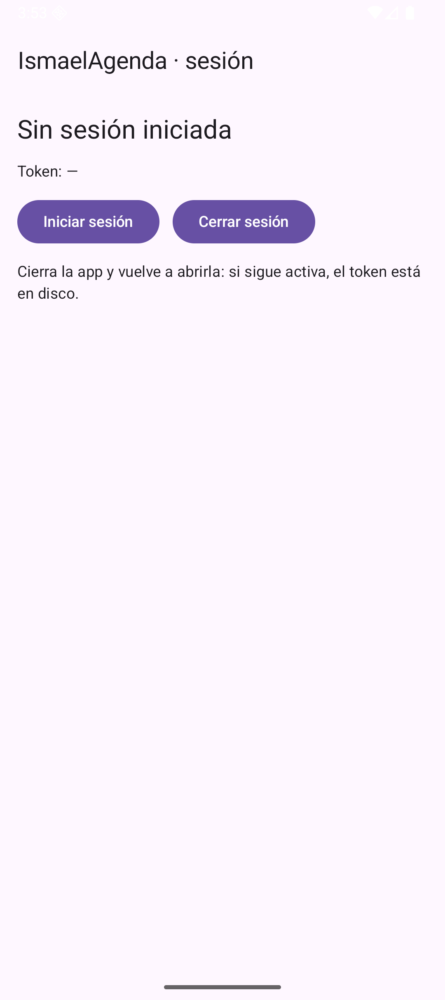
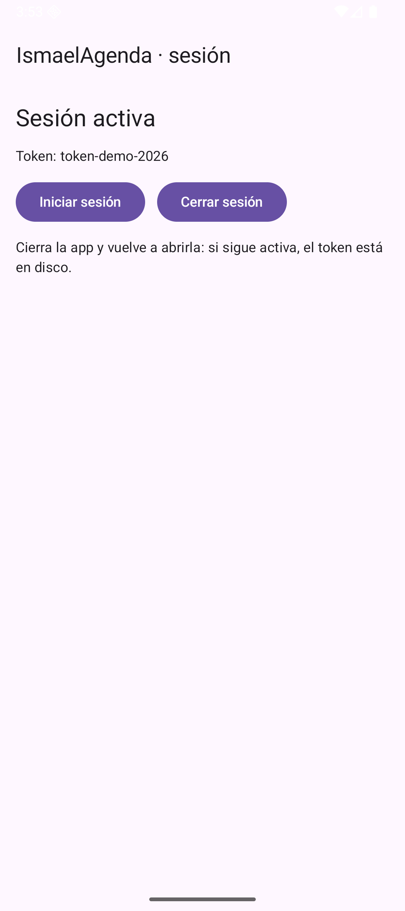

# Tema 3.5 - Taller integrador

Último apartado de la unidad: juntamos todo. La app ya navega, valida, guarda en Room y habla con un servidor; lo que falta es **recordar quién eres** entre arranques (sesión) y **demostrar que funciona** (pruebas).

<div style="background-color:#a5d6a7; border-radius:8px; padding:10px 14px; margin:14px 0;">
<strong>🟢 Leyenda de repaso obligatorio:</strong> los textos con <span style="background-color:#a5d6a7;padding:0 3px;border-radius:3px;">este fondo verde</span> son imprescindibles y entran en todas las evaluaciones del módulo.</div>

## 1. Qué integra el taller

| Pieza | Apartado | Qué aporta aquí |
|---|---|---|
| Navegación con argumentos | 3.1 | llegar a la pantalla de sesión con datos |
| ViewModel + StateFlow | 3.2 | estado de la pantalla sin perderlo al girar |
| Room | 3.3 | datos que sobreviven en disco |
| Retrofit | 3.4 | traer datos del servidor |
| **DataStore** | **3.5** | **token de sesión persistente** |
| **Pruebas** | **3.5** | **demostrar que la lógica es correcta** |

## 2. DataStore: la sesión que sobrevive

`SharedPreferences` sigue existiendo, pero DataStore es la forma recomendada: asíncrona, con `Flow` y sin bloqueos. Se declara un almacén por nombre y se accede por claves.

=== "Código 1 — Repositorio de sesión con DataStore"

    ```kotlin
    val Context.almacenSesion: DataStore<Preferences> by preferencesDataStore(name = "sesion") // un archivo por nombre
    val CLAVE_TOKEN = stringPreferencesKey("token")             // clave del token dentro del archivo

    class SesionRepositorio(private val contexto: Context) {    // acceso a la sesión
        suspend fun guardar(token: String) {                    // guarda el token en disco
            contexto.almacenSesion.edit { it[CLAVE_TOKEN] = token }
        }
        fun observar(): Flow<String?> =                         // lee el token y avisa de cambios
            contexto.almacenSesion.data.map { it[CLAVE_TOKEN] }
        suspend fun borrar() {                                  // cierra sesión
            contexto.almacenSesion.edit { it.remove(CLAVE_TOKEN) }
        }
    }
    ```

<span style="background-color:#a5d6a7;padding:0 3px;border-radius:3px;">`preferencesDataStore(name = "sesion")` crea **un archivo** en la app. La clave se declara una sola vez y se usa para leer, escribir y borrar.</span>

=== "Código 2 — Pantalla de sesión"

    ```kotlin
    fun EscenaSesion() {                                        // 3.5: la sesión sobrevive a cerrar la app
        val contexto = LocalContext.current
        val repositorio = remember { SesionRepositorio(contexto) } // una sola instancia
        val token by repositorio.observar().collectAsState(initial = null) // token vivo
        val alcance = rememberCoroutineScope()
        Scaffold(topBar = { TopAppBar(title = { Text("IsmaelAgenda · sesión") }) }) { relleno ->
            Column(
                Modifier.fillMaxSize().padding(relleno).padding(16.dp),
                verticalArrangement = Arrangement.spacedBy(12.dp)
            ) {
                Text(
                    if (token == null) "Sin sesión iniciada" else "Sesión activa",
                    style = MaterialTheme.typography.headlineSmall
                )
                Text("Token: ${token ?: "—"}", style = MaterialTheme.typography.bodyMedium)
                Row(horizontalArrangement = Arrangement.spacedBy(12.dp)) {
                    Button(onClick = {
                        alcance.launch { repositorio.guardar("token-demo-2026") } // escribe en disco
                    }) { Text("Iniciar sesión") }
                    Button(onClick = { alcance.launch { repositorio.borrar() } }) { Text("Cerrar sesión") }
                }
                Text(
                    "Cierra la app y vuelve a abrirla: si sigue activa, el token está en disco.",
                    style = MaterialTheme.typography.bodyMedium
                )
            }
        }
    }
    ```

<span style="background-color:#a5d6a7;padding:0 3px;border-radius:3px;">`observar()` devuelve un `Flow`: si el token cambia desde otra pantalla, esta se entera sola. No hay que refrescar ni preguntar.</span>



*Figura 1. Sin sesión: «Sin sesión iniciada» y el token a «—».*



*Figura 2. Tras pulsar «Iniciar sesión»: el token se escribe en disco y la pantalla lo refleja.*


*Figura 3. Se cierra la app del todo (`am force-stop`) y se vuelve a abrir: **la sesión sigue activa**. Eso es DataStore: el token está en disco, no en memoria.*

## 3. Pruebas: demostrar que la validación funciona

Una prueba unitaria comprueba la lógica **sin emulador**, en milisegundos. Se ejecuta con `gradlew test`. Aquí probamos las cuatro reglas del formulario del tema 3.2:

=== "Código 3 — Pruebas de la validación"

    ```kotlin
        @Test
        fun `nombre vacio produce error y no guarda`() {          // regla 1
            val vm = FormularioViewModel()
            vm.cambiarTelefono("956123456")                        // teléfono correcto
            val guardado = vm.guardar()                            // nombre vacío
            assertFalse("no debe guardar sin nombre", guardado)
            assertEquals("El nombre no puede estar vacío", vm.estado.value.errorNombre)
        }

        @Test
        fun `telefono de ocho digitos produce error`() {          // regla 2
            val vm = FormularioViewModel()
            vm.cambiarNombre("Nerea Ruiz")
            vm.cambiarTelefono("95612345")                         // 8 dígitos
            val guardado = vm.guardar()
            assertFalse("no debe guardar con 8 dígitos", guardado)
            assertEquals("El teléfono debe tener 9 dígitos", vm.estado.value.errorTelefono)
        }

        @Test
        fun `datos correctos guardan y limpian errores`() {       // regla 3
            val vm = FormularioViewModel()
            vm.cambiarNombre("Nerea Ruiz")
            vm.cambiarTelefono("956123456")
            val guardado = vm.guardar()
            assertTrue("debe guardar con datos correctos", guardado)
            assertNull(vm.estado.value.errorNombre)
            assertNull(vm.estado.value.errorTelefono)
        }

        @Test
        fun `el telefono filtra lo que no son digitos`() {        // regla 4
            val vm = FormularioViewModel()
            vm.cambiarTelefono("956-12-34-56")
            assertEquals("956123456", vm.estado.value.telefono)
        }
    ```

Resultado real de la ejecución en el proyecto:

```
BUILD SUCCESSFUL in 22s
```

```xml
<testsuite name="com.example.ismaelagenda.ValidacionTest"
           tests="4" skipped="0" failures="0" errors="0" time="0.017">
```

<span style="background-color:#a5d6a7;padding:0 3px;border-radius:3px;">Una prueba unitaria no necesita emulador ni servidor: si la lógica está en el ViewModel, se prueba en la JVM en 17 milisegundos. Si está dentro del `onClick`, no se puede probar.</span>

## 4. Inyección de dependencias: de los singletons a Hilt

En esta unidad el DAO y el repositorio se obtienen con **singletons** (`AgendaDatabase.obtener(contexto)`). Es correcto para una app de un módulo y no exige nada extra.

En un proyecto real con varias pantallas y varios módulos se usa **Hilt** (basado en Dagger), que genera ese cableado:

| Sin Hilt (lo que hemos hecho) | Con Hilt |
|---|---|
| `AgendaDatabase.obtener(contexto)` en cada pantalla | `@Inject constructor(...)` y el framework lo pone |
| El ViewModel crea sus dependencias | `@HiltViewModel` + `hiltViewModel()` |
| Cambiar la implementación = tocar la pantalla | Cambiar el `@Module` |
| Una app, un módulo: suficiente | Varios módulos y testeo con dobles: necesario |

Para añadirlo harían falta tres piezas más en Gradle (plugin de Hilt, `ksp` del compilador y la extensión de navegación) y una clase `Application` anotada con `@HiltAndroidApp`. Se ve en el módulo de proyecto intermodular, donde la app ya tiene varias capas.

<span style="background-color:#a5d6a7;padding:0 3px;border-radius:3px;">Hilt no es un requisito para aprobar este módulo: es la evolución del patrón que ya has usado. Si sabes explicar **qué dependencia necesita cada clase**, sabes inyección de dependencias.</span>

## 5. Checklist de la práctica de la unidad

Tu entrega tiene que demostrar, con capturas propias:

- [ ] Navegación a un detalle **con argumento** y vuelta atrás (3.1).
- [ ] Un formulario que **valida** y muestra el error bajo el campo (3.2).
- [ ] Los datos **siguen** tras girar el móvil (3.2).
- [ ] Una lista leída de **Room** que sobrevive a cerrar la app (3.3).
- [ ] Una petición **HTTPS** con su estado de carga y su estado de error (3.4).
- [ ] La **sesión** sigue activa tras cerrar y abrir la app (3.5).
- [ ] Al menos **una prueba unitaria** de la validación, con `gradlew test` en verde (3.5).

## 6. Resumen de la unidad

| Apartado | Idea que hay que llevarse |
|---|---|
| 3.1 | La ruta es el contrato; el argumento se lee con valor por defecto |
| 3.2 | El estado va en el ViewModel; la validación es lógica de negocio |
| 3.3 | Room: entidad, DAO, base única, `Flow` y migraciones |
| 3.4 | Retrofit: DTO, `suspend`, `ignoreUnknownKeys` y tres estados |
| 3.5 | DataStore para la sesión; las pruebas demuestran la lógica |

Con esto se cierran los criterios **a)**, **e)**, **f)**, **g)**, **i)** y **j)** del RA2 del módulo 0489 (RD 405/2023): estructura de clases, conexiones HTTP/HTTPS, persistencia, pruebas en emulador, documentación y permisos.

## Lo que tienes que llevarte de este apartado

- <span style="background-color:#a5d6a7;padding:0 3px;border-radius:3px;">DataStore se maneja con corutinas: `edit` es `suspend` y no bloquea el hilo de la interfaz.</span>
- <span style="background-color:#a5d6a7;padding:0 3px;border-radius:3px;">El token de sesión se guarda en disco, nunca en una variable en memoria: las variables mueren al cerrar la app y la sesión con ellas.</span>
- <span style="background-color:#a5d6a7;padding:0 3px;border-radius:3px;">Un almacén por nombre: cada `preferencesDataStore(name = ...)` abre un archivo, y multiplicar almacenes multiplica las escrituras.</span>
- <span style="background-color:#a5d6a7;padding:0 3px;border-radius:3px;">Si una regla de negocio no se puede probar sin tocar la pantalla, está en la capa equivocada.</span>
- <span style="background-color:#a5d6a7;padding:0 3px;border-radius:3px;">En este módulo todo lo que entregues se demuestra con una captura o con una prueba: las dos son evidencia, la intención no.</span>

## Presentación

- [PM-U3 - Navegación, estado y red](https://revilofe.github.io/slides/section1-pmdm/PM-U3.-NavegacionEstadoYRed.html)
