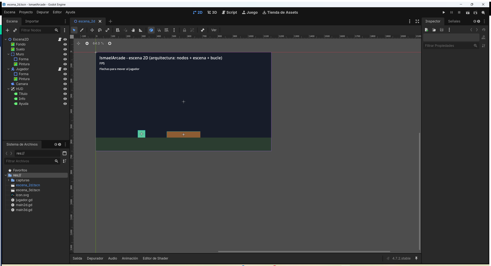
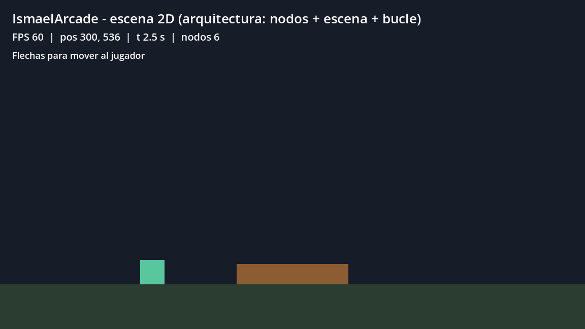
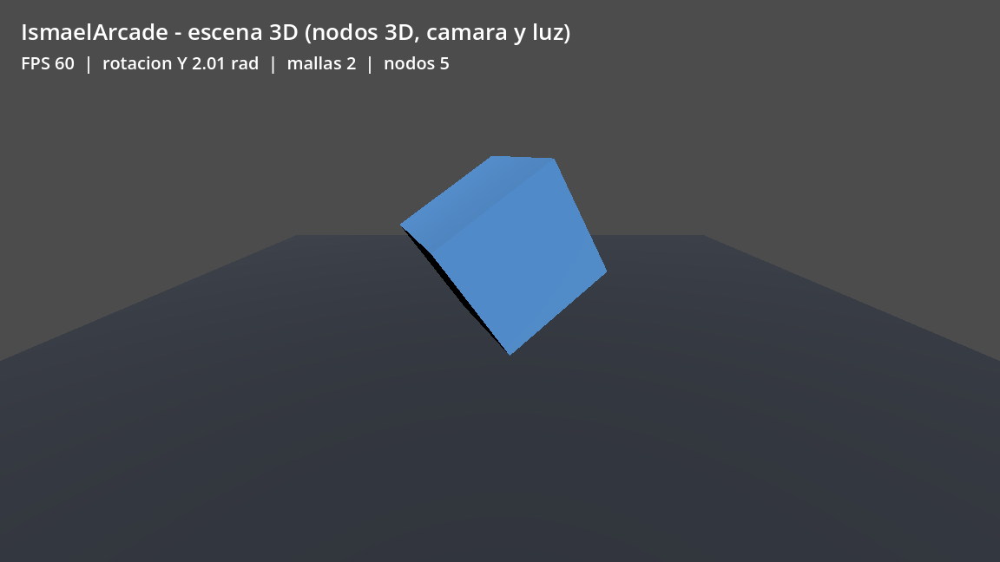

# Tema 4.1 - Arquitectura de un juego 2D y 3D

Empezamos la unidad de motores de juegos. No vamos a programar un juego grande: vamos a **entender cómo está montado un juego por dentro**, que es lo que pide el criterio de evaluación. Todo lo que se ve aquí está ejecutado en el proyecto **IsmaelArcade**, con capturas del programa funcionando.

<div style="background-color:#a5d6a7; border-radius:8px; padding:10px 14px; margin:14px 0;">
<strong>🟢 Leyenda de repaso obligatorio:</strong> los textos con <span style="background-color:#a5d6a7;padding:0 3px;border-radius:3px;">este fondo verde</span> son imprescindibles y entran en todas las evaluaciones del módulo.</div>

## 1. Un juego son cuatro piezas

Cualquier juego, del Pong a un AAA, se puede reducir a cuatro piezas:

1. **Un bucle** que se repite muchas veces por segundo.
2. **Una escena** con los objetos que existen en ese momento.
3. **Una entrada** (teclado, pantalla táctil, mando).
4. **Un estado** que cambia con cada vuelta del bucle.

<span style="background-color:#a5d6a7;padding:0 3px;border-radius:3px;">Un juego no es un programa que empieza y termina: es un bucle que se repite mientras el jugador siga ahí. Todo lo demás cuelga de esa idea.</span>

## 2. El bucle de juego (game loop)

El motor llama a tu código muchas veces por segundo. En Godot hay dos funciones que se llaman solas:

| Función | Cuándo se llama | Para qué sirve |
|---|---|---|
| `_process(delta)` | en cada fotograma | animaciones, HUD, lógica que no depende de la física |
| `_physics_process(delta)` | a ritmo fijo (60 veces por segundo por defecto) | movimiento, colisiones, fuerzas |

El parámetro `delta` es **el tiempo que ha pasado desde la llamada anterior**, en segundos. Multiplicar por `delta` es lo que hace que el juego se mueva igual en un ordenador rápido y en uno lento.

<span style="background-color:#a5d6a7;padding:0 3px;border-radius:3px;">`delta` es el tiempo entre fotogramas: si el jugador avanza 320 píxeles por segundo, en cada vuelta avanza `320 * delta`. Sin `delta`, el juego corre más rápido en un equipo mejor.</span>

## 3. La escena es un árbol de nodos

Un juego no es una lista plana de objetos: es un **árbol**. Hay un nodo raíz y todo lo demás cuelga de él. Cada nodo tiene un tipo (`Node2D`, `CharacterBody2D`, `Camera2D`, `Label`…) y una serie de propiedades.

Este es el árbol real de nuestra escena 2D, volcado con el script `dump_arbol.gd`:

```text
┖╴Escena2D
    ┠╴Fondo
    ┠╴Suelo
    ┠╴Muro
    ┃  ┠╴Forma
    ┃  ┖╴Pintura
    ┠╴Jugador
    ┃  ┠╴Forma
    ┃  ┖╴Pintura
    ┠╴Camara
    ┖╴HUD
       ┠╴Titulo
       ┠╴Info
       ┖╴Ayuda
```

Léelo así: **`Escena2D`** es la raíz; `Fondo`, `Suelo`, `Muro`, `Jugador`, `Camara` y `HUD` son hijos suyos; `Muro` y `Jugador` tienen a su vez dos hijos (`Forma` para la colisión y `Pintura` para lo que se ve).

<span style="background-color:#a5d6a7;padding:0 3px;border-radius:3px;">Un nodo hijo hereda la posición de su padre: si mueves `Muro`, su `Forma` y su `Pintura` se mueven con él. Por eso la colisión y el dibujo van como hijos del mismo nodo.</span>

<figure>

<figcaption>Figura 1. El árbol de nodos en el panel <em>Escena</em> del editor, con la escena 2D dibujada en el centro y el sistema de archivos del proyecto abajo a la izquierda.</figcaption>
</figure>

## 4. Qué cambia entre 2D y 3D

La arquitectura es la misma (bucle + escena + nodos). Lo que cambia es el **tipo de nodos** y el **espacio** en el que se colocan:

| | 2D | 3D |
|---|---|---|
| Raíz de la escena | `Node2D` | `Node3D` |
| Posición | `Vector2(x, y)` | `Vector3(x, y, z)` |
| Lo que se dibuja | `Sprite2D`, `ColorRect`, `Polygon2D` | `MeshInstance3D` con una malla |
| Cámara | `Camera2D` | `Camera3D` |
| Luz | no hay luces: todo es color plano | `DirectionalLight3D`, `OmniLight3D` |
| Colisión | `CollisionShape2D` | `CollisionShape3D` |

<span style="background-color:#a5d6a7;padding:0 3px;border-radius:3px;">En 2D la profundidad se finge con el orden de dibujo (lo último se pinta encima). En 3D la profundidad es real: la cámara y la luz deciden qué se ve y qué queda detrás.</span>

## 5. El proyecto del aula, paso a paso

Todo el material sale del proyecto **IsmaelArcade**, que puedes abrir con Godot 4.7.2:

1. Descarga Godot (enlace en la bibliografía) y descomprime el `.zip`: no tiene instalador.
2. Abre el ejecutable y elige **Importar** → carpeta `IsmaelArcade` → `project.godot`.
3. En el panel **Escena**, haz doble clic en `escena_2d.tscn`.
4. Pulsa **F5** para ejecutar el proyecto y **F8** para pararlo.
5. Mueve al jugador con las flechas del teclado.

El fichero de proyecto solo necesita estas líneas para arrancar:

=== "Código 1 — project.godot"

    ; Engine configuration file.
    config_version=5

    [application]

    config/name="IsmaelArcade"
    run/main_scene="res://escena_2d.tscn"
    config/features=PackedStringArray("4.7", "GL Compatibility")
    config/icon="res://icon.svg"

    [display]

    window/size/viewport_width=1152
    window/size/viewport_height=648

    [rendering]

    renderer/rendering_method="gl_compatibility"
    renderer/rendering_method.mobile="gl_compatibility"

<span style="background-color:#a5d6a7;padding:0 3px;border-radius:3px;">`run/main_scene` es la escena que se carga al pulsar F5. Si el nombre está mal, el proyecto compila y no arranca: es lo primero que se revisa cuando "no hace nada".</span>

## 6. El código del jugador

Este es el script completo del jugador, comentado línea a línea:

=== "Código 2 — jugador.gd"

    extends CharacterBody2D
    ## Jugador 2D: se mueve con las flechas y choca con los obstaculos.

    @export var velocidad: float = 320.0      # pixeles por segundo (editable en el inspector)

    func _physics_process(_delta: float) -> void:
    	var direccion := Vector2.ZERO                        # vector de entrada
    	if Input.is_action_pressed("ui_right"):
    		direccion.x += 1.0
    	if Input.is_action_pressed("ui_left"):
    		direccion.x -= 1.0
    	if Input.is_action_pressed("ui_down"):
    		direccion.y += 1.0
    	if Input.is_action_pressed("ui_up"):
    		direccion.y -= 1.0
    	velocity = direccion.normalized() * velocidad        # normalizar evita la diagonal rapida
    	move_and_slide()                                     # mueve y resuelve colisiones

<span style="background-color:#a5d6a7;padding:0 3px;border-radius:3px;">`move_and_slide()` mueve el nodo y resuelve las colisiones en el mismo paso. Si mueves la posición a mano (`position += ...`), atraviesas las paredes.</span>

<span style="background-color:#a5d6a7;padding:0 3px;border-radius:3px;">`normalized()` evita que la diagonal sea más rápida: sin él, moverse en diagonal suma dos velocidades y el jugador avanza más que en línea recta.</span>

## 7. El código del bucle y del HUD

=== "Código 3 — main2d.gd"

    extends Node2D
    ## Escena 2D: bucle de juego, HUD con FPS y captura automatica.

    var _tiempo := 0.0

    func _process(delta: float) -> void:
    	_tiempo += delta
    	var j := $Jugador as CharacterBody2D
    	$HUD/Info.text = "FPS %d  |  pos %.0f, %.0f  |  t %.1f s  |  nodos %d" % [
    		Engine.get_frames_per_second(), j.position.x, j.position.y, _tiempo, get_child_count()]

    func _ready() -> void:
    	await get_tree().create_timer(2.5).timeout          # deja que el juego corra
    	await RenderingServer.frame_post_draw               # espera el frame dibujado
    	get_viewport().get_texture().get_image().save_png("res://capturas/escena2d.png")
    	get_tree().quit()

Fíjate en tres cosas:

- `_process(delta)` se ejecuta en cada fotograma: ahí se acumula el tiempo y se actualiza el HUD.
- `Engine.get_frames_per_second()` devuelve los FPS reales que está consiguiendo el juego.
- La captura se guarda con `get_viewport().get_texture().get_image().save_png(...)`: es el propio juego el que se fotografía, sin herramientas externas.

<figure>

<figcaption>Figura 2. La escena 2D ejecutándose: <strong>FPS 60 · pos 300,536 · t 2.5 s · nodos 6</strong>. El jugador (cuadrado verde) está apoyado sobre el suelo y el muro marrón queda a su derecha.</figcaption>
</figure>

<span style="background-color:#a5d6a7;padding:0 3px;border-radius:3px;">El HUD no es decoración: es el instrumento de medida. Sin ver los FPS y la posición no puedes saber si el juego va bien o va a tirones.</span>

## 8. La misma arquitectura en 3D

El script 3D es casi idéntico: cambian el tipo de nodo y las tres dimensiones.

=== "Código 4 — main3d.gd"

    extends Node3D
    ## Escena 3D: cubo girando, camara y luz direccional.

    var _angulo := 0.0

    func _process(delta: float) -> void:
    	_angulo += delta * 0.8
    	$Cubo.rotation.y = _angulo                        # giro del cubo
    	$Cubo.rotation.x = _angulo * 0.5
    	var mallas := 0                                      # cuenta de mallas reales en la escena
    	for n in get_children():
    		if n is MeshInstance3D:
    			mallas += 1
    	$HUD/Info.text = "FPS %d  |  rotacion Y %.2f rad  |  mallas %d  |  nodos %d" % [
    		Engine.get_frames_per_second(), _angulo, mallas, get_child_count()]

    func _ready() -> void:
    	await get_tree().create_timer(2.5).timeout
    	await RenderingServer.frame_post_draw
    	get_viewport().get_texture().get_image().save_png("res://capturas/escena3d.png")
    	get_tree().quit()

<span style="background-color:#a5d6a7;padding:0 3px;border-radius:3px;">Un nodo 3D sin cámara no se ve: la cámara decide qué parte del espacio se proyecta en la pantalla. Y sin luz, todo se ve negro.</span>

<figure>

<figcaption>Figura 3. La escena 3D ejecutándose: <strong>FPS 60 · rotación Y 2.01 rad · mallas 2 · nodos 5</strong>. Se distinguen las caras del cubo con distinta iluminación y el suelo en perspectiva.</figcaption>
</figure>

## 9. El script que vuelca el árbol

Para comprobar la arquitectura sin abrir el editor usamos un script de diagnóstico de cinco líneas:

=== "Código 5 — dump_arbol.gd"

    extends SceneTree
    ## Vuelca por consola el arbol de nodos de una escena (diagnostico).

    func _init() -> void:
    	var empaquetada: PackedScene = load("res://escena_2d.tscn")   # carga el fichero .tscn
    	var escena: Node = empaquetada.instantiate()                  # crea los nodos en memoria
    	escena.print_tree_pretty()                                    # imprime el arbol con sangria
    	quit()                                                        # termina sin abrir ventana

Se ejecuta así, sin ventana:

```bash
godot --headless --path IsmaelArcade --script dump_arbol.gd
```

<span style="background-color:#a5d6a7;padding:0 3px;border-radius:3px;">`--headless` ejecuta el motor sin ventana: sirve para comprobar escenas y scripts en una máquina sin pantalla o desde un servidor.</span>

## 10. Lo que tienes que llevarte de este apartado

- <span style="background-color:#a5d6a7;padding:0 3px;border-radius:3px;">Un juego es un bucle que se repite: `_process` para lo visual y `_physics_process` para lo que choca.</span>
- <span style="background-color:#a5d6a7;padding:0 3px;border-radius:3px;">`delta` hace que el movimiento no dependa de la potencia del equipo.</span>
- <span style="background-color:#a5d6a7;padding:0 3px;border-radius:3px;">La escena es un árbol: un nodo raíz y sus hijos, que heredan su posición.</span>
- <span style="background-color:#a5d6a7;padding:0 3px;border-radius:3px;">2D usa `Node2D` y `Vector2`; 3D usa `Node3D` y `Vector3`, con cámara y luces de verdad.</span>
- <span style="background-color:#a5d6a7;padding:0 3px;border-radius:3px;">El HUD con FPS y posición es la prueba de que el juego corre como debe.</span>

## Bibliografía y documentación oficial

- Godot Engine — documentación oficial: [docs.godotengine.org](https://docs.godotengine.org/en/stable/).
- Godot Engine — descargas oficiales (versión usada en el aula, 4.7.2): [godotengine.org/download](https://godotengine.org/download/).
- Godot Engine — referencia de GDScript: [docs.godotengine.org — GDScript](https://docs.godotengine.org/en/stable/tutorials/scripting/gdscript/index.html).
- Unity — manual oficial: [docs.unity3d.com/Manual](https://docs.unity3d.com/Manual/index.html).
- Unreal Engine — documentación oficial: [dev.epicgames.com — Unreal Engine](https://dev.epicgames.com/documentation/en-us/unreal-engine).
- libGDX — wiki oficial: [libgdx.com/wiki](https://libgdx.com/wiki/).
- Phaser — documentación oficial: [docs.phaser.io](https://docs.phaser.io/).
- Android — desarrollo de juegos: [developer.android.com/games](https://developer.android.com/games).
- Módulo 0489 — Real Decreto 405/2023 (BOE): [BOE-A-2023-13221](https://www.boe.es/buscar/act.php?id=BOE-A-2023-13221).

