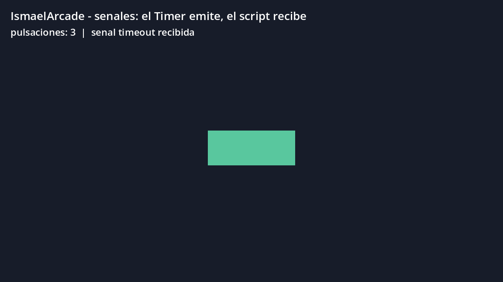

# Tema 4.2 - Componentes de un motor de juegos

En 4.1 vimos que un juego es un bucle con un árbol de nodos. Ahora toca abrir el motor y ver **qué piezas lo forman** y cómo se hablan entre ellas. Todo lo que sigue está ejecutado en IsmaelArcade.

<div style="background-color:#a5d6a7; border-radius:8px; padding:10px 14px; margin:14px 0;">
<strong>🟢 Leyenda de repaso obligatorio:</strong> los textos con <span style="background-color:#a5d6a7;padding:0 3px;border-radius:3px;">este fondo verde</span> son imprescindibles y entran en todas las evaluaciones del módulo.</div>

## 1. Un motor no es «lo que dibuja»

Un motor de juegos es un conjunto de subsistemas que ya vienen resueltos para que tú solo escribas la lógica de tu juego:

| Subsistema | Qué resuelve | En Godot lo usas con |
|---|---|---|
| Render | dibujar en pantalla a 60 FPS | `Sprite2D`, `MeshInstance3D`, `Camera2D/3D` |
| Física | choques, gravedad, cuerpos | `CharacterBody2D`, `StaticBody2D`, `CollisionShape2D` |
| Entrada | teclado, táctil, mando | `Input.is_action_pressed()` |
| Audio | reproducir sonidos y música | `AudioStreamPlayer` |
| Recursos | cargar y reutilizar datos | texturas, mallas, materiales, escenas |
| Scripting | ejecutar tu lógica | GDScript (o C#) |
| Escenas | guardar y cargar árboles de nodos | ficheros `.tscn` |

<span style="background-color:#a5d6a7;padding:0 3px;border-radius:3px;">El motor no programa tu juego: te da el render, la física y la entrada ya hechos. Tu trabajo es la lógica y la escena.</span>

## 2. Nodos: cada pieza hace una cosa

Godot construye por **composición**: no hay una clase "Jugador" gigante, hay un nodo que colisiona y otro que se dibuja, unidos en un árbol. Nuestro jugador es exactamente eso:

```text
Jugador (CharacterBody2D)     ← el cuerpo y el movimiento
  ├── Forma (CollisionShape2D) ← la caja de colisión
  └── Pintura (ColorRect)      ← lo que se ve
```

<span style="background-color:#a5d6a7;padding:0 3px;border-radius:3px;">Un nodo = una responsabilidad. Si el nodo hace dos cosas (moverse y dibujarse a la vez), el árbol está mal montado.</span>

En Unity la idea es la misma con otro vocabulario: un `GameObject` vacío al que se le **añaden componentes** (`Rigidbody`, `BoxCollider`, `MeshRenderer`). En Godot, los componentes *son* los nodos hijos.

| Idea | Godot | Unity |
|---|---|---|
| Objeto de la escena | nodo | `GameObject` |
| Pieza que se añade | nodo hijo | componente |
| Agrupar en un fichero | escena `.tscn` | prefab |
| Reutilizar datos | recurso `.tres` | asset |

## 3. Escena y recurso no son lo mismo

- Una **escena** (`.tscn`) es un **árbol de nodos guardado**: se puede instanciar muchas veces (diez enemigos = diez instancias de la misma escena).
- Un **recurso** (`.tres`, `.res`, `.png`) son **datos reutilizables**: una malla, un material, una textura. No tiene lógica ni árbol.

<span style="background-color:#a5d6a7;padding:0 3px;border-radius:3px;">Una escena se instancia; un recurso se comparte. Diez enemigos instanciados gastan diez veces su lógica, pero comparten la misma textura en memoria.</span>

Nuestra escena de señales, por dentro, es texto. Estas son sus declaraciones de nodos:

=== "Código 1 — escena_senales.tscn (fragmento de nodos)"

    [node name="EscenaSenales" type="Node2D"]
    script = ExtResource("1_main")
    [node name="Fondo" type="ColorRect" parent="."]
    [node name="Boton" type="ColorRect" parent="."]
    [node name="Reloj" type="Timer" parent="."]
    wait_time = 0.8
    autostart = true
    [node name="HUD" type="CanvasLayer" parent="."]
    [node name="Titulo" type="Label" parent="HUD"]
    [node name="Info" type="Label" parent="HUD"]

<span style="background-color:#a5d6a7;padding:0 3px;border-radius:3px;">Un `.tscn` es texto plano: se puede leer, comparar en Git y revisar en una revisión de código. No es un binario opaco.</span>

## 4. Señales: avisar sin estar mirando

Una **señal** es un aviso que un nodo emite cuando pasa algo (`timeout`, `body_entered`, `pressed`). Otro nodo se **conecta** y ejecuta una función. Es el patrón editorial: el que emite no sabe quién escucha.

En esta escena, un `Timer` emite `timeout` cada 0,8 segundos y el script los cuenta:

=== "Código 2 — main_senales.gd"

    extends Node2D
    ## Escena de senales: un Timer emite y este script recibe.

    var pulsaciones := 0                                  # contador de senales recibidas

    func _ready() -> void:
    	$Reloj.timeout.connect(_on_reloj_timeout)         # conecta la senal timeout
    	await get_tree().create_timer(2.5).timeout        # deja pasar tres pulsos
    	await RenderingServer.frame_post_draw
    	get_viewport().get_texture().get_image().save_png("res://capturas/senales.png")
    	get_tree().quit()

    func _on_reloj_timeout() -> void:                     # se ejecuta en cada pulso
    	pulsaciones += 1
    	$HUD/Info.text = "pulsaciones: %d  |  senal timeout recibida" % pulsaciones
    	print("senal recibida: ", pulsaciones)             # deja rastro en la consola

<figure>

<figcaption>Figura 1. La escena de señales ejecutándose: el <code>Timer</code> ha emitido tres veces y el contador lo refleja (<strong>pulsaciones: 3</strong>).</figcaption>
</figure>

Y esto es lo que escribe en la consola, tal cual, al ejecutarla desde terminal:

```text
Godot Engine v4.7.2.stable.official.ed1daf0bf - https://godotengine.org
OpenGL API 3.3.0 NVIDIA 610.88 - Compatibility - Using Device: NVIDIA - NVIDIA GeForce RTX 5070

senal recibida: 1
senal recibida: 2
senal recibida: 3
```

<span style="background-color:#a5d6a7;padding:0 3px;border-radius:3px;">`connect()` une una señal a una función: `$Reloj.timeout.connect(_on_reloj_timeout)`. Si no conectas, el aviso se emite y nadie lo escucha.</span>

<span style="background-color:#a5d6a7;padding:0 3px;border-radius:3px;">Las señales desacoplan: el `Timer` no sabe qué hace el receptor, y el receptor no sabe quién avisa. Se pueden cambiar las piezas sin tocar las demás.</span>

## 5. Dónde se ve cada componente en el árbol

Volviendo al árbol de 4.1, cada nodo es un subsistema en acción:

| Nodo del árbol | Subsistema que usa |
|---|---|
| `Fondo`, `Suelo`, `Pintura` | render |
| `Muro`, `Jugador` | física (cuerpos) |
| `Forma` | física (colisión) |
| `Camara` | render (proyección) |
| `HUD/Info` | interfaz y medida (FPS) |
| `Reloj` (en la escena de señales) | scripting y tiempo |

<span style="background-color:#a5d6a7;padding:0 3px;border-radius:3px;">Saber a qué subsistema pertenece cada nodo es lo que te permite depurar: si el juego va a tirones es render; si atraviesas paredes es física; si no responde, es entrada.</span>

## 6. Lo que tienes que llevarte de este apartado

- <span style="background-color:#a5d6a7;padding:0 3px;border-radius:3px;">Un motor es render + física + entrada + audio + recursos + scripting + escenas.</span>
- <span style="background-color:#a5d6a7;padding:0 3px;border-radius:3px;">En Godot se compone con nodos; en Unity, con componentes sobre un `GameObject`.</span>
- <span style="background-color:#a5d6a7;padding:0 3px;border-radius:3px;">Escena = árbol de nodos que se instancia. Recurso = datos que se comparten.</span>
- <span style="background-color:#a5d6a7;padding:0 3px;border-radius:3px;">Una señal avisa sin conocer al receptor: `emisor.senal.connect(funcion)`.</span>
- <span style="background-color:#a5d6a7;padding:0 3px;border-radius:3px;">Cada nodo del árbol pertenece a un subsistema, y eso guía la depuración.</span>

## Bibliografía y documentación oficial

- Godot Engine — documentación oficial: [docs.godotengine.org](https://docs.godotengine.org/en/stable/).
- Godot Engine — señales (signals): [docs.godotengine.org — Signals](https://docs.godotengine.org/en/stable/getting_started/step_by_step/signals.html).
- Godot Engine — nodos y escenas: [docs.godotengine.org — Nodes and scenes](https://docs.godotengine.org/en/stable/getting_started/step_by_step/nodes_and_scenes.html).
- Godot Engine — `Timer`: [docs.godotengine.org — Timer](https://docs.godotengine.org/en/stable/classes/class_timer.html).
- Unity — manual oficial: [docs.unity3d.com/Manual](https://docs.unity3d.com/Manual/index.html).
- Unreal Engine — documentación oficial: [dev.epicgames.com — Unreal Engine](https://dev.epicgames.com/documentation/en-us/unreal-engine).
- libGDX — wiki oficial: [libgdx.com/wiki](https://libgdx.com/wiki/).
- Phaser — documentación oficial: [docs.phaser.io](https://docs.phaser.io/).
- Módulo 0489 — Real Decreto 405/2023 (BOE): [BOE-A-2023-13221](https://www.boe.es/buscar/act.php?id=BOE-A-2023-13221).


## Presentación

- [PM-U4 - Motores de juegos](https://revilofe.github.io/slides/section5-pmdm/PM-U4.-MotoresDeJuegos.html)
