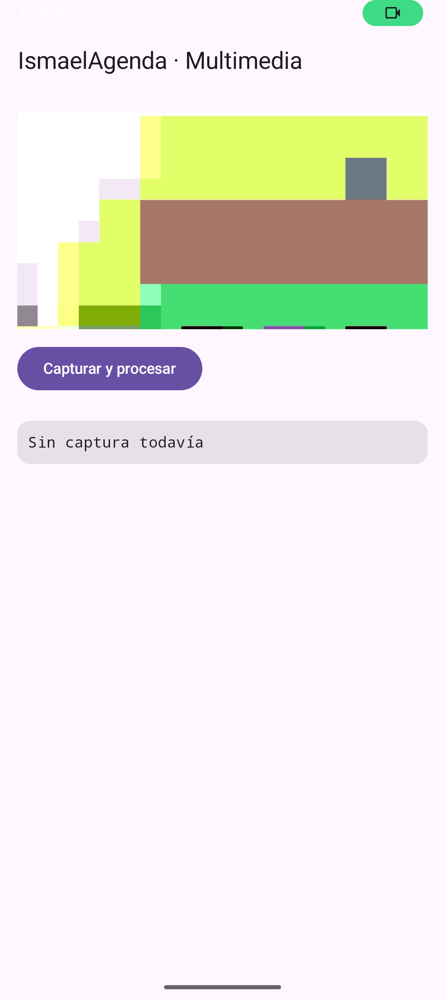
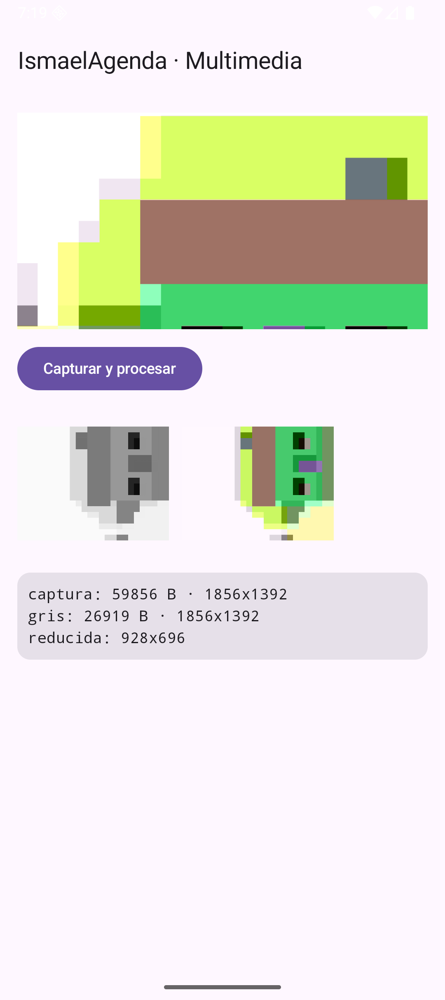
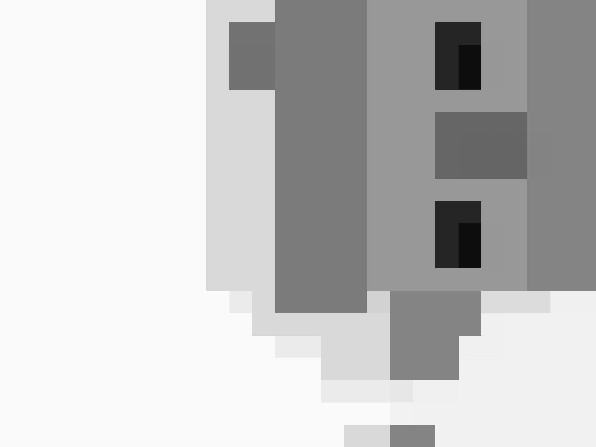

# Tema 5.2 - Captura y procesamiento en Android

Aquí ya hay app: la escena 8 de `IsmaelAgenda` abre la cámara, hace una foto, la convierte a escala de grises, la reduce a la mitad y guarda el resultado. Todo lo que sigue es el código que está corriendo en el emulador, con las medidas que devolvió.

<div style="background-color:#a5d6a7; border-radius:8px; padding:10px 14px; margin:14px 0;">
<strong>🟢 Leyenda de repaso obligatorio:</strong> los textos con <span style="background-color:#a5d6a7;padding:0 3px;border-radius:3px;">este fondo verde</span> son imprescindibles y entran en todas las evaluaciones del módulo.</div>

## 1. Qué se necesita para capturar

| Pieza | Para qué | Dónde se declara |
|---|---|---|
| `<uses-permission CAMERA>` | poder usar la cámara | `AndroidManifest.xml` |
| `<uses-feature camera required="false">` | la app arranca aunque no haya cámara | `AndroidManifest.xml` |
| `camera-camera2` | acceso al hardware | `build.gradle.kts` |
| `camera-lifecycle` | atar la cámara al ciclo de vida | `build.gradle.kts` |
| `camera-view` | la vista `PreviewView` | `build.gradle.kts` |

Versiones reales usadas (sacadas de Google Maven): **1.6.2** de las tres.

<span style="background-color:#a5d6a7;padding:0 3px;border-radius:3px;">La cámara se declara en tres sitios: permiso en el manifiesto, dependencias en Gradle y petición del permiso en tiempo de ejecución. Si falta uno, no hay cámara.</span>

## 2. Las tres piezas de CameraX

CameraX trabaja con **casos de uso** que se atan juntos:

| Caso de uso | Qué hace |
|---|---|
| `Preview` | pinta lo que ve la cámara en un `PreviewView` |
| `ImageCapture` | guarda una foto en un fichero |
| `ProcessCameraProvider` | arranca y ata los casos de uso al ciclo de vida |

```kotlin
val proveedor = ProcessCameraProvider.getInstance(ctx).get()   // motor de CameraX
val previa = Preview.Builder().build().also {
    it.setSurfaceProvider(vista.surfaceProvider)               // dónde se pinta
}
val captura = ImageCapture.Builder().build()                   // el que hace la foto
proveedor.bindToLifecycle(                                     // ata al ciclo de vida
    ctx as LifecycleOwner,                                     // manda la Activity
    CameraSelector.DEFAULT_BACK_CAMERA,                        // cámara trasera
    previa, captura                                            // dos casos a la vez
)
```

<span style="background-color:#a5d6a7;padding:0 3px;border-radius:3px;">`bindToLifecycle` es lo que evita fugas de memoria y cámaras bloqueadas: al cerrar la pantalla, CameraX suelta la cámara solo.</span>

## 3. Pedir el permiso sin salir de Compose

```kotlin
val pedirPermiso = rememberLauncherForActivityResult(
    ActivityResultContracts.RequestPermission()
) { concedido -> permiso = concedido }                       // respuesta del usuario

LaunchedEffect(Unit) {
    if (!permiso) pedirPermiso.launch(Manifest.permission.CAMERA)
}
```

<span style="background-color:#a5d6a7;padding:0 3px;border-radius:3px;">El permiso de cámara no basta con declararlo: hay que pedirlo en ejecución y guardar la respuesta. Si el usuario dice que no, la app debe seguir funcionando y explicarlo.</span>

## 4. La captura, paso a paso

```kotlin
val fichero = File(contexto.filesDir, "captura_${System.currentTimeMillis()}.jpg")
val salida = ImageCapture.OutputFileOptions.Builder(fichero).build()
captura.takePicture(salida, hilo, object : ImageCapture.OnImageSavedCallback {
    override fun onImageSaved(resultado: ImageCapture.OutputFileResults) {
        // aquí ya tenemos el JPEG en disco
    }
    override fun onError(e: ImageCaptureException) {
        // CE e: la excepción se controla, no se deja caer la app
    }
})
```

| Detalle | Por qué |
|---|---|
| `filesDir` | carpeta privada de la app, sin permisos extra |
| nombre con marca de tiempo | dos capturas no se pisan |
| `hilo` (executor) | capturar tarda; no se hace en el hilo de la interfaz |
| `onError` | si falla, se avisa en pantalla |

<span style="background-color:#a5d6a7;padding:0 3px;border-radius:3px;">`takePicture` es asíncrono: se entrega un callback, no un valor de retorno. El trabajo pesado va en un hilo aparte y la pantalla se actualiza al volver al hilo principal.</span>

## 5. Procesar el Bitmap: escala de grises

```kotlin
val bmp = BitmapFactory.decodeFile(fichero.absolutePath)       // JPEG -> Bitmap
val pixeles = IntArray(bmp.width * bmp.height)                  // un Int por píxel
bmp.getPixels(pixeles, 0, bmp.width, 0, 0, bmp.width, bmp.height)

for (i in pixeles.indices) {
    val p = pixeles[i]
    val grisPixel = (
        Color.red(p) * 0.299 +                                 // el ojo ve más el verde
        Color.green(p) * 0.587 +
        Color.blue(p) * 0.114
    ).toInt()
    pixeles[i] = Color.rgb(grisPixel, grisPixel, grisPixel)     // R = G = B
}

val bmpGris = Bitmap.createBitmap(bmp.width, bmp.height, Bitmap.Config.ARGB_8888)
bmpGris.setPixels(pixeles, 0, bmp.width, 0, 0, bmp.width, bmp.height)
```

Los tres números **0,299 / 0,587 / 0,114** no son inventados: son los coeficientes de luminancia que usan los estándares de vídeo. Si se hace la media simple (0,33 cada uno) el gris sale más apagado y las zonas verdes pierden detalle.

<span style="background-color:#a5d6a7;padding:0 3px;border-radius:3px;">Un Bitmap se procesa con `getPixels` y `setPixels`: se copia a un array de enteros, se recorre y se vuelve a escribir. Es la forma de tocar los píxeles sin dibujar.</span>

<span style="background-color:#a5d6a7;padding:0 3px;border-radius:3px;">Escala de grises = 0,299·R + 0,587·G + 0,114·B. El verde pesa más porque el ojo humano es más sensible a él.</span>

## 6. Reducir y guardar

```kotlin
val bmpMini = Bitmap.createScaledBitmap(bmp, bmp.width / 2, bmp.height / 2, true)

val ficheroGris = File(contexto.filesDir, "gris.png")
ficheroGris.outputStream().use {
    bmpGris.compress(Bitmap.CompressFormat.PNG, 100, it)        // PNG sin pérdida
}
```

| Operación | Efecto real medido |
|---|---|
| Captura JPEG | 59.856 bytes · 1856 × 1392 |
| Escala de grises guardada en PNG | 26.919 bytes · 1856 × 1392 |
| Reducción a la mitad | 928 × 696 |

<span style="background-color:#a5d6a7;padding:0 3px;border-radius:3px;">El JPEG original ocupa más que el PNG en gris porque el JPEG ya venía comprimido con pérdida y el gris tiene menos información de color. Se mide, no se supone.</span>

<span style="background-color:#a5d6a7;padding:0 3px;border-radius:3px;">`use {{ }}` cierra el flujo solo: si se olvida, el fichero se queda a medias en disco.</span>

## 7. Errores que hay que controlar (CE e)

| Situación | Qué pasa | Cómo se controla |
|---|---|---|
| Usuario deniega el permiso | no hay previsualización | mensaje y botón para volver a pedir |
| `takePicture` falla | no hay fichero | `onError` con el mensaje |
| `decodeFile` devuelve `null` | fichero corrupto o vacío | comprobar antes de usar el Bitmap |
| Cámara ocupada por otra app | no se puede atar | error del proveedor |

<span style="background-color:#a5d6a7;padding:0 3px;border-radius:3px;">En multimedia los fallos son normales: cámara ocupada, fichero corrupto, permiso denegado. Un `try/catch` y un `onError` no son adorno, son parte del ejercicio.</span>

## 8. Una trampa real de este taller

La primera versión usaba el modo por defecto de `PreviewView` (basado en `SurfaceView`). Resultado: en la captura de pantalla la previsualización **tapaba la tarjeta con las medidas**. La solución fue:

```kotlin
vista.implementationMode = PreviewView.ImplementationMode.COMPATIBLE
```

Con `COMPATIBLE` se usa `TextureView`, que se dibuja dentro de la jerarquía de vistas y se comporta como cualquier otro elemento.

<span style="background-color:#a5d6a7;padding:0 3px;border-radius:3px;">`PreviewView.ImplementationMode.COMPATIBLE` (TextureView) se dibuja dentro de la jerarquía; el modo por defecto usa SurfaceView y va en otra capa. Si algo "desaparece" debajo de la cámara, es esto.</span>

## 9. Así se ve funcionando

**Antes de capturar**: previsualización en vivo y la tarjeta con «Sin captura todavía».



**Después de capturar**: las dos versiones (gris y reducida) y las medidas reales.



**El PNG en gris que quedó guardado en la app** (26.919 bytes, 1856 × 1392):



## 10. Lo que tienes que llevarte de este apartado

- <span style="background-color:#a5d6a7;padding:0 3px;border-radius:3px;">CameraX une casos de uso: `Preview` para ver, `ImageCapture` para guardar, atados con `bindToLifecycle`.</span>
- <span style="background-color:#a5d6a7;padding:0 3px;border-radius:3px;">El permiso de cámara se declara en el manifiesto y se pide en ejecución.</span>
- <span style="background-color:#a5d6a7;padding:0 3px;border-radius:3px;">`takePicture` es asíncrono y devuelve callback: `onImageSaved` u `onError`.</span>
- <span style="background-color:#a5d6a7;padding:0 3px;border-radius:3px;">Los píxeles se leen y escriben con `getPixels`/`setPixels` sobre un `IntArray`.</span>
- <span style="background-color:#a5d6a7;padding:0 3px;border-radius:3px;">Gris con 0,299·R + 0,587·G + 0,114·B, no con la media simple.</span>
- <span style="background-color:#a5d6a7;padding:0 3px;border-radius:3px;">Guardar en `filesDir` con `compress` y cerrar el flujo con `use`.</span>
- <span style="background-color:#a5d6a7;padding:0 3px;border-radius:3px;">Medido: JPEG 59.856 B → PNG gris 26.919 B → reducida 928 × 696.</span>

## Bibliografía y documentación oficial

- Android — CameraX: [developer.android.com/media/camera/camerax](https://developer.android.com/media/camera/camerax).
- Android — guía de CameraX (casos de uso): [developer.android.com/media/camera/camerax/architecture](https://developer.android.com/media/camera/camerax/architecture).
- Android — `ImageCapture`: [developer.android.com/reference/androidx/camera/core/ImageCapture](https://developer.android.com/reference/androidx/camera/core/ImageCapture).
- Android — `PreviewView`: [developer.android.com/reference/androidx/camera/view/PreviewView](https://developer.android.com/reference/androidx/camera/view/PreviewView).
- Android — `Bitmap`: [developer.android.com/reference/android/graphics/Bitmap](https://developer.android.com/reference/android/graphics/Bitmap).
- Android — permisos en tiempo de ejecución: [developer.android.com/training/permissions/requesting](https://developer.android.com/training/permissions/requesting).
- Android — almacenamiento interno: [developer.android.com/training/data-storage/app-specific](https://developer.android.com/training/data-storage/app-specific).
- Módulo 0489 — Real Decreto 405/2023 (BOE): [BOE-A-2023-13221](https://www.boe.es/buscar/act.php?id=BOE-A-2023-13221).

## Presentación

- [PM-U5 - Contenidos multimedia](https://revilofe.github.io/slides/section5-pmdm/PM-U5.-ContenidosMultimedia.html)
