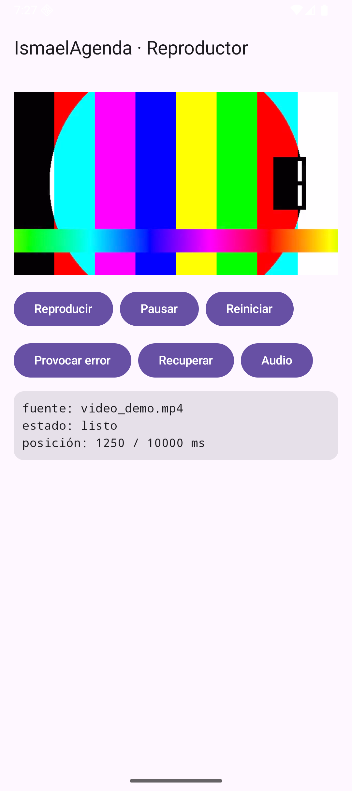
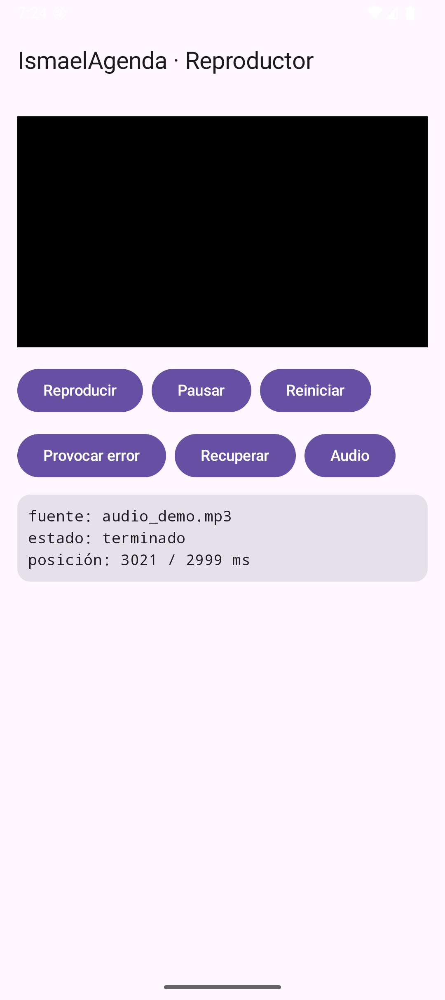
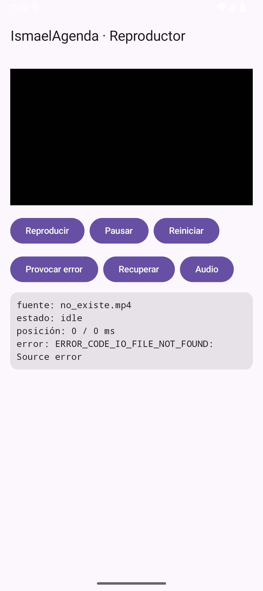

# Tema 5.3 - Reproducción de audio y vídeo

La escena 9 de `IsmaelAgenda` reproduce un vídeo, reproduce un MP3 sin imagen y provoca un error a propósito para ver cómo se comporta el reproductor. Todo lo que sigue está sacado de esa app corriendo en el emulador.

<div style="background-color:#a5d6a7; border-radius:8px; padding:10px 14px; margin:14px 0;">
<strong>🟢 Leyenda de repaso obligatorio:</strong> los textos con <span style="background-color:#a5d6a7;padding:0 3px;border-radius:3px;">este fondo verde</span> son imprescindibles y entran en todas las evaluaciones del módulo.</div>

## 1. Media3: el reproductor recomendado

`Media3` es la librería actual de Google para multimedia. Su reproductor se llama **ExoPlayer**.

| | `MediaPlayer` (antiguo) | `ExoPlayer` (Media3) |
|---|---|---|
| Formatos | los del sistema | muchos más, extensible |
| Estados | muchos y rígidos (idle, initialized, prepared, started, paused, stopped, completed, error, end): llamar a un método en el estado equivocado da error | solo cuatro: `idle`, `buffering`, `ready`, `ended` |
| Errores | un `what/extra` numérico | `PlaybackException` con código y mensaje |
| Listas de reproducción | no | sí |
| Uso hoy | legacy | **recomendado** |

Versiones reales usadas: `media3-exoplayer` **1.11.1** y `media3-ui` **1.11.1** (de Google Maven).

<span style="background-color:#a5d6a7;padding:0 3px;border-radius:3px;">El reproductor actual de Android es ExoPlayer, dentro de la librería Media3. `MediaPlayer` se estudia por herencia, no se elige para proyectos nuevos.</span>

## 2. Los estados del reproductor

| Estado | Significado | Cuándo aparece |
|---|---|---|
| `STATE_IDLE` | sin fuente preparada | al crear o tras un error |
| `STATE_BUFFERING` | llenando el búfer | al preparar o tras un salto |
| `STATE_READY` | listo para sonar | preparado y con datos |
| `STATE_ENDED` | llegó al final | al terminar |

```kotlin
p.addListener(object : Player.Listener {
    override fun onPlaybackStateChanged(nuevo: Int) {
        estado = when (nuevo) {                            // número -> texto legible
            Player.STATE_IDLE -> "idle"
            Player.STATE_BUFFERING -> "cargando"
            Player.STATE_READY -> "listo"
            Player.STATE_ENDED -> "terminado"
            else -> "desconocido"
        }
    }
})
```

<span style="background-color:#a5d6a7;padding:0 3px;border-radius:3px;">El reproductor no se consulta: avisa. Se escucha con `Player.Listener` y se traduce el número de estado a texto para la pantalla.</span>

## 3. Ciclo de vida: crear y liberar

```kotlin
var reproductor by remember { mutableStateOf<ExoPlayer?>(null) }  // lo usan los botones

DisposableEffect(Unit) {
    val p = ExoPlayer.Builder(contexto).build()                 // se crea
    p.setMediaItem(MediaItem.fromUri("asset:///video_demo.mp4")) // fuente dentro de assets
    p.prepare()                                                 // empieza a preparar
    reproductor = p                                             // ya lo pueden usar los botones
    onDispose {
        p.release()                                             // se libera al salir
        reproductor = null
    }
}
```

<span style="background-color:#a5d6a7;padding:0 3px;border-radius:3px;">`release()` es obligatorio: si no se llama, el decodificador y el audio se quedan cogidos y la app va perdiendo recursos. `DisposableEffect` lo hace al salir de la pantalla.</span>

<span style="background-color:#a5d6a7;padding:0 3px;border-radius:3px;">El esquema `asset:///nombre` sirve para ficheros metidos en `assets/`. Para un fichero de `res/raw` se usa `android.resource://paquete/raw/nombre`.</span>

## 4. Reproducir, pausar y volver al principio

```kotlin
Button(onClick = { reproductor?.play() }) { Text("Reproducir") }
Button(onClick = { reproductor?.pause() }) { Text("Pausar") }
Button(onClick = {
    reproductor?.seekTo(0)                                      // al milisegundo 0
    reproductor?.play()
}) { Text("Reiniciar") }
```

`seekTo(0)` no recarga el fichero: mueve el cursor. Es instantáneo comparado con volver a preparar.

<span style="background-color:#a5d6a7;padding:0 3px;border-radius:3px;">`play()` y `pause()` cambian la marcha; `seekTo(ms)` mueve el cursor sin volver a cargar el fichero.</span>

## 5. Posición y duración

```kotlin
LaunchedEffect(reproductor) {
    while (true) {                                             // mientras la pantalla viva
        reproductor?.let {
            posicion = it.currentPosition                       // milisegundo actual
            duracion = if (it.duration > 0) it.duration else 0L
        }
        delay(500)                                              // dos veces por segundo
    }
}
```

| Dato | De dónde sale | Ejemplo medido |
|---|---|---|
| posición | `currentPosition` | `1250 ms` |
| duración | `duration` | `10000 ms` |

<span style="background-color:#a5d6a7;padding:0 3px;border-radius:3px;">`duration` devuelve 0 o negativo mientras el fichero no está preparado. Hay que comprobarlo antes de dividir o pintar una barra de progreso.</span>

## 6. Errores de reproducción (CE e)

```kotlin
override fun onPlayerError(e: PlaybackException) {
    error = "${e.errorCodeName}: ${e.message}"              // código y mensaje
    estado = "error"
}
```

| Código | Qué significa |
|---|---|
| `ERROR_CODE_IO_FILE_NOT_FOUND` | el fichero no existe o no se puede abrir |
| `ERROR_CODE_IO_NETWORK_CONNECTION_FAILED` | no hay red para la URL |
| `ERROR_CODE_DECODING_FAILED` | el códec no puede decodificar el contenido |
| `ERROR_CODE_PARSING_CONTAINER_MALFORMED` | el contenedor está corrupto |

Error real provocado en clase pidiendo `asset:///no_existe.mp4`:

```text
fuente: no_existe.mp4
estado: idle
posición: 0 / 0 ms
error: ERROR_CODE_IO_FILE_NOT_FOUND: Source error
```

<span style="background-color:#a5d6a7;padding:0 3px;border-radius:3px;">Un error de reproducción deja el reproductor en `idle` y con duración 0. Hay que enseñar el código, no tragárselo: `errorCodeName` ya lo da en texto.</span>

<span style="background-color:#a5d6a7;padding:0 3px;border-radius:3px;">Provocar errores a propósito es parte del trabajo: se prueba el camino malo antes de que lo pruebe el usuario.</span>

## 7. Audio sin vídeo

El mismo reproductor sirve para un MP3. No hace falta `PlayerView`: basta con crear el `ExoPlayer` y llamar a `play()`.

```kotlin
fuente = "audio_demo.mp3"
reproductor?.setMediaItem(MediaItem.fromUri("asset:///audio_demo.mp3"))
reproductor?.prepare()
reproductor?.play()
```

| Fichero | Duración real | Estado al capturar |
|---|---|---|
| `video_demo.mp4` | 10.000 ms | `listo` en `1250 ms` |
| `audio_demo.mp3` | 2.999 ms | `listo` en `1890 ms` |

<span style="background-color:#a5d6a7;padding:0 3px;border-radius:3px;">Para audio solo no se necesita vista: `PlayerView` se queda negro porque no hay imagen, pero el sonido se reproduce igual.</span>

## 8. Así se ve funcionando

**Vídeo reproduciéndose** (posición 1250 de 10000 ms):



**Solo audio** (`audio_demo.mp3`, 1890 de 2999 ms):



**Error provocado a propósito** (fichero inexistente):



## 9. Lo que tienes que llevarte de este apartado

- <span style="background-color:#a5d6a7;padding:0 3px;border-radius:3px;">El reproductor actual es ExoPlayer (Media3), no `MediaPlayer`.</span>
- <span style="background-color:#a5d6a7;padding:0 3px;border-radius:3px;">Cuatro estados: `idle`, `buffering`, `ready`, `ended`, y se escuchan con `Player.Listener`.</span>
- <span style="background-color:#a5d6a7;padding:0 3px;border-radius:3px;">`release()` en `onDispose` o el decodificador se queda ocupado.</span>
- <span style="background-color:#a5d6a7;padding:0 3px;border-radius:3px;">`play()`, `pause()` y `seekTo(ms)` son los tres controles básicos.</span>
- <span style="background-color:#a5d6a7;padding:0 3px;border-radius:3px;">La posición se lee de `currentPosition` y la duración de `duration` (0 si aún no está listo).</span>
- <span style="background-color:#a5d6a7;padding:0 3px;border-radius:3px;">Los errores llegan por `onPlayerError` con `errorCodeName`.</span>
- <span style="background-color:#a5d6a7;padding:0 3px;border-radius:3px;">Medido: vídeo 10.000 ms, audio 2.999 ms, error con duración 0.</span>

## Bibliografía y documentación oficial

- Android — Media3: [developer.android.com/media/media3](https://developer.android.com/media/media3).
- Android — guía de ExoPlayer: [developer.android.com/media/media3/exoplayer](https://developer.android.com/media/media3/exoplayer).
- Android — `Player.Listener` y estados: [developer.android.com/reference/androidx/media3/common/Player](https://developer.android.com/reference/androidx/media3/common/Player).
- Android — `PlaybackException` y códigos de error: [developer.android.com/reference/androidx/media3/common/PlaybackException](https://developer.android.com/reference/androidx/media3/common/PlaybackException).
- Android — `MediaItem` y URIs: [developer.android.com/reference/androidx/media3/common/MediaItem](https://developer.android.com/reference/androidx/media3/common/MediaItem).
- Módulo 0489 — Real Decreto 405/2023 (BOE): [BOE-A-2023-13221](https://www.boe.es/buscar/act.php?id=BOE-A-2023-13221).

## Presentación

- [PM-U5 - Contenidos multimedia](https://revilofe.github.io/slides/section1-pmdm/PM-U5.-ContenidosMultimedia.html)
