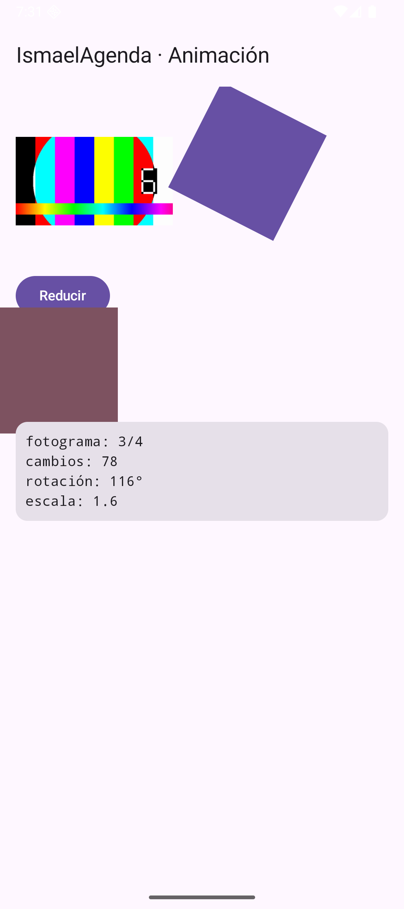
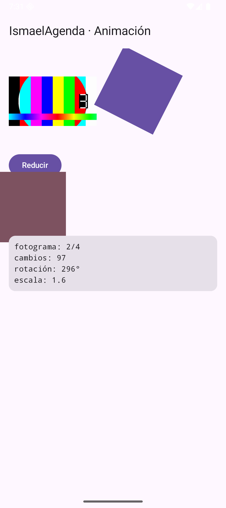

# Tema 5.4 - Animaciones

Animar es **cambiar algo con el tiempo**. En Android hay dos formas de hacerlo y la escena 10 de `IsmaelAgenda` usa las dos a la vez: una secuencia de fotogramas y un cuadrado que gira y escala.

<div style="background-color:#a5d6a7; border-radius:8px; padding:10px 14px; margin:14px 0;">
<strong>🟢 Leyenda de repaso obligatorio:</strong> los textos con <span style="background-color:#a5d6a7;padding:0 3px;border-radius:3px;">este fondo verde</span> son imprescindibles y entran en todas las evaluaciones del módulo.</div>

## 1. Las dos familias

| | Por fotogramas | Por propiedades |
|---|---|---|
| Qué se anima | una **secuencia de imágenes** | un **valor** (giro, escala, color) |
| Quién dibuja | tú, imagen a imagen | el sistema, interpolando |
| Coste | crece con el número de imágenes | constante |
| Ejemplo del taller | 4 PNG extraídos del vídeo | rotación y escala de un cuadrado |

<span style="background-color:#a5d6a7;padding:0 3px;border-radius:3px;">Animar por fotogramas es cambiar de imagen; animar por propiedades es cambiar un número y dejar que el sistema interpole.</span>

## 2. Animación por fotogramas

Los cuatro dibujos salen del vídeo de la unidad, extraídos con `ffmpeg`:

```bash
ffmpeg -ss 0.5 -i video10.mp4 -frames:v 1 -vf scale=320:180 fotograma_05.png
ffmpeg -ss 3   -i video10.mp4 -frames:v 1 -vf scale=320:180 fotograma_3.png
ffmpeg -ss 6   -i video10.mp4 -frames:v 1 -vf scale=320:180 fotograma_6.png
ffmpeg -ss 9   -i video10.mp4 -frames:v 1 -vf scale=320:180 fotograma_9.png
```

Se copian a `res/drawable/` y se recorren con un bucle:

```kotlin
val fotogramas = listOf(
    R.drawable.fotograma_05,                                // los 4 dibujos
    R.drawable.fotograma_3,
    R.drawable.fotograma_6,
    R.drawable.fotograma_9
)
var indice by remember { mutableStateOf(0) }

LaunchedEffect(Unit) {
    while (true) {
        delay(250)                                          // 4 fotogramas por segundo
        indice = (indice + 1) % fotogramas.size              // siguiente, y vuelve al primero
    }
}

Image(painter = painterResource(fotogramas[indice]), contentDescription = "fotograma")
```

| Dato | Valor en el taller |
|---|---|
| fotogramas | 4 |
| espera entre fotogramas | 250 ms |
| velocidad resultante | 4 fps |

<span style="background-color:#a5d6a7;padding:0 3px;border-radius:3px;">El operador `%` (módulo) hace que la animación vuelva al primer fotograma sola: `(indice + 1) % 4` pasa de 3 a 0.</span>

<span style="background-color:#a5d6a7;padding:0 3px;border-radius:3px;">En `res/drawable` los nombres solo admiten minúsculas, números y guion bajo, y la extensión debe ser `.png`, `.jpg` o `.webp`.</span>

<span style="background-color:#a5d6a7;padding:0 3px;border-radius:3px;">Con `delay(250)` se consiguen 4 fps. Para 60 fps no se usa `delay`: se usa `withFrameNanos` o las animaciones por propiedades.</span>

## 3. Animación por propiedades

### Disparada por un estado: `animateFloatAsState`

```kotlin
var grande by remember { mutableStateOf(false) }            // estado normal
val escala by animateFloatAsState(                          // valor animado
    targetValue = if (grande) 1.6f else 1f,                 // a dónde va
    label = "escala"
)

Box(
    Modifier
        .size(80.dp)
        .graphicsLayer { scaleX = escala; scaleY = escala } // escala sin recolocar
)
```

### Continua: `rememberInfiniteTransition`

```kotlin
val transicion = rememberInfiniteTransition(label = "giro")
val giro by transicion.animateFloat(
    initialValue = 0f,
    targetValue = 360f,                                     // una vuelta completa
    animationSpec = infiniteRepeatable(tween(2000, easing = LinearEasing)),
    label = "angulo"
)
```

<span style="background-color:#a5d6a7;padding:0 3px;border-radius:3px;">`animateFloatAsState` anima hacia un valor cuando cambia el estado; `rememberInfiniteTransition` anima sin parar, sin que nadie cambie nada.</span>

<span style="background-color:#a5d6a7;padding:0 3px;border-radius:3px;">`graphicsLayer` rota y escala en la fase de dibujo: no vuelve a medir ni a colocar la vista, así que es barato.</span>

## 4. Las dos animaciones a la vez

La escena 10 mide lo que ocurre y lo enseña en pantalla:

| Medida | Antes de pulsar | Después de pulsar «Ampliar» |
|---|---|---|
| fotograma | 1 de 4 | 4 de 4 |
| cambios de fotograma | 40 | 71 |
| rotación | 134° | 122° |
| escala | 1.0 | **1.6** |

La rotación no para nunca (transición infinita) y por eso baja de 134° a 122°: ha dado la vuelta. La escala solo cambia cuando se pulsa el botón.

<span style="background-color:#a5d6a7;padding:0 3px;border-radius:3px;">Una animación infinita no se detiene al cambiar otro estado: sigue girando mientras la pantalla exista. Por eso los grados suben y bajan.</span>

## 5. Así se ve funcionando

**Con el cuadrado ampliado** (escala 1.6) y un fotograma de la secuencia:



**Un instante después**: otro fotograma y otra rotación, con la misma escala.



Comparando las dos capturas se ve lo importante: **el fotograma cambia solo** (animación por fotogramas) y **la rotación también**, mientras la escala se queda donde la dejó el botón.

## 6. Alternativa: animaciones ya hechas (Lottie)

| Ventaja | Inconveniente |
|---|---|
| las diseña un diseñador en After Effects | hay que añadir una dependencia |
| ficheros JSON pequeños | no se controla el detalle fino |
| misma animación en Android, iOS y web | pesa si el JSON es grande |

<span style="background-color:#a5d6a7;padding:0 3px;border-radius:3px;">Lottie sirve para animaciones complejas ya diseñadas; para un giro o una escala, las animaciones de Compose son más simples y no añaden dependencias.</span>

## 7. Lo que tienes que llevarte de este apartado

- <span style="background-color:#a5d6a7;padding:0 3px;border-radius:3px;">Dos familias: por fotogramas (cambiar imágenes) y por propiedades (interpolar valores).</span>
- <span style="background-color:#a5d6a7;padding:0 3px;border-radius:3px;">`(indice + 1) % tamaño` hace el bucle de fotogramas.</span>
- <span style="background-color:#a5d6a7;padding:0 3px;border-radius:3px;">`delay(250)` = 4 fps; para 60 fps no se usa `delay`.</span>
- <span style="background-color:#a5d6a7;padding:0 3px;border-radius:3px;">`animateFloatAsState` responde a un estado; `rememberInfiniteTransition` no para nunca.</span>
- <span style="background-color:#a5d6a7;padding:0 3px;border-radius:3px;">`graphicsLayer` rota y escala sin volver a medir la vista.</span>
- <span style="background-color:#a5d6a7;padding:0 3px;border-radius:3px;">Medido: escala 1.0 → 1.6 y rotación que sigue girando entre capturas.</span>

## Bibliografía y documentación oficial

- Android — animaciones en Compose: [developer.android.com/develop/ui/compose/animation](https://developer.android.com/develop/ui/compose/animation).
- Android — `animateFloatAsState`: [developer.android.com/develop/ui/compose/animation/value-based](https://developer.android.com/develop/ui/compose/animation/value-based).
- Android — animaciones infinitas: [developer.android.com/develop/ui/compose/animation/value-based#rememberinfinitetransition](https://developer.android.com/develop/ui/compose/animation/value-based).
- Android — `graphicsLayer`: [developer.android.com/reference/kotlin/androidx/compose/ui/graphics/GraphicsLayerScope](https://developer.android.com/reference/kotlin/androidx/compose/ui/graphics/GraphicsLayerScope).
- Android — recursos `drawable`: [developer.android.com/guide/topics/resources/drawable-resource](https://developer.android.com/guide/topics/resources/drawable-resource).
- Lottie — documentación oficial: [airbnb.io/lottie](https://airbnb.io/lottie/).
- Módulo 0489 — Real Decreto 405/2023 (BOE): [BOE-A-2023-13221](https://www.boe.es/buscar/act.php?id=BOE-A-2023-13221).
