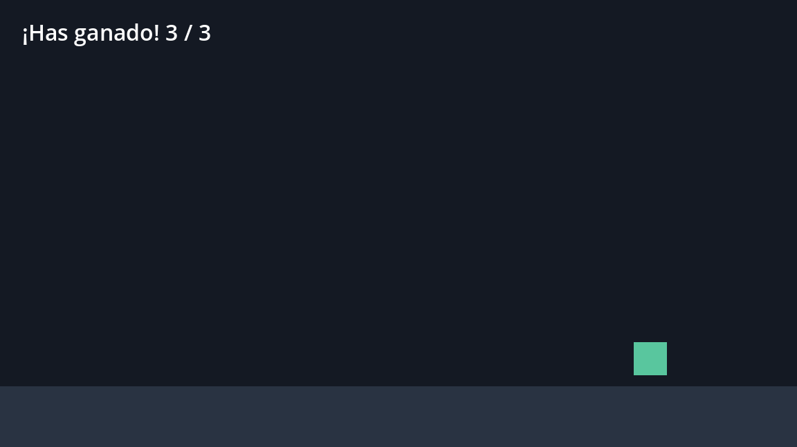

# Tema 6.2 - Juego 2D: movimiento, colisiones y puntuación

Aquí montamos el juego entero: un personaje que se mueve, tres monedas que se recogen, un marcador que cuenta y un sonido que suena. Es el proyecto **IsmaelJuego** ejecutado en Godot 4.7.2.

<div style="background-color:#a5d6a7; border-radius:8px; padding:10px 14px; margin:14px 0;">
<strong>🟢 Leyenda de repaso obligatorio:</strong> los textos con <span style="background-color:#a5d6a7;padding:0 3px;border-radius:3px;">este fondo verde</span> son imprescindibles y entran en todas las evaluaciones del módulo.</div>

## 1. El árbol de la escena

Todo el juego es una sola escena `juego2d.tscn` con este árbol:

```text
Juego2D (Node2D)                  ← script juego2d.gd: la lógica
├── Fondo (ColorRect)             ← fondo azul oscuro 1152×648
├── Suelo (ColorRect)             ← franja gris de 88 px de alto
├── Jugador (CharacterBody2D)     ← el personaje que controla el usuario
│   ├── Cuerpo (Polygon2D)        ← cuadrado verde de 48×48 (lo que se ve)
│   └── Colision (CollisionShape2D) ← rectángulo de 48×48 (lo que choca)
├── Moneda1 (Area2D)  [grupo: monedas]
│   ├── Dibujo (Polygon2D)        ← rombo amarillo de 36×36
│   └── Colision (CollisionShape2D) ← rectángulo de 32×32
├── Moneda2 (Area2D)  [grupo: monedas]
├── Moneda3 (Area2D)  [grupo: monedas]
├── HUD (CanvasLayer)
│   └── Puntos (Label)            ← "monedas: 0 / 3"
└── Sonido (AudioStreamPlayer)    ← sonido.wav
```

<span style="background-color:#a5d6a7;padding:0 3px;border-radius:3px;">En Godot lo que se ve y lo que choca son nodos distintos: `Polygon2D` dibuja y `CollisionShape2D` colisiona. Si cambias el dibujo y no la forma, el choque no coincide con la imagen.</span>

## 2. CharacterBody2D: el cuerpo que controla el jugador

Hay tres familias de cuerpos en Godot 2D y elegir mal es el error más caro:

| Nodo | Quién lo mueve | Para qué se usa |
|---|---|---|
| `CharacterBody2D` | tu código (`velocity` + `move_and_slide`) | jugador, enemigos con IA |
| `RigidBody2D` | la física del motor | cajas que caen, objetos empujables |
| `StaticBody2D` | nadie (no se mueve) | paredes, suelo |

<span style="background-color:#a5d6a7;padding:0 3px;border-radius:3px;">El jugador es `CharacterBody2D` porque lo mueve el usuario, no la gravedad. Un `RigidBody2D` para el jugador da un control resbaladizo y difícil de ajustar.</span>

El movimiento son tres líneas y ninguna más:

```gdscript
func _physics_process(_delta: float) -> void:
	# get_vector devuelve (-1..1) en X e Y según las teclas de las acciones ui_*
	var direccion := Input.get_vector("ui_left", "ui_right", "ui_up", "ui_down")
	jugador.velocity = direccion * 320.0   # velocidad en píxeles por segundo
	jugador.move_and_slide()               # aplica el movimiento y resuelve choques
```

`Input.get_vector` ya normaliza la diagonal: pulsando arriba y derecha a la vez no se va un 41 % más rápido, que es el bug clásico de los primeros juegos.

<span style="background-color:#a5d6a7;padding:0 3px;border-radius:3px;">`Input.get_vector` normaliza la diagonal. Si sumas `Input.is_action_pressed` a mano, la diagonal corre más: hay que normalizar el vector.</span>

## 3. Area2D + señal: detectar que tocan algo

Una moneda no es un cuerpo físico: es un **área**. No frena al jugador, solo avisa cuando algo entra en ella. Ese aviso es una **señal**:

```gdscript
func _ready() -> void:
	# get_nodes_in_group devuelve las tres monedas de la escena
	var monedas := get_tree().get_nodes_in_group("monedas")
	total = monedas.size()
	for moneda in monedas:
		# body_entered se emite cuando un cuerpo entra en el área.
		# bind(moneda) añade la moneda como último argumento de _al_recoger
		moneda.body_entered.connect(_al_recoger.bind(moneda))
	_actualizar_marcador()
```

La función que recibe la señal tiene **un parámetro más** que la señal, porque `bind()` añade la moneda:

```gdscript
func _al_recoger(cuerpo: Node2D, moneda: Area2D) -> void:
	if cuerpo != jugador:
		return                          # entró otra cosa: no cuenta
	puntos += 1
	sonido.play()                       # CE f: sonido en el evento
	moneda.queue_free()                 # la moneda se borra al final del fotograma
	_actualizar_marcador()
```

<span style="background-color:#a5d6a7;padding:0 3px;border-radius:3px;">`body_entered` pasa el cuerpo que entra; `bind(x)` añade `x` detrás. Por eso la función recibe `(cuerpo, moneda)`.</span>

`area_entered` en vez de `body_entered` solo funciona si lo que entra es otra área: para detectar al jugador (`CharacterBody2D`) hace falta `body_entered`.

<span style="background-color:#a5d6a7;padding:0 3px;border-radius:3px;">Jugador `CharacterBody2D` + moneda `Area2D` → se usa `body_entered`. `area_entered` no se dispara nunca en ese caso.</span>

## 4. Marcador y condición de victoria

El marcador es un `Label` dentro de un `CanvasLayer`. El `CanvasLayer` es lo que hace que el texto **no se mueva con la cámara** y quede siempre encima:

```gdscript
func _actualizar_marcador() -> void:
	etiqueta.text = "monedas: %d / %d" % [puntos, total]
	if puntos == total:                 # condición de fin de partida
		etiqueta.text = "¡Has ganado! %d / %d" % [puntos, total]
```

| Elemento | Nodo | Por qué |
|---|---|---|
| Marcador fijo en pantalla | `CanvasLayer` + `Label` | no le afecta la cámara ni el zoom |
| Texto actualizado | `etiqueta.text = ...` | se cambia solo cuando cambia el dato |
| Fin de partida | `if puntos == total` | se comprueba al cambiar el marcador |

<span style="background-color:#a5d6a7;padding:0 3px;border-radius:3px;">El HUD va en un `CanvasLayer`. Un `Label` suelto en el `Node2D` se desplaza con el mundo y acaba fuera de pantalla.</span>

## 5. Sonido en el evento (CE f)

El sonido es un `AudioStreamPlayer` con un `.wav` importado. Se reproduce en el momento exacto del suceso, no en bucle:

```gdscript
sonido.play()      # se llama justo al recoger la moneda
```

| Propiedad | Valor en el juego | Efecto |
|---|---|---|
| `stream` | `sonido.wav` (0,15 s) | el pitido de recoger |
| `volume_db` | 0 | volumen normal |
| `autoplay` | desactivado | suena solo cuando se llama a `play()` |

<span style="background-color:#a5d6a7;padding:0 3px;border-radius:3px;">Un `AudioStreamPlayer` reproduce un sonido puntual; para música de fondo se usa el mismo nodo con `stream` en bucle y `autoplay` activado.</span>

El fichero se generó con `ffmpeg` recortando 0,15 s de un tono de 440 Hz, y Godot lo importa a `.ogg` internamente:

```bash
ffmpeg -i audio.wav -t 0.15 -af volume=6 sonido.wav
```

<span style="background-color:#a5d6a7;padding:0 3px;border-radius:3px;">Godot importa el audio al añadir el fichero al proyecto: hasta que no existe el `.import`, el `AudioStreamPlayer` da error de carga.</span>

## 6. El código completo del juego

```gdscript
extends Node2D
# ============================================================
# UD6 · Juego 2D: movimiento, colisiones, puntuación y sonido
# RA5 · CE a (lógica), b (objetos), c (escenas), e (físicas), f (sonido)
# ============================================================

var puntos: int = 0                                    # monedas recogidas
var total: int = 0                                     # monedas que hay en la escena

@onready var etiqueta: Label = $HUD/Puntos             # texto del marcador
@onready var sonido: AudioStreamPlayer = $Sonido       # efecto al recoger
@onready var jugador: CharacterBody2D = $Jugador       # el personaje


func _ready() -> void:
	# se conecta la señal de cada moneda con la función que suma puntos
	var monedas := get_tree().get_nodes_in_group("monedas")
	total = monedas.size()
	for moneda in monedas:
		moneda.body_entered.connect(_al_recoger.bind(moneda))
	_actualizar_marcador()


func _physics_process(_delta: float) -> void:
	# vector de entrada: flechas o WASD (acciones ui_* que trae Godot)
	var direccion := Input.get_vector("ui_left", "ui_right", "ui_up", "ui_down")
	jugador.velocity = direccion * 320.0               # 320 píxeles por segundo
	jugador.move_and_slide()                           # mueve y resuelve colisiones


func _al_recoger(cuerpo: Node2D, moneda: Area2D) -> void:
	if cuerpo != jugador:
		return                                         # solo cuenta si lo toca el jugador
	puntos += 1
	sonido.play()                                      # CE f: sonido en el evento
	moneda.queue_free()                                # la moneda desaparece
	_actualizar_marcador()


func _actualizar_marcador() -> void:
	etiqueta.text = "monedas: %d / %d" % [puntos, total]
	if puntos == total:                                 # condición de fin de partida
		etiqueta.text = "¡Has ganado! %d / %d" % [puntos, total]
```

*En el fichero real hay además dos funciones de captura (`_capturar_secuencia` y `_guardar`) que solo se usan para generar las imágenes de estos apuntes; no forman parte de la lógica del juego.*



*Partida terminada: las tres monedas han desaparecido y el marcador muestra `¡Has ganado! 3 / 3`. Captura real del mismo proyecto.*


*Partida terminada: las tres monedas han desaparecido y el marcador muestra `¡Has ganado! 3 / 3`. Captura real del mismo proyecto.*

## 7. La escena en texto (`.tscn`)

Godot guarda la escena en un fichero de texto, así que se puede leer y versionar con Git. Este es el trozo del jugador y de la primera moneda:

```text
[sub_resource type="RectangleShape2D" id="RectangleShape2D_jugador"]
size = Vector2(48, 48)

[node name="Jugador" type="CharacterBody2D" parent="."]
position = Vector2(180, 520)

[node name="Cuerpo" type="Polygon2D" parent="Jugador"]
color = Color(0.35, 0.78, 0.62, 1)
polygon = PackedVector2Array(-24, -24, 24, -24, 24, 24, -24, 24)

[node name="Colision" type="CollisionShape2D" parent="Jugador"]
shape = SubResource("RectangleShape2D_jugador")

[node name="Moneda1" type="Area2D" parent="." groups=["monedas"]]
position = Vector2(420, 520)
```

<span style="background-color:#a5d6a7;padding:0 3px;border-radius:3px;">Un `.tscn` es texto plano: se puede revisar en un diff de Git. Eso es lo que permite trabajar el módulo con control de versiones.</span>

## 8. Pruebas de funcionamiento (CE i)

| Prueba | Cómo se hace | Resultado esperado |
|---|---|---|
| Movimiento | pulsar cada flecha | el cuadrado se mueve en las 4 direcciones |
| Diagonal | pulsar arriba + derecha | velocidad igual que en recto |
| Colisión | pasar por encima de una moneda | desaparece y suma 1 |
| Marcador | recoger las tres | muestra `3 / 3` y el mensaje de victoria |
| Sonido | recoger una moneda | pitido corto, sin solaparse raro |
| Límites | salir de la pantalla | el jugador se sale (mejora pendiente) |

<span style="background-color:#a5d6a7;padding:0 3px;border-radius:3px;">Una prueba sin resultado esperado no es una prueba: es una acción. Se escribe siempre qué debería pasar.</span>

## 9. Errores típicos

| Error | Síntoma | Solución |
|---|---|---|
| Falta `CollisionShape2D` | la moneda no se recoge nunca | añadir la forma al `Area2D` |
| Moneda sin grupo | el marcador dice `0 / 0` | añadir el grupo `monedas` |
| `queue_free()` y seguir usando la moneda | «previously freed instance» | no volver a tocarla |
| Mover en `_process` | atraviesa monedas a saltos | mover en `_physics_process` |
| HUD en el `Node2D` | el marcador se va de la pantalla | meterlo en un `CanvasLayer` |

<span style="background-color:#a5d6a7;padding:0 3px;border-radius:3px;">Si el marcador dice `0 / 0`, el grupo está mal escrito. Es el fallo número uno de esta práctica.</span>

## Bibliografía oficial

- Godot Engine — *Using CharacterBody2D*: <https://docs.godotengine.org/en/stable/tutorials/physics/using_character_body_2d.html>
- Godot Engine — *Area2D*: <https://docs.godotengine.org/en/stable/classes/class_area2d.html>
- Godot Engine — *Signals*: <https://docs.godotengine.org/en/stable/getting_started/step_by_step/signals.html>
- Godot Engine — *AudioStreamPlayer*: <https://docs.godotengine.org/en/stable/classes/class_audiostreamplayer.html>
- Godot Engine — *CanvasLayer*: <https://docs.godotengine.org/en/stable/classes/class_canvaslayer.html>

## Presentación

- [PM-U6 - Juegos 2D y 3D](https://revilofe.github.io/slides/section5-pmdm/PM-U6.-Juegos2DY3D.html)
