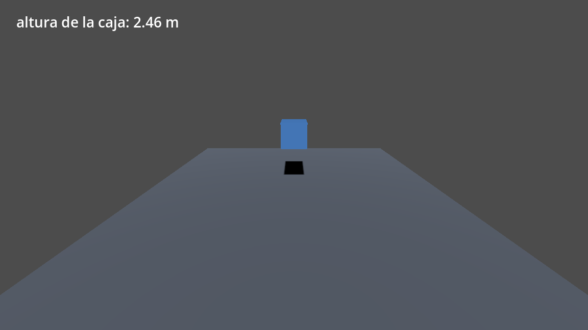
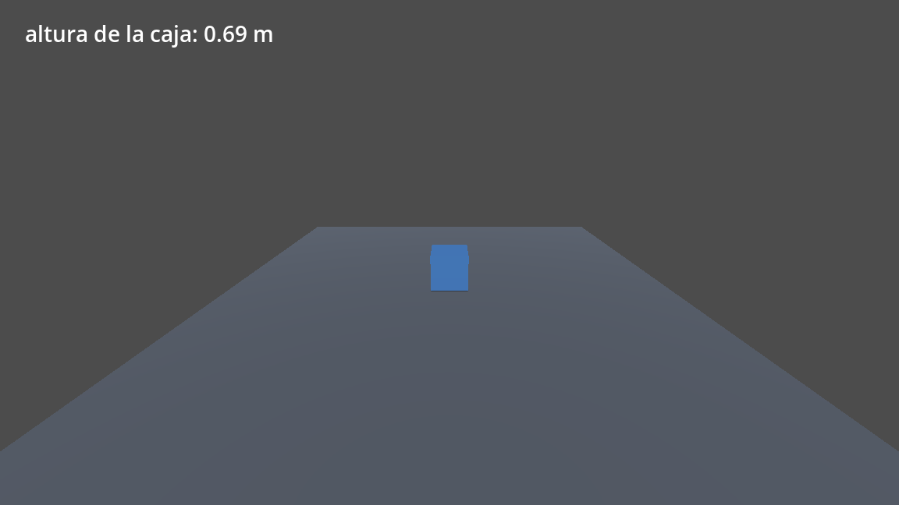

# Tema 6.3 - Juego 3D: materiales, físicas, cámara e iluminación

Un juego 3D es lo mismo que el 2D con una dimensión más: objetos, física y una cámara que mira. Lo que cambia es que ahora la **luz** y los **materiales** deciden si el objeto se ve o se ve como un pegote.

<div style="background-color:#a5d6a7; border-radius:8px; padding:10px 14px; margin:14px 0;">
<strong>🟢 Leyenda de repaso obligatorio:</strong> los textos con <span style="background-color:#a5d6a7;padding:0 3px;border-radius:3px;">este fondo verde</span> son imprescindibles y entran en todas las evaluaciones del módulo.</div>

## 1. El árbol de la escena 3D

```text
Fisica3D (Node3D)                ← script fisica3d.gd
├── Camara (Camera3D)            ← mira la escena desde (0, 4.2, 8.5)
├── Luz (DirectionalLight3D)     ← luz del sol, con sombras
├── Suelo (StaticBody3D)         ← no se mueve: el suelo
│   ├── Malla (MeshInstance3D)
│   └── Forma (CollisionShape3D) ← caja de 12 × 0,4 × 12
├── Caja (RigidBody3D)           ← cae por la gravedad
│   ├── Malla (MeshInstance3D)
│   └── Forma (CollisionShape3D) ← caja de 1 × 1 × 1
└── HUD (CanvasLayer)
    └── Altura (Label)           ← "altura de la caja: 3.20 m"
```

<span style="background-color:#a5d6a7;padding:0 3px;border-radius:3px;">En 3D cada objeto necesita tres nodos: `MeshInstance3D` (lo que se ve), `CollisionShape3D` (lo que choca) y el cuerpo que lo agrupa.</span>

## 2. Las tres familias de cuerpos en 3D

| Nodo | Quién lo mueve | Uso |
|---|---|---|
| `RigidBody3D` | la física (gravedad, impulsos) | cajas, pelotas, escombros |
| `CharacterBody3D` | tu código | jugador en primera/tercera persona |
| `StaticBody3D` | nadie | suelo, paredes, rampas |

<span style="background-color:#a5d6a7;padding:0 3px;border-radius:3px;">`RigidBody3D` no se mueve con `position`: se mueve con `apply_impulse()` o dejándolo caer. Cambiarle la posición a mano rompe la simulación.</span>

## 3. Propiedades físicas (CE e)

Un `RigidBody3D` se comporta según cuatro propiedades:

| Propiedad | Valor por defecto | Qué controla |
|---|---|---|
| `mass` | 1.0 kg | cómo responde a los impulsos y a otras masas |
| `gravity_scale` | 1.0 | multiplicador de la gravedad (2.0 = cae el doble de rápido) |
| `physics_material_override` | ninguno | rebote (`bounce`) y rozamiento (`friction`) |
| `linear_damp` | 0.0 | frenado en el aire |

<span style="background-color:#a5d6a7;padding:0 3px;border-radius:3px;">La gravedad del proyecto es 9,8 m/s² en Y negativa. `gravity_scale = 2` la duplica sin tocar la configuración del proyecto.</span>

Para que la caja rebote hay que darle un **material físico**, no un material visual:

```gdscript
# Se crea un material físico y se le pone rebote 0,6 y rozamiento 0,3
var fisico := PhysicsMaterial.new()
fisico.bounce = 0.6          # 0 = no rebota, 1 = rebote perfecto
fisico.friction = 0.3        # 0 = patina como hielo
caja.physics_material_override = fisico
```

<span style="background-color:#a5d6a7;padding:0 3px;border-radius:3px;">`bounce` y `friction` van en un `PhysicsMaterial`, no en el `StandardMaterial3D`. Confundirlos es el error clásico: el objeto se ve bien pero no rebota.</span>

## 4. Materiales (CE d)

El aspecto final de la superficie lo decide el `StandardMaterial3D`:

| Propiedad | Qué hace | Valor en nuestra caja |
|---|---|---|
| `albedo_color` | color base | azul `(0.36, 0.62, 0.95)` |
| `metallic` | 0 = plástico, 1 = metal | 0,4 |
| `roughness` | 0 = espejo, 1 = mate | 0,25 (brillo suave) |
| `emission_enabled` | convierte el objeto en fuente de luz | desactivado |

```text
[sub_resource type="StandardMaterial3D" id="Material_caja"]
albedo_color = Color(0.36, 0.62, 0.95, 1)
metallic = 0.4
roughness = 0.25

[sub_resource type="BoxMesh" id="BoxMesh_caja"]
size = Vector3(1, 1, 1)
```

El material **no basta**: hace falta una malla (`BoxMesh`) que le dé forma y una forma de colisión (`BoxShape3D`) que le dé cuerpo. Un `MeshInstance3D` sin `mesh` no dibuja nada, aunque tenga material.

{ V('Un `MeshInstance3D` sin `mesh` no se ve: el material solo se aplica a una superficie, y sin malla no hay superficie.') }

<span style="background-color:#a5d6a7;padding:0 3px;border-radius:3px;">`metallic` y `roughness` solo se notan si hay luz y entorno. Un objeto metálico sin luz alrededor se ve negro: el material no crea la luz.</span>

## 5. Cámara (CE g)

La cámara es el ojo del jugador. Su `transform` guarda posición y rotación juntas, así que se lee mal a simple vista. Lo importante:

| Propiedad | Valor | Efecto |
|---|---|---|
| `fov` | 75° | campo de visión (más grados = más angular) |
| `near` | 0,05 m | lo más cerca que se ve |
| `far` | 4000 m | lo más lejos que se ve |
| `current` | activada | es la cámara que se usa |

```text
[node name="Camara" type="Camera3D" parent="."]
transform = Transform3D(1, 0, 0, 0, 0.94, 0.34, 0, -0.34, 0.94, 0, 4.2, 8.5)
```

Los tres primeros números son el eje X, los tres siguientes el eje Y, luego el Z, y los **tres últimos son la posición** `(0, 4.2, 8.5)`: 4,2 m de alto y 8,5 m atrás, mirando en diagonal hacia abajo.

<span style="background-color:#a5d6a7;padding:0 3px;border-radius:3px;">En un `Transform3D` los tres últimos números son la posición. Los nueve primeros son los ejes de rotación: es una matriz de 3×3 más un vector.</span>

## 6. Iluminación (CE g)

Sin luz, un `MeshInstance3D` se ve negro. La `DirectionalLight3D` simula el sol: ilumina **todo** el escenario en una dirección, sin importar dónde esté colocada.

| Propiedad | Valor | Efecto |
|---|---|---|
| `light_energy` | 1,2 | intensidad (1 = normal) |
| `shadow_enabled` | activado | proyecta sombras |
| `directional_shadow_max_distance` | 100 m | hasta dónde se calculan sombras |

<span style="background-color:#a5d6a7;padding:0 3px;border-radius:3px;">La `DirectionalLight3D` solo cuenta su **rotación**, no su posición: moverla no cambia la luz, girarla sí.</span>

Y una `OmniLight3D` (bombilla) sí depende de la posición y se atenúa con la distancia: es la que se usa para farolas y antorchas.

<span style="background-color:#a5d6a7;padding:0 3px;border-radius:3px;">Direccional = sol (solo rotación). Omni = bombilla (posición y alcance). Spot = foco (cono con ángulo).</span>



*La caja azul cayendo: 2,46 m de altura, con la sombra proyectada por la `DirectionalLight3D`. Captura real de `fisica3d.tscn`.*

## 7. El código de la escena 3D

```gdscript
extends Node3D
# ============================================================
# UD6 · Escena 3D: físicas, cámara e iluminación
# RA5 · CE e (propiedades físicas), g (cámaras e iluminación)
# ============================================================

@onready var caja: RigidBody3D = $Caja
@onready var etiqueta: Label = $HUD/Altura


func _process(_delta: float) -> void:
	# muestra en pantalla la altura real de la caja cada fotograma
	etiqueta.text = "altura de la caja: %.2f m" % caja.global_position.y
```



*Dos segundos y medio después: la caja ha caído y descansa sobre el suelo. La altura la mide el propio motor (`0.69 m`). Captura real.*

Cuatro líneas de código y una escena: la física la pone el motor. Ese es el sentido de usar un motor de juegos.

<span style="background-color:#a5d6a7;padding:0 3px;border-radius:3px;">La altura se lee de `caja.global_position.y`, la posición real simulada, no de una variable que llevemos a mano.</span>

## 8. Añadir rebote e impulso

Para que la caja no se quede muerta en el suelo:

```gdscript
func _ready() -> void:
	# material físico: rebote del 60 % y rozamiento bajo
	var fisico := PhysicsMaterial.new()
	fisico.bounce = 0.6
	fisico.friction = 0.3
	caja.physics_material_override = fisico
	# impulso inicial hacia arriba: masa 1 kg → 4 m/s hacia arriba
	caja.apply_impulse(Vector3(0, 4, 0))
```

<span style="background-color:#a5d6a7;padding:0 3px;border-radius:3px;">`apply_impulse` da un empujón instantáneo (newton·segundo); `apply_force` empuja fotograma a fotograma. Para un salto, impulso.</span>

## 9. Pruebas de funcionamiento (CE i)

| Prueba | Cómo | Resultado esperado |
|---|---|---|
| Caída | arrancar la escena | la caja baja de 3,2 m a ~0,5 m |
| Reposo | esperar 2 s | la caja queda quieta sobre el suelo |
| Cámara | mirar la escena | se ve la caja y el suelo, sin atravesarlos |
| Luz | desactivar la luz | todo negro (confirma que la luz ilumina) |
| Sombras | mirar bajo la caja | sombra proyectada en el suelo |

<span style="background-color:#a5d6a7;padding:0 3px;border-radius:3px;">Si al desactivar la luz no se ve negro, hay luz de entorno (`Environment`) y el `DirectionalLight3D` no está haciendo el trabajo.</span>

## 10. Errores típicos

| Error | Síntoma | Solución |
|---|---|---|
| Caja sin `CollisionShape3D` | atraviesa el suelo | añadir la forma |
| Mover un `RigidBody3D` con `position` | la caja tiembla o se teletransporta | usar impulsos |
| `bounce` en el material visual | no rebota | usar `PhysicsMaterial` |
| Cámara sin `current` | se ve negro | marcar la cámara como actual |
| Luz sin sombras | los objetos flotan | activar `shadow_enabled` |

<span style="background-color:#a5d6a7;padding:0 3px;border-radius:3px;">Caja que atraviesa el suelo = falta `CollisionShape3D` en la caja, en el suelo o en los dos.</span>

## Bibliografía oficial

- Godot Engine — *3D physics*: <https://docs.godotengine.org/en/stable/tutorials/physics/physics_introduction.html>
- Godot Engine — *RigidBody3D*: <https://docs.godotengine.org/en/stable/classes/class_rigidbody3d.html>
- Godot Engine — *StandardMaterial3D*: <https://docs.godotengine.org/en/stable/classes/class_standardmaterial3d.html>
- Godot Engine — *Cameras*: <https://docs.godotengine.org/en/stable/tutorials/3d/camera/index.html>
- Godot Engine — *Lights and shadows*: <https://docs.godotengine.org/en/stable/tutorials/3d/lights_and_shadows.html>

## Presentación

- [PM-U6 - Juegos 2D y 3D](https://revilofe.github.io/slides/section1-pmdm/PM-U6.-Juegos2DY3D.html)
