# 3.1 — Generación de interfaces a partir de documentos de descripción

> **Del libro de texto:** tema 3, *Generación de interfaces a partir de documentos XML*.
> Este curso damos el salto a **Jetpack Compose**, así que vamos a hacer dos cosas a la vez: entender el
> XML que describe interfaces (sigue estando en todas partes: webs, feeds, documentos, Android clásico)
> y aprender su equivalente moderno en Compose, donde **la descripción de la interfaz es código Kotlin**.
>
> En esta unidad, **todos los bloques de código son el código exacto que produjo su captura**: lo que
> lees es lo que se ejecutó en el emulador, comentado línea a línea.

## 1. Introducción y contextualización práctica


<div style="background-color:#a5d6a7; border-radius:8px; padding:10px 14px; margin:14px 0;">
<strong>🟢 Leyenda de repaso obligatorio:</strong> los textos con <span style="background-color:#a5d6a7;padding:0 3px;border-radius:3px;">este fondo verde</span> son imprescindibles para programar interfaces: hay que repasarlos <strong>cada semana</strong>, porque entrarán en todas las evaluaciones del módulo.</div>

<span style="background-color:#a5d6a7;padding:0 3px;border-radius:3px;">Hasta hace poco, crear la pantalla de una app Android significaba escribir **dos lenguajes**: XML para</span>
el diseño (los famosos *layouts*) y Java o Kotlin para la lógica. El XML era ese "documento de
descripción" que definía qué botones, textos o campos tenía la pantalla y dónde se colocaban, y unas
herramientas lo **traducían** a código compilado.

Hoy, con Jetpack Compose, esa frontera desaparece: **la interfaz se describe directamente con código
Kotlin declarativo**, sin documento intermedio ni fichero de diseño que traducir. Pero el XML sigue
importando y mucho:

- Es el formato universal de intercambio de datos (feeds RSS, facturas, configuraciones, mapas GML).
- Sigue describiendo la interfaz en otras plataformas: XHTML en webs, SVG en gráficos, XUL en escritorio.
- Es **lengua madre** de los layouts Android que te vas a encontrar en cualquier app heredada y en las
  entrevistas de trabajo.
- Y entender de dónde venimos te hace **razonar mejor tus composables**: un `Column` es un
  `LinearLayout vertical` pensando con otra sintaxis.

<div style="border: 2px solid #7b1fa2; border-radius: 8px; padding: 12px 16px; margin: 16px 0;">
<p style="margin: 0;"><strong>💡 Idea central del tema</strong><br>
Una interfaz se puede <strong>describir</strong> (en un documento) o <strong>programar</strong> (en código).
Android pasó de lo primero a lo segundo con Compose. Las dos vías tienen las mismas piezas:
etiquetas ↔ composables, atributos ↔ parámetros, eventos ↔ lambdas.</p>
</div>

## 2. Lenguajes de descripción de interfaces basados en XML

<span style="background-color:#a5d6a7;padding:0 3px;border-radius:3px;">XML es metalenguaje: no describe nada por sí mismo, pero permite definir lenguajes que sí lo hacen</span>.
El libro los recorre; nosotros los traducimos a cómo se ven desde Compose en 2026. Cada apartado trae
su documento y **su escena real ejecutándose en el emulador**.

<figure markdown>
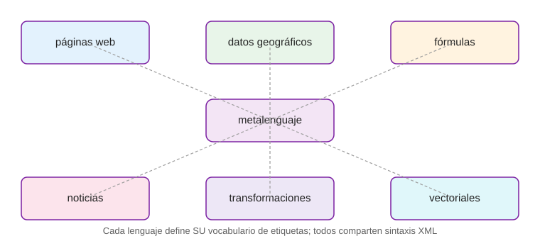
<figcaption>Figura 1. Los seis lenguajes de descripción basados en XML que estudia el tema, hoy en día.</figcaption>
</figure>

### 2.1. XHTML

El lenguaje de marcas de las páginas web. En Android lo tocamos con la mano cuando incrustamos una
página o un aviso legal dentro de una pantalla con `WebView`:

<span style="background-color:#a5d6a7;padding:0 3px;border-radius:3px;">**Código 1.** Un `WebView` incrustado en una pantalla Compose sigue consumiendo XHTML puro: el documento</span>
describe la interfaz web y el navegador la genera.

```kotlin
val aviso = """                                        // Declaramos el documento XHTML como texto Kotlin
<html><body style='font-family:sans-serif'>            //   cuerpo con fuente del sistema
  <h3>Aviso legal</h3>                                 //   título de nivel 3
  <p>Este proyecto usa datos <b>públicos</b> …</p>     //   párrafo con texto en negrita
</body></html>
""".trimIndent()                                       // trimIndent limpia la sangría del literal

WebView(context).apply {                               // Creamos un WebView y lo configuramos en el bloque
    loadData(aviso, "text/html", "utf-8")              //   le pasamos el documento: la interfaz la genera el navegador
}
```

<div style="background:#e1bee7; border-radius:6px; padding:8px 12px; margin:12px 0;">
<strong>⚠️ Importante (del libro)</strong>: XHTML obliga a documentos <em>well-formed</em>: toda etiqueta
cerrada, atributos entrecomillados y un único nodo raíz. Un HTML antiguo podía ser un desastre tolerado;
un XHTML no.
</div>

### 2.2. GML

<abbr title="Geography Markup Language">GML</abbr> describe datos geográficos (puntos, rutas, zonas) como
<span style="background-color:#a5d6a7;padding:0 3px;border-radius:3px;">documentos XML. En una app de turismo de Chipiona, la ficha de un mirador **es** un documento GML</span>:
coordenadas, nombre, descripción. Y la pantalla que lo muestra se genera a partir de él:

**Código 2.** El documento GML de la Figura 3 entra como texto y la interfaz de la tarjeta se construye
a partir de sus datos. Es el mini-caso práctico 2 del libro (XML → interfaz) en miniatura:

```kotlin
@Composable
fun GmlAInterfaz() {                                       // pantalla 'documento → interfaz'
    val gml = """                                          // EL DOCUMENTO: fragmento GML real
<gml:featureMember>                                        //   un miembro del conjunto de datos geográficos
  <mirador>                                                //   nuestra entidad: un mirador
    <title>Mirador del Castillo de Chipiona</title>        //   su nombre
    <coord>36.7447, -6.4427</coord>                        //   sus coordenadas (lat, lon)
  </mirador>
</gml:featureMember>""".trimIndent()                       // como texto Kotlin, listo para parsear
    Column {                                               // contenedor vertical de la pantalla
        Text("Documento GML → interfaz",                   //   título de la escena
             fontWeight = FontWeight.Bold, fontSize = 17.sp)  // en negrita, 17 sp
        Spacer(Modifier.height(8.dp))                      //   separación
        Card {                                             //   PRIMERA tarjeta: el documento tal cual
            Text(
                gml,                                       //     el XML sin tocar
                fontFamily = FontFamily.Monospace,         //     fuente monoespaciada: es código
                fontSize = 11.sp,                          //     pequeño, como un visor de texto
                color = Color(0xFF37474F),                 //     gris pizarra
                modifier = Modifier.padding(10.dp)         //     con aire interior
            )
        }
        Spacer(Modifier.height(10.dp))                     //   separación entre documento y resultado
        Text("↓ generado a partir del documento ↓",        //   pista visual del flujo documento→UI
             fontSize = 11.sp, color = Color.Gray)
        Spacer(Modifier.height(6.dp))                      //   separación
        Card(elevation = CardDefaults.cardElevation(4.dp)) {   // SEGUNDA tarjeta: la interfaz generada
            Column(Modifier.padding(12.dp)) {              //     interior con margen
                Text("Mirador del Castillo de Chipiona",    //     el <title> convertido en titular
                     fontWeight = FontWeight.SemiBold)
                Text("Coordenadas: 36.7447, -6.4427",       //     el <coord> convertido en pie de ficha
                     color = Color.Gray, fontSize = 13.sp)
            }
        }                                                  //     (parsear de verdad = XmlPullParser o kxml,
                                                             //      lo veremos con los adaptadores)
    }
}
```

<figure markdown>
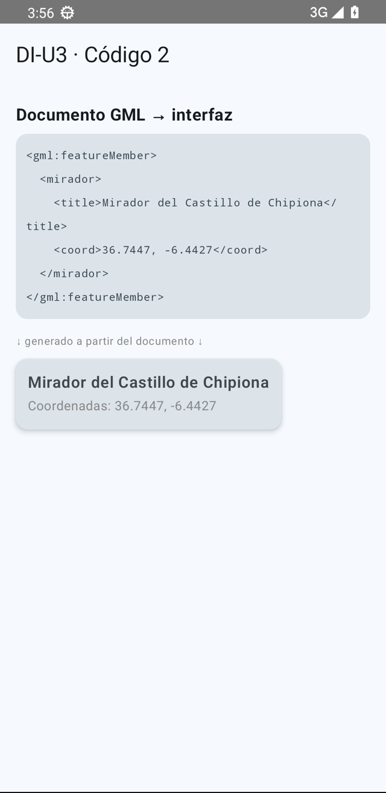
<figcaption>Figura 3. Un documento GML (arriba) y la interfaz que se genera de él (abajo), en el emulador.</figcaption>
</figure>

### 2.3. MathML

<span style="background-color:#a5d6a7;padding:0 3px;border-radius:3px;">MathML describe fórmulas matemáticas con etiquetas (`<mfrac>` es una fracción, `<msup>` un exponente…)</span>
para que un motor de composición las renderice. **Android no entiende MathML de forma nativa**, así que
la vía práctica en una app es meter el MathML dentro de un `WebView` y dejar que el motor de Chrome lo
maquete. Mira la escena completa:

**Código 3.** Derivada en MathML renderizada sobre el emulador (Figura 4):

```kotlin
@Composable
fun MathMlEnWebView() {                                    // pantalla de la fórmula MathML
    val mathml = """                                       // EL DOCUMENTO: XHTML + MathML anidado
<html><body style='font-size:220%;text-align:center'>      <!--   cuerpo grande y centrado -->
<math display='block'>                                     <!--   bloque MathML: así se integra en la página -->
  <mfrac><mi>d</mi><mrow><mi>d</mi><mi>x</mi></mrow></mfrac>   <!--   la fracción d/dx -->
  <mo>(</mo><msup><mi>x</mi><mn>2</mn></msup><mo>+</mo><mn>3</mn><mi>x</mi><mo>)</mo>
  <!--   el paréntesis con x elevada a 2 (msup = superíndice) más 3x -->
  <mo>=</mo><mn>2</mn><mi>x</mi><mo>+</mo><mn>3</mn>        <!--   el resultado de derivar -->
</math></body></html>""".trimIndent()                      // literal Kotlin con el documento completo
    Column {                                               // contenedor vertical
        Text("MathML viaja dentro de un WebView y el motor lo maqueta:",  //   cabecera explicativa
             fontSize = 14.sp)                             //   a 14 sp
        Spacer(Modifier.height(8.dp))                      //   separación
        AndroidView(factory = { ctx ->                     //   PUENTE AndroidView: incrusta una View clásica
            WebView(ctx).apply {                           //     en un composable: aquí el navegador
                setBackgroundColor(0xFFECEFF1.toInt())     //     fondo gris claro para ver el 'papel'
                loadData(mathml, "text/html", "utf-8")     //     cargamos el documento: él pinta la fórmula
            }
        }, modifier = Modifier.fillMaxWidth().height(140.dp))  // a todo el ancho, 140 dp de alto
        Spacer(Modifier.height(8.dp))                      //   separación
        Text("Sin WebView: Android no entiende MathML nativo (apartado 2.3)",  //   la lección del apartado
             fontSize = 11.sp, color = Color.Gray)         //   en gris, como pie
    }
}
```

<figure markdown>
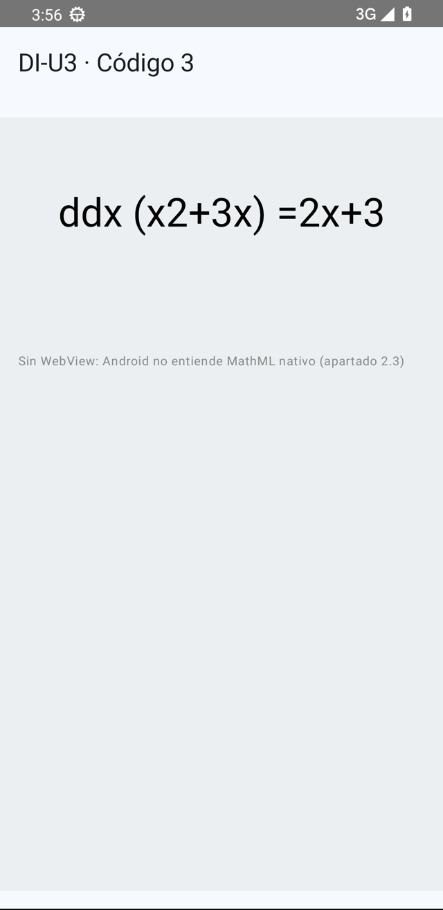
<figcaption>Figura 4. La fórmula MathML, renderizada por el motor de un WebView dentro de Compose.</figcaption>
</figure>

### 2.4. RSS

<span style="background-color:#a5d6a7;padding:0 3px;border-radius:3px;">RSS/Atom es el XML de las noticias: un `<channel>` con `<item>`s que tienen `title`, `link` y</span>
`description`. Un lector de noticias es exactamente un **parser de RSS que compone una interfaz**: en
el Android clásico era un `ListView` con un adaptador alimentado por el feed; en Compose es un bucle
sobre los ítems parseados. La escena lee tres ítems de un canal y los pinta como tarjetas:

**Código 4.** El lector RSS de la Figura 5, tal cual se ejecutó:

```kotlin
data class Noticia(val titulo: String, val fecha: String)  // modelo: los campos del <item> que nos interesan

@Composable
fun LectorRss() {                                          // pantalla del lector
    val items = listOf(                                    // EL CANAL: tres ítems ya parseados del feed
        Noticia("DAM publica el calendario de prácticas", "18 oct"),      //   <item> 1
        Noticia("La JetPack Compose 1.9 trae CanvasModifier", "17 oct"),  //   <item> 2
        Noticia("Taller de SVG vectorial el jueves", "16 oct")            //   <item> 3
    )
    Column {                                               // contenedor vertical = la lista del lector
        Text("DI · RSS Reader",                            //   cabecera de la app
             fontWeight = FontWeight.Bold, fontSize = 17.sp)
        Spacer(Modifier.height(8.dp))                      //   separación
        for ((i, n) in items.withIndex()) {                //   RECORRER el canal = GENERAR la interfaz
            Card(modifier = Modifier.fillMaxWidth().padding(vertical = 4.dp)) {   //   una tarjeta por ítem
                Column(Modifier.padding(10.dp)) {          //       interior con margen
                    Text(n.titulo, fontWeight = FontWeight.Medium)       //       el <title> en negrita media
                    Text("<pubDate>${n.fecha}</pubDate>",                //       y el <pubDate>, en crudo
                         fontFamily = FontFamily.Monospace,              //       en monoespaciada para que
                         fontSize = 10.sp, color = Color.Gray)           //       se vea que VIENE del XML
                }
            }
            if (i < items.lastIndex) { /* separadores implícitos por el margen del card */ }   // sin líneas extra
        }
    }
}
```

<figure markdown>
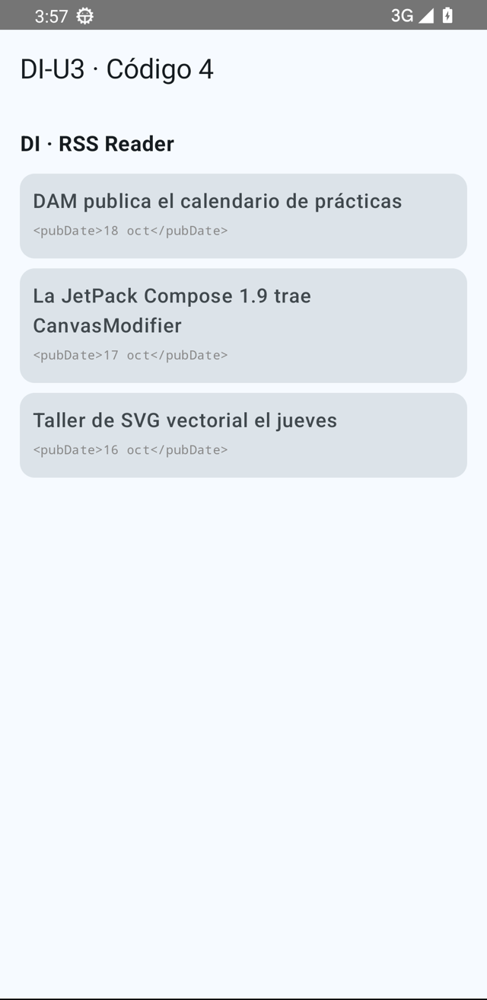
<figcaption>Figura 5. Un canal RSS de tres ítems generado como lista de tarjetas: el feed XML, hecho interfaz.</figcaption>
</figure>

### 2.5. XSLT

<span style="background-color:#a5d6a7;padding:0 3px;border-radius:3px;">XSLT es XML que **transforma** otros XML: una hoja de reglas del tipo "cada vez que veas `<titulo>`,</span>
saca un `<h2>` con su contenido". Es el abuelo conceptual de lo que hace cualquier capa de presentación:
recibe datos, produce representación. La escena muestra el documento de entrada, la salida transformada
y la hoja en medio:

**Código 5.** La transformación documentada de la Figura 6:

```kotlin
@Composable
fun TransformacionXslt() {                                 // pantalla 'documento → hoja → salida'
    val xml = listOf("<libro>", " <titulo>Clean Code</titulo>",   // LA ENTRADA: el documento original,
                     " <pag>464</pag>", "</libro>")                //   línea a línea, como un visor XML
    val html = listOf("<h2>Clean Code</h2>", "<p>464 páginas</p>") // LA SALIDA: cómo queda tras la hoja XSL
    Column {                                               // contenedor vertical
        Text("XSLT: un XML transforma otro XML",            //   título de la escena
             fontWeight = FontWeight.Bold, fontSize = 15.sp)
        Spacer(Modifier.height(8.dp))                      //   separación
        Row(Modifier.fillMaxWidth(),                       //   fila con entrada y salida UNA JUNTO A OTRA
            horizontalArrangement = Arrangement.spacedBy(8.dp)) {
            Card(Modifier.weight(1f)) {                    //     mitad izquierda: el documento de entrada
                Column(Modifier.padding(8.dp)) {           //         con margen interior
                    Text("documento.xml",                  //         nombre del fichero de entrada
                         fontSize = 10.sp, color = Color.Gray)
                    xml.forEach {                          //         imprimimos el XML tal cual
                        Text(it, fontFamily = FontFamily.Monospace,   // monoespaciada = texto crudo
                             fontSize = 10.sp)
                    }
                }
            }
            Column(Modifier.weight(1f)) {                  //     mitad derecha: la transformación
                Text("↓ hoja XSL",                         //         la flecha: la hoja hace el trabajo
                     fontSize = 11.sp, color = Color(0xFF7B1FA2))
                Card(elevation = CardDefaults.cardElevation(4.dp)) {   //  salida: tarjeta elevada
                    Column(Modifier.padding(8.dp)) {       //         interior con margen
                        Text("salida.html",                //         nombre del fichero de salida
                             fontSize = 10.sp, color = Color.Gray)
                        Text("Clean Code",                 //         <titulo> convertido en titular
                             fontWeight = FontWeight.Bold, fontSize = 13.sp)
                        Text("464 páginas",                //         <pag> convertido en texto legible
                             fontSize = 11.sp, color = Color.Gray)
                    }
                }
            }
        }
        Spacer(Modifier.height(8.dp))                      //   separación final
        Text("En Compose esa hoja la escribe un map() de Kotlin",   //   moraleja: la 'hoja' hoy es código
             fontSize = 11.sp, color = Color.Gray)
    }
}
```

<figure markdown>
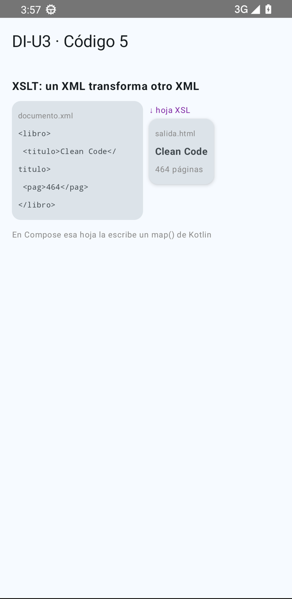
<figcaption>Figura 6. Entrada XML, flecha «hoja XSL», salida transformada: la idea de XSLT hecha pantalla.</figcaption>
</figure>

### 2.6. SVG

<span style="background-color:#a5d6a7;padding:0 3px;border-radius:3px;">SVG es el caso más bonito: **SVG describe gráficos vectoriales en XML** — la estrella de tu logo no es</span>
un mapa de bits, es una lista de trazados. Android los adopta como *Vector Drawable* (¡XML!) y en
Compose los dibujamos directamente con `ImageVector`. Mira cómo el `path` del SVG se convierte en un
componible, línea a línea:

<figure markdown>
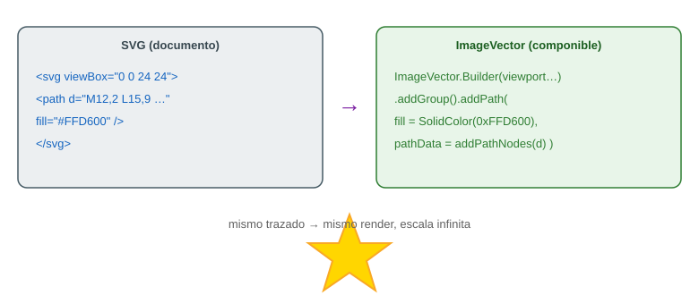
<figcaption>Figura 7. Del <code>&lt;path d="…"&gt;</code> del SVG al ImageVector componible: mismo trazado, dos mundos.</figcaption>
</figure>

**Código 6.** El logo de la unidad, tal cual se ejecutó para la Figura 8:

```kotlin
@Composable
fun LogoVectorial() {                                          // Declaramos un componible: cabecera con el logo
    val pathData = "M12,2 L15,9 L22,9 L16.5,13.5 L18.5,21 L12,16.5 " +  // Copiamos el atributo 'd' del SVG
            "L5.5,21 L7.5,13.5 L2,9 L9,9 Z"
    val nodes = addPathNodes(pathData)                         // Parseamos el texto: lista de nodos de trazado

    val builder = ImageVector.Builder(                         // Construimos el vector 'a mano', como el SVG
        name = "Estrella",                                     //   nombre interno del drawable
        defaultWidth = 24.dp, defaultHeight = 24.dp,           //   tamaño por defecto al pintarse
        viewportWidth = 24f, viewportHeight = 24f              //   el 'viewBox' original del SVG
    )
    builder.addGroup().addPath(                                // Todo vector es grupos con paths: añadimos uno
        name = "estrella",                                     //   el 'id' del trazado en SVG
        fill = SolidColor(Color(0xFFFFD600)),                  //   el fill="#FFD600": relleno amarillo sólido
        pathData = nodes                                       //   los nodos que parseamos del 'd'
    )
    val logo = builder.build()                                 // ImageVector final, listo para pintar

    Column(horizontalAlignment = Alignment.CenterHorizontally) {   // Columna que centra sus hijos
        Box(                                                   // La caja que hace de marco del logo
            modifier = Modifier
                .size(220.dp)                                  //   220×220 dp: el 'frame' del mockup
                .background(                                   //   pintamos el fondo…
                    brush = Brush.verticalGradient(            //     …con degradado vertical
                        listOf(Color(0xFF1A237E), Color(0xFF00ACC1))  //     azul oscuro → cian
                    ),
                    shape = RoundedCornerShape(24.dp)          //     esquinas redondeadas 24 dp
                ),
            contentAlignment = Alignment.Center                //   su contenido, centrado en los dos ejes
        ) {
            Image(                                             // El componible que pinta ImageVectors
                imageVector = logo,                            //   el vector construido arriba
                contentDescription = "Logo estrella SVG",      //   accesibilidad: qué se ve
                modifier = Modifier.size(140.dp)               //   140 dp: vector = escala sin pixeleo
            )
        }
        Spacer(Modifier.height(12.dp))                         // Separación vertical de 12 dp
        Text("Nuestro logo vectorial, del SVG al componible",   // El pie que se ve bajo el logo
             fontSize = 16.sp)                                 //   a 16 sp
    }
}
```

Y así queda, ejecutado en el emulador:

<figure markdown>
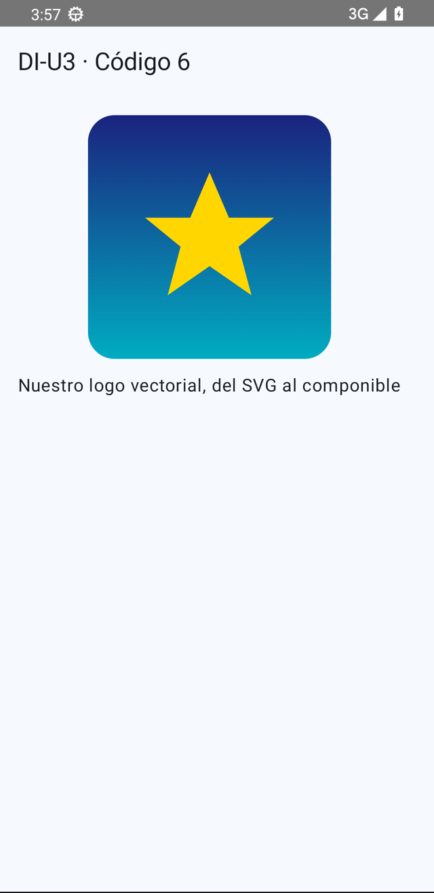
<figcaption>Figura 8. El logo SVG ejecutándose en el emulador (Google Pixel 4, Android 13).</figcaption>
</figure>

## 3. El documento XML: análisis y edición

<span style="background-color:#a5d6a7;padding:0 3px;border-radius:3px;">Un documento XML se lee con tres conceptos. El libro los define para el documento; nosotros los ponemos</span>
en paralelo con Compose porque **un composable es un documento XML convertido en función**:

<figure markdown>
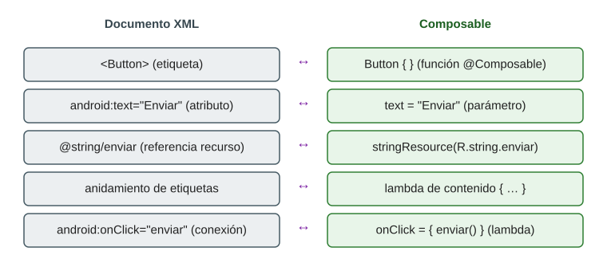
<figcaption>Figura 9. Equivalencia mental: cada concepto del XML tiene su gemelo exacto en Compose.</figcaption>
</figure>

### 3.1. Etiquetas

<span style="background-color:#a5d6a7;padding:0 3px;border-radius:3px;">Una etiqueta abre un elemento y encierra contenido u otros elementos. En un layout Android clásico</span>:

```xml
<!-- Android clásico (2019): la etiqueta define el control -->
<Button android:id="@+id/btnEnviar" android:text="Enviar" />
```

En Compose, **la etiqueta es una función** que se llama a sí misma en el orden en que debe pintarse:

```kotlin
// Compose (2026): el "elemento" es una llamada a @Composable
Button(onClick = { enviar() }) { Text("Enviar") }
```

### 3.2. Atributos

<span style="background-color:#a5d6a7;padding:0 3px;border-radius:3px;">Los atributos son las propiedades del elemento. En XML van entre comillas dentro de la etiqueta; en</span>
Compose son **parámetros con nombre** de la función. `android:textSize="14sp"` se convierte en
`fontSize = 14.sp`, `android:layout_marginTop="8dp"` en `Modifier.padding(top = 8.dp)`. La diferencia
funda: los parámetros Kotlin admiten **expresiones**, no solo literales — un atributo XML no podía
llamar a una función, un parámetro sí.

### 3.3. Valores

Un valor puede ser un literal (`23,5`) o una **referencia a recurso** (`@string/temperatura`). La
regla de oro del libro — "en un proyecto real, nada de valores mágicos en el layout" — sigue viva en
Compose con `stringResource(R.string.…)` y los colores del `MaterialTheme`:

**Código 7.** Literales frente a recursos, la escena completa de la Figura 10:

```kotlin
@Composable
fun ColoresLiteralYRecurso() {                               // Escena comparativa de los dos estilos
    Column {                                                 // Apilamos los elementos en vertical
        Text("Color literal hardcodeado",                     //   etiqueta de la primera muestra
             fontSize = 15.sp)                               //   a 15 sp
        Box(                                                 // Muestra 1: color FIJO en el código
            Modifier
                .fillMaxWidth()                              //   ocupa todo el ancho
                .height(56.dp)                               //   56 dp de alto
                .background(Color(0xFF00695C),               //   fondo: LITERAL verde (valor mágico)
                            RoundedCornerShape(10.dp))       //   con esquinas de 10 dp
                .padding(10.dp)                              //   margen interno para el texto
        ) { Text("background = Color(0xFF00695C)",            //   dentro, el código que lo pinta
                  color = Color.White) }                      //   en blanco sobre verde
        Spacer(Modifier.height(12.dp))                       // Separación entre las dos muestras
        Text("Color del tema (recurso de la app)",            //   etiqueta de la segunda muestra
             fontSize = 15.sp)
        Box(                                                 // Muestra 2: color tomado del TEMA
            Modifier
                .fillMaxWidth()                              //   mismo tamaño que la anterior
                .height(56.dp)
                .background(MaterialTheme.colorScheme.primary,  // fondo: RECURSO del tema (azul)
                            RoundedCornerShape(10.dp))
                .padding(10.dp)
        ) {
            Text("background = MaterialTheme.colorScheme.primary",  // dentro, el código que lo pinta
                 color = MaterialTheme.colorScheme.onPrimary)        // texto legible sobre el color del tema
        }
        Spacer(Modifier.height(12.dp))                       // Separación final
        Text("Cambia el recurso (themes.xml) y TODA la app se recolorea",  // la moraleja
             fontSize = 12.sp, color = Color.Gray)           //   en gris y pequeño, como un pie
    }
}
```

<figure markdown>
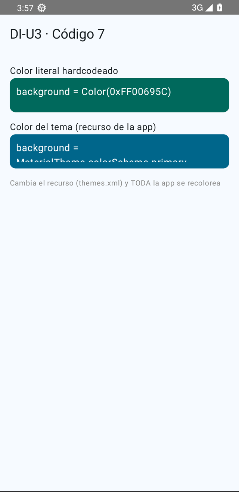
<figcaption>Figura 10. Literales frente a recursos: el recurso centraliza y permite re-tematizar toda la app.</figcaption>
</figure>

## 4. Eventos

<span style="background-color:#a5d6a7;padding:0 3px;border-radius:3px;">En el mundo del documento, los eventos se **conectaban** a código: `android:onClick="enviar"` en el XML</span>
buscaba un método en la actividad; en web, `onclick` y `addEventListener`. El acoplamiento era débil y
el compilador no te salvaba de una errata en el nombre.

En Compose **no hay conexión: hay lambdas**. El evento es un parámetro más de la etiqueta-función, y el
estado que cambia vive junto a él con `remember/mutableStateOf`, que es la versión Compose del viejo
"campo de la actividad":

**Código 8.** El contador de eventos — la escena exacta de la Figura 11, con sus tres botones:

```kotlin
@Composable
fun ContadorDeEventos() {                                    // pantalla del contador
    var pulsaciones by remember { mutableStateOf(0) }        // ESTADO: número de pulsaciones (empieza en 0)

    Column(horizontalAlignment = Alignment.CenterHorizontally) {         // todo, centrado en horizontal
        Text("Pulsaciones: $pulsaciones",                    //   LEEMOS el estado: interpolado en el texto
             fontSize = 26.sp, fontWeight = FontWeight.Bold) //     grande y en negrita
        Spacer(Modifier.height(12.dp))                       //   separación con la fila de botones
        Row(horizontalArrangement = Arrangement.spacedBy(8.dp)) {        //   fila con 8 dp entre botones
            Button(onClick = { pulsaciones++ }) { Text("+1") }           //   ESCRIBE el estado: sube
            Button(onClick = { pulsaciones-- }) { Text("−1") }           //   ESCRIBE el estado: baja
            Button(onClick = { pulsaciones = 0 }) { Text("Reset") }      //   ESCRIBE el estado: a cero
        }
        Spacer(Modifier.height(8.dp))                        //   separación con el mensaje
        Text(                                                //   mensaje CONDICIONAL: se decide al componer
            if (pulsaciones >= 5) "¡Objetivo conseguido!"     //     si llegamos a 5, victoria
            else "Llega a 5 para ganar",                     //     si no, a por ello
            color = if (pulsaciones >= 5) Color(0xFF2E7D32)  //     verde en victoria,
                    else Color.Gray                          //     gris en cualquier otro caso
        )
    }
}                                                            // cada pulsación muta el estado → Compose re-ejecuta
                                                             // la función y la pantalla se re-pinta sola
```

<figure markdown>
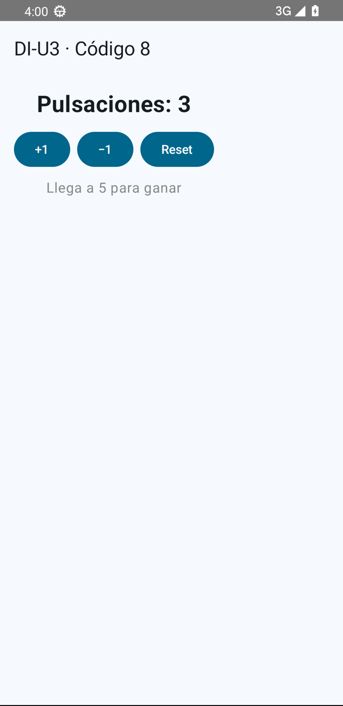
<figcaption>Figura 11. Eventos por lambda: tocar un botón muta el estado y la pantalla se re-pinta sola.</figcaption>
</figure>

Y el diálogo de confirmación — que en Android clásico era un `AlertDialog.Builder` conectado a los
botones del layout — es hoy un composable más del árbol, que aparece y desaparece según el estado:

**Código 9.** Diálogo condicionado a estado, la escena completa de la Figura 12:

```kotlin
@Composable
fun DialogoPorEstado() {                                     // pantalla con diálogo de confirmación
    var abortar by remember { mutableStateOf(false) }        // ESTADO 1: la decisión del usuario
    var dialogoAbierto by remember { mutableStateOf(true) }  // ESTADO 2: visibilidad del diálogo (nace abierto)

    Column {                                                 // contenedor vertical
        Switch(checked = abortar,                            //   el Switch REFLEJA el estado 1
               onCheckedChange = { abortar = it })           //   y al tocarlo, lo ESCRIBE
        Spacer(Modifier.height(8.dp))                        //   separación
        Text("Opción marcada: " + if (abortar) "Abandonar partida"  //   texto que LEE el estado 1
                                  else "Continuar")
        TextButton(onClick = { dialogoAbierto = true }) {    //   botón para re-abrir el diálogo:
            Text("Volver a abrir el diálogo")                //     escribe true en el estado 2
        }
        if (dialogoAbierto) {                                // el diálogo existe MIENTRAS el estado diga sí
            AlertDialog(
                onDismissRequest = { dialogoAbierto = false },   // evento "toque fuera": escribe false
                title = { Text("¿Seguro que quieres salir?") },  // cabecera del diálogo
                text = {
                    Text(if (abortar) "Abandonarás la partida en curso."   // cuerpo: LEE el estado 1
                         else "No has marcado la opción de abandonar.")
                },
                confirmButton = {                            //   botón afirmativo
                    Button(onClick = { dialogoAbierto = false }) { Text("Aceptar") }  // escribe false
                },
                dismissButton = {                            //   botón de escape
                    TextButton(onClick = { dialogoAbierto = false }) { Text("Cancelar") }  // también false
                }
            )
        }                                                    // al ponerse false, Compose retira el diálogo
    }
}
```

<figure markdown>
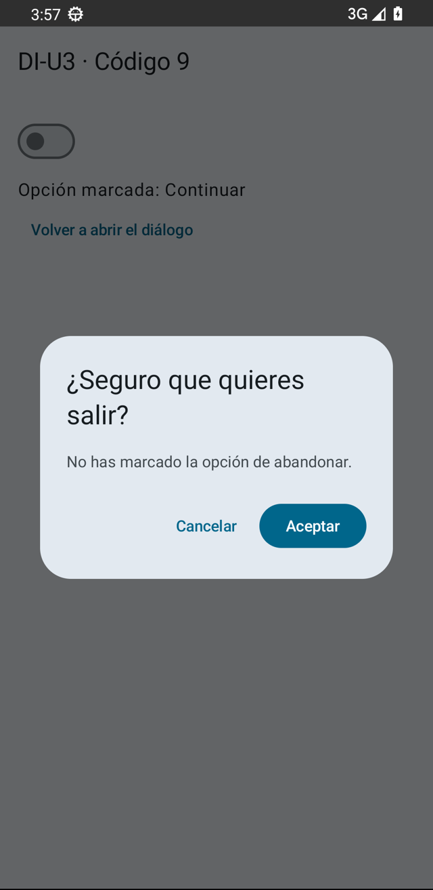
<figcaption>Figura 12. El diálogo como parte del árbol de composición: se muestra porque el estado dice que sí.</figcaption>
</figure>

## 5. Herramientas para la creación de interfaces multiplataforma

<span style="background-color:#a5d6a7;padding:0 3px;border-radius:3px;">El libro compara editores de documentos XML. Te los resumimos tal cual (entran en el examen tipo test)</span>
y luego te contamos cuál es la nuestra de verdad:

| Herramienta | Tipo | Para qué sirve hoy |
|---|---|---|
| **Notepad++** | Editor de texto (Windows) | Rápido, con resaltado XML y plugins (XML Tools: formatear/validar). Para retoques puntuales. |
| **Atom** | Editor hackable (GitHub) | Muerto oficialmente en 2022; su espíritu vive en **Pulsar**. Fue muy usado para XML+Git. |
| **Adobe Dreamweaver CC** | IDE visual web | Edición WYSIWYG de XHTML/CSS. En declive, pero se sigue enseñando. |
| **Visual Studio Code** | Editor multiextensión | El estándar actual: extensiones XML, Red Hat, preview, Git… |
| **Android Studio** | IDE Android | La nuestra: edita código **y a la vez genera la interfaz** en tiempo real con `@Preview`. |

<figure markdown>
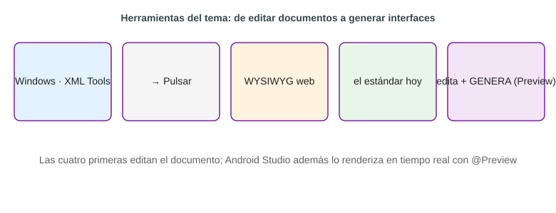
<figcaption>Figura 13. El arsenal del tema: de los editores de documentos al IDE que renderiza tu interfaz mientras escribes.</figcaption>
</figure>

### 5.1. `@Preview`: el generador de interfaces integrado

<span style="background-color:#a5d6a7;padding:0 3px;border-radius:3px;">En el Android clásico, el generador era el editor visual de Eclipse/Studio que escribía XML por ti. En</span>
Compose el generador es **el propio compilador pintando tus funciones**: la anotación `@Preview` ejecuta
un composable en el panel de diseño sin lanzar el emulador.

```kotlin
@Preview(showBackground = true, device = "id:pixel_4")   // pintamos en el panel, con fondo, en un Pixel 4
@Composable
fun VistaPrevia() {                                      // composable que SOLO existe para la previsualización
    MyApplicationTheme { GmlAInterfaz() }                //   lo envolvemos en el tema y llamamos a la escena real
}                                                        //   (el Código 2): el preview ES la app, no un sucedáneo
```

Con `@PreviewParameter`, `@UiMode` o `@Configuration` te sacas variantes (oscuro/claro, tamaños de
fuente, dispositivos) del mismo composable: es la versión 2026 del "generar la interfaz a partir del
documento", pero el documento ya es código.

### 5.2. Layout Inspector

El inspector que tenía Eclipse (Structure) hoy es **Layout Inspector** en Android Studio: te muestra el
árbol de composición en vivo sobre la app en ejecución — el equivalente exacto del "análisis del
documento XML" del apartado 3, pero del documento vivo.

## 6. Generación de código para diferentes plataformas

<span style="background-color:#a5d6a7;padding:0 3px;border-radius:3px;">El libro explica cómo de un mismo documento XML se generaba código para Java, C++ o web. La equivalencia</span>
moderna tiene dos lecturas, y ambas son ciertas:

1. **La interfaz se "genera" sola desde el código**: Compose interpreta tus composables y emite el árbol
   de dibujo en cada pantalla, cada configuración, cada tema. Tú escribes una descripción; la plataforma
   la materializa. Es el sueño del "escribe una vez" del XML de 2005, conseguido por otra vía.
2. **La app entera puede ir a varias plataformas**: con **Kotlin Multiplatform** (lo vimos en 8.6 de U1),
   el mismo código Compose se ejecuta en Android, iOS y escritorio. La descripción ya no se traduce a
   cada plataforma: se *ejecuta* en cada una.

**Código 10.** La configuración como estado — la escena de la Figura 14 (fotografiada en modo oscuro):

```kotlin
@Composable
fun AjustesPorEstado(oscuroInicial: Boolean = false) {       // escena de ajustes con dos controles
    var brillo by remember { mutableStateOf(30f) }           // ESTADO 1: brillo del panel (0–100 %)
    var oscuro by remember {                                // ESTADO 2: modo oscuro/claro
        mutableStateOf(oscuroInicial)                       //   nace con el valor que le pase quien la llama
    }

    Column(                                                 // contenedor que OCCUPA la pantalla entera
        Modifier
            .fillMaxSize()                                  //   a todo lo ancho y largo
            .background(if (oscuro) Color(0xFF212121)       //   fondo: oscuro si el estado 2 dice oscuro,
                        else Color(0xFFFFF8E1))             //        crema si dice claro
            .padding(16.dp)                                 //   con 16 dp de margen interior
    ) {
        Row(verticalAlignment = Alignment.CenterVertically) {           // fila interruptor + etiqueta
            Switch(checked = oscuro,                       //   el Switch refleja el estado 2
                   onCheckedChange = { oscuro = it })      //   y al tocarlo lo cambia → TODO se recompone
            Spacer(Modifier.width(10.dp))                  //   separación
            Text(if (oscuro) "Modo oscuro" else "Modo claro",  //   etiqueta según el estado 2
                 color = if (oscuro) Color.White else Color.Black)    // legible sobre el fondo elegido
        }
        Spacer(Modifier.height(16.dp))                     // separación
        Text("Brillo del panel: ${brillo.toInt()} %",      // leemos el estado 1 (sin decimales)
             color = if (oscuro) Color.White else Color.Black)        // adaptado al modo
        Slider(                                            // el Slider ESCRIBE el estado 1 al deslizar
            value = brillo,                                //   refleja la posición actual
            onValueChange = { brillo = it },               //   cada arrastre guarda el nuevo valor
            valueRange = 0f..100f                          //   recorrido de 0 a 100
        )
        Spacer(Modifier.height(16.dp))                     // separación
        Box(                                               // LA MUESTRA: un panel que brilla según el estado 1
            Modifier
                .fillMaxWidth()                            //   a todo el ancho
                .height(90.dp)                             //   90 dp de alto
                .background(
                    Color(0xFFFFC107).copy(alpha = brillo / 100f),  // ámbar con opacidad = brillo
                    RoundedCornerShape(12.dp)              //   esquinas de 12 dp
                )
        )
        Spacer(Modifier.height(8.dp))                      // separación
        Text("El estado (oscuro/brillo) decide qué se compone: así se implementan las " +
             "configuraciones, en código, sin XML adicional",          // moraleja de la escena
             fontSize = 12.sp,
             color = if (oscuro) Color.LightGray else Color.DarkGray,  // también adaptada al modo
             textAlign = TextAlign.Start)                  //   alineada a la izquierda
    }
}
```

<figure markdown>
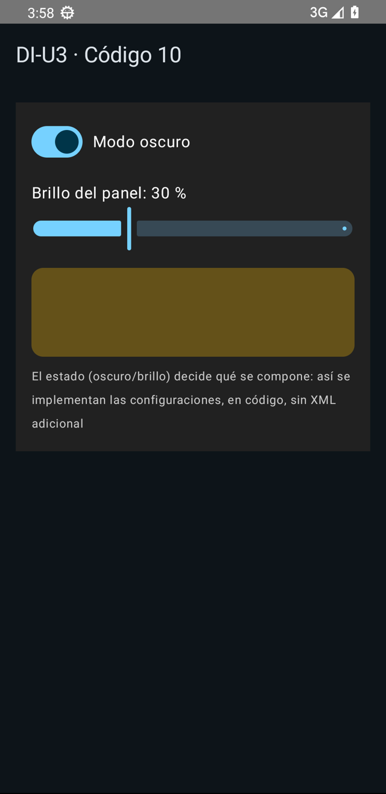
<figcaption>Figura 14. El mismo composable en modo oscuro, switch activado y brillo al 30 %: el estado decide la configuración de la interfaz.</figcaption>
</figure>

## 7. Caso práctico 1: "Generación de un logo con gráficos vectoriales escalables"

<span style="background-color:#a5d6a7;padding:0 3px;border-radius:3px;">**Enunciado (adaptado del libro)**: partiendo del trazado de una estrella en SVG, construir el logo de la</span>
aplicación como recurso vectorial y colocarlo en la cabecera de la pantalla.

**Solución paso a paso**:

1. Copiamos el atributo `d` del SVG como `pathData` y lo parseamos con `addPathNodes` (Código 6).
2. Montamos el `ImageVector` con el `fill` original del SVG en `SolidColor`.
3. Lo presentamos con `Image` dentro de una `Box` con degradado (el equivalente Compose del contenedor
   `frame` del mockup del libro).
4. Comprobamos escalabilidad: probamos el logo a 40, 140 y 400 dp. Al ser trazados, no pixelea nunca —
   la ventaja del SVG/XML vectorial que el libro defendía ya en 2012, intacta.

> El resultado ejecutándose es la **Figura 8** de este tema.

## 8. Caso práctico 2: "Estructura de documento XML"

<span style="background-color:#a5d6a7;padding:0 3px;border-radius:3px;">**Enunciado (adaptado)**: simular una entrada de un documento GML/RSS con título y descripción, y</span>
construir una ficha editable cuya previsualización se actualiza al vuelo.

**Solución**: dos `OutlinedTextField` anclados a `remember` (la edición del documento) más una `Card`
que refleja el estado (la interfaz generada). Editar el documento y ver la interfaz cambiar **en el
mismo sitio** es justo la lección del tema:

**Código 11.** La ficha editable, escena completa de la Figura 15:

```kotlin
@Composable
fun FichaEditable() {                                        // la ficha GML/RSS editable
    var titulo by remember {                                 // ESTADO: el campo 'title' del documento
        mutableStateOf("Estación Puerto de Santa María")     //   con su valor inicial
    }
    var descripcion by remember {                            // ESTADO: el campo 'description'
        mutableStateOf("Temperatura: 23,5 °C")               //   con su valor inicial
    }

    Column {                                                 // contenedor vertical
        Text("Ficha de la entrada",                          //   cabecera de la pantalla
             fontWeight = FontWeight.Bold, fontSize = 18.sp) //   en negrita, a 18 sp
        Spacer(Modifier.height(8.dp))                        //   separación
        OutlinedTextField(                                   //   EDITOR del título: borde fino, estilo Material
            value = titulo,                                  //     refleja el estado 'titulo'
            onValueChange = { titulo = it },                 //     cada tecla ESCRIBE el estado
            label = { Text("tag: title") },                  //     la etiqueta dice qué tag XML editas
            modifier = Modifier.fillMaxWidth()               //     a todo el ancho
        )
        Spacer(Modifier.height(8.dp))                        //   separación
        OutlinedTextField(                                   //   EDITOR de la descripción
            value = descripcion,                             //     refleja el estado 'descripcion'
            onValueChange = { descripcion = it },            //     escribe el estado al teclear
            label = { Text("tag: description") },            //     su tag correspondiente
            modifier = Modifier.fillMaxWidth()               //     también a todo el ancho
        )
        Spacer(Modifier.height(12.dp))                       //   separación con la previsualización
        Card(elevation = CardDefaults.cardElevation(4.dp)) { //   LA INTERFAZ GENERADA: tarjeta con sombra
            Column(Modifier.padding(12.dp)) {                //     interior con 12 dp de margen
                Text(titulo, fontWeight = FontWeight.SemiBold)         //     pinta el título actual
                Text(descripcion, color = Color.Gray, fontSize = 13.sp)  // y la descripción actual
            }
        }                                                    //   al mutar cualquier campo, la tarjeta se
                                                             //   recompone sola: documento y UI, en vivo
    }
}
```

<figure markdown>
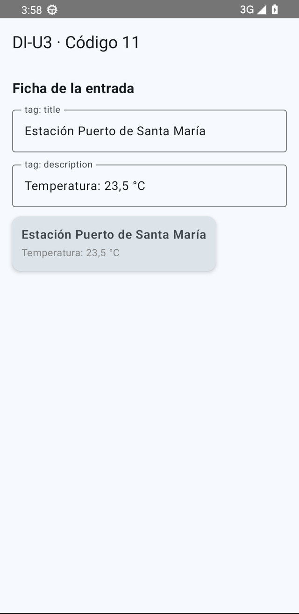
<figcaption>Figura 15. Editar la descripción y ver la interfaz generada al instante: la idea del XML, pero en vivo.</figcaption>
</figure>

## 9. Resumen y resolución del caso práctico de la unidad

- **XML** describe interfaz y datos con etiquetas bien formadas: seis lenguajes del tema — XHTML, GML,
  MathML, RSS, XSLT, SVG — con su escena ejecutándose en el emulador cada uno.
- **Documento XML** = etiquetas + atributos + valores; **composable** = función + parámetros + argumentos.
- **Eventos**:  <span style="background-color:#a5d6a7;padding:0 3px;border-radius:3px;">de la conexión por nombre (`android:onClick`) a la **lambda directa** con estado `remember`</span>.
- **Herramientas**:  del editor de documentos (Notepad++, Atom, Dreamweaver, VS Code) al **IDE que genera.
  la interfaz**: `@Preview` y Layout Inspector.
- **Generación para plataformas**:  <span style="background-color:#a5d6a7;padding:0 3px;border-radius:3px;">hoy la descripción *se ejecuta* en cada plataforma (Compose + KMP)</span>.
  en vez de traducirse.
- El XML clásico Android sigue en las apps heredadas y en las etiquetas de examen: **reconocerlo** y
  **saber que Compose es su heredero** es el objetivo de este tema.

## Bibliografía y fuentes

Sin libros de editorial: el material se apoya en las especificaciones y documentaciones oficiales
del software que se usa en clase.

**Especificaciones originales (W3C / OASIS / IETF)**

- W3C. *XML 1.1 (Quinta Edición)*, especificación del lenguaje. <https://www.w3.org/TR/REC-xml/>
- W3C. *Scalable Vector Graphics (SVG) 2*. <https://www.w3.org/TR/SVG2/>
- W3C. *Mathematical Markup Language (MathML) Version 3.0 2nd Edition*. <https://www.w3.org/TR/MathML3/>
- W3C. *XSL Transformations (XSLT) Version 3.0*. <https://www.w3.org/TR/xslt-30/>
- W3C. *HTML Living Standard* (sucesor de XHTML). <https://html.spec.whatwg.org/>
- IETF RFC 4287. *The Atom Syndication Format* (familia RSS/Atom). <https://datatracker.ietf.org/doc/html/rfc4287>
- OGC. *Geography Markup Language (GML) Encoding Standard*. <https://www.ogc.org/standards/gml/>

**Documentación oficial de las herramientas**

- Android Developers. *Jetpack Compose* (composables, `@Preview`, Layout Inspector). <https://developer.android.com/develop/ui/compose>
- Android Developers. *Vector drawables*. <https://developer.android.com/develop/ui/views/graphics/vector-drawable-resources>
- Android Developers. `WebView` <https://developer.android.com/reference/android/webkit/WebView> y `XmlPullParser` <https://developer.android.com/reference/android/util/XmlPullParser>
- Material Design 3, especificación de diseño. <https://m3.material.io/>
- JetBrains. *Kotlin documentation*. <https://kotlinlang.org/docs/home.html>

**Normativa del módulo**

- Real Decreto 405/2023, de 29 de mayo (BOE-A-2023-13221). Módulo profesional 0488 *Desarrollo de interfaces*:
  resultados de aprendizaje RA1 y RA3 y sus criterios de evaluación, que son los que ordenan este tema.
