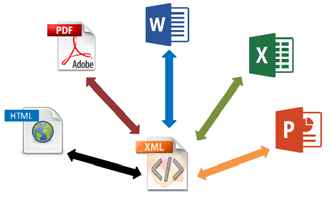
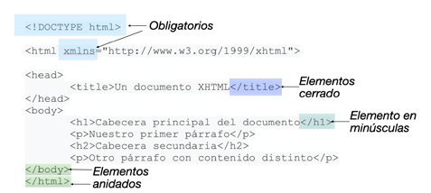
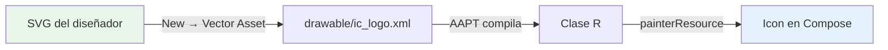
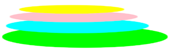

# UD 3 — Generación de interfaces a partir de documentos XML

## 1. Introducción y contextualización práctica

En la UD 1 viste que Compose es *code-first*: la interfaz se escribe en Kotlin y la herramienta de diseño la renderiza en vivo. ¿Y entonces por qué dedicar una unidad entera a XML?

Porque XML no ha desaparecido de tu proyecto Android: se ha retirado del primer plano. Abre cualquier proyecto Compose recién creado y encontrarás XML en el `AndroidManifest.xml`, en `res/values/strings.xml` y `themes.xml`, y quizá un `ic_launcher_foreground.xml` en `drawable/`. Y si abres una app corporativa de las que mantienen los bancos —o el AOSP que ya viste en PMDM—, su capa de UI sigue siendo el **sistema de vistas XML clásico**, con `layout/activity_main.xml` describiendo jerarquías de `TextView` y `MaterialButton`.

Comprender XML sigue siendo clave por tres razones profesionales:

- **Intercambio de información**: XML es texto plano estructurado, legible por cualquier plataforma sin software especial.
- **Lectura del legado**: miles de apps en producción y tutoriales de una década usan el sistema Views; saber leerlo es saber mantenerlo.
- **Recursos Android**: strings, colores, temas, iconos vectoriales y el manifest son XML hoy, y lo seguirán siendo.

En esta unidad analizamos el documento XML como tal, los lenguajes de descripción de interfaces derivados, y el puente entre ambos mundos: cómo Android genera recursos a partir de XML y cómo consumirlos desde Compose con una sola línea.

!!! tip "Objetivo de la unidad"
    Al terminar sabrás leer, validar y modificar cualquier documento XML de un proyecto Android, distinguir los lenguajes derivados que siguen vivos (SVG → vector drawables, strings.xml → externalización) y conectar esos recursos con tus composables.

## 2. Lenguajes de descripción de interfaces basados en XML

XML (*eXtensible Markup Language*) es un **metalenguaje**: un lenguaje para definir otros lenguajes. Esa es exactamente la razón de su longevidad — quien define el vocabulario de etiquetas decide para qué sirve, y así han nacido dialectos para interfaces (XHTML, XAML, GladeXML), para datos geográficos (GML), para matemáticas (MathML), para sindicación (RSS) y para gráficos vectoriales (SVG).



### 2.1. XHTML

XHTML (*eXtensible HyperText Markup Language*) es HTML reformulado con las reglas de XML. Todo documento XHTML debe incluir `<!DOCTYPE>`, el atributo `xmlns` en `<html>` y las etiquetas `<html>`, `<head>`, `<title>` y `<body>`.



Sus reglas de diseño son las de XML puro — y son las mismas que te va a exigir el compilador de recursos de Android:

| Regla XHTML | En tu proyecto Android |
|---|---|
| Elementos correctamente anidados | `<LinearLayout>` contiene `<Button>`, nunca se cruzan |
| Toda etiqueta cerrada | `<Button ... />` o `<Button></Button>`, sin excepción |
| Minúsculas para etiquetas y atributos | `android:text`, no `Android:Text` |
| Valores de atributos siempre citados | `android:text="@string/hola"` |
| Atributos únicos, prohibida la minimización | `android:checked="true"`, nunca solo `checked` |

### 2.2. GML

**GML** (*Geography Markup Language*) es el dialecto del mundo GIS: describe características geográficas (coordenadas, polígonos, rutas) en XML. Las apps de mapas de hace unos años intercambiaban sus capas en GML, y KML —el dialecto de Google Earth— es su hijo directo. Hoy lo verás poco en móvil (JSON y GeoJSON se lo comieron), pero es un buen ejemplo de "XML para un dominio concreto".

El PDF original mostraba GML como un formato de texto con marcas `:h1.`, `:p.` — eso es en realidad **asciidoc**, no GML. Confusión clásica de materiales antiguos: la defino correctamente arriba y no la arrastro.

### 2.3. MathML

**MathML** describe fórmulas matemáticas para intercambio entre programas:

```xml
<math>
  <mrow>
    <mi>a</mi><mn>2</mn><mo>+</mo><mi>b</mi><mn>2</mn><mo>=</mo><mi>c</mi><mn>2</mn>
  </mrow>
</math>
```

En Android no escribirás MathML, pero la idea —describir contenido no textual de forma estructurada— la vuelves a encontrar en `avd-*.xml` (animaciones vectoriales) o en los `objectAnimator` que animan propiedades.

### 2.4. RSS

**RSS** (*Really Simple Syndication*) sindica contenido actualizado: titular, descripción, enlace y fechas.

```xml
<?xml version="1.0" encoding="UTF-8"?>
<rss version="2.0">
  <channel>
    <title>Última hora</title>
    <description>Noticia importante</description>
    <link>https://example.com/ultimas-noticias/</link>
    <pubDate>Mon, 06 Jan 2026 16:20:00 +0000</pubDate>
  </channel>
</rss>
```

Es el protocolo de podcasts y sigue siendo el caso de uso de XML más visible para el gran público: cuando tu app favorita de radio muestra el listado de episodios, detrás hay un `<channel>` con `<item>` por episodio. En la práctica de esta unidad consumiremos uno de verdad.

### 2.5. XSLT

**XSLT** (*eXtensible Stylesheet Language Transformations*) es el "CSS de XML", pero con superpoderes: no solo aplica estilo, sino que **transforma** un XML en otro documento distinto (otro XML, HTML o texto plano), añadiendo, eliminando y reordenando elementos, con condiciones y bucles. Es el antepasado conceptual de los *transformadores* de datos que hoy escribes en Kotlin con `map`/`filter`: entra un formato, sale otro.

### 2.6. SVG y los vector drawables

**SVG** (*Scalable Vector Graphics*) describe gráficos vectoriales: formas geométricas, trazos y texto. Sus primitivas básicas:

```xml
<svg width="60" height="60">
  <circle cx="30" cy="30" r="25" fill="cyan" stroke="black" stroke-width="3"/>
</svg>

<svg width="60" height="60">
  <rect x="0" y="0" width="60" height="60" fill="red"/>
</svg>

<svg width="60" height="60">
  <ellipse cx="30" cy="30" rx="20" ry="16" fill="orange"/>
</svg>

<svg width="60" height="60">
  <polygon fill="green" stroke="black" stroke-width="2" points="5,30 15,10 25,30"/>
</svg>
```

Y aquí viene el puente con tu día a día de desarrollador Android: **Android Studio convierte cualquier SVG en un vector drawable** (clic derecho sobre `drawable/` → **New → Vector Asset**), que es un XML casi idéntico pero con vocabulario Android:

```xml
<!-- res/drawable/ic_onda.xml -->
<vector xmlns:android="http://schemas.android.com/apk/res/android"
    android:width="24dp" android:height="24dp"
    android:viewportWidth="24" android:viewportHeight="24">
    <path android:fillColor="#2E7D32"
        android:pathData="M12,4L16,10L8,10Z" />
</vector>
```

El `<svg>` se vuelve `<vector>`, el `fill` se vuelve `android:fillColor` y las formas se compilan en `pathData`. El flujo profesional es exactamente ese: **el diseñador entrega SVG → tú lo importas como drawable → lo usas en Compose**. El logo escalable que una radio pediría en 2023 ya no es un `<svg>` incrustado en una web, sino un drawable vectorial a todas densidades.

## 3. El documento XML. Análisis y edición

### 3.1. La primera línea: prólogo

```xml
<?xml version="1.0" encoding="UTF-8"?>
```

- **`version`**: versión de la especificación XML empleada (1.0 sigue siendo la norma).
- **`encoding`**: juego de caracteres (UTF-8 en todo lo que hagas; es el estándar de facto en Android).

Un archivo `strings.xml` de Android **no lleva prólogo** (lo añade la herramienta de build), pero cualquier XML independiente que escribas sí debe llevarlo.

### 3.2. Etiquetas, elementos y nodos

Una **etiqueta** empieza con `<`, continúa con un nombre identificativo y termina con `>`. El nombre debe empezar por letra y puede continuar con letras, dígitos, guiones y puntos:

- **Start-Tag** o etiqueta de apertura: `<etiqueta>`
- **End-Tag** o etiqueta de cierre: `</etiqueta>`
- **Empty-Tag** o etiqueta vacía: `<etiqueta_vacia />`

El conjunto de etiqueta de apertura + contenido + etiqueta de cierre es un **elemento** o **nodo**. `<nombre>Lucas</nombre>` es un elemento con etiqueta `nombre` y contenido `Lucas`. Un elemento puede contener a otros elementos, pero **no mezclar hijos y texto** en el mismo nivel — esa es la diferencia entre un árbol limpio y un documento ambiguo:

```xml
<!-- BIEN: jerarquía limpia -->
<cliente>
    <nombre>Lucas</nombre>
    <pedidos>
        <pedido id="7"/>
    </pedidos>
</cliente>

<!-- MAL: texto y elementos mezclados -->
<cliente>Lucas<pedido id="7"/></cliente>
```

La estructura es jerárquica y anidada: **las etiquetas hijas se cierran antes que las madres**, y toda etiqueta abierta debe quedar cerrada en orden inverso a su apertura. La Figura 3 del material original lo representa como un árbol genealógico de nodos — exactamente la misma metáfora que ya usamos para la jerarquía de composables en la UD 1.

### 3.3. Atributos y valores

Un **atributo** es un par `nombre="valor"` que vive dentro de la etiqueta de apertura o de la vacía — nunca en la de cierre. Los atributos de un elemento son **únicos**: no puede haber dos `apellido` en la misma etiqueta.

```xml
<!-- Correcto: tres atributos únicos -->
<programadora nombre="Augusta" apellido1="Ada" apellido2="King"/>

<!-- Incorrecto: atributo repetido -->
<programadora nombre="Augusta" apellido="Ada" apellido="King"/>
```

En Android verás la treta inversa usada a conciencia: cuando un elemento necesita lista de valores, se usan **elementos repetidos** en lugar de un atributo repetido:

```xml
<!-- res/values/arrays.xml -->
<integer-array name="duracion_barras">
    <item>300</item>
    <item>150</item>
    <item>600</item>
</integer-array>
```

### 3.4. Bien formado vs. válido

Un XML está **bien formado** cuando cumple las reglas sintácticas anteriores (etiquetas cerradas, anidamiento correcto, atributos citados y únicos). Está **válido** cuando además obedece a un vocabulario externo — DTD o XML Schema. Android usa su propia validación: el compilador de recursos (AAPT) conoce el vocabulario de `<vector>`, `<selector>` o `<string>` y rompe el build con mensajes tan explícitos como:

```
error: attribute 'android:fillColour' not found.
```

(Con la errata `fillColour` → `fillColor` incluida: AAPT no perdona ni una mayúscula — XML es *case-sensitive*.)

### 3.5. Herramientas de análisis y edición

Los editores de XML modernos resaltan sintaxis, autocompletan etiquetas y estructuras comunes, y validan al vuelo. La comparativa clásica del material original — Notepad++ con su plugin XML Tools, Atom con Teletype, Dreamweaver WYSIWYG, VS Code con Live Share — queda hoy así:

| Necesidad | Herramienta 2026 |
|---|---|
| Editar un XML suelto rápido | Cualquier editor con resaltado: VS Code, Notepad++ |
| Validar contra schema | VS Code + extensión XML (Red Hat) |
| Interfaz WYSIWYG desde XML | Ya no aplica en Android: Compose es code-first |
| Colaboración en tiempo real | VS Code Live Share / JetBrains Code With Me |
| El editor que ya tienes abierto | **Android Studio**: valida, autocompleta y previsualiza tus recursos XML |

Si el material de 2 años atrás dedicaba un apartado entero a elegir editor XML, hoy la respuesta es una: **el que ya usas para programar**. En Android Studio abres `strings.xml` o un drawable y tienes los tres servicios — resaltado, autocompletado y validación — sin instalar nada.

!!! note "¿Y el clásico Layout Editor de vistas XML?"
    El editor visual de layouts XML (Design/Dual) sigue existiendo para apps Views heredadas, pero no es el camino recomendado para UI nueva: para eso está Compose, que viste en las UD 1 y 2. Aquí nos quedamos con la parte de XML que sigue viva: recursos y datos.

## 4. Eventos

Una interfaz, por sí sola, no sabe cuándo el usuario quiere actuar. Los **eventos** son el mecanismo que convierte una interfaz estática en dinámica: pulsaciones, cambios de texto, foco, gestos.

El material clásico enumeraba MouseMove, MouseDown, Click, GetFocus, LostFocus… El móvil los traduce a su vocabulario (no hay ratón ni foco de teclado igual que en escritorio):

| Evento clásico (escritorio) | Equivalente Android | En Compose |
|---|---|---|
| Click | `onClick` | `onClick = { ... }` en `Button`, `Text` con `clickable`… |
| Change | `onTextChanged` | `onValueChange = { ... }` en `TextField` |
| GetFocus / LostFocus | `onFocusChanged` | `Modifier.focusProperties` / `onFocusEvent` |
| MouseMove / MouseEntered | `onHover` (escritorio) | `Modifier.pointerInput` + `detectTapGestures` |
| MouseDown / MouseUp | `onTouchEvent` | `pointerInput` con `awaitPointerEvent` |

La diferencia conceptual grande está en **cómo se asocia la acción al evento**:

- **Clásico (Views XML)**: en el XML pones `android:onClick="saludar"` (o registras un `OnClickListener` en la actividad), y en Kotlin escribes `fun saludar(v: View)`. El XML *declara* el punto de conexión; el código lo *implementa*.
- **Compose**: no hay registro por nombre — el handler es un parámetro más del componible: `Button(onClick = { contador++ })`. La asociación evento-acción es una expresión de Kotlin, verificada por el compilador (si te equivocas de nombre, no compila; en el sistema clásico, fallaba en ejecución).

```kotlin
@Composable
fun ContadorEventos() {
    var clics by remember { mutableStateOf(0) }
    var texto by remember { mutableStateOf("") }

    Column(horizontalAlignment = Alignment.CenterHorizontally,
           verticalArrangement = Arrangement.spacedBy(8.dp)) {
        Text("Clics: $clics")
        OutlinedTextField(value = texto, onValueChange = { texto = it },
            label = { Text("Escribe algo") })
        Button(onClick = { clics++ }) { Text("Suma") }
    }
}
```

Tres eventos, tres líneas de asociación: `onValueChange` (Change), `onClick` (Click), y el propio `Text("Clics: $clics")` reaccionando al estado — la UI declarativa de Compose es, en el fondo, *la respuesta automática a todos los eventos de estado*.

## 5. Generación de recursos y código para Android

La promesa del XML de interfaces era *"escribe el documento una vez, genera la interfaz para cada plataforma"*. En Android esa promesa se cumple a escala de recursos:

1. **Escribes** el documento XML (`strings.xml`, `ic_logo.xml`, `themes.xml`…).
2. **AAPT lo compila** y genera la clase `R` con identificadores (`R.string.app_name`, `R.drawable.ic_logo`).
3. **Consumes** desde código — clásico o Compose — con una línea.

```kotlin
// Compose consumiendo recursos nacidos en XML:
Text(stringResource(R.string.bienvenida))            // strings.xml
Icon(painterResource(R.drawable.ic_logo), null)      // drawable vectorial (SVG importado)
Text("Hola", color = MaterialTheme.colorScheme.primary) // themes.xml
```

El esquema del material original — XML → herramienta → código multiplataforma — es literalmente este flujo, solo que el "código generado" ya no es un `form1.java` autogenerado sino la clase `R` y los accesores de recursos.

**Del SVG al icono en pantalla, el camino completo:**



### 5.1. Caso práctico 1: *"El logo de la radio, versión 2026"*

**Planteamiento.** La emisora FourWaves (naturaleza, mindfulness, corazón y economía) quiere su logo vectorial para la app Android: cuatro ondas superpuestas — verde, azul, rosa y amarilla — reescalables a cualquier densidad.

**Nudo.** En el material clásico se resolvía con un `<svg>` con cuatro `<ellipse>` en una web. Hoy el mismo diseño viaja por el flujo Android: el diseñador entrega el SVG y tú lo conviertes en vector drawable. Estas son las cuatro elipses originales…

```xml
<svg height="150" width="500">
  <ellipse cx="240" cy="100" rx="220" ry="30" style="fill:lime"/>
  <ellipse cx="220" cy="70"  rx="190" ry="20" style="fill:cyan"/>
  <ellipse cx="210" cy="45"  rx="170" ry="15" style="fill:pink"/>
  <ellipse cx="205" cy="25"  rx="140" ry="12" style="fill:yellow"/>
</svg>
```

…y así queda tras importarlo (Vector Asset acepta el SVG y genera el XML Android):

```xml
<!-- res/drawable/ic_fourwaves.xml -->
<vector xmlns:android="http://schemas.android.com/apk/res/android"
    android:width="120dp" android:height="36dp"
    android:viewportWidth="500" android:viewportHeight="150">
    <path android:fillColor="#7CB342"
        android:pathData="M20,100 a220,30 0 1,0 440,0 a220,30 0 1,0 -440,0"/>
    <path android:fillColor="#4DD0E1"
        android:pathData="M30,70 a190,20 0 1,0 380,0 a190,20 0 1,0 -380,0"/>
    <path android:fillColor="#F48FB1"
        android:pathData="M40,45 a170,15 0 1,0 340,0 a170,15 0 1,0 -340,0"/>
    <path android:fillColor="#FFF176"
        android:pathData="M65,25 a140,12 0 1,0 280,0 a140,12 0 1,0 -280,0"/>
</vector>
```

**Desenlace.** En la pantalla Compose:

```kotlin
Image(
    painter = painterResource(R.drawable.ic_fourwaves),
    contentDescription = "Logo FourWaves",
    modifier = Modifier.fillMaxWidth()
)
```



Un solo XML, todas las densidades: el drawable vectorial no tiene `@2x/@3x` como los PNG — escala sin pérdida porque es matemática, no píxeles.

### 5.2. Caso práctico 2: *"Estructura de un documento XML de datos"*

**Planteamiento.** Para la app de viajes TravelWithMe necesitamos almacenar las siete maravillas del mundo moderno (nombre, país).

**Nudo.** Un documento XML de datos, con elemento repetido `maravilla` y subelementos `nombre`/`pais`:

```xml
<?xml version="1.0" encoding="UTF-8"?>
<maravillas>
  <maravilla>
    <nombre>Muralla China</nombre>
    <pais>China</pais>
  </maravilla>
  <maravilla>
    <nombre>Coliseo Romano</nombre>
    <pais>Italia</pais>
  </maravilla>
  <maravilla>
    <nombre>Chichén Itzá</nombre>
    <pais>México</pais>
  </maravilla>
  <maravilla>
    <nombre>Machu Picchu</nombre>
    <pais>Perú</pais>
  </maravilla>
  <maravilla>
    <nombre>Taj Mahal</nombre>
    <pais>India</pais>
  </maravilla>
  <maravilla>
    <nombre>Cristo Redentor</nombre>
    <pais>Brasil</pais>
  </maravilla>
  <maravilla>
    <nombre>Petra</nombre>
    <pais>Jordania</pais>
  </maravilla>
</maravillas>
```

**Desenlace.** La información queda estructurada en elementos `maravilla` repetidos con subelementos regulares — el patrón exacto que luego parsearás con `XmlPullParser` en la práctica de la unidad (y el mismo que sigue hoy cualquier feed RSS o sitemap).

## 6. Resumen

- XML es un metalenguaje: define lenguajes (XHTML, GML, MathML, RSS, XSLT, SVG). En Android los que siguen vivos son **SVG→vector drawables**, **strings/temas/colores** y el **manifest**.
- Un documento XML bien formado exige prólogo, etiquetas cerradas y correctamente anidadas, minúsculas, atributos únicos y valores citados. AAPT valida el vocabulario Android al compilar.
- Los eventos clásicos (Click, Change, Focus…) existen en Android; en Compose la asociación evento→acción es un parámetro de Kotlin (`onClick = { }`), verificada en compilación.
- El flujo moderno de "interfaz desde XML" es: **SVG → Vector Asset → drawable XML → clase R → composable**. La generación de código multiplataforma que prometía XML la cumple hoy la clase `R` para recursos.
- Los documentos de datos (maravillas, feeds RSS) siguen el patrón **elemento contenedor + elementos repetidos con subelementos regulares**: listo para parsear con `XmlPullParser`.

## Bibliografía y fuentes

- Develop Android. *Vector graphics*. Android Developers. https://developer.android.com/develop/ui/views/graphics/vector-drawable-resources
- Develop Android. *App resources overview*. Android Developers. https://developer.android.com/guide/topics/resources/providing-resources
- W3C. *Extensible Markup Language (XML) 1.0 (Fifth Edition)*. https://www.w3.org/TR/xml/
- W3C. *Scalable Vector Graphics (SVG) 1.1*. https://www.w3.org/TR/SVG11/
- Material original del módulo (Tema 3, 2023) — adaptado, corregido y actualizado a Kotlin/Jetpack Compose.
