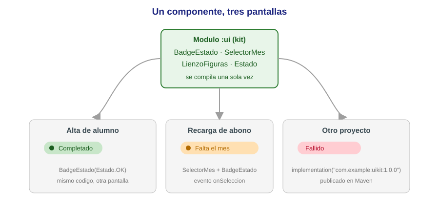
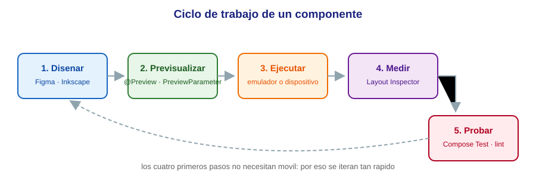
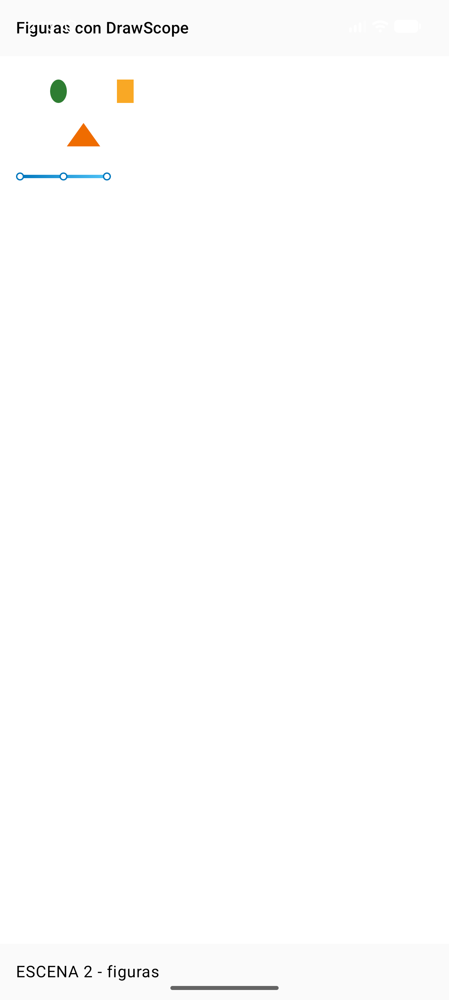

# 4.1 — Creación de componentes visuales

> **El trabajo de ingeniería:** crear una pieza nueva, darle propiedades, probarla, documentarla y
> empaquetarla. En Java Swing se resolvía con JavaBeans, `Graphics` y un JAR metido a mano en la paleta
> de Eclipse.
> Aquí hacemos **exactamente el mismo trabajo de ingeniería** —crear una pieza nueva, darle propiedades,
> probarla, documentarla y empaquetarla para reutilizarla— pero con las herramientas de 2026:
> **Jetpack Compose**, un **módulo de librería** y **pruebas instrumentadas**.
>
> Como en las unidades anteriores, **cada bloque marcado como `Código N` es el fichero completo que se
> compiló y se ejecutó**: lo que lees es el código real del proyecto `IsmaelUIKit`, comentado línea a línea.

## Resultado de aprendizaje que trabaja esta unidad

<span style="background-color:#a5d6a7;padding:0 3px;border-radius:3px;">**RA3. Crea componentes visuales valorando y empleando herramientas específicas** (RD 405/2023, módulo 0488)</span>.

| CE | Criterio de evaluación | Dónde se trabaja |
| -- | ---------------------- | ---------------- |
| a | Se han identificado las herramientas para diseño y prueba de componentes. | §7 previews, §9 herramientas |
| b | Se han creado componentes visuales. | §6 `BadgeEstado`, §10 `LienzoFiguras` |
| c | Se han definido sus métodos y propiedades con asignación de valores por defecto. | §4 y §6, parámetros con defecto |
| d | Se han determinado los eventos a los que debe responder el componente y se les han asociado las acciones correspondientes. | §6.3 `SelectorMes`, §15 caso del abono |
| e | Se han realizado pruebas unitarias sobre los componentes desarrollados. | §12 `BadgeEstadoTest` |
| f | Se han documentado los componentes creados. | §13 KDoc y previews |
| g | Se han empaquetado componentes. | §8 módulo `:ui` y su AAR |
| h | Se han programado aplicaciones cuyo interfaz gráfico utiliza los componentes creados. | app `IsmaelUIKit.demo` (las tres escenas) |

<div style="background-color:#a5d6a7; border-radius:8px; padding:10px 14px; margin:14px 0;">
<strong>🟢 Leyenda de repaso obligatorio:</strong> los textos con <span style="background-color:#a5d6a7;padding:0 3px;border-radius:3px;">este fondo verde</span> son imprescindibles para crear componentes: hay que repasarlos <strong>cada semana</strong>, porque entrarán en todas las evaluaciones del módulo.</div>

## 1. Introducción y contextualización práctica

<span style="background-color:#a5d6a7;padding:0 3px;border-radius:3px;">Hasta ahora has **usado** componentes: `Button`, `TextField`, `Card`… Los ponías, les cambiabas</span>
propiedades y les conectabas eventos. Este tema da el paso siguiente: **fabricar tus propios
componentes**, los que la librería estándar no trae, con el mismo rigor con el que un fabricante de
componentes diseña los suyos.

<figure markdown>

<figcaption>Figura 1. El mismo componente, tres contextos. Escribirlo una vez y reutilizarlo diez es todo el sentido del tema.</figcaption>
</figure>

¿Cuándo se crea un componente y no se copia y pega el código? La regla práctica:

- Aparece **dos veces** en la aplicación con el mismo aspecto → componente.
- Cambia **el color, el texto o el tamaño**, pero no la estructura → componente con **parámetros**.
- Lo necesita **otro equipo u otro proyecto** → componente en un **módulo de librería aparte** (§8).

<span style="background-color:#a5d6a7;padding:0 3px;border-radius:3px;">Un componente es código probado y reutilizable que se comunica con el resto a través de su interfaz pública: sus parámetros de entrada y sus eventos de salida</span>. Todo lo que no esté en esa interfaz es interno y puede cambiar sin romper a nadie.

## 2. Desarrollo de software en componentes

<span style="background-color:#a5d6a7;padding:0 3px;border-radius:3px;">El modelo de componentes nació con historia: programar “en componentes” significa **ensamblar** piezas hechas en vez</span>
de escribirlo todo. Las ventajas son siempre las mismas:

| Ventaja | Qué significa en el día a día |
| ------- | ----------------------------- |
| Reutilización | Escribes la pieza una vez; la usas en todas las pantallas y proyectos. |
| Fiabilidad | El componente ya se probó una vez; no se vuelve a probar desde cero. |
| Coste y plazo | Montar pantallas pasa de “escribir” a “componer”. |
| Consistencia | Si el botón de “aceptar” es uno solo, se ve igual en toda la app. |
| Mantenimiento | Cambiar el verde de “Completado” es tocar una línea, no veinte pantallas. |

**Cómo se empaquetaba antes y cómo se empaqueta hoy:**

| Concepto clásico (Java/Swing) | Equivalente en 2026 |
| ------------------------- | ------------------- |
| Clase JavaBean en un `.jar` | `@Composable` en un **módulo de librería** Android |
| Añadir el JAR a la paleta de Eclipse | `implementation(project(":ui"))` en `build.gradle.kts` |
| `.jar` (solo clases) | **`.aar`** (clases + recursos + manifiesto) |
| “Proyecto de componente” | Módulo `:ui` dentro del mismo proyecto Gradle, o repositorio aparte |
| Publicarlo a un compañero copiándole el JAR | Publicarlo a un repositorio Maven (Maven Local, GitHub Packages, Artifacts) |

## 3. Concepto de componente y características

<span style="background-color:#a5d6a7;padding:0 3px;border-radius:3px;">Un **componente de interfaz** es una pieza de código que dibuja una parte de la pantalla y se comporta</span>
de forma predecible. Para que merezca ese nombre, se le piden seis cosas:

1. **Interfaz pública clara**: parámetros con tipos y nombres que se entienden sin leer el interior.
2. **Valores por defecto sensatos**: quien lo usa puede llamarlo con lo mínimo (`BadgeEstado(Estado.OK)`).
3. **Sin efectos surprises**: no guarda datos “en un sitio raro”, no escribe ficheros, no lanza redes.
4. **Comunicación por eventos**: informa de lo que pasa con *lambda*s (`onSeleccion`), no rebuscando en la pantalla.
5. **Aislado y portable**: no depende de una Activity concreta ni de un paquete de la aplicación.
6. **Documentado y probado**: trae explicación, previsualizaciones y al menos una prueba.

En Compose, un componente **es una función `@Composable`**. No hay que heredar de ninguna clase base ni
registrarla en ninguna paleta: si es `@Composable`, el editor la entiende, la previsualiza y Layout
Inspector la muestra.

## 4. Propiedades y atributos

!!! definition "Definición clásica de componente (JavaBeans, 1997)"
    **Las propiedades** de un componente definen los datos públicos que forman la apariencia y el
    comportamiento del objeto, y se consultan o modifican mediante métodos.

En Java eso se materializaba en el patrón **JavaBean**: campo privado + `getX()`/`setX()`. En Compose las
<span style="background-color:#a5d6a7;padding:0 3px;border-radius:3px;">**propiedades son parámetros de la función**, y el “valor por defecto” es directamente el valor por</span>
defecto del parámetro:

| Concepto JavaBean | Equivalente Compose | Ejemplo real de esta unidad |
| ------------------------- | ------------------- | --------------------------- |
| Propiedad `font` con getter/setter | Parámetro `style: TextStyle` | `MaterialTheme.typography.labelLarge` |
| Valor por defecto en el setter | Valor por defecto del parámetro | `texto: String = estado.etiqueta` |
| Propiedad opcional booleana | `Boolean` con defecto | `conPunto: Boolean = true` |
| Propiedad de color con cálculo | Expresión en el defecto | `relleno = estado.acento.copy(alpha = 0.15f)` |
| Método `paintComponent(...)` | Cuerpo de la `@Composable` | El `Row { ... }` que dibuja la píldora |
| Evento con `ActionListener` | Parámetro lambda | `onSeleccion: (Int) -> Unit` |

Tres detalles que se preguntan en el examen y que deciden si un componente es bueno:

- <span style="background-color:#a5d6a7;padding:0 3px;border-radius:3px;">`modifier: Modifier = Modifier` SIEMPRE como primer parámetro opcional: es lo que permite a quien te llama colocar y dar tamaño a tu componente sin tocarte el código</span>.
- Un parámetro con valor por defecto **es documentación**: dice qué es opcional y cuál es el comportamiento normal.
- Si una propiedad se calcula a partir de otra, calcúlala en el defecto (`estado.acento.copy(alpha = 0.15f)`) en vez de obligar a quien te llama a repetirlo.

### 4.1. JavaBean: por qué se menciona y por qué ya no se escribe

La especificación **JavaBean** dedica un apartado entero a: clase pública con constructor sin argumentos,
<span style="background-color:#a5d6a7;padding:0 3px;border-radius:3px;">que implementa `Serializable`, con propiedades privadas accesibles por `getX()`/`setX()` y eventos por</span>
escucha. Con esas reglas, los componentes se podían instanciar por reflexión desde el editor visual.

<span style="background-color:#a5d6a7;padding:0 3px;border-radius:3px;">De JavaBean nos queda la idea —datos públicos bien definidos, constructor sencillo, comportamiento predecible— y nos sobra la sintaxis: Kotlin convierte cada propiedad en getter/setter automáticamente</span>.

```kotlin
// El mismo dato en las tres generaciones de lenguaje que vas a ver en el ciclo.

// 1) JavaBean clásico: 8 lineas para un solo dato
public class Badge {
    private String texto;              // propiedad privada
    public String getTexto() { return texto; }    // getter
    public void setTexto(String t) { texto = t; } // setter
}

// 2) Kotlin: la propiedad, el getter y el setter caben en una linea
class Badge { var texto: String = "" }

// 3) Compose: la propiedad es un parametro de la funcion que dibuja
@Composable fun Badge(texto: String = "") { /* ... */ }
```

Y hay un motivo técnico para el cambio de modelo: en Compose **no existe una instancia viva del
componente** a la que “ponerle” un valor. Cada vez que cambia un dato, la función se vuelve a ejecutar y
produce la nueva pantalla. Por eso las propiedades son parámetros de entrada, y las “modificaciones” se
devuelven al llamador con un evento.

## 5. El proyecto donde vive todo el tema

El tema se trabaja en el proyecto **`IsmaelUIKit`**, con dos módulos. Esta estructura es el equivalente
moderno al par «módulo de componente + módulo de aplicación»:

```mermaid
flowchart TD
    A["modulo :app<br/>com.example.uikit.demo<br/>la aplicacion de ejemplo"] -->|implementation project(:ui)| B["modulo :ui<br/>com.example.uikit<br/>el kit de componentes"]
    B --> C["BadgeEstado<br/>pildora de estado"]
    B --> D["SelectorMes<br/>desplegable con evento"]
    B --> E["LienzoFiguras<br/>dibujo con DrawScope"]
    B --> F["Estado<br/>enum con color y texto"]
    B --> G["Pruebas: BadgeEstadoTest"]
```

El fichero que declara los módulos (`settings.gradle.kts`) y la configuración del módulo de librería
son los que hacen hoy de “Añadir a la paleta”:

```kotlin title="settings.gradle.kts"
rootProject.name = "IsmaelUIKit"
include(":app")   // la aplicacion de demostracion
include(":ui")    // el kit de componentes: aqui viven los componentes creados en clase
```

```kotlin title="ui/build.gradle.kts (el empaquetado, explicado en el apartado 8)"
// Modulo de libreria :ui: el "jar" de toda la vida, hoy convertido en AAR.
plugins {
    alias(libs.plugins.android.library)
    alias(libs.plugins.kotlin.compose)
}

android {
    namespace = "com.example.uikit"     // paquete raiz del componente; sustituye al package del manifest
    compileSdk { version = release(37) }

    defaultConfig {
        minSdk = 24
        testInstrumentationRunner = "androidx.test.runner.AndroidJUnitRunner"
    }
    compileOptions {
        sourceCompatibility = JavaVersion.VERSION_11
        targetCompatibility = JavaVersion.VERSION_11
    }
    buildFeatures {
        compose = true
    }
}

dependencies {
    // api, no implementation: quien consuma :ui debe ver Compose sin declararlo el tambien
    api(platform(libs.androidx.compose.bom))
    api(libs.androidx.compose.foundation)
    api(libs.androidx.compose.material3)
    api(libs.androidx.compose.ui)
    api(libs.androidx.compose.ui.graphics)
    implementation(libs.androidx.compose.ui.tooling.preview)
    debugImplementation(libs.androidx.compose.ui.tooling)

    // Pruebas unitarias del componente (criterio de evaluacion 3e)
    androidTestImplementation(platform(libs.androidx.compose.bom))
    androidTestImplementation(libs.androidx.compose.ui.test.junit4)
    androidTestImplementation(libs.androidx.junit)
    androidTestImplementation(libs.androidx.espresso.core)
    debugImplementation(libs.androidx.compose.ui.test.manifest)
}
```

<figure markdown>
  
  <figcaption>Figura 2. El `build.gradle.kts` del módulo `:ui`, tal cual está en el proyecto. De estas 27 líneas sale el AAR reutilizable (CE g).</figcaption>
</figure>


## 6. Creación de un nuevo componente: `BadgeEstado`

<span style="background-color:#a5d6a7;padding:0 3px;border-radius:3px;">Empezamos por el caso más simple que cumple todas las reglas: una píldora de estado con un punto de color</span>
y un texto. La ruta clásica era la misma: **partir de un componente existente y añadirle lo que le falta**
(aquí partimos de `Row`, `Text` y `Box` de Material 3).

### 6.1. El enum que trae las propiedades puestas

```kotlin title="ui/src/main/java/com/example/uikit/Estado.kt"
package com.example.uikit

import androidx.compose.ui.graphics.Color

/**
 * Los tres estados que sabe representar el kit.
 *
 * Es un `enum class` con datos: cada valor se construye con las **propiedades** que el
 * componente necesita para pintarse. Asi el color y el mensaje viajan *dentro* del estado
 * y no repartidos por las pantallas: cambiar el verde de "Completado" es tocar una linea.
 *
 * @param etiqueta texto que ve el usuario en el componente
 * @param acento color de referencia (punto, texto y borde) del estado
 * @param mensaje frase larga para los sitios donde el estado se explica, no se solo pinta
 */
enum class Estado(
    val etiqueta: String,
    val acento: Color,
    val mensaje: String,
) {
    OK("Completado", Color(0xFF1B5E20L), "Todo en orden"),
    AVISO("Revisa", Color(0xFFB26A00L), "Hay algo que conviene mirar"),
    ERROR("Fallido", Color(0xFFB00020L), "Algo no ha funcionado"),
}
```

### 6.2. El componente

<span style="background-color:#a5d6a7;padding:0 3px;border-radius:3px;">**Código 1.** Fichero completo de `BadgeEstado`, incluido su `@Preview`. Es el código que produjo la</span>
Figura 4.

```kotlin title="ui/src/main/java/com/example/uikit/BadgeEstado.kt"
package com.example.uikit

import androidx.compose.foundation.background
import androidx.compose.foundation.layout.Arrangement
import androidx.compose.foundation.layout.Box
import androidx.compose.foundation.layout.Row
import androidx.compose.foundation.layout.padding
import androidx.compose.foundation.layout.size
import androidx.compose.foundation.shape.CircleShape
import androidx.compose.foundation.shape.RoundedCornerShape
import androidx.compose.material3.MaterialTheme
import androidx.compose.material3.Text
import androidx.compose.runtime.Composable
import androidx.compose.ui.Alignment
import androidx.compose.ui.Modifier
import androidx.compose.ui.draw.clip
import androidx.compose.ui.graphics.Color
import androidx.compose.ui.platform.testTag
import androidx.compose.ui.tooling.preview.Preview
import androidx.compose.ui.unit.dp

/**
 * Componente: chivato de estado con punto de color y texto.
 *
 * Cada parametro es una **propiedad** del componente (lo que JavaBeans resolvia con
 * getters y setters del JavaBean, aqui son parametros con valor por defecto).
 *
 * @param estado unico dato obligatorio: de el salen color, punto y texto por defecto
 * @param texto permite sustituir la etiqueta del estado sin crear otro componente
 * @param modifier hereda la posicion y el tamano que decida quien nos llama
 * @param conPunto apaga el punto de color para las listas donde ya sobra
 * @param relleno color de fondo; por defecto el acento del estado al 15% de opacidad
 */
@Composable
fun BadgeEstado(
    estado: Estado,
    texto: String = estado.etiqueta,
    modifier: Modifier = Modifier,
    conPunto: Boolean = true,
    relleno: Color = estado.acento.copy(alpha = 0.15f),
) {
    Row(
        modifier = modifier
            .testTag("badge_" + estado.name)          // nombre estable para las pruebas
            .clip(RoundedCornerShape(percent = 50))    // recorte en "pastilla": esquinas al 50%
            .background(relleno)                       // fondo del color del estado, apagado
            .padding(horizontal = 12.dp, vertical = 6.dp),
        verticalAlignment = Alignment.CenterVertically, // punto y texto, centrados en su fila
        horizontalArrangement = Arrangement.spacedBy(8.dp),
    ) {
        if (conPunto) {
            Box(
                Modifier
                    .size(10.dp)                       // diametro del punto
                    .clip(CircleShape)                 // caja cuadrada -> circulo
                    .background(estado.acento),        // el color puro del estado
            )
        }
        Text(
            text = texto,
            color = estado.acento,
            style = MaterialTheme.typography.labelLarge, // la tipografia la decide el tema, no el componente
        )
    }
}

/** Documentacion viva: la propia pantalla de diseno ensena como se ve el componente. */
@Preview(name = "BadgeEstado · tres estados", showBackground = true)
@Composable
private fun VistaPreviaBadge() {
    Row(horizontalArrangement = Arrangement.spacedBy(8.dp)) {
        BadgeEstado(estado = Estado.OK)
        BadgeEstado(estado = Estado.AVISO)
        BadgeEstado(estado = Estado.ERROR, conPunto = false)
    }
}
```

<figure markdown>
  
  <figcaption>Figura 3. El fichero `BadgeEstado.kt` en el editor (las 45 líneas del componente). Es el mismo listado del §6.2, sin recortar.</figcaption>
</figure>


<figure markdown>

<figcaption>Figura 4. El Código 1 en ejecución: las tres llamadas del `@Preview`, ejecutadas en la app de demostración. La primera usa todos los valores por defecto; la segunda solo cambia `texto`; la tercera apaga el punto con `conPunto = false`.</figcaption>
</figure>

Fíjate en lo que **no** hace el componente: no sabe en qué pantalla está, no sabe qué idioma habla, no
crea estado propio. <span style="background-color:#a5d6a7;padding:0 3px;border-radius:3px;">Un componente sin estado propio es más fácil de reutilizar: el estado lo decide quien lo usa, y el componente solo dibuja lo que le cuentan</span>.

### 6.3. Un componente con evento: `SelectorMes`

En Swing se compraba un `JMonthChooser` de terceros y se añadía a la paleta. Nosotros lo escribimos: el
<span style="background-color:#a5d6a7;padding:0 3px;border-radius:3px;">desplegable de meses es el mismo componente, con la diferencia de que **devuelve información** a la</span>
pantalla.

**Código 2.** Fichero completo, con sus dos `@Preview`. El botón «Elige un mes» de la Figura 8 lo pinta este código.

```kotlin title="ui/src/main/java/com/example/uikit/SelectorMes.kt"
package com.example.uikit

import androidx.compose.foundation.layout.Box
import androidx.compose.material3.DropdownMenu
import androidx.compose.material3.DropdownMenuItem
import androidx.compose.material3.OutlinedButton
import androidx.compose.material3.Text
import androidx.compose.runtime.Composable
import androidx.compose.runtime.getValue
import androidx.compose.runtime.mutableIntStateOf
import androidx.compose.runtime.remember
import androidx.compose.runtime.setValue
import androidx.compose.ui.Modifier
import androidx.compose.ui.platform.testTag
import androidx.compose.ui.tooling.preview.Preview

/** Los doce meses: la lista es una propiedad mas, se puede sustituir por otro calendario. */
val MESES = listOf(
    "Enero", "Febrero", "Marzo", "Abril", "Mayo", "Junio",
    "Julio", "Agosto", "Septiembre", "Octubre", "Noviembre", "Diciembre",
)

/**
 * Componente: desplegable de meses con estado interno.
 *
 * En Swing esto se hacia con un `JMonthChooser` de terceros pintado a mano con `Graphics`.
 * Aqui el componente se guarda solo si esta abierto el menu (estado interno) y **avisa**
 * al exterior por un evento: `onSeleccion`, la pareja moderna de "asociar acciones al evento".
 *
 * @param mesSeleccionado 1..12: el control es "controlado", manda quien nos usa
 * @param onSeleccion evento: se dispara con el numero de mes cuando el usuario elige uno
 * @param modifier posicion y tamano decididos por la pantalla
 * @param textoVacio etiqueta del boton cuando aun no hay eleccion
 */
@Composable
fun SelectorMes(
    mesSeleccionado: Int?,
    onSeleccion: (Int) -> Unit,
    modifier: Modifier = Modifier,
    textoVacio: String = "Elige un mes",
) {
    var abierto by remember { mutableIntStateOf(0) }   // 0 = cerrado, 1 = abierto (estado interno)
    Box(modifier) {
        OutlinedButton(
            onClick = { abierto = 1 },                  // evento de apertura
            modifier = Modifier.testTag("selector_mes"),
        ) {
            Text(mesSeleccionado?.let { MESES[it - 1] } ?: textoVacio)
        }
        DropdownMenu(expanded = abierto == 1, onDismissRequest = { abierto = 0 }) {
            MESES.forEachIndexed { indice, nombre ->
                DropdownMenuItem(
                    text = { Text(nombre) },
                    onClick = {                          // el evento propaga el numero, no el nombre:
                        abierto = 0                      // la pantalla decide que hacer con el mes
                        onSeleccion(indice + 1)
                    },
                    trailingIcon = if (indice + 1 == mesSeleccionado) {
                        { Text("ok") }                   // marca la opcion activa
                    } else {
                        null
                    },
                )
            }
        }
    }
}

@Preview(name = "SelectorMes · sin elegir", showBackground = true)
@Composable
private fun VistaPreviaSelectorVacio() {
    SelectorMes(mesSeleccionado = null, onSeleccion = {})
}

@Preview(name = "SelectorMes · con eleccion", showBackground = true)
@Composable
private fun VistaPreviaSelectorElegido() {
    SelectorMes(mesSeleccionado = 3, onSeleccion = {})
}
```

<figure markdown>
  
  <figcaption>Figura 5. `SelectorMes.kt` en el editor: el componente que guarda su estado y **dispara un evento** (CE d).</figcaption>
</figure>


**Dos estados, dos previsualizaciones.** Es la costumbre que separa un componente bien hecho de uno
aceptable: todo componente con aspecto distinto según su estado trae un `@Preview` por estado. Cuando
los estados dependen de una lista de datos, se usa `@PreviewParameter` y un proveedor:

```kotlin title="Variante con todos los estados a la vez (no requiere emulador)"
class ProveedorEstado : PreviewParameterProvider<Estado> {
    override val values: Sequence<Estado> = sequenceOf(Estado.OK, Estado.AVISO, Estado.ERROR)
}

@Preview(name = "BadgeEstado · parametrizado")
@Composable
private fun VistaPreviaParametrizada(@PreviewParameter(ProveedorEstado::class) estado: Estado) {
    BadgeEstado(estado = estado)          // el editor genera una fila por cada valor de la lista
}
```

## 7. Herramientas para diseñar y probar componentes (CE a)

La comparación de editores de imágenes (Photoshop, GIMP, Paint.NET, Inkscape) es de manual. Esas siguen: se usan para
<span style="background-color:#a5d6a7;padding:0 3px;border-radius:3px;">**crear el material gráfico**. Para diseñar y probar el componente en sí, las de 2026 son estas</span>:

| Herramienta | Qué hace | Cuándo se usa |
| ----------- | -------- | ------------- |
| `@Preview` y sus variantes | Dibuja el componente en el editor, sin arrancar el móvil. | Cada vez que cambias una propiedad. |
| `@PreviewParameter` | Genera una preview por cada valor de prueba. | Componentes con estados o listas. |
| `@Preview(uiMode = Configuration.UI_MODE_NIGHT_YES)` | Preview en tema oscuro. | Comprobar contraste sin tocar el móvil. |
| Layout Inspector | Árbol real de la interfaz: medidas, colores, orden de composición. | Cuando algo no se ve donde debía. |
| Compose Testing (`createComposeRule`) | Busca nodos por `testTag` o texto y comprueba lo que se ve. | Pruebas automáticas (CE e). |
| `lint` / Detekt | Avisos de estilo y errores típicos de Compose. | En el build y en la CI. |
| Figma, Inkscape, vector asset studio | Material gráfico (iconos, logos) que se convierte a `ImageVector`. | Antes de escribir el componente. |

<figure markdown>

<figcaption>Figura 6. El ciclo de trabajo de un componente: diseñar, previsualizar, ejecutar, medir, probar. Ninguna de las cuatro primeras fases necesita un dispositivo.</figcaption>
</figure>

## 8. Integración y empaquetado del componente (CE g)

<span style="background-color:#a5d6a7;padding:0 3px;border-radius:3px;">En Java se empaquetaba en un `.jar` y se añadía a la paleta. Aquí el paquete es un **módulo de librería** y</span>
la “paleta” es el `dependencies` de Gradle:

1. **Módulo `:ui`** con `com.android.library`: produce un **`.aar`** (Android Archive), que a diferencia del `.jar`
   también lleva recursos, drawables y su manifiesto.
2. <span style="background-color:#a5d6a7;padding:0 3px;border-radius:3px;">Quien consume el kit escribe `implementation(project(":ui"))` y ya tiene sus componentes: no copia ficheros y no pega el código</span>.
3. Dentro del módulo, las dependencias se declaran con `api` y no con `implementation`: **`api` filtra la
   dependencia a quien te usa**, `implementation` la esconde. Un kit de UI usa `api` para Compose, porque
   quien consume el componente también compila contra Compose.
4. Para compartirlo con otro proyecto se publica a un repositorio Maven:

```kotlin title="Publicar el kit a Maven Local para usarlo desde otro proyecto"
plugins {
    id("maven-publish")                        // plugin de publicacion de Gradle
}

publishing {
    publications {
        create<MavenPublication>("release") {
            groupId = "com.example"            // se escribe a mano: es tu "marca"
            artifactId = "uikit"               // nombre del paquete
            version = "1.0.0"                  // versionado semantico: mayor.menor.parche
            from(components["release"])        // el AAR ya construido por el modulo
        }
    }
}
// Orden:  ./gradlew :ui:publishToMavenLocal
// Y en el otro proyecto:  implementation("com.example:uikit:1.0.0")
```

**Comprobación de que el empaquetado es real:** el build genera dos artefactos.

```text title="Salida real del build del tema"
$ ./gradlew :app:assembleDebug :ui:assembleDebugAndroidTest
> Task :ui:compileDebugKotlin
> Task :app:processDebugResources
BUILD SUCCESSFUL in 33s

app/build/outputs/apk/debug/app-debug.apk
ui/build/outputs/apk/androidTest/debug/ui-debug-androidTest.apk
```

## 9. Dibujar sobre la interfaz: `Graphics` → `DrawScope` (CE b)

`java.awt.Graphics` (1996) sigue siendo la idea de referencia: un lienzo, un color, coordenadas y figuras.
<span style="background-color:#a5d6a7;padding:0 3px;border-radius:3px;">En Compose ese lienzo se llama **`DrawScope`** y está disponible dentro de `Canvas { }` o de</span>
`Modifier.drawBehind { }`.

| Java `Graphics` | Compose `DrawScope` | Notas |
| ------------------ | --------------------- | ----- |
| `paint(Graphics g)` sobre escrito | `Canvas { ... }` / `Modifier.drawBehind { ... }` | No hay `update()` ni `repaint()`: al cambiar el estado se vuelve a dibujar. |
| `g.setColor(Color.green)` | `color = Color(0xFF2E7D32L)` en cada figura | El color es un argumento, no un estado del pincel. |
| `g.fillOval(150, 70, 50, 70)` | `drawOval(color, topLeft = Offset(150f, 70f), size = Size(50f, 70f))` | Mismas coordenadas, mismo resultado. |
| `g.fillRect(350, 70, 50, 70)` | `drawRect(color, topLeft = Offset(350f, 70f), size = Size(50f, 70f))` | Ídem. |
| `g.fillPolygon(xs, ys, 3)` | `Path().apply { moveTo(); lineTo(); close() }` + `drawPath(...)` | El polígono se construye con un `Path`. |
| `g.drawImage(img, x, y, this)` | `drawImage(image, offset, alpha)` | Ver apartado 11. |
| `Stroke`/pluma gruesa | `style = Stroke(width = 10f, cap = StrokeCap.Round)` | Trazos redondeados y degradados con `Brush`. |

**Código 3.** Fichero completo del componente de dibujo. Es el código que produjo la Figura 7.

```kotlin title="ui/src/main/java/com/example/uikit/LienzoFiguras.kt"
package com.example.uikit

import androidx.compose.foundation.Canvas
import androidx.compose.foundation.background
import androidx.compose.foundation.layout.fillMaxSize
import androidx.compose.runtime.Composable
import androidx.compose.ui.Modifier
import androidx.compose.ui.geometry.Offset
import androidx.compose.ui.geometry.Size
import androidx.compose.ui.graphics.Brush
import androidx.compose.ui.graphics.Color
import androidx.compose.ui.graphics.Path
import androidx.compose.ui.graphics.StrokeCap
import androidx.compose.ui.graphics.drawscope.Stroke
import androidx.compose.ui.tooling.preview.Preview

/**
 * Componente: las figuras clasicas de `java.awt.Graphics`, dibujadas con `DrawScope`.
 *
 * `Graphics` (AWT, 1996) se sustituye por el bloque de dibujo de Compose: dentro de `Canvas`
 * tienes un `DrawScope` con las mismas operaciones de siempre y coordenadas en pixeles.
 * Mismas cifras que el ejercicio clasico de AWT: ovalo verde en (150, 70) de 50x70,
 * rectangulo amarillo en (350, 70) de 50x70 y triangulo naranja debajo.
 */
@Composable
fun LienzoFiguras(modifier: Modifier = Modifier) {
    Canvas(modifier.fillMaxSize().background(Color.White)) {
        // 1. Ovalo: caja imaginaria de 50x70 en (150, 70) -> drawOval, el `fillOval` de AWT
        drawOval(
            color = Color(0xFF2E7D32L),
            topLeft = Offset(150f, 70f),
            size = Size(50f, 70f),
        )
        // 2. Rectangulo relleno: mismo tamano, 200 px mas a la derecha
        drawRect(
            color = Color(0xFFF9A825L),
            topLeft = Offset(350f, 70f),
            size = Size(50f, 70f),
        )
        // 3. Triangulo: el `fillPolygon` de AWT se construye con un Path de tres vertices
        val triangulo = Path().apply {
            moveTo(250f, 200f)
            lineTo(300f, 270f)
            lineTo(200f, 270f)
            close()                                     // cierra el vertice con el origen
        }
        drawPath(triangulo, color = Color(0xFFEF6C00L))

        // 4. Y una linea de metro: trazo redondeado con degradado y estaciones en blanco
        val via = Path().apply {
            moveTo(60f, 360f)
            lineTo(320f, 360f)
        }
        drawPath(
            path = via,
            brush = Brush.linearGradient(
                colors = listOf(Color(0xFF0277BDL), Color(0xFF4FC3F7L)),
                start = Offset(60f, 360f),
                end = Offset(320f, 360f),
            ),
            style = Stroke(width = 10f, cap = StrokeCap.Round),
        )
        listOf(60f, 190f, 320f).forEach { x ->          // estaciones: circulos con borde
            drawCircle(color = Color.White, radius = 10f, center = Offset(x, 360f))
            drawCircle(
                color = Color(0xFF0277BDL),
                radius = 10f,
                center = Offset(x, 360f),
                style = Stroke(width = 4f),
            )
        }
    }
}

@Preview(name = "LienzoFiguras", showBackground = true, widthDp = 380, heightDp = 420)
@Composable
private fun VistaPreviaLienzo() {
    LienzoFiguras()
}
```

<figure markdown>

<figcaption>Figura 7. El Código 3 en ejecución: las tres figuras del ejercicio clásico (mismas coordenadas y colores) más una línea de metro con degradado y estaciones.</figcaption>
</figure>

## 10. Imágenes en el componente

En AWT se cargaban imágenes con `paint` porque los contenedores no tenían fondo por URL. Hoy separamos tres
casos y cada uno tiene su herramienta:

| Caso | Cómo se hace | Claves |
| ---- | ------------ | ------ |
| Icono o logotipo **vectorial** del componente | `ImageVector` (creado desde SVG, tema 3) o `vector asset studio` | Escala sin pixelar y pesa cientos de bytes. |
| Imagen **incluida en el paquete** (PNG, WebP) | `painterResource(R.drawable.nombre)` dentro de `Image(...)` | Vive en el módulo: va dentro del `.aar`. |
| Imagen **remota** (la que AWT cargaba por URL) | librería de carga asíncrona (Coil `AsyncImage`, o `Fresco`) | Ocupa el hueco mientras carga y muestra un error si falla. |

```kotlin title="Los tres casos, en el mismo componente"
@Composable
fun CabeceraConLogo(modifier: Modifier = Modifier, urlLogo: String? = null) {
    Row(modifier.padding(16.dp), verticalAlignment = Alignment.CenterVertically) {
        if (urlLogo == null) {
            Image(                                        // 1 y 2: imagen que viaja en el paquete
                painter = painterResource(R.drawable.ic_logo),
                contentDescription = "Logo de la aplicación",  // obligatoria: la lee el lector de pantalla
                modifier = Modifier.size(40.dp),
            )
        } else {
            AsyncImage(                                   // 3: imagen remota (Coil)
                model = urlLogo,
                contentDescription = "Logo de la aplicación",
                placeholder = painterResource(R.drawable.ic_hueco),  // hueco mientras carga
                error = painterResource(R.drawable.ic_error),        // y aviso si falla
                modifier = Modifier.size(40.dp),
            )
        }
        Spacer(Modifier.width(12.dp))
        Text("Recarga del abono", style = MaterialTheme.typography.titleMedium)
    }
}
```

!!! warning "Accesibilidad de las imágenes"
    `contentDescription = null` es correcto **solo** en imágenes decorativas. En cuanto la imagen informa
    de algo (un estado, un precio, un avatar), el texto es obligatorio: sin él el componente no pasa una
    revisión de accesibilidad, y accesibilidad se evalúa en RA4.

## 11. Caso práctico 1: “Interfaz del metro” (adaptado)

**Enunciado del caso práctico.** La Red de Transporte Regional quiere una pantalla para recargar el abono
mensual. Hace falta un desplegable con los doce meses y que la interfaz confirme la recarga elegida.

**Montaje con el kit.** La pantalla no dibuja nada “a mano”: compone piezas del módulo `:ui`.

```kotlin title="app/src/main/java/com/example/uikit/demo/MainActivity.kt (escena 3)"
/** Escena 3: caso practico 1 (recarga de abono). El evento del componente alimenta la pantalla. */
@Composable
private fun EscenaAbono() {
    var mes by remember { mutableStateOf<Int?>(null) }   // estado de la PANTALLA, no del componente
    Column(
        modifier = Modifier.fillMaxSize().verticalScroll(rememberScrollState()).padding(24.dp),
        verticalArrangement = Arrangement.spacedBy(16.dp),
    ) {
        Text("Recarga del abono", style = MaterialTheme.typography.headlineSmall)
        SelectorMes(                                      // componente del kit: no sabe nada de abonos
            mesSeleccionado = mes,
            onSeleccion = { elegido -> mes = elegido },   // el evento sube el numero de mes
        )
        Card(modifier = Modifier.fillMaxWidth()) {
            Column(
                modifier = Modifier.padding(16.dp),
                verticalArrangement = Arrangement.spacedBy(8.dp),
            ) {
                Text(
                    if (mes == null) "Selecciona el mes que quieres recargar"
                    else "Recargado: ${com.example.uikit.MESES[mes!! - 1]} · 20,00 EUR",
                )
                BadgeEstado(
                    estado = if (mes == null) Estado.AVISO else Estado.OK,
                    texto = if (mes == null) "Falta el mes" else Estado.OK.etiqueta,
                )
            }
        }
        Text("ESCENA 3 - abono")
    }
}
```

<figure markdown>

<figcaption>Figura 8. El caso práctico con el estado inicial: `mes == null`, así que la tarjeta pide el mes y el badge se pinta en ámbar. Al elegir uno, el evento `onSeleccion` cambia el estado y la misma pantalla pasa a “Recargado: Marzo · 20,00 EUR” con el badge verde.</figcaption>
</figure>

<span style="background-color:#a5d6a7;padding:0 3px;border-radius:3px;">El detalle con nota: **el componente no sabe qué es un abono**. `SelectorMes` solo sabe de meses; la</span>
lógica del precio y de la confirmación es de la pantalla. Ese reparto es lo que permite reutilizar el
desplegable en una cita médica, una reserva o un formulario de matrícula.

## 12. Pruebas unitarias del componente (CE e)

<span style="background-color:#a5d6a7;padding:0 3px;border-radius:3px;">Una prueba de un componente no comprueba “que el código se ejecuta”, sino **que el usuario ve lo correcto**</span>.
En Compose se hace con `createComposeRule`: se monta el componente, se busca por su `testTag` o por su
texto y se afirma sobre lo visible.

**Código 4.** Fichero de pruebas, ejecutado sobre el emulador.

```kotlin title="ui/src/androidTest/java/com/example/uikit/BadgeEstadoTest.kt"
package com.example.uikit

import androidx.compose.ui.test.assertIsDisplayed
import androidx.compose.ui.test.junit4.createComposeRule
import androidx.compose.ui.test.onNodeWithTag
import androidx.compose.ui.test.onNodeWithText
import org.junit.Rule
import org.junit.Test

/** Pruebas del componente (criterio de evaluacion 3e): se comprueba lo que ve el usuario. */
class BadgeEstadoTest {

    @get:Rule
    val regla = createComposeRule()               // arranca un compose host en el dispositivo

    @Test
    fun muestraLaEtiquetaDeSuEstado() {
        regla.setContent { BadgeEstado(estado = Estado.OK) }
        regla.onNodeWithTag("badge_OK").assertIsDisplayed()      // existe y esta en pantalla
        regla.onNodeWithText("Completado").assertIsDisplayed()   // y pinta la etiqueta del estado
    }

    @Test
    fun elTextoPersonalizadoGanaALaEtiqueta() {
        regla.setContent { BadgeEstado(estado = Estado.ERROR, texto = "Caducado") }
        regla.onNodeWithText("Caducado").assertIsDisplayed()     // la propiedad texto manda
        regla.onNodeWithText("Fallido").assertDoesNotExist()     // y la etiqueta base desaparece
    }
}
```

<figure markdown>
  
  <figcaption>Figura 9. El fichero de pruebas completo: tres comprobaciones sobre lo que ve el usuario, ejecutadas en el emulador (CE e).</figcaption>
</figure>


```text title="Resultado real de la ejecucion"
INSTRUMENTATION_RESULT: stream=...
com.example.uikit.BadgeEstadoTest:..

Time: 1.461

OK (2 tests)
```

!!! tip "Cómo leer la salida de las pruebas"
    El `..` después del nombre de la clase son las dos pruebas: cada letra es una prueba que pasó; una
    `F` sería un fallo. Que `Fallido` (la etiqueta por defecto del estado `ERROR`) **no** aparezca cuando
    se le sustituye el texto es la prueba de que la propiedad funciona: es más útil afirmar la ausencia
    que contar píxeles.

## 13. Documentar componentes (CE f)

Tres niveles, y los dos primeros no cuestan trabajo porque ya los estás escribiendo:

1. **KDoc en la declaración** (`/** ... */` con `@param`): es la ayuda que ve quien usa el componente al
   escribir, en el autocompletado. Por eso el Código 1 documenta **cada propiedad**.
<span style="background-color:#a5d6a7;padding:0 3px;border-radius:3px;">2. **Previews como documentación viva**: un `@Preview` por estado vale más que un párrafo; el editor las</span>
   pinta sin compilar la aplicación.
3. **Documentación publicada**: con el plugin **Dokka** los KDoc se exportan a HTML o Markdown, igual que
   Javadoc/Javadoc.io en el mundo Java.

```kotlin title="Documentar el componente, no la app"
/**
 * Componente: chivato de estado con punto de color y texto.
 *
 * Cada parametro es una **propiedad** del componente...
 *
 * @param estado unico dato obligatorio: de el salen color, punto y texto por defecto
 * @param texto permite sustituir la etiqueta del estado sin crear otro componente
 * @param conPunto apaga el punto de color para las listas donde ya sobra
 */
```

## 14. Caso práctico 2: “Formas básicas con DrawScope” (adaptado)

En Swing había que sobrescribir `paint`, llamar a `super.paint(g)` y encadenar `setColor` + `fillOval` +
`fillRect` + `fillPolygon`. Aquí el equivalente es el **Código 3** de esta unidad, con las mismas cifras:

| Paso en Swing | Paso en Compose |
| -------------- | --------------- |
| 1. Sobrescribir `paint` | Abrir el bloque `Canvas { }` (o `Modifier.drawBehind`). |
| 2. Llamar al `paint` de la superclase | No hace falta: el fondo se pone con `Modifier.background(Color.White)`. |
| 3-4. Verde y `fillOval(150, 70, 50, 70)` | `drawOval(Color(0xFF2E7D32L), Offset(150f, 70f), Size(50f, 70f))`. |
| 5-6. Amarillo y `fillRect(350, 70, 50, 70)` | `drawRect(Color(0xFFF9A825L), Offset(350f, 70f), Size(50f, 70f))`. |
| 7-8. Naranja y `fillPolygon` | `Path` de tres vértices + `drawPath(...)` (en el Código 3, `triángulo`). |

**Resultado:** la Figura 7 de esta página, ejecutada en el emulador.

## 15. Errores típicos al crear componentes

| Error | Síntoma | Solución |
| ----- | ------- | -------- |
| No aceptar `modifier` | El llamador no puede colocar tu componente; se pone donde tú quisiste. | Primer parámetro opcional: `modifier: Modifier = Modifier` y aplicarlo al contenedor raíz. |
| Meter `padding` “porque queda bien” | El componente se descoloca al cambiar de pantalla. | El espacio exterior lo pone el `modifier` del llamador; dentro usa `Arrangement.spacedBy`. |
| Guardar estado que no es tuyo | El componente “se acuerda” de cosas y se contradice al girar la pantalla. | Estado interno solo para lo interno (si el menú está abierto). Lo demás, parámetro + evento. |
| `implementation` donde toca `api` | Quien usa el kit tiene que volver a declarar Compose. | `api` para lo que forma parte de la interfaz pública del componente. |
| Sin `testTag` | Las pruebas van buscando textos que cambian con el idioma. | `testTag` estables + afirmaciones por etiqueta y, solo de apoyo, por texto. |
| Depender de una clase de la app | El módulo `:ui` no compila solo. | El kit no importa nada de `:app`; si hace falta, se pasa como parámetro. |

## 16. Resumen

- **Componente** = pieza de código reutilizable con interfaz pública: parámetros de entrada, eventos de salida. <span style="background-color:#a5d6a7;padding:0 3px;border-radius:3px;">En Compose un componente es una función `@Composable`: no hay clase base que heredar ni paleta en la que registrarlo</span>.
- **Propiedades** = parámetros, y los **valores por defecto** sustituyen a los setters con defecto del JavaBean. <span style="background-color:#a5d6a7;padding:0 3px;border-radius:3px;">`modifier: Modifier = Modifier` siempre, para que decida el llamador</span>.
- **Diseño y prueba sin móvil**: `@Preview`, `@PreviewParameter`, `uiMode`, Layout Inspector. Y **prueba automática con `createComposeRule`**, afirmando sobre lo visible.
- **Dibujar a mano** sigue existiendo: `Canvas { }` y `DrawScope` son la versión actual de `Graphics` (óvalo, rectángulo, `Path`, trazos y degradados).
- **Imágenes**: `ImageVector` desde SVG (tema 3), `painterResource` para lo empaquetado, carga asíncrona para lo remoto, y `contentDescription` en todo lo que informe de algo.
- **Empaquetar**: módulo de librería → **`.aar`** → `implementation(project(":ui"))` o publicación Maven. <span style="background-color:#a5d6a7;padding:0 3px;border-radius:3px;">`api` filtra la dependencia a quien te usa; `implementation` la esconde</span>.
- **Documentar**: KDoc en cada propiedad + un `@Preview` por estado + Dokka si hay que publicarlo.

## Bibliografía y fuentes

Todo el material se apoya en las especificaciones y documentaciones oficiales
del software que se usa en clase.

**Documentación oficial de Android y de las herramientas**

- Android Developers. *Jetpack Compose — documentación principal*. <https://developer.android.com/develop/ui/compose>
- Android Developers. *Crear composables y pasar datos (parametros, slots, `Modifier`)*. <https://developer.android.com/develop/ui/compose/tutorial>
- Android Developers. `@Preview` <https://developer.android.com/develop/ui/compose/tooling/previews> y *Layout Inspector* <https://developer.android.com/studio/debug/layout-inspector>
- Android Developers. *Pruebas de interfaz con Compose Testing*. <https://developer.android.com/develop/ui/compose/testing>
- Android Developers. *Dibujo con `DrawScope` y `Modifier.drawBehind`*. <https://developer.android.com/develop/ui/compose/graphics/draw>
- Android Developers. *Gráficos vectoriales (vector drawables) e imágenes*. <https://developer.android.com/develop/ui/views/graphics/vector-drawable-resources>
- Android Developers. *Módulos de librería y formatos AAR*. <https://developer.android.com/studio/projects/android-library>
- Android Developers. *Dependencias de la declaración de proyectos de Gradle* (`api` frente a `implementation`). <https://developer.android.com/build/gradle-dependency-catalog>
- Gradle. *Publicación de componentes (plugin `maven-publish`)*. <https://docs.gradle.org/current/userguide/publishing_maven.html>
- JetBrains. *Dokka, generación de documentación Kotlin*. <https://kotlinlang.org/docs/dokka-introduction.html>
- Kotlin Foundation. *Enumerations* y *Properties and accessors*. <https://kotlinlang.org/docs/enums.html>

**Espejo histórico: vocabulario de Swing y su equivalente actual**

- Oracle. *JavaBeans Focus Guide* (especificación JavaBeans). <https://docs.oracle.com/javase/tutorial/javabeans/>
- Oracle. *Clase `java.awt.Graphics`* (API de Java SE). <https://docs.oracle.com/en/java/javase/21/docs/api/java.desktop/java/awt/Graphics.html>

**Normativa del módulo**

- Real Decreto 405/2023, de 29 de mayo (BOE-A-2023-13221). Módulo profesional 0488 *Desarrollo de interfaces*:
  **RA3** y sus criterios de evaluación a) a h), que son los que ordenan este tema.
