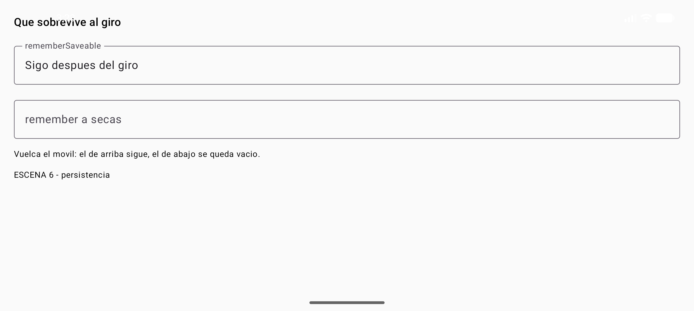
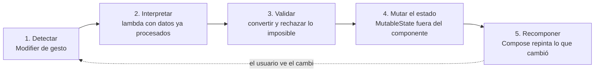
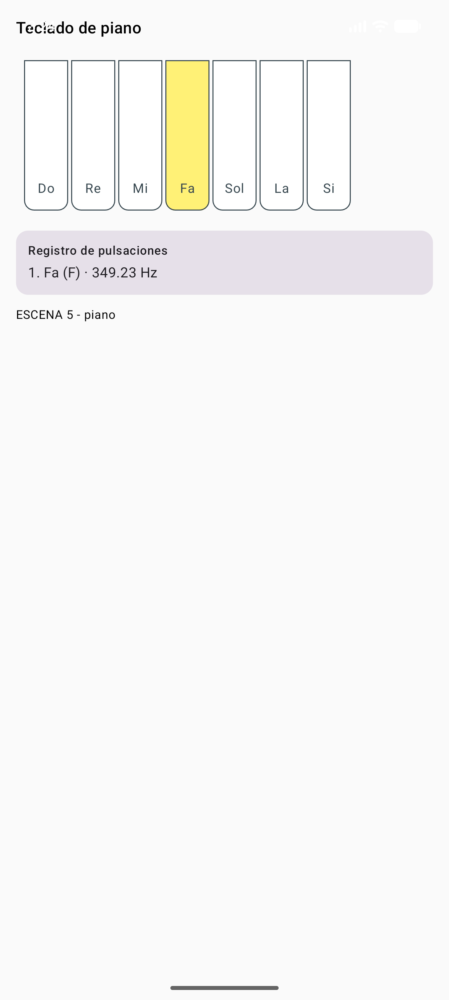

# 5.1 — Explotación de componentes visuales

> **Del libro de texto:** tema 5, *Explotación de componentes visuales*.
> El libro lo resuelve con `MouseListener`, `KeyListener`, `ActionListener`, `FocusListener`, JUnit en
> Eclipse y dos casos prácticos (configuración del ratón con `JSpinner` y teclado de piano con JFugue).
> Aquí se hace **el mismo trabajo**: decidir a qué eventos responde cada pieza, conectarles la acción,
> guardar el estado, probarlo y documentarlo. Cambian las herramientas:
> **Jetpack Compose**, `rememberSaveable` con `Saver` propio y **pruebas instrumentadas** con
> Compose Testing. Todo el código de esta página es el del proyecto `IsmaelUIKit` de la UD4, ampliado
> con dos componentes nuevos (`PanelPuntero` y `Tecla`): **compilado y ejecutado de verdad**, y las
> capturas son del emulador.

## Resultado de aprendizaje que trabaja esta unidad

<span style="background-color:#a5d6a7;padding:0 3px;border-radius:3px;">**RA3. Crea componentes visuales valorando y empleando herramientas específicas** (RD 405/2023, módulo 0488)</span>,
con dos criterios de evaluación que en la UD4 quedaron abiertos y aquí se cierran, más uno del RA1.

| CE | Criterio de evaluación | Dónde se trabaja |
| -- | ---------------------- | ---------------- |
| RA3 d | Se han determinado los eventos a los que debe responder el componente y se les han asociado las acciones correspondientes. | §4.1 tabla de eventos, §5 `Tecla`, §9 y §10 casos prácticos |
| RA3 e | Se han realizado pruebas unitarias sobre los componentes desarrollados. | §3 (tres clases de prueba) y §12 (salida real) |
| RA1 g | Se han asociado acciones a los eventos de la interfaz. | §7 flujo de asociación, §9 |
| RA3 c | Propiedades con valores por defecto. | §8, `ConfigPuntero` inmutable |
| RA3 h | Aplicaciones cuyo interfaz utiliza los componentes creados. | las tres escenas nuevas del `MainActivity` |

<div style="background-color:#a5d6a7; border-radius:8px; padding:10px 14px; margin:14px 0;">
<strong>🟢 Leyenda de repaso obligatorio:</strong> los textos con <span style="background-color:#a5d6a7;padding:0 3px;border-radius:3px;">este fondo verde</span> son imprescindibles para explotar componentes: hay que repasarlos <strong>cada semana</strong>. Son la parte del módulo que más se repite en exámenes y en la práctica profesional.</div>

## 1. Introducción y contextualización práctica

<span style="background-color:#a5d6a7;padding:0 3px;border-radius:3px;">En la UD4 fabricaste componentes. Este tema los **explota**: convertirlos en piezas que responden al</span>
usuario, sobreviven a que el sistema mate la actividad, se puedan inspeccionar desde fuera y tienen
pruebas automáticas que demuestran que funcionan.

Un componente «explotado» cumple cuatro cosas:

1. **Responde**: responde solo a los eventos que le interesan, y a cada evento le tiene asociada una acción concreta.
2. **Recuerda**: su estado visible sobrevive a una rotación de pantalla o a que Android recupere la app.
3. **Se deja mirar**: desde fuera (Layout Inspector, `uiautomator`, un lector de pantalla) se ve qué es, cómo se llama y dónde está.
4. **Se prueba**: tiene pruebas que fallan si algo se rompe, antes de que lo descubra el usuario.

<figure markdown>

<figcaption>Figura 1. El mismo viaje, dos épocas. Arriba, el modelo que explica el libro; abajo, cómo se recorre hoy. Ninguna de las dos ideas es nueva: en ambas, un componente detecta, avisa y alguien actúa.</figcaption>
</figure>

## 2. Características fundamentales del componente explotado

### 2.1 Introspección y reflexión

El libro abre el tema hablando de **introspección** (el componente sabe qué propiedades tiene) y
**reflexión** (el entorno descubre esas propiedades sin saber de qué clase es). De ahí salía todo: la
paleta de Eclipse, el inspector de propiedades, la serialización.

!!! note "La reflexión, dónde está en 2026"
    **En 2026 la reflexión sigue ahí, pero casi no la tocas.** Lo que antes se conseguía con
    `java.beans.Introspector.getBeanInfo(clase)` hoy se reparte en tres sitios: `@Composable` (las
    propiedades son los parámetros de la función), `data class` y `copy` (Kotlin genera los accesores)
    y `@Parcelize` / `kotlinx.serialization` (reflexión delegada en un anotador de código, que genera
    el código en tiempo de compilación en lugar de pagarlo en tiempo de ejecución).


<span style="background-color:#a5d6a7;padding:0 3px;border-radius:3px;">Lo que un examinador entiende hoy por «introspección de una interfaz» es el **árbol de semántica**:</span>
el árbol paralelo que Compose mantiene para que el sistema —y TalkBack, y las pruebas, y
`uiautomator`— pueda preguntar qué hay en la pantalla. Cada nodo declara un rol, un contenido, un
estado de selección, si es togglable, si está enfocado.

Y se puede ver desde fuera del proceso. Con una sola línea puesta en la raíz de la interfaz,

```kotlin title="app/src/main/java/com/example/uikit/demo/MainActivity.kt"
androidx.compose.foundation.layout.Box(
    modifier = androidx.compose.ui.Modifier.semantics { testTagsAsResourceId = true },
) { /* la escena */ }
```

los `testTag` que pusiste para las pruebas salen como `resource-id` en el volcado de `uiautomator`.
Volcado real de la escena del panel del puntero, sacado con `adb shell uiautomator dump`:

```xml title="dump-escena4.xml (extracto real)"
<node class="android.view.View" resource-id="velocidad-50"
      clickable="true" checkable="false" bounds="[476,288][670,432]" />
<node class="android.view.View" resource-id="boton-DERECHO"
      clickable="true" checkable="false" bounds="[408,564][712,708]" />
<node class="android.view.View" resource-id="animacion"
      clickable="true" checkable="true" checked="false" bounds="[60,744][216,888]" />
```

Tres cosas útiles en esas tres líneas: **nombre estable** para las pruebas (no depende del texto, así
que la prueba no se rompe al traducir la app), **caja de toque** (el área que acepta el dedo, que debe
medir al menos 48 dp de lado) y **estado accesible** (`checkable`, `checked`: lo que lee un lector de
pantalla). En la escena del piano el volcado además describe cada tecla:

```xml title="dump-escena5.xml (extracto real)"
<node class="android.view.View" resource-id="tecla-Do" content-desc="Tecla Do" bounds="[72,180][204,630]" />
<node class="android.view.View" resource-id="tecla-Sol" content-desc="Tecla Sol" bounds="[636,180][768,630]" />
```

<span style="background-color:#a5d6a7;padding:0 3px;border-radius:3px;">Un componente sin `contentDescription` en lo que informa de algo es un componente invisible para un usuario con lector de pantalla</span>. En los botones del panel no hizo falta ponerlo: el hijo `Text` ya aporta la etiqueta. En la tecla, que se pinta a sí misma, sí.

### 2.2 Persistencia del componente

Segundo pilar del tema en el libro: el componente tiene que poder **guardar y recuperar su estado**
(serializar, `persistState`). En Android eso no es un lujo: al girar el móvil, el sistema destruye la
actividad y la vuelve a crear. Si no guardas nada, la pantalla vuelve en blanco.

<span style="background-color:#a5d6a7;padding:0 3px;border-radius:3px;">En Compose hay dos memoriales y la diferencia importa: `remember` vive mientras vive la composición; `rememberSaveable` sobrevive a la destrucción de la actividad porque viaja en el `Bundle` del sistema</span>.

```kotlin title="app/src/main/java/com/example/uikit/demo/MainActivity.kt (escena 6)"
var sobrevive by rememberSaveable { mutableStateOf("") }   // pasa por el Bundle: resucita al girar
var sePierde by remember { mutableStateOf("") }            // muere con la composicion
```

`rememberSaveable` solo sabe guardar tipos que caben en un `Bundle` (números, texto, `Parcelable`,
listas de esas cosas). Un tipo de dominio propio hay que enseñarle a guardarse, y eso se hace con un
`Saver`: dos funciones, una que reduce el objeto a algo serializable y otra que lo reconstruye (§9,
`SaverConfigPuntero`). Es exactamente el papel que en el libro jugaba `Serializable` / `persistState`,
pero escrito una vez junto al tipo de dato y no en una interfaz que hay que implementar.

**Comprobado en el emulador**, girando el dispositivo con `adb shell settings put system user_rotation 1`.
Mismo volcado de `uiautomator`, antes y después del giro:

```text title="uiautomator dump, escena 6 (datos reales)"
ANTES     campo-sobrevive  text="Sigo despues del giro"      campo-se-pierde  text="Me pierdo"
DESPUES   campo-sobrevive  text="Sigo despues del giro"      campo-se-pierde  text=""
```

<figure markdown>

<figcaption>Figura 2. Antes del giro: los dos campos tienen texto.</figcaption>
</figure>

<figure markdown>

<figcaption>Figura 3. Después del giro: la actividad se ha destruido y recreado. El campo guardado sigue entero; el otro ha vuelto a nacer vacío. Esa es la diferencia entre los dos memorialistas, en una sola imagen.</figcaption>
</figure>

!!! warning "Qué NO se guarda en el Bundle"
    El `Bundle` de estado tiene un tope pequeño (unos pocos cientos de kB). Se guarda **lo que el usuario
    ha puesto o elegido**: texto del formulario,filtro de la lista, índice de la pestaña, identificador del
    elemento seleccionado. No se guarda **lo que se puede volver a pedir**: el listado del servidor, el
    bitmap descargado, el contenido de la base de datos. Para eso están `ViewModel` (sobrevive a la
    rotación, no al proceso) y la capa de datos — que es lo que trata PMDM, no este módulo.

## 3. Pruebas unitarias: dónde se escriben y qué se prueba

El libro monta las pruebas con JUnit en Eclipse: clase de prueba, métodos anotados, aserciones y
comprobación de errores. El esquema no ha cambiado nada; han cambiado la ubicación y el alcance.

| | Pruebas **JVM** (`src/test`) | Pruebas **instrumentadas** (`src/androidTest`) |
| --- | --- | --- |
| Dónde corren | en el portátil, sin Android | en el dispositivo o emulador |
| Velocidad | milisegundos | segundos |
| Qué pueden tocar | lógica pura, `data class`, validaciones | la interfaz real, gestos, semántica, base de datos |
| Aquí | `ConfigPunteroTest` | `TeclaEventosTest`, `PanelPunteroTest`, `BadgeEstadoTest` |
| Compose | nada (no hay composición) | `createComposeRule()` y `onNodeWithTag(...)` |

<span style="background-color:#a5d6a7;padding:0 3px;border-radius:3px;">Regla para no equivocarse de carpeta: si la prueba necesita ver la pantalla o tocar algo, va a `androidTest`; si solo necesita pensar, va a `test`</span>. Y un componente con lógica **dentro** del composable no se puede probar sin dispositivo: por eso el `Saver` y el parser `deVelocidad` del §10 son funciones normales, probables en JVM.

Las anotaciones y aserciones del libro siguen siendo las mismas (`@Test`, `@Before`, `@After`,
`assertEquals`, `assertThrows`). Lo nuevo es el vocabulario de Compose:

| Quiero | Cómo |
| ------ | ---- |
| Montar el componente a prueba | `regla.setContent { Tecla(...) }` |
| Buscarlo sin depender del texto | `regla.onNodeWithTag("tecla-Do")` |
| Comprobar que se ve | `.assertIsDisplayed()` |
| Hacer un clic | `.performClick()` |
| Hacer un gesto real | `.performTouchInput { click() }` |
| Preguntar qué dice la semántica | `.fetchSemanticsNode().config[SemanticsProperties.ContentDescription]` |

**Código 7.** Fichero completo de pruebas. Es el código que produjo la salida del §12.

```kotlin title="ui/src/androidTest/java/com/example/uikit/EventosTest.kt"
package com.example.uikit

import androidx.compose.ui.semantics.SemanticsProperties
import androidx.compose.ui.test.assertIsDisplayed
import androidx.compose.ui.test.click
import androidx.compose.ui.test.junit4.createComposeRule
import androidx.compose.ui.test.onNodeWithTag
import androidx.compose.ui.test.onNodeWithText
import androidx.compose.ui.test.performClick
import androidx.compose.ui.test.performTouchInput
import org.junit.Assert.assertEquals
import org.junit.Assert.assertNull
import org.junit.Assert.assertThrows
import org.junit.Rule
import org.junit.Test

/**
 * Pruebas del teclado (criterios 3d y 3e). Son **instrumentadas**: se ejecutan en el dispositivo,
 * con dedo falso incluido (`performTouchInput`), porque un gesto no se puede simular en la JVM.
 */
class TeclaEventosTest {

    @get:Rule
    val regla = createComposeRule()

    @Test
    fun alPulsarLaTeclaSeDisparaElEventoConSuNota() {
        var tocada: Nota? = null
        var soltada: Nota? = null
        regla.setContent {
            Tecla(ESCALA.first(), presionada = false, onPulsar = { tocada = it }, onSoltar = { soltada = it })
        }
        regla.onNodeWithTag("tecla-Do").performTouchInput { click() }      // pulsar y levantar, sintetico
        assertEquals("Do", tocada?.nombre)                                 // el evento llego con su nota
        assertEquals("Do", soltada?.nombre)                                // y tambien la subida del dedo
    }

    @Test
    fun componerLaTeclaNoDisparaNada() {
        var tocada: Nota? = null                                           // nadie la ha tocado
        regla.setContent {
            Tecla(ESCALA.first(), presionada = false, onPulsar = { tocada = it }, onSoltar = { })
        }
        regla.onNodeWithTag("tecla-Do").assertIsDisplayed()                // esta en pantalla...
        assertNull(tocada)                                                 // ...y aun no ha pasado nada
    }

    @Test
    fun laTeclaSeDescribeSolaParaElLectorDePantalla() {
        regla.setContent { Tecla(ESCALA[3], presionada = false, onPulsar = { }, onSoltar = { }) }
        // Leemos el arbol de semantica: es la introspeccion de 2026, lo que ve TalkBack.
        val descripciones = regla.onNodeWithTag("tecla-Fa")
            .fetchSemanticsNode()
            .config[SemanticsProperties.ContentDescription]
        assertEquals(listOf("Tecla Fa"), descripciones)
    }
}

/** Pruebas del panel de configuracion: el evento entrega la configuracion completa. */
class PanelPunteroTest {

    @get:Rule
    val regla = createComposeRule()

    @Test
    fun elegirCincuentaCambiaSoloLaVelocidad() {
        var ultima: ConfigPuntero? = null
        regla.setContent { PanelPuntero(ConfigPuntero(), onCambio = { nueva -> ultima = nueva }) }
        regla.onNodeWithTag("velocidad-50").performClick()
        assertEquals(50, ultima?.velocidad)
        assertEquals(BotonRaton.IZQUIERDO, ultima?.principal)               // lo demas se conserva (inmutable)
    }

    @Test
    fun elegirDerechoConservaLaVelocidad() {
        var ultima: ConfigPuntero? = null
        regla.setContent {
            PanelPuntero(ConfigPuntero(velocidad = 0), onCambio = { nueva -> ultima = nueva })
        }
        regla.onNodeWithTag("boton-DERECHO").performClick()
        assertEquals(BotonRaton.DERECHO, ultima?.principal)
        assertEquals(0, ultima?.velocidad)
    }

    @Test
    fun cadaBotonAnunciaLoQueEs() {
        regla.setContent { PanelPuntero(ConfigPuntero(), onCambio = { }) }
        val descripciones = regla.onNodeWithTag("velocidad-25")
            .fetchSemanticsNode()
            .config[SemanticsProperties.ContentDescription]
        assertEquals(listOf("Velocidad 25"), descripciones)
        regla.onNodeWithText("Izquierdo").assertIsDisplayed()
    }
}

/** Pruebas de la logica suelta (apartado 3.4 del tema): tambien de los errores. */
class ConfigPunteroTest {

    @Test
    fun aceptaLosTresValoresDelPanel() {
        assertEquals(25, ConfigPuntero.deVelocidad("25").velocidad)
        assertEquals(50, ConfigPuntero.deVelocidad("  50 ").velocidad)      // con espacios, como en la vida real
    }

    @Test
    fun rechazaUnaVelocidadQueNoExiste() {
        val error = assertThrows(IllegalArgumentException::class.java) { ConfigPuntero.deVelocidad("75") }
        assertEquals("Velocidad no admitida: 75", error.message)            // el mensaje tambien se prueba
    }

    @Test
    fun unTextoQueNoEsNumeroDaNumberFormatException() {
        assertThrows(NumberFormatException::class.java) { ConfigPuntero.deVelocidad("rapido") }
    }
}

```

Tres detalles que valen punto en el examen:

- <span style="background-color:#a5d6a7;padding:0 3px;border-radius:3px;">`@get:Rule val regla = createComposeRule()` levanta el `ComposeTestRule`: sin eso no hay composición donde mirar</span>.
- <span style="background-color:#a5d6a7;padding:0 3px;border-radius:3px;">Se afirma sobre la etiqueta y sobre el estado, no sobre píxeles</span>. Una captura que cambia de tamaño no rompe la prueba; un `assertTrue` sobre `null` sí.
- <span style="background-color:#a5d6a7;padding:0 3px;border-radius:3px;">`assertThrows` también prueba el mensaje</span>: el apartado 3.4 del libro («comprobación de errores») es exactamente esto, y es lo que salva una app cuando el usuario escribe `75` donde valían 0, 25 o 50.

## 4. Eventos: clases, componentes y métodos

El libro desmonta la «programación basada en eventos» en tres piezas: **fuente** (el componente que
genera), **objeto de evento** (lo que se envía) y **listener** (quien lo escucha). Y añade una tabla de
qué componente emite qué evento. Esa taxonomía sigue siendo la forma correcta de pensar una interfaz,
porque lo que se decide es **el contrato**: a qué responde cada pieza y qué hace cuando responde.

<span style="background-color:#a5d6a7;padding:0 3px;border-radius:3px;">En Compose no se registra escuchadores: el «listener» es un parámetro de la función y el objeto evento casi nunca se ve, porque se interpreta dentro del `Modifier` de entrada</span>. El contrato se declara en la firma:

```kotlin
fun PanelPuntero(configuracion: ConfigPuntero, onCambio: (ConfigPuntero) -> Unit, ...)
```

Con esa línea ya está dicho todo: el componente **no** cambia nada por dentro, **devuelve** la
configuración completa cuando el usuario toca, y no sabe ni le importa qué hará el llamador con ella.

### 4.1 Qué eventos tiene cada componente (el mismo análisis del libro)

| Componente | Evento(s) que le interesan | Acción razonable |
| ---------- | -------------------------- | ---------------- |
| `Button` | `onClick` | emitir el evento propio con el estado nuevo |
| `Switch` | `onCheckedChange(activada)` | copiar la configuración con el booleano cambiado |
| `OutlinedTextField` | `onValueChange`, `onKeyboardAction` | validar, y solo escribir si es válido |
| `Checkbox` / `FilterChip` | `onCheckedChange` / `onClick` | alternar un filtro |
| `Slider` | `onValueChange`, `onValueChangeFinished` | previsualizar durante el arrastre y confirmar al soltar |
| `Tecla` (propio) | `onPulsar`, `onSoltar` | sonar y pintar la tecla hundida |
| `FiguraRaton` (propio) | ninguno: **solo recibe** | pintar según lo que le pasan |
| Lista de elementos | scroll, clic en fila, deslizamiento lateral | cargar más, abrir detalle, borrar |
| Pantalla completa | teclas (DPAD, Tab), foco | mover el foco de forma predecible |

!!! note "La fila de `FiguraRaton` es la importante"
    Un componente de dibujo **no necesita eventos**: es una función de `ConfigPuntero` a píxeles. Si le
    metes estado dentro, introduces una segunda fuente de verdad y aparece la incoherencia entre lo que
    el usuario eligió y lo que se pinta. <span style="background-color:#a5d6a7;padding:0 3px;border-radius:3px;">Cuanta más lógica de presentación esté en componentes que solo reciben parámetros, menos pruebas hacen falta y menos fallos hay</span>.


## 5. Los listeners del libro, traducidos uno a uno

El apartado 6 del libro dedica su espacio a `KeyListener` y `ActionListener`. Su traducción es directa,
y conviene tenerla memorizada porque cae en las dos direcciones («¿cómo se hace hoy esto?» y «¿esto de
qué evento viene?»).

| Del libro (Swing / JavaBeans) | Método que se sobrescribía | Equivalente en Compose | Notas |
| ----------------------------- | -------------------------- | ---------------------- | ----- |
| `ActionListener` | `actionPerformed(ActionEvent)` | `onClick = { ... }` de `clickable`/`Button` | El `ActionEvent` no llega: ya sabes qué control has tocado porque la lambda está en ese componente. |
| `KeyListener` | `keyPressed` / `keyReleased` / `keyTyped` | `Modifier.onPreviewKeyEvent { }` / `onKeyEvent { }` | Devuelve `true` si te lo quedas, `false` para que siga subiendo. `onPreview` se ejecuta antes que el componente. |
| `MouseListener` | `mousePressed` / `mouseReleased` / `mouseClicked` / `mouseEntered` / `mouseExited` | `Modifier.clickable`, `Modifier.hoverable` (entrar/salir con ratón) | En táctil, `clickable` cubre pulsar y soltar. |
| `MouseMotionListener` | `mouseDragged` / `mouseMoved` | `Modifier.pointerInput { detectDragGestures { … } }` | El arrastre ya viene con la distancia acumulada. |
| `FocusListener` | `focusGained` / `focusLost` | `Modifier.onFocusEvent { estado.hasFocus }`, `FocusRequester` | Con teclado físico o DPAD esto no es opcional. |
| `ChangeListener` (del `JSpinner`) | `stateChanged(ChangeEvent)` | `onValueChange` del `Slider`, `TextField`, `Checkbox` | |
| `ItemListener` (del `JComboBox`) | `itemStateChanged(ItemEvent)` | `onClick` en cada opción, o `onSelectedChange` de una fila de opciones | |

<span style="background-color:#a5d6a7;padding:0 3px;border-radius:3px;">Todo evento en Compose se gestiona igual: un `Modifier` que observa y una lambda que actúa. Lo único que cambia entre un evento y otro es el `Modifier` que se pone delante</span>.

**Código 4.** Las teclas del piano. `Tecla` es un componente propio, sin `JButton` debajo, así que el
gesto se caza a mano con `pointerInput`: es el `MouseListener` de 2026, en versión *suspend* en lugar de
interfaz con cinco métodos vacíos.

```kotlin title="ui/src/main/java/com/example/uikit/Nota.kt"
package com.example.uikit

/**
 * Datos del teclado del caso práctico 2.
 *
 * El libro usaba siete `JButton` con la nota inglesa dentro del `actionCommand`. Aquí la nota es un
 * tipo de dato: nombre en español (lo que ve el alumno), letra inglesa (lo que se envía al sinte) y
 * frecuencia real, que es lo que necesita `AudioTrack` para generar el sonido.
 */
data class Nota(val nombre: String, val inglesa: String, val frecuenciaHz: Double)

/** Las siete teclas del caso práctico 2 (allí, siete `JButton` con JFugue). */
val ESCALA: List<Nota> = listOf(
    Nota("Do", "C", 261.63),
    Nota("Re", "D", 293.66),
    Nota("Mi", "E", 329.63),
    Nota("Fa", "F", 349.23),
    Nota("Sol", "G", 392.00),
    Nota("La", "A", 440.00),
    Nota("Si", "B", 493.88),
)

```

```kotlin title="ui/src/main/java/com/example/uikit/Tecla.kt"
package com.example.uikit

import androidx.compose.foundation.background
import androidx.compose.foundation.border
import androidx.compose.foundation.*            // pointerInput vive en foundation
import androidx.compose.ui.input.pointer.*      // y sus tipos de evento, aqui
import androidx.compose.foundation.gestures.awaitEachGesture
import androidx.compose.foundation.gestures.awaitFirstDown
import androidx.compose.foundation.gestures.waitForUpOrCancellation
import androidx.compose.foundation.layout.Arrangement
import androidx.compose.foundation.layout.Box
import androidx.compose.foundation.layout.Row
import androidx.compose.foundation.layout.height
import androidx.compose.foundation.layout.padding
import androidx.compose.foundation.layout.width
import androidx.compose.foundation.shape.RoundedCornerShape
import androidx.compose.material3.Text
import androidx.compose.runtime.Composable
import androidx.compose.runtime.getValue
import androidx.compose.runtime.mutableStateOf
import androidx.compose.runtime.remember
import androidx.compose.runtime.setValue
import androidx.compose.ui.Alignment
import androidx.compose.ui.Modifier
import androidx.compose.ui.graphics.Color
import androidx.compose.ui.platform.testTag
import androidx.compose.ui.semantics.contentDescription
import androidx.compose.ui.semantics.semantics
import androidx.compose.ui.unit.dp
import androidx.compose.ui.unit.sp

/**
 * Una tecla del piano: caso práctico 2 del libro, sin `JButton`.
 *
 * El libro se apoyaba en `ActionListener` del botón. Un componente propio no tiene botón debajo,
 * así que el gesto se detecta con `pointerInput`: es el **`MouseListener` de 2026**, pero en versión
 * de suspend (`awaitEachGesture`) en lugar de interfaz con seis métodos vacíos.
 *
 * El componente **no sabe que suena nada**: avisa por sus dos eventos y quien lo use decide.
 */
@Composable
fun Tecla(
    nota: Nota,
    presionada: Boolean,
    onPulsar: (Nota) -> Unit,
    onSoltar: (Nota) -> Unit,
    modifier: Modifier = Modifier,
) {
    val forma = RoundedCornerShape(bottomStart = 10.dp, bottomEnd = 10.dp)
    Box(
        contentAlignment = Alignment.BottomCenter,
        modifier = modifier
            .width(44.dp)
            .height(150.dp)
            .background(if (presionada) Color(0xFFFFF176) else Color.White, forma)
            .border(1.dp, Color(0xFF37474F), forma)
            .semantics { contentDescription = "Tecla ${nota.nombre}" }   // para el lector de pantalla
            .testTag("tecla-${nota.nombre}")                              // para las pruebas
            .pointerInput(nota) {
                awaitEachGesture {                     // cada toque es un bucle de gestos
                    awaitFirstDown(requireUnconsumed = false)   // pulsacion (equivale a mousePressed)
                    onPulsar(nota)                              // aqui sonaria la nota
                    waitForUpOrCancellation()                   // espera la subida del dedo
                    onSoltar(nota)                              // mouseReleased
                }
            },
    ) {
        Text(
            nota.nombre,
            fontSize = 13.sp,
            color = Color(0xFF37474F),
            modifier = Modifier.padding(bottom = 10.dp),
        )
    }
}

/**
 * Fila de teclas. Es un componente de orden superior: recibe la escala y el evento, y
 * **esconde** el estado «qué tecla está abajo ahora» porque nadie de fuera necesita saberlo.
 */
@Composable
fun TecladoPiano(
    notas: List<Nota> = ESCALA,
    onTocar: (Nota) -> Unit,
    modifier: Modifier = Modifier,
) {
    var pulsada by remember { mutableStateOf<String?>(null) }    // solo interes interno
    Row(
        modifier = modifier.padding(8.dp),
        horizontalArrangement = Arrangement.spacedBy(3.dp),
    ) {
        notas.forEach { nota ->
            Tecla(
                nota = nota,
                presionada = pulsada == nota.nombre,
                onPulsar = { pulsada = nota.nombre; onTocar(nota) },
                onSoltar = { if (pulsada == nota.nombre) pulsada = null },
            )
        }
    }
}

```

Dentro del `pointerInput` hay un mini-protocolo que es bueno saber leer:

- `awaitEachGesture { }` — bucle: se reactiva con cada gesto nuevo sobre el componente.
- <span style="background-color:#a5d6a7;padding:0 3px;border-radius:3px;">`awaitFirstDown()` espera a que el dedo toque (el `mousePressed` del libro) y `waitForUpOrCancellation()` espera a que se levante (el `mouseReleased`)</span>. Entre las dos, el componente está «pulsado».
- El bloque es *suspend*: **se pausa sin bloquear el hilo de la interfaz**. En Swing, hacer algo lento dentro de `actionPerformed` congelaba la ventana (el *EDT*); aquí eso no ocurre mientras no llames a algo bloqueante, y para eso está el hilo de `tocarNota` (§10).
- <span style="background-color:#a5d6a7;padding:0 3px;border-radius:3px;">`pointerInput(nota)` lleva una clave: si la nota cambia, el bloque se reinicia y deja de escuchar el gesto viejo</span>. Sin clave, los closures se quedan apuntando al valor con el que se compusieron la primera vez, que es la fuente de bugs de eventos más frecuente en Compose.

## 6. Ratón, foco y teclado físico

El libro incluye `MouseListener` y `FocusListener` porque en escritorio hay ratón y hay teclado. En un
móvil el primero casi no se usa, pero **el foco sí**: mando de consola, teclado Bluetooth, accesibilidad
y navegación por controles. Las tres piezas que hay que conocer:

```kotlin
var foco by remember { mutableStateOf(false) }
Box(
    Modifier
        .onFocusEvent { evento -> foco = evento.hasFocus }   // el focusGained/focusLost del libro
        .onPreviewKeyEvent { evento ->                        // antes de que el campo se lo coma
            if (evento.key == Key.Enter && evento.type == KeyEventType.KeyUp) {
                onPulsar(nota); true                          // true = me lo he quedado
            } else false                                      // false = que siga subiendo
        },
) { /* … */ }
```

- `FocusRequester` pide el foco (el `requestFocus()` de toda la vida) y se encadena con
  `focusRestorer()` para recuperarlo tras una recomposición.
- El recorrido del foco va **en el orden en que se declara la interfaz**: si el orden visual no coincide
  con el del árbol, se arregla con `focusGroup` y `focusOrder`, no a base de poner `tabIndex` a mano.
- <span style="background-color:#a5d6a7;padding:0 3px;border-radius:3px;">Un componente propio que no declara `contentDescription` ni acepta foco es invisible para media clase: la otra mitad no lo puede usar sin ratón</span>.

## 7. Asociación de acciones a eventos

El apartado 9 del libro pide un flujo ordenado para asociar una acción a un evento. Funciona igual en
2026, con otros nombres:



| Paso | En el libro | Aquí |
| ---- | ----------- | ---- |
| 1. Crear el escuchador y registrarlo | `spinner1.addChangeListener(...)` | `onClick`/`onValueChange` en el propio componente |
| 2. Averiguar qué ha pasado | `e.getSource()`, `spinner1.getValue()` | el valor llega por parámetro de la lambda |
| 3. Validar | `try { Integer.parseInt(...) } catch ...` | `deVelocidad(texto)` (§9), con `require` |
| 4. Cambiar el modelo | mutar campos del `JFrame` y llamar a `repaint()` | `config = config.copy(...)`; la recomposición es automática |
| 5. Refrescar la vista | `repaint()` a mano | nada: Compose observa el `MutableState` |

<span style="background-color:#a5d6a7;padding:0 3px;border-radius:3px;">El error de concepto que hay que arrancar: la acción de un evento **no repinta**, cambia el estado. Quien repinta es el sistema de composición</span>. Todo lo que en el libro era «y al final llamo a `repaint()`» aquí es escribir una variable observada.

!!! warning "Cuatro antipatrones que se ven en los exámenes"
    | Antipatrón | Por qué se rompe |
    | ---------- | ---------------- |
    | Mutar una lista dentro del `@Composable` sin `mutableStateListOf` | Compose no se entera: la pantalla no cambia y el alumno jura que «el evento no llega». |
    | Guardar en el evento el valor anterior («para poder volver») | Dos copias de la verdad: se desincronizan al girar la pantalla. |
    | Petición de red o disco dentro de la lambda del clic | Si tarda, la interfaz se planta (y en Compose, además, es un efecto secundario dentro de la composición). Se lanza en una `coroutine` o con `LaunchedEffect`. |
    | `when` de 12 ramas dentro del componente para decidir qué hacer | El componente deja de ser reutilizable: la decisión se saca al llamador, que es quien sabe qué quiere hacer. |

## 8. Propiedades y valores por defecto en un componente con estado

Criterio **RA3 c**, que en la UD4 se resolvió con un `enum` y un texto. Aquí la propiedad es un objeto de
dominio, y la forma de cambiarla es **inmutable**:

```kotlin
configuracion.copy(velocidad = 50)        // objeto NUEVO; el anterior sigue intacto
```

<span style="background-color:#a5d6a7;padding:0 3px;border-radius:3px;">Con objetos inmutables, el evento puede entregar la configuración completa: no hay ambigüedad sobre qué ha cambiado ni quién lo cambió, y el `Saver` puede serializar el objeto entero de golpe</span>. Las ventajas colaterales son las de siempre: un `data class` da `equals` (Compose puede comparar y no repintar de más), `copy` (actualizaciones parciales) y `toString` (un volcado legible en el log).

## 9. Caso práctico 1: «Configuración del puntero»

**Planteamiento del libro.** Interfaz para configurar la velocidad del ratón y el botón principal, con
`JSpinner` (0, 25, 50), `JComboBox` (izquierdo/derecho), una barra de progreso pintada a mano (0 → 20 px
roja, 25 → 40 px naranja, 50 → 60 px verde) y un ratón dibujado donde se resalta el botón elegido
(`fillRect(215,120,60,60)` o `(275,120,60,60)`). Los eventos: `ChangeListener` en el spinner,
`ItemListener` en el combo.

**Traducción.** Mismo planteamiento, mismos números, mismos dos eventos:

| Del libro | Aquí | Por qué |
| --------- | ---- | ------- |
| `JSpinner` con 0/25/50 | tres botones (0, 25, 50) | en móvil un spinner es un dolor de dedos; tres opciones se eligen a un toque |
| `ChangeListener.stateChanged` | `onClick` de cada botón | el valor entra ya validado: no existe la velocidad 37 |
| `JComboBox` izquierdo/derecho | dos botones | mismo efecto, cero plegables |
| `g.fillRect(50,120,20,20)` con rojo/naranja/verde | `drawRoundRect` en `FiguraRaton`, con 20/40/60 **dp** | la correspondencia es idéntica; en dp se ve igual en cualquier densidad |
| `repaint()` al final | nada | `config` ha cambiado, Compose repinta |
| campos `private` del `JFrame` | `ConfigPuntero` inmutable | el estado del panel se puede guardar y comparar |

**Código 1.** Las propiedades, su guardado y su validación. Fichero completo.

```kotlin title="ui/src/main/java/com/example/uikit/ConfigPuntero.kt"
package com.example.uikit

import androidx.compose.runtime.saveable.Saver

/** Qué botón del ratón hace de principal: la pareja moderna del `JComboBox` del libro. */
enum class BotonRaton(val etiqueta: String) {
    IZQUIERDO("Izquierdo"),
    DERECHO("Derecho"),
}

/**
 * Propiedades del panel de puntero.
 *
 * Es un `data class` inmutable: en lugar de mutar el objeto, el componente **fabrica uno nuevo**
 * con `copy(...)` y lo devuelve por el evento. Así el cambio es trazable y se puede guardar.
 */
data class ConfigPuntero(
    val velocidad: Int = 25,
    val principal: BotonRaton = BotonRaton.IZQUIERDO,
    val animacion: Boolean = true,
) {
    /** Longitud y color de la barra del caso práctico: 0→20 rojo, 25→40 naranja, 50→60 verde. */
    companion object {
        /**
         * Parsea la velocidad tecleada por el usuario. Un `IllegalArgumentException` en mitad del
         * evento hunde la aplicacion, asi que se comprueba aqui y se captura en la pantalla.
         */
        fun deVelocidad(texto: String): ConfigPuntero {
            val numero = texto.trim().toIntOrNull()
                ?: throw NumberFormatException("«$texto» no es un número")
            require(numero in setOf(0, 25, 50)) { "Velocidad no admitida: $numero" }
            return ConfigPuntero(velocidad = numero)
        }
    }

    val barra: Pair<Float, Long>
        get() = when (velocidad) {
            0 -> 20f to 0xFFD32F2FL
            50 -> 60f to 0xFF388E3CL
            else -> 40f to 0xFFF9A825L
        }
}

/**
 * Cómo se guarda `ConfigPuntero` cuando el sistema mata la actividad (al girar, por ejemplo).
 *
 * `rememberSaveable` no sabe qué es un `ConfigPuntero`: hay que decirle cómo reducirlo a algo
 * que quepa en el `Bundle` (aqui un `IntArray` de 3: velocidad, boton, animacion) y cómo
 * reconstruirlo. Eso es un `Saver`, el equivalente a la persistencia del componente del libro.
 */
val SaverConfigPuntero: Saver<ConfigPuntero, IntArray> = Saver(
    save = { config ->
        intArrayOf(
            config.velocidad,                                    // 0, 25 o 50
            if (config.principal == BotonRaton.IZQUIERDO) 0 else 1,
            if (config.animacion) 1 else 0,
        )
    },
    restore = { guardado ->
        ConfigPuntero(
            velocidad = guardado[0],
            principal = if (guardado[1] == 0) BotonRaton.IZQUIERDO else BotonRaton.DERECHO,
            animacion = guardado[2] == 1,
        )
    },
)

```

**Código 2 y Código 3.** El componente, en dos mitades del mismo fichero: la primera pinta y emite
eventos, la segunda dibuja el ratón con `DrawScope` (el `paint(Graphics g)` del libro).

```kotlin title="ui/src/main/java/com/example/uikit/PanelPuntero.kt (primera parte)"
package com.example.uikit

import androidx.compose.foundation.Canvas

import androidx.compose.foundation.layout.Arrangement
import androidx.compose.foundation.layout.Column
import androidx.compose.foundation.layout.Row
import androidx.compose.foundation.layout.fillMaxWidth
import androidx.compose.foundation.layout.height
import androidx.compose.foundation.layout.padding
import androidx.compose.foundation.shape.RoundedCornerShape
import androidx.compose.material3.MaterialTheme
import androidx.compose.material3.Button
import androidx.compose.material3.ButtonDefaults
import androidx.compose.material3.Switch
import androidx.compose.material3.Text
import androidx.compose.runtime.Composable
import androidx.compose.ui.Alignment
import androidx.compose.ui.Modifier
import androidx.compose.ui.geometry.CornerRadius
import androidx.compose.ui.geometry.Offset
import androidx.compose.ui.geometry.Size
import androidx.compose.ui.graphics.Color
import androidx.compose.ui.platform.testTag
import androidx.compose.ui.semantics.contentDescription
import androidx.compose.ui.semantics.semantics
import androidx.compose.ui.unit.dp

/**
 * Panel de configuración del puntero — versión 2026 del caso práctico 1 del libro.
 *
 * El libro usaba `JSpinner` + `JComboBox` + `ChangeListener` + `ItemListener`. Aqui hay dos botones
 * por opción y una `Switch`: **cada control dispara el mismo evento** `onCambio` con la configuración
 * completa, porque el componente es inmutable y no se toca a si mismo.
 *
 * @param configuracion lo que hay ahora (viene de fuera: el componente no lo recuerda)
 * @param onCambio          evento: se llama con la configuración nueva cada vez que el usuario toca algo
 */
@Composable
fun PanelPuntero(
    configuracion: ConfigPuntero,
    onCambio: (ConfigPuntero) -> Unit,
    modifier: Modifier = Modifier,
) {
    Column(
        modifier = modifier.fillMaxWidth(),
        verticalArrangement = Arrangement.spacedBy(12.dp),
    ) {
        Text("Velocidad del puntero", style = MaterialTheme.typography.titleSmall)
        Row(horizontalArrangement = Arrangement.spacedBy(8.dp)) {
            listOf(0, 25, 50).forEach { velocidad ->
                val elegido = velocidad == configuracion.velocidad
                Button(
                    onClick = { onCambio(configuracion.copy(velocidad = velocidad)) },
                    colors = coloresElegido(elegido),
                    modifier = Modifier
                        .testTag("velocidad-$velocidad")
                        .semantics { contentDescription = "Velocidad $velocidad" },
                ) { Text("$velocidad") }
            }
        }

        Text("Botón principal", style = MaterialTheme.typography.titleSmall)
        Row(horizontalArrangement = Arrangement.spacedBy(8.dp)) {
            BotonRaton.entries.forEach { boton ->
                val elegido = boton == configuracion.principal
                Button(
                    onClick = { onCambio(configuracion.copy(principal = boton)) },
                    colors = coloresElegido(elegido),
                    modifier = Modifier
                        .testTag("boton-${boton.name}")
                        .semantics { contentDescription = "Botón ${boton.etiqueta}" },
                ) { Text(boton.etiqueta) }
            }
        }

        Row(
            verticalAlignment = Alignment.CenterVertically,
            horizontalArrangement = Arrangement.spacedBy(12.dp),
        ) {
            Switch(
                checked = configuracion.animacion,
                onCheckedChange = { activada -> onCambio(configuracion.copy(animacion = activada)) },
                modifier = Modifier.testTag("animacion"),
            )
            Text("Animación del puntero")
        }

        FiguraRaton(configuracion)                       // la prueba visual del estado
        Text(
            "Barra: ${configuracion.barra.first.toInt()} dp",
            style = MaterialTheme.typography.bodySmall,
            modifier = Modifier.testTag("estado-barra"),
        )
    }
}

/** Botón pintado como elegido o no elegido, sin APIs experimentales de Material 3. */
@Composable
private fun coloresElegido(elegido: Boolean) = ButtonDefaults.buttonColors(
    containerColor = if (elegido) MaterialTheme.colorScheme.primary else MaterialTheme.colorScheme.surfaceVariant,
    contentColor = if (elegido) MaterialTheme.colorScheme.onPrimary else MaterialTheme.colorScheme.onSurfaceVariant,
)

```

```kotlin title="ui/src/main/java/com/example/uikit/PanelPuntero.kt (segunda parte)"
/**
 * Ratón dibujado a mano (caso práctico 1) con `DrawScope`.
 *
 * El libro dibujaba con `g.fillRect(215,120,60,60)` en píxeles del formulario. Aquí son las mismas
 * figuras, en **dp**: se ven igual en un móvil de 300 dpi y en uno de 450 dpi.
 * La barra reproduce la correspondencia del libro: 0 → 20 dp rojo, 25 → 40 dp naranja, 50 → 60 dp verde.
 */
@Composable
fun FiguraRaton(configuracion: ConfigPuntero, modifier: Modifier = Modifier) {
    val (longitudBarra, colorBarra) = configuracion.barra
    val centro = if (configuracion.principal == BotonRaton.IZQUIERDO) -1f else 1f
    Canvas(modifier = modifier.fillMaxWidth().height(190.dp).testTag("figura-raton")) {
        val cx = size.width / 2f
        val cuerpo = Color(0xFF90A4AE)
        val borde = Color(0xFF546E7A)

        // 1) cuerpo del ratón: rectangulo muy redondeado
        drawRoundRect(
            color = cuerpo,
            topLeft = Offset(cx - 60f.dp.toPx(), 12f.dp.toPx()),
            size = Size(120f.dp.toPx(), 140f.dp.toPx()),
            cornerRadius = CornerRadius(60f.dp.toPx()),
        )
        // 2) los dos botones; el elegido se pinta claro (era el fillRect(215..) o (275..) del libro)
        val anchoBoton = 50f.dp.toPx()
        val xIzquierda = cx - 54f.dp.toPx()
        val xDerecha = cx + 4f.dp.toPx()
        listOf(xIzquierda, xDerecha).forEachIndexed { indice, x ->
            val esElegido = (indice == 0 && centro < 0) || (indice == 1 && centro > 0)
            drawRoundRect(
                color = if (esElegido) Color(0xFFFFF176) else Color(0xFFECEFF1),
                topLeft = Offset(x, 20f.dp.toPx()),
                size = Size(anchoBoton, 52f.dp.toPx()),
                cornerRadius = CornerRadius(20f.dp.toPx()),
            )
        }
        // 3) la rueda y la linea que separa los botones
        drawRoundRect(
            color = Color(0xFF455A64),
            topLeft = Offset(cx - 5f.dp.toPx(), 34f.dp.toPx()),
            size = Size(10f.dp.toPx(), 24f.dp.toPx()),
            cornerRadius = CornerRadius(5f.dp.toPx()),
        )
        drawLine(borde, Offset(cx, 20f.dp.toPx()), Offset(cx, 76f.dp.toPx()), strokeWidth = 2f.dp.toPx())
        // 4) la barra de velocidad: longitud y color segun la propiedad `barra`
        drawRoundRect(
            color = Color(colorBarra),
            topLeft = Offset(16f.dp.toPx(), 168f.dp.toPx()),
            size = Size(longitudBarra.dp.toPx(), 14f.dp.toPx()),
            cornerRadius = CornerRadius(7f.dp.toPx()),
        )
    }
}

```

**Resultado.** Tocado con `adb shell input tap` —es decir, con un dedo sintético—: velocidad 50, botón Derecho,
animación apagada.

<figure markdown>

<figcaption>Figura 4. El caso práctico 1 del libro, ejecutado. El dibujo es el mismo que salió del <code>fillRect/fillOval</code> del libro: cuerpo, dos botones, rueda, y la barra de velocidad con la correspondencia 0 → 20 rojo, 25 → 40 naranja, 50 → 60 verde. Las líneas <code>Barra: 60 dp</code> y <code>Guardado: 50 · Derecho</code> salen del estado real del componente.</figcaption>
</figure>

Lista de comprobación de los criterios:

- **RA3 d** — los dos eventos del panel están declarados en su firma y conectados a una acción.
- **RA3 c** — `ConfigPuntero` con valores por defecto (`25`, `IZQUIERDO`, `true`).
- **RA1 g** — la acción asociada (cambiar la configuración) cambia el estado y se ve en el dibujo.
- **RA3 e** — `PanelPunteroTest` y `ConfigPunteroTest` (§3, salida en §12).

## 10. Caso práctico 2: «Teclado de piano»

**Planteamiento del libro.** Siete `JButton` a modo de teclas, librería JFugue, `Player.play(nota)`
dentro del `actionPerformed` de cada botón, con la nota inglesa en el comando de cada botón.

**Traducción.** El componente `Tecla` del §5 hace de `JButton` y además distingue pulsar de soltar (el
libro no lo pedía; un piano sin «nota soltada» no es un piano). El sonido es un listado aparte:

```kotlin title="app/src/main/java/com/example/uikit/demo/NotaReproductor.kt"
package com.example.uikit.demo

import kotlin.concurrent.thread
import kotlin.math.PI
import kotlin.math.sin
import android.media.AudioAttributes
import android.media.AudioFormat
import android.media.AudioTrack

/**
 * Nota senoidal generada al vuelo: el equivalente a `player.play("C4")` de JFugue del libro.
 *
 * Android no trae un sintetizador de notas sueltas, así que se calcula la onda y se manda a
 * `AudioTrack`. Se lanza en un hilo aparte para no bloquear la interfaz mientras suena.
 */
fun tocarNota(frecuencia: Double, milisegundos: Int = 260) {
    thread {                                                   // nada de trabajo pesado en el hilo UI
        val tasaDeMuestreo = 22_050                             // Hz: suficiente para un silbido limpio
        val muestras = tasaDeMuestreo * milisegundos / 1000
        val datos = ShortArray(muestras) { indice ->
            val envolvente = 1f - indice.toFloat() / muestras   // fade-out: evita el "clac" final
            val valor = sin(2.0 * PI * frecuencia * indice / tasaDeMuestreo) * Short.MAX_VALUE * envolvente
            valor.toInt().coerceIn(Short.MIN_VALUE.toInt(), Short.MAX_VALUE.toInt()).toShort()
        }
        val pista = AudioTrack.Builder()
            .setAudioAttributes(
                AudioAttributes.Builder()
                    .setUsage(AudioAttributes.USAGE_MEDIA)
                    .setContentType(AudioAttributes.CONTENT_TYPE_MUSIC)
                    .build(),
            )
            .setAudioFormat(
                AudioFormat.Builder()
                    .setEncoding(AudioFormat.ENCODING_PCM_16BIT)
                    .setSampleRate(tasaDeMuestreo)
                    .setChannelMask(AudioFormat.CHANNEL_OUT_MONO)
                    .build(),
            )
            .setBufferSizeInBytes(datos.size * 2)              // 2 bytes por muestra (16 bits)
            .setTransferMode(AudioTrack.MODE_STATIC)
            .build()
        pista.write(datos, 0, datos.size, AudioTrack.WRITE_BLOCKING)
        pista.play()
        Thread.sleep(milisegundos + 80L)
        pista.stop()
        pista.release()
    }
}

```

Y así se monta la escena, con un registro de lo que suena — que es lo que hace de prueba visible del
evento, porque el sonido no se ve en una captura:

```kotlin title="app/src/main/java/com/example/uikit/demo/MainActivity.kt (escena 5)"
/** Escena 5: caso practico 2 (teclado de piano). El log demuestra que el evento llego. */
@Composable
private fun EscenaPiano() {
    val registro = remember { androidx.compose.runtime.mutableStateListOf<String>() }
    Column(
        modifier = Modifier.fillMaxSize().padding(16.dp),
        verticalArrangement = Arrangement.spacedBy(12.dp),
    ) {
        Text("Teclado de piano", style = MaterialTheme.typography.titleMedium)
        TecladoPiano(onTocar = { nota ->
            registro.add("${registro.size + 1}. ${nota.nombre} (${ nota.inglesa }) · ${nota.frecuenciaHz} Hz")
            tocarNota(nota.frecuenciaHz)                           // sonido real: no se ve en la captura
        })
        Card(modifier = Modifier.fillMaxWidth()) {
            Column(modifier = Modifier.padding(12.dp), verticalArrangement = Arrangement.spacedBy(4.dp)) {
                Text("Registro de pulsaciones", style = MaterialTheme.typography.labelMedium)
                if (registro.isEmpty()) Text("Toca una tecla")
                registro.takeLast(4).forEach { linea -> Text(linea, style = MaterialTheme.typography.bodyMedium) }
            }
        }
        Text("ESCENA 5 - piano", style = MaterialTheme.typography.bodySmall)
    }
}

```

<figure markdown>

<figcaption>Figura 5. Tres toques reales, en el orden Do → Sol → Mi (arpegio de Do mayor). El registro lo escribe la lambda <code>onTocar</code>: si el evento no hubiera llegado, la casilla diría «Toca una tecla».</figcaption>
</figure>

<figure markdown>

<figcaption>Figura 6. La tecla Fa hundida: captura tomada durante un <code>input swipe</code> de 4 segundos sobre ella, o sea con el dedo aún puesto. El amarillo aparece entre <code>awaitFirstDown()</code> y <code>waitForUpOrCancellation()</code> y desaparece al soltar: es la señal visual del par de eventos.</figcaption>
</figure>

!!! note "Sobre el sonido"
    El emulador se lanza con `-no-audio`, así que el `AudioTrack` se ejecuta pero no se oye. En el móvil
    suena: 261,63 Hz es un do de octavo 4. Que una captura no pueda enseñar el sonido no significa que el
    código sobre: es el equivalente exacto del `player.play("C4")` del libro, y si algún año hay examen
    con móvil real, ahí estará.

## 11. Errores típicos al explotar componentes

| Error | Síntoma | Solución |
| ----- | ------- | -------- |
| `remember` donde tocaba `rememberSaveable` | la pantalla se limpia al girar el móvil | el estado que el usuario escribió, a `rememberSaveable` (con `Saver` si es un tipo propio) |
| `Saver` que no reconstruye un campo | tras el giro falta media configuración | probar el giro, no solo el arranque: `adb shell settings put system user_rotation 1` |
| Evento que muta el parámetro que le pasó el padre | Compose no recompone o lo hace tarde | el parámetro es `val`: se emite un objeto nuevo por el evento |
| Clave equivocada en `pointerInput` | el gesto responde con datos del item anterior | la clave debe ser lo que cambia: `pointerInput(nota)`, `pointerInput(unidad)` |
| Aceptar el evento y no hacer nada con él | el usuario pulsa y no pasa nada, sin error | en el `else` del `when`, devolver `false` para que el evento siga subiendo |
| Pruebas que buscan por texto literal | se rompen al traducir la interfaz o al cambiar una etiqueta | `testTag` estables; el texto, solo como apoyo |
| Probar la interfaz en `src/test` | la prueba no ve nada y falla sin motivo | la interfaz se prueba en `src/androidTest`, con `createComposeRule` |

## 12. Qué se ha verificado (y cómo repetirlo)

Todo lo que afirma esta página se ha ejecutado en el emulador `Pixel_9_Fumeto` de la torre de captura.
Compilación:

```text
> Task :ui:compileDebugKotlin
> Task :app:compileDebugKotlin
BUILD SUCCESSFUL in 16s
```

Pruebas instrumentadas, lanzadas con
`adb shell am instrument -w com.example.uikit.test/androidx.test.runner.AndroidJUnitRunner`:

```text
com.example.uikit.BadgeEstadoTest:..
com.example.uikit.ConfigPunteroTest:...
com.example.uikit.PanelPunteroTest:...
com.example.uikit.TeclaEventosTest:...

Time: 15.239

OK (11 tests)
```

Once pruebas, cuatro clases: dos del `BadgeEstado` de la UD4, tres de la lógica del panel (JVM
*puras*, sin interfaz), tres del panel con clics reales y tres del teclado con gestos reales.

Tres comprobaciones que no dependen de las pruebas y que están en esta página:

| Qué se comprobó | Prueba | Dónde |
| --------------- | ------ | ----- |
| Los `testTag` salen como `resource-id` | volcado de `uiautomator dump` | §2.1 |
| La semántica describe cada tecla | `content-desc="Tecla Do"` en el volcado | §2.1 |
| El estado guardado sobrevive al giro | el mismo volcado, antes y después | §2.2 |

**Repetirlo en tu portátil** (Android Studio abierto sobre el proyecto `IsmaelUIKit`):

```bash
./gradlew :app:assembleDebug :ui:assembleDebugAndroidTest   # compila app y apk de pruebas
adb install -r -g app/build/outputs/apk/debug/app-debug.apk
adb install -r ui/build/outputs/apk/androidTest/debug/ui-debug-androidTest.apk
adb shell am instrument -w com.example.uikit.test/androidx.test.runner.AndroidJUnitRunner
```

!!! tip "Detalle que rompe la mitad de las pruebas del alumnado"
    El APK de pruebas de un módulo de librería no está en `.../androidTest/`, sino en
    `.../androidTest/debug/`. Instalar la ruta equivocada da
    `INSTRUMENTATION_FAILED: Unable to find instrumentation info` y parece que las pruebas estén mal
    escritas, cuando no se han instalado.

## 13. Resumen

- <span style="background-color:#a5d6a7;padding:0 3px;border-radius:3px;">Un componente explotado responde, recuerda, se deja inspeccionar y tiene pruebas</span>. Las cuatro cosas, no dos.
- **Introspección y reflexión**: hoy se llaman **árbol de semántica**. `testTagsAsResourceId = true` en la raíz, y `uiautomator` te enseña nombre, caja y estado de cada pieza.
- **Persistencia**: `remember` para lo interno de la pantalla, `rememberSaveable` para lo que el usuario escribió, y `Saver` para tipos propios. En el `Bundle` solo lo que no se pueda volver a pedir.
- **Eventos**: el modelo fuente → evento → oyente → acción del libro se mantiene; el oyente es ahora un **parámetro de la función** y el `Modifier` de gesto hace de registro. `pointerInput` + `awaitEachGesture` es el `MouseListener`; `onKeyEvent`, el `KeyListener`; `onFocusEvent`, el `FocusListener`.
- **Acciones**: un evento **cambia el estado**; el sistema de composición repinta. <span style="background-color:#a5d6a7;padding:0 3px;border-radius:3px;">Nunca al revés</span>.
- **Pruebas**: lógica en `src/test`, interfaz en `src/androidTest`; `createComposeRule`, `onNodeWithTag`, `performClick`, `performTouchInput`, `assertThrows`. <span style="background-color:#a5d6a7;padding:0 3px;border-radius:3px;">11 pruebas en verde, `Time: 15.239`</span> — no «a ojo se ve bien».

## Bibliografía y fuentes

Sin libros de editorial ni material de centro: el tema se apoya en las especificaciones y
documentaciones oficiales del software que se usa en clase.

**Documentación oficial de Android**

- Android Developers. *Punter y gestos en Compose* (`Modifier.pointerInput`, `awaitEachGesture`, detectores de gesto). <https://developer.android.com/develop/ui/compose/touch-input/pointer-input/understand-gestures>
- Android Developers. *Interacción con teclado* (`onPreviewKeyEvent`, `FocusRequester`, orden de foco). <https://developer.android.com/develop/ui/compose/touch-input/keyboard-input/commands> y <https://developer.android.com/develop/ui/compose/touch-input/focus/keyboard-focus>
- Android Developers. *Semántica en Compose* (`semantics`, `contentDescription`, `Role`, `testTagsAsResourceId`). <https://developer.android.com/develop/ui/compose/accessibility>
- Android Developers. *Guardar el estado de la interfaz* (`rememberSaveable`, `Saver`, cambios de configuración). <https://developer.android.com/topic/libraries/architecture/saving-states>
- Android Developers. *Cómo funciona la recomposición* (por qué cambiar el estado repinta la pantalla). <https://developer.android.com/develop/ui/compose/technology>
- Android Developers. *Pruebas de interfaz con Compose Testing* (`createComposeRule`, `performTouchInput`, `fetchSemanticsNode`). <https://developer.android.com/develop/ui/compose/testing>
- Android Developers. `AudioTrack` (reproducción de PCM en crudo). <https://developer.android.com/reference/android/media/AudioTrack>
- Android Developers. *Pruebas instrumentadas* (`am instrument`, APK de `androidTest`). <https://developer.android.com/studio/test/instrumentation>
- Android Developers. *Accesibilidad en Android* (tamaño mínimo de toque, etiquetas para lector de pantalla). <https://developer.android.com/guide/topics/ui/accessibility>

**Pruebas y especificaciones**

- JUnit 4. *Documentación oficial* (anotaciones, reglas, aserciones). <https://junit.org/junit4/>
- Google. *uiautomator* (herramienta de la plataforma para volcar el árbol de la interfaz). <https://developer.android.com/training/testing/other-components/ui-automator>
- W3C. *WCAG 2.2 — objetivo 2.5.5, tamaño del objetivo del puntero*. <https://www.w3.org/TR/WCAG22/#target-size-minimum>
- Comisión Europea. *EN 301 549 — requisitos de accesibilidad de productos y servicios TIC*. <https://ec.europa.eu/programmes/erasmus-plus/project-result-content/f0bfba68-a3a1-49f5-93a8-d62e27d83d1b/EN%20301%20549%20v3.2.1%20evaluation%20report.pdf>

**Lenguaje y construcción**

- Kotlin Foundation. *Data classes*, *Copy function* e *inmutabilidad*. <https://kotlinlang.org/docs/data-classes.html>
- Kotlin Foundation. *Corrutinas: código suspend no bloqueante*. <https://kotlinlang.org/docs/coroutines-basics.html>
- Gradle. *Módulos y variantes de construcción (debug / androidTest)*. <https://docs.gradle.org/current/userguide/java_testing.html>

**Marco legal**

- Orden EFP/310/2023 y **RD 405/2023** por el que se establece el título de Técnico o Técnica en Sistemas
  Microinformáticos y Redes y sus enseñanzas mínimas (BOE-A-2023-13221): currículo del módulo 0488
  *Desarrollo de interfaces*, RA3 y sus criterios de evaluación.
