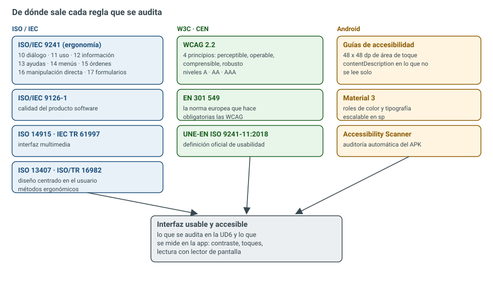
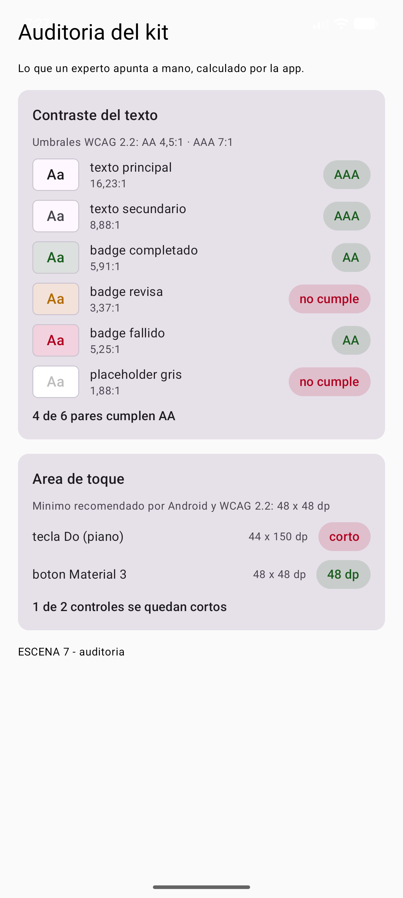

# 6.1 — Usabilidad y accesibilidad

> **El trabajo de ingeniería:** decidir con números si una interfaz se puede usar. No es «a mí me
> parece bonita» ni «yo lo veo bien en mi monitor»: es medir el contraste de cada texto, medir el área
> de toque de cada control, comprobar que la letra se puede poner al 200 % sin que se rompa nada y
> demostrar que el lector de pantalla sabe qué es cada pieza. En esta unidad esas cuatro comprobaciones
> **las hace la app**: se escribe el código que calcula el contraste según la fórmula de las WCAG, se
> escribe el detector de áreas de toque y se prueba todo con pruebas automáticas. El resultado no es
> una opinión: es una tabla de ratios y un veredicto por control. Y, de paso, la auditoría encuentra
> **dos defectos reales en nuestro propio kit** que hasta ahora nadie había visto.

## Resultado de aprendizaje que trabaja esta unidad

<span style="background-color:#a5d6a7;padding:0 3px;border-radius:3px;">**RA4. Diseña interfaces gráficas identificando y aplicando criterios de usabilidad y accesibilidad**</span>
(RD 405/2023, módulo 0488 *Desarrollo de interfaces*). Esta unidad lo trabaja **completo**: los nueve
criterios de evaluación, de la `a` a la `i`.

| CE | Criterio de evaluación (texto literal del real decreto) | Dónde se trabaja |
| -- | ------------------------------------------------------ | ---------------- |
| RA4 a | Se han identificado los principales estándares de usabilidad y accesibilidad. | §2, los ocho estándares uno por uno |
| RA4 b | Se ha valorado la importancia del uso de estándares para la creación de interfaces. | §1 y §2.7 (la definición oficial) |
| RA4 c | Se han creado diferentes tipos de menús cuya estructura y contenido siguen los estándares establecidos. | §2.1 (ISO 9241-14) y §10.1 (menús y navegación) |
| RA4 d | Se han distribuido las acciones en menús, barras de herramientas, botones de comando, entre otros, siguiendo un criterio coherente. | §6 y §10.1 |
| RA4 e | Se han distribuido adecuadamente los controles en la interfaz de usuario. | §6 (48 dp) y §7 (la pantalla de auditoría) |
| RA4 f | Se ha utilizado el tipo de control más apropiado en cada caso. | §3 y §4 (adaptadores y formatos alternativos) |
| RA4 g | Se ha diseñado el aspecto de la interfaz de usuario (colores y fuentes entre otros) atendiendo a su legibilidad. | §5 (contraste) y §8 (escalado de fuente) |
| RA4 h | Se ha verificado que los mensajes generados por la aplicación son adecuados en extensión y claridad. | §4.3 y §11 (mensajes de error) |
| RA4 i | Se han realizado pruebas para evaluar la usabilidad y accesibilidad de la aplicación. | §9 (pruebas automáticas) y §10 (expertos y usuarios) |

<div style="background-color:#a5d6a7; border-radius:8px; padding:10px 14px; margin:14px 0;">
<strong>🟢 Leyenda de repaso obligatorio:</strong> los textos con <span style="background-color:#a5d6a7;padding:0 3px;border-radius:3px;">este fondo verde</span> son imprescindibles: son los datos que se preguntan en examen y los que se auditan en el trabajo real. Hay que repasarlos cada semana.</div>

## 1. Introducción y contextualización práctica

<span style="background-color:#a5d6a7;padding:0 3px;border-radius:3px;">Una interfaz es usable cuando el usuario consigue su objetivo sin pelearse con la herramienta</span>, y
es accesible cuando **cualquier** usuario puede conseguirlo, tenga la vista que tenga, el pulso que
tenga o el dispositivo que tenga. Las dos cosas se miden. La norma que fija cómo se miden es la
**UNE-EN ISO 9241-11:2018**, y da tres medidas —no una:

| Medida | Qué es | Cómo se mide en una app |
| ------ | ------ | ----------------------- |
| **Eficacia** | Se consigue el objetivo | ¿Termina la tarea? ¿Cuántos la terminan? |
| **Eficiencia** | Se consigue con pocos recursos | Tiempo, toques, clics, pasos de más |
| **Satisfacción** | El usuario queda a gusto | Cuestionario SUS, entrevista, escala |

<span style="background-color:#a5d6a7;padding:0 3px;border-radius:3px;">Si una de las tres falla, la interfaz no es usable</span>: una app donde todos terminan la tarea pero
tardando veinte minutos y cabreados cumple la eficacia y suspende las otras dos. Y si hay que pedir
ayuda a un compañero para terminarla, tampoco.

En esta unidad se audita **el kit que ya está construido**: `BadgeEstado`, `SelectorMes`, `Tecla`,
`TecladoPiano` y las pantallas del `MainActivity`. No se audita un ejemplo de laboratorio: se audita lo
que se va a publicar. Por eso los dos defectos que salen son defectos de verdad.

<figure markdown>


<figcaption>Figura 1. De dónde sale cada regla que se audita. No hay una sola norma: hay tres familias que se complementan. Las ISO dicen qué es la ergonomía del diálogo; las WCAG y la EN 301 549 dicen qué es accesible y con qué umbrales; Android traduce todo eso a dp, sp y etiquetas de accesibilidad.</figcaption>
</figure>

## 2. Los estándares, uno por uno

Este es el apartado del criterio **a)**: identificarlos. Y el del **b)**: entender por qué se usan en
lugar de inventarse las reglas.

### 2.1 ISO/IEC 9241: las diecisiete partes que todo el mundo cita y casi nadie ha leído

La ISO/IEC 9241 se llama *Ergonomía de la interacción persona-sistema* y va por partes. Las que se
nombran en los manuales de interfaces son de la **10 a la 17**, que son las de diálogo:

| Parte | Título | Qué regula |
| ----- | ------ | ---------- |
| 9241-10 | Principios de diálogo | Los siete principios: adecuación a la tarea, autodescriptivo, control del usuario, conformidad con las expectativas, tolerancia al error, personalización, aprendizaje |
| 9241-11 | Guía de usabilidad | **La definición de usabilidad y sus tres medidas** |
| 9241-12 | Presentación de la información | Cómo se organiza y se presenta la información en pantalla |
| 9241-13 | Guía del usuario | Ayudas, mensajes y documentación en línea |
| 9241-14 | Diálogos controlados por menús | Estructura, profundidad y navegación de menús |
| 9241-15 | Diálogos por órdenes | Lenguajes de comandos |
| 9241-16 | Diálogos de manipulación directa | Arrastrar, soltar, seleccionar (lo que hoy es casi toda la interfaz táctil) |
| 9241-17 | Diálogos de relleno de formularios | Campos, validación, orden de llenado |

<span style="background-color:#a5d6a7;padding:0 3px;border-radius:3px;">Para el criterio c) —los menús— la parte que hay que citar es la 9241-14</span>, y para los formularios
de la app, la 9241-17. Los siete principios de la parte 10 son los mismos que luego aparecen
reescritos en las diez heurísticas de Nielsen (§10.2): no son dos listas distintas, son la misma idea
contada dos veces.

### 2.2 ISO/IEC 9126-1 y su heredera ISO/IEC 25010

La 9126-1 metía la usabilidad dentro de un modelo de **calidad del producto software** con seis
características: funcionalidad, fiabilidad, **usabilidad**, eficiencia, mantenibilidad y portabilidad.
La norma actual es la familia **ISO/IEC 25010** (SQuaRE), que amplía el modelo a ocho características
—añade adecuación funcional, compatibilidad y **seguridad**— y, sobre todo, desglosa la usabilidad en
subcaracterísticas que sí se pueden evaluar por separado:

- **Capacidad de aprendizaje** (¿se aprende rápido?).
- **Operabilidad** (¿se maneja sin esfuerzo?).
- **Protección contra errores del usuario**.
- **Estética de la interfaz**.
- **Accesibilidad** (esta la añadió la versión de 2011; en 9126 no existía como subcaracterística).

<span style="background-color:#a5d6a7;padding:0 3px;border-radius:3px;">Que la accesibilidad sea una subcaracterística de la usabilidad, y no un extra, es el dato que hay que
tener claro</span>: una interfaz inaccesible es, por definición del modelo, una interfaz de peor calidad.

### 2.3 ISO 14915 e IEC TR 61997: la interfaz multimedia

La **ISO 14915** (*Software ergonomics for multimedia user interfaces*) tiene cuatro partes: principios
y marco de diseño, control y navegación, selección y combinación de medios, y dominio de aplicación. La
**IEC TR 61997** son directrices de interfaz para equipos multimedia de uso general. Se citan cuando la
interfaz lleva vídeo, audio o animación —por ejemplo, una pantalla con un reproductor o un tutorial
animado— y lo que aportan es que **el medio se elige por la tarea**, no por lo vistoso que queda.

### 2.4 ISO 13407 e ISO/TR 16982: el proceso y los métodos

- **ISO 13407:1999** describía el **proceso** de diseño centrado en el usuario: entender el contexto,
  especificar requisitos, producir soluciones y evaluar. Está **sustituida** por la **ISO 9241-210**
  (2010, revisada en 2019), que es la que hay que citar hoy.
- **ISO/TR 16982:2002** es el catálogo de **métodos** que apoyan ese proceso: observación, entrevistas,
  cuestionarios, thinking aloud, evaluación heurística… Es la lista de la que sale todo lo del §10.

<span style="background-color:#a5d6a7;padding:0 3px;border-radius:3px;">Citar la 13407 como norma vigente es un error de examen</span>: se cita la 9241-210. La 13407 solo se
menciona para decir que fue la precursora.

### 2.5 WCAG 2.2: cuatro principios, tres niveles

Las **Web Content Accessibility Guidelines 2.2** son una recomendación del W3C (octubre de 2023) y son
la referencia mundial de accesibilidad. Se organizan en **cuatro principios** —el acrónimo inglés es
**POUR**— y cada criterio tiene un **nivel**:

| Principio | Significa | Ejemplo de criterio |
| --------- | --------- | ------------------- |
| **Perceptible** | Se puede percibir con algún sentido | 1.4.3 contraste; 1.2.2 subtítulos |
| **Operable** | Se puede manejar con algún dispositivo | 2.5.8 tamaño del objetivo; 2.1.1 teclado |
| **Comprensible** | Se entiende | 3.3.1 identificación de errores; 3.2.3 navegación coherente |
| **Robusto** | Funciona con las tecnologías de apoyo | 4.1.2 nombre, función, valor |

Y tres niveles: **A** (mínimo), **AA** (el que exige la ley en Europa) y **AAA** (el más exigente, no
obligatorio en general). <span style="background-color:#a5d6a7;padding:0 3px;border-radius:3px;">El objetivo realista y legal es AA</span>; AAA se persigue en textos críticos.

Los criterios que se usan en esta unidad, con su número exacto:

| Criterio | Nivel | Qué exige |
| -------- | ----- | --------- |
| **1.4.3** Contrast (Minimum) | AA | 4,5:1 en texto normal; 3:1 en texto grande |
| **1.4.6** Contrast (Enhanced) | AAA | 7:1 en texto normal; 4,5:1 en texto grande |
| **1.4.11** Non-text Contrast | AA | 3:1 para iconos, bordes y controles |
| **1.4.4** Resize Text | AA | El texto se puede ampliar al **200 %** sin perder contenido |
| **1.4.10** Reflow | AA | Sin scroll horizontal a 320 px de ancho |
| **2.5.8** Target Size (Minimum) | AA | 24 × 24 px CSS como mínimo absoluto |
| **2.5.5** Target Size (Enhanced) | AAA | 44 × 44 px CSS |

<span style="background-color:#a5d6a7;padding:0 3px;border-radius:3px;">«Texto grande» en WCAG no es «el que a mí me parece grande»</span>: es **18 pt (24 px)** o **14 pt
(18,66 px) en negrita**. Por debajo de eso, el umbral es 4,5:1 y no hay discusión.

### 2.6 EN 301 549 y el RD 1112/2018: cuando la norma se convierte en obligación

La **EN 301 549** es la norma europea armonizada de accesibilidad de productos y servicios TIC. Su
versión 3.2.1 recoge los criterios de las **WCAG 2.1 nivel AA** y les añade requisitos de software,
documentos, hardware y servicios de apoyo. Lo importante para el módulo: <span style="background-color:#a5d6a7;padding:0 3px;border-radius:3px;">es la norma que se usa en la
contratación pública europea</span>, así que una app que venda al sector público tiene que cumplirla.

En España eso se concreta en el **Real Decreto 1112/2018**, que obliga a los sitios web y aplicaciones
móviles del **sector público** a ser accesibles según la EN 301 549 (transpone la Directiva (UE)
2016/2102). Y desde el **28 de junio de 2025** se aplica además la **Directiva (UE) 2019/882** (Acta
Europea de Accesibilidad), que amplía la obligación a muchos productos y servicios privados: banca,
transporte, comercio electrónico, libros digitales.

<span style="background-color:#a5d6a7;padding:0 3px;border-radius:3px;">Traducción práctica: la accesibilidad ya no es buena voluntad, es requisito legal en una parte enorme
del mercado</span>. Y en un ciclo de DAM/DAW eso se traduce en que alguien va a pedir cuentas por ello.

### 2.7 UNE-EN ISO 9241-11:2018: la definición que hay que saber de memoria

> **Usabilidad**: grado en que un sistema, producto o servicio puede ser utilizado por **usuarios
> específicos** para lograr **objetivos concretos** con **eficacia, eficiencia y satisfacción** en un
> **contexto de uso especificado**.

Las cinco piezas de la definición son las cinco preguntas de cualquier auditoría: quién (usuarios
específicos), para qué (objetivos), con qué resultado (eficacia), a qué coste (eficiencia), a gusto o
no (satisfacción) y en qué circunstancias (contexto). <span style="background-color:#a5d6a7;padding:0 3px;border-radius:3px;">Si una auditoría no responde a las cinco,
no es una auditoría: es una opinión</span>.

### 2.8 Lo que añade Android (y que es lo que se programa)

Las normas de arriba son genéricas. Android las traduce a cosas concretas y medibles:

| Regla de Android | De dónde viene | Cómo se cumple en Compose |
| ---------------- | -------------- | ------------------------- |
| **48 × 48 dp** de área de toque | Guías de Material + WCAG 2.5.5/2.5.8 | `Modifier.size(48.dp)` o `minimumInteractiveComponentSize()` |
| Texto en **sp**, no en dp | WCAG 1.4.4 (200 %) | `fontSize = 16.sp`, `MaterialTheme.typography` |
| **`contentDescription`** en lo que no lleva texto | WCAG 4.1.2 / 1.1.1 | `Modifier.semantics { contentDescription = "..." }` |
| Rol y estado accesible | WCAG 4.1.2 | `Modifier.semantics { role = Role.Button; stateDescription = "..." }` |
| Nada de información **solo por color** | WCAG 1.4.1 | icono + texto, además del color |
| Orden de foco lógico | WCAG 2.4.3 | orden de composición y `focusOrder` |

Y las tres herramientas que se usan para comprobarlo:

- **TalkBack**: el lector de pantalla de Android. Lee lo que hay en el árbol de semántica.
- **Accessibility Scanner**: app de Google que audita la pantalla en vivo y marca los fallos (toques
  pequeños, contraste bajo, falta de etiqueta).
- **`uiautomator dump`**: volcado del árbol de accesibilidad, que es lo que lee TalkBack. Es la prueba
  objetiva de que la etiqueta está puesta.

<span style="background-color:#a5d6a7;padding:0 3px;border-radius:3px;">Si algo no aparece en el volcado de `uiautomator`, TalkBack no lo ve</span>. No hay debate posible: es
el mismo árbol.

## 3. Perfiles funcionales: a quién le falla la interfaz

El criterio **f)** pide elegir el control apropiado; para eso hay que saber **para quién**. Un perfil
funcional no es una etiqueta médica: es la descripción de lo que una persona **puede y no puede hacer**
delante de la pantalla.

| Limitación | Barrera típica en una app | Qué hace la app | Adaptador del sistema |
| ---------- | ------------------------- | --------------- | --------------------- |
| **Visual** (baja visión, ceguera) | Texto pequeño, contraste bajo, iconos sin texto | Texto en sp, contraste AA, `contentDescription` | TalkBack, lupa, fuente grande, alto contraste, braille |
| **Daltonismo** | Información solo por color (verde = bien, rojo = mal) | Color **+** icono **+** texto | Filtros de color, modo alto contraste |
| **Auditiva** | Avisos solo con sonido | Vibración, aviso visual, subtítulos | Subtítulos, transcripción, vibración |
| **Motriz** | Botones pequeños, gestos obligatorios, tiempo límite | 48 dp, alternativas a gestos, sin límite de tiempo | Switch Access, control por voz, teclado externo |
| **Cognitiva** | Lenguaje enrevesado, pasos que hay que memorizar | Lenguaje claro, consistencia, ayudas visibles | Lectura fácil, tiempo ajustable |

La idea que hay que llevarse: <span style="background-color:#a5d6a7;padding:0 3px;border-radius:3px;">las limitaciones son **permanentes, temporales o situacionales**, y
el diseño que resuelve la permanente beneficia a las otras dos</span>. Un subtítulo sirve al sordo, al
que está en un bar con ruido y al que ve el vídeo sin cascos. Un botón grande sirve al que tiene
artrosis, al que lleva una escayola y al que va en el metro agarrado a la barra. Es el mismo diseño.

### 3.1 Los adaptadores que hay que conocer por su nombre

| Adaptador | Qué hace | A quién sirve |
| --------- | -------- | ------------- |
| **TalkBack** | Lector de pantalla: lee el árbol de semántica y permite navegar por gestos | Ceguera y baja visión severa |
| **Switch Access** | Recorre los elementos con uno o dos pulsadores externos | Movilidad muy reducida |
| **Control por voz** | «Abrir ajustes», «pulsar» | Manos ocupadas o sin movilidad fina |
| **Teclado / D-pad** | Navegación por foco con Tab o flechas | Usuarios de teclado, TV, mandos |
| **Lupa y fuente grande** | Ampliación y escalado del texto | Baja visión |
| **Alto contraste** | Invierte o fuerza colores de máximo contraste | Baja visión, fotosensibilidad |
| **Braille (HID)** | Línea braille conectada por Bluetooth o USB | Sordoceguera |

<span style="background-color:#a5d6a7;padding:0 3px;border-radius:3px;">Ninguno de estos adaptadores necesita código especial si la app está bien etiquetada</span>: funcionan
leyendo la semántica. Por eso el trabajo real es poner bien `contentDescription`, rol y estado, y no
«hacer una versión para discapacitados».

## 4. Formatos alternativos

El criterio **f)** otra vez, y parte del **h)**: el mismo contenido en otro formato, para que llegue a
quien no puede usar el original.

| Contenido | Alternativa | Cuándo es obligatoria |
| --------- | ----------- | --------------------- |
| Imagen con información | **Texto alternativo** (`contentDescription`) | Siempre que la imagen aporte información |
| Imagen decorativa | `contentDescription = null` | Siempre: no se anuncia |
| Icono sin texto | Etiqueta accesible + `Role` | Siempre |
| Audio o vídeo | **Subtítulos** y **transcripción** | WCAG 1.2.2 (A) para vídeo grabado |
| Gráfico de datos | Tabla de datos equivalente | Cuando el gráfico es la única fuente del dato |
| Aviso de color | Icono + texto («Completado», no solo verde) | WCAG 1.4.1 |
| Texto complejo | **Lectura fácil**: frases cortas, una idea por frase | Contenido dirigido a público general |
| Mensaje de error | Qué pasó + cómo se arregla, sin códigos internos | WCAG 3.3.1 y 3.3.3 |

### 4.1 El texto alternativo bien puesto (y el que sobra)

La regla es sencilla: **el texto alternativo describe la función, no la forma**. En un botón de
borrar, `contentDescription = "Borrar"`; no `"icono de papelera"`. Y en una imagen decorativa,
`null`, para que el lector no se pare a anunciar adornos.

```kotlin title="ui/src/main/java/com/example/uikit/BadgeEstado.kt"
            // El color no puede ser la unica informacion: el texto dice el estado y el lector lo lee.
            Text(
                text = texto,
                color = estado.acento,
```

<span style="background-color:#a5d6a7;padding:0 3px;border-radius:3px;">Un badge que solo cambia de color es invisible para un lector de pantalla y para un daltónico</span>.
Por eso `BadgeEstado` lleva texto además del punto de color: el color acelera la lectura de quien lo
distingue, el texto la garantiza para todos.

### 4.2 Subtítulos y transcripciones

Si la app reproduce vídeo o audio, el subtítulo no es un extra: es el criterio 1.2.2 en nivel A (el
más básico). Y la transcripción resuelve además el caso de quien no puede ver el vídeo pero sí leer.
En una app de formación, sin subtítulos, el contenido es inaccesible para una parte del alumnado.

### 4.3 Mensajes: extensión y claridad (criterio h)

Un mensaje útil tiene tres partes y ninguna sobra:

1. **Qué ha pasado**, en lenguaje del usuario.
2. **Por qué**, si se sabe y ayuda.
3. **Qué hacer ahora**, en imperativo y concreto.

| Mal | Bien |
| --- | ---- |
| `Error 500` | «No se ha podido guardar el abono. Comprueba la conexión y vuelve a intentarlo.» |
| `Campo inválido` | «El teléfono debe tener 9 cifras. Has escrito 7.» |
| `Operación no permitida` | «No puedes cambiar la fecha de un turno ya cerrado. Pide el cambio a tu supervisor.» |

## 5. Contraste: la fórmula que se calcula, no se discute

Este es el corazón del criterio **g)**. El contraste entre dos colores no se estima a ojo: se calcula
con dos fórmulas publicadas en las WCAG.

### 5.1 Las dos fórmulas

**Primera: pasar cada canal de sRGB a luz lineal.** La pantalla aplica una corrección de gamma, así que
el valor 0,5 no es la mitad de luz. La norma deshace esa corrección:

<div style="background:#f5f7fa;border-left:4px solid #1a4d7a;border-radius:6px;padding:12px 18px;margin:14px 0;line-height:1.9;">
<strong>1 · Canal de color a luz lineal</strong><br>
C<sub>lineal</sub> = C<sub>sRGB</sub> / 12,92 &nbsp;&nbsp;&nbsp;&nbsp;si C<sub>sRGB</sub> ≤ 0,03928<br>
C<sub>lineal</sub> = ((C<sub>sRGB</sub> + 0,055) / 1,055)<sup>2,4</sup> &nbsp;&nbsp;&nbsp;&nbsp;en otro caso
</div>

**Segunda: luminancia relativa** con los pesos de la percepción humana (el verde pesa mucho más que el
azul):

<div style="background:#f5f7fa;border-left:4px solid #1a4d7a;border-radius:6px;padding:12px 18px;margin:14px 0;line-height:1.9;">
<strong>2 · Luminancia relativa</strong> (0 = negro, 1 = blanco)<br>
L = 0,2126 · R<sub>lineal</sub> + 0,7152 · G<sub>lineal</sub> + 0,0722 · B<sub>lineal</sub>
</div>

**Y el ratio**, que va de 1:1 a 21:1:

<div style="background:#f5f7fa;border-left:4px solid #1a4d7a;border-radius:6px;padding:12px 18px;margin:14px 0;line-height:1.9;">
<strong>3 · Ratio de contraste</strong><br>
ratio = (L<sub>claro</sub> + 0,05) / (L<sub>oscuro</sub> + 0,05)
</div>

El `+ 0,05` no es un capricho: evita dividir por cero cuando el color más oscuro es negro puro
(luminancia 0).

| Situación | AA | AAA |
| --------- | -- | --- |
| Texto normal (< 18 pt) | **4,5:1** | **7:1** |
| Texto grande (≥ 18 pt o ≥ 14 pt negrita) | **3:1** | **4,5:1** |
| Iconos, bordes, controles (1.4.11) | **3:1** | — |

<span style="background-color:#a5d6a7;padding:0 3px;border-radius:3px;">21:1 es el máximo posible (negro sobre blanco) y 1:1 el mínimo (un color contra sí mismo)</span>. Esos
dos valores son los que se usan como prueba de que la fórmula está bien implementada: si tu código no
da exactamente 21 y 1, está mal.

### 5.2 El código que lo calcula

```kotlin title="ui/src/main/java/com/example/uikit/Contraste.kt"
package com.example.uikit

import androidx.compose.ui.graphics.Color
import androidx.compose.ui.unit.Dp
import kotlin.math.max
import kotlin.math.min
import kotlin.math.pow

/**
 * Contraste de color segun WCAG 2.2 (criterio 1.4.3 y 1.4.6).
 *
 * Toda la cuenta sale de dos formulas publicadas en la especificacion:
 *   1) luminancia relativa de un color (0 = negro, 1 = blanco)
 *   2) ratio de contraste entre dos luminancias: (claro + 0.05) / (oscuro + 0.05)
 *
 * El resultado va de 1:1 (mismo color, ilegible) a 21:1 (negro sobre blanco).
 * Los umbrales que exige la norma:
 *   - AA  texto normal  >= 4.5   | AA  texto grande (>= 24 px o 18.66 px en negrita) >= 3
 *   - AAA texto normal  >= 7     | AAA texto grande >= 4.5
 */
object Contraste {

    /**
     * Pasa un canal de color (0f..1f) de sRGB a luz lineal.
     * WCAG no usa el valor tal cual: hay que deshacer la correccion gamma de la pantalla,
     * por eso el tramo lineal (v <= 0.03928) y la potencia 2.4 del resto.
     */
    private fun canalLineal(valor: Float): Double {
        val v = valor.toDouble()
        return if (v <= 0.03928) v / 12.92 else ((v + 0.055) / 1.055).pow(2.4)
    }

    /** Luminancia relativa: cuanto "brilla" el color. Pesos 0.2126 / 0.7152 / 0.0722 (R, G, B). */
    fun luminancia(color: Color): Double =
        0.2126 * canalLineal(color.red) +      // rojo
        0.7152 * canalLineal(color.green) +    // verde: el que mas aporta a la luz percibida
        0.0722 * canalLineal(color.blue)       // azul: el que menos

    /** Ratio de contraste entre el fondo y el texto, siempre >= 1 (da igual el orden de los argumentos). */
    fun ratio(fondo: Color, texto: Color): Double {
        val a = luminancia(fondo)
        val b = luminancia(texto)
        val claro = max(a, b)                  // el mas luminoso va arriba
        val oscuro = min(a, b)                 // el menos luminoso abajo
        return (claro + 0.05) / (oscuro + 0.05) // el +0.05 evita dividir por cero en negro puro
    }

    /** Criterio AA: 4.5 en texto normal, 3 en texto grande. */
    fun cumpleAA(ratio: Double, grande: Boolean = false): Boolean =
        ratio >= if (grande) 3.0 else 4.5

    /** Criterio AAA: 7 en texto normal, 4.5 en texto grande. */
    fun cumpleAAA(ratio: Double, grande: Boolean = false): Boolean =
        ratio >= if (grande) 4.5 else 7.0

    /** Etiqueta lista para pintar en pantalla: AAA, AA o "no cumple". */
    fun etiqueta(ratio: Double, grande: Boolean = false): String = when {
        cumpleAAA(ratio, grande) -> "AAA"      // el mas exigente primero
        cumpleAA(ratio, grande) -> "AA"
        else -> "no cumple"                    // ni siquiera llega al minimo legal
    }

    /**
     * Compone una capa con transparencia sobre un fondo opaco (alpha compositing "source-over").
     *
     * Hace falta porque un color con alfa NO se mide tal cual: el fondo de un badge es el acento
     * al 15% sobre la tarjeta, y lo que ve el ojo (y lo que mide la norma) es la mezcla.
     * Medir el acento puro daria 1:1 contra si mismo, que es justo el error que caza la auditoria.
     */
    fun sobre(base: Color, capa: Color): Color {
        val a = capa.alpha.toDouble()                                  // opacidad de la capa
        return Color(
            red = (capa.red * a + base.red * (1 - a)).toFloat(),       // mezcla canal a canal
            green = (capa.green * a + base.green * (1 - a)).toFloat(),
            blue = (capa.blue * a + base.blue * (1 - a)).toFloat(),
            alpha = 1f,                                                // el resultado es opaco
        )
    }
}

/** Un par fondo/texto que queremos auditar, con nombre para poder citarlo en el informe. */
data class ParContraste(
    val nombre: String,          // "texto principal", "badge aviso", ...
    val fondo: Color,            // color de la superficie donde se escribe
    val texto: Color,            // color de la letra
    val grande: Boolean = false, // true si es texto grande (>= 24 px): el umbral baja
) {
    /** El ratio se calcula al vuelo: si cambia un color, cambia el veredicto. */
    val ratio: Double get() = Contraste.ratio(fondo, texto)
    /** AA / AAA / no cumple. */
    val veredicto: String get() = Contraste.etiqueta(ratio, grande)
}

/**
 * Un control interactivo y su tamano real.
 *
 * WCAG 2.2 (criterio 2.5.8) pide 24x24 px como minimo absoluto y las guias de Android
 * piden 48x48 dp; en la practica 48 dp es el numero que se audita.
 */
data class ControlToque(
    val nombre: String,   // "tecla Do", "boton Derecho", ...
    val ancho: Dp,        // ancho declarado en el codigo
    val alto: Dp,         // alto declarado en el codigo
) {
    /** true si cumple el minimo de 48 dp en las dos dimensiones. */
    val cumple: Boolean get() = ancho.value >= 48f && alto.value >= 48f
    /** Texto corto para el informe: "44 x 150 dp". */
    val medida: String get() = "${ancho.value.toInt()} x ${alto.value.toInt()} dp"
}
```

Fíjate en tres detalles que son los que se preguntan:

- `canalLineal` tiene **dos tramos**: el lineal para valores muy bajos (≤ 0,03928) y el potencial para
  el resto. Quien se salta el tramo lineal obtiene ratios ligeramente distintos y, en grises oscuros,
  se equivoca.
- `ratio` ordena las luminancias con `max` y `min` **antes** de dividir: así da igual el orden de los
  argumentos. Una función que devuelve 0,2 si le pasas los colores al revés está mal.
- `sobre` compone un color con alfa sobre un fondo opaco. Esto no estaba en el plan de la unidad y
  apareció porque la app se equivocaba: se cuenta en el apartado siguiente.

### 5.3 La trampa del alfa: el fallo que la auditoría encontró en la auditoría

Los badges del kit pintan su fondo así: `Estado.OK.acento.copy(alpha = 0.15f)`, es decir, el color del
estado **al 15 % de opacidad** sobre la tarjeta. La primera versión del panel medía el contraste entre
ese color con alfa y el texto. Resultado en pantalla: **1,00:1 en los tres badges**, o sea, «no cumple»
en los tres.

El número era correcto y la conclusión era falsa. Un color con alfa **no se ve tal cual**: se ve la
mezcla con lo que hay debajo. `Color.copy(alpha = 0.15f)` conserva los canales RGB del acento y solo
cambia la opacidad, así que compararlo consigo mismo da 1:1 siempre. Lo que hay que medir es la
**mezcla**:

<div style="background:#f5f7fa;border-left:4px solid #1a4d7a;border-radius:6px;padding:12px 18px;margin:14px 0;line-height:1.9;">
<strong>Composición de un color con transparencia</strong><br>
C<sub>resultado</sub> = C<sub>capa</sub> · α + C<sub>base</sub> · (1 − α)
</div>

<span style="background-color:#a5d6a7;padding:0 3px;border-radius:3px;">Regla que hay que memorizar: antes de medir un color translúcido, se compone sobre el fondo real</span>.
Y el fondo real es el que tiene debajo en la pantalla, no el blanco del editor.

Con la composición bien hecha, los tres badges dan números de verdad: 5,91:1, **3,37:1** y 5,25:1. El
del medio no llega. Ese es el segundo hallazgo y se cuenta en §7.

### 5.4 Qué se hace cuando un contraste no llega

En orden de menos a más invasivo:

1. **Oscurecer el texto** (o aclararlo, si el fondo es oscuro): casi siempre basta.
2. **Aclarar el fondo**: bajar la intensidad del tinte.
3. **Subir el tamaño o el peso**: si el texto pasa a «grande», el umbral baja de 4,5 a 3.
4. **Cambiar el par de colores**: usar el color de texto oscuro sobre el tinte claro, en lugar del
   acento sobre su propio tinte. Es lo que hace Material 3 con los roles `container` / `onContainer`.
5. **No usar el color como única señal**: icono + texto.

Y lo que **no** se hace: dejar el fallo y escribir «se ve bien». La norma tiene un número y el número
está o no está.

## 6. Área de toque: 48 dp y por qué ese número

Un dedo no es un cursor. La yema mide entre 8 y 10 mm, y el objetivo táctil recomendado por Android es
**48 × 48 dp** (unos 9 mm en un móvil de densidad media). Las WCAG piden un mínimo absoluto de
**24 × 24 px CSS** (2.5.8, AA) y **44 × 44** para el nivel AAA (2.5.5). <span style="background-color:#a5d6a7;padding:0 3px;border-radius:3px;">Android es más exigente que
el mínimo legal: 48 dp</span>. En la práctica se audita contra 48.

Lo importante: **el área de toque no es el dibujo**. Un icono de 24 dp puede tener 48 dp de zona
pulsable si se le añade relleno o `minimumInteractiveComponentSize()`. Lo que se mide es la zona que
responde al dedo, no el píxel pintado.

### 6.1 El código que lo detecta

```kotlin title="ui/src/main/java/com/example/uikit/Auditoria.kt"
package com.example.uikit

import androidx.compose.foundation.background
import androidx.compose.foundation.border
import androidx.compose.foundation.layout.Arrangement
import androidx.compose.foundation.layout.Box
import androidx.compose.foundation.layout.Column
import androidx.compose.foundation.layout.Row
import androidx.compose.foundation.layout.fillMaxWidth
import androidx.compose.foundation.layout.padding
import androidx.compose.foundation.layout.size
import androidx.compose.foundation.shape.RoundedCornerShape
import androidx.compose.material3.Card
import androidx.compose.material3.MaterialTheme
import androidx.compose.material3.Text
import androidx.compose.runtime.Composable
import androidx.compose.ui.Alignment
import androidx.compose.ui.Modifier
import androidx.compose.ui.platform.testTag
import androidx.compose.ui.text.style.TextAlign
import androidx.compose.ui.unit.dp
import java.util.Locale

/**
 * Panel de auditoria de contraste: pinta cada par fondo/texto con su ratio y su veredicto.
 *
 * Es la parte "de informe" de la unidad: lo que un experto apunta en la evaluacion heuristica,
 * aqui sale calculado por la propia app en lugar de a ojo.
 */
@Composable
fun PanelContraste(pares: List<ParContraste>, modifier: Modifier = Modifier) {
    Card(modifier = modifier.fillMaxWidth()) {
        Column(
            modifier = Modifier.padding(16.dp),
            verticalArrangement = Arrangement.spacedBy(10.dp),
        ) {
            Text("Contraste del texto", style = MaterialTheme.typography.titleMedium)
            Text(
                "Umbrales WCAG 2.2: AA 4,5:1 · AAA 7:1",
                style = MaterialTheme.typography.bodySmall,
                color = MaterialTheme.colorScheme.onSurfaceVariant,
            )
            pares.forEach { par -> FilaContraste(par) }        // una fila por par auditado
            val cumplen = pares.count { Contraste.cumpleAA(it.ratio, it.grande) }
            Text(
                "$cumplen de ${pares.size} pares cumplen AA",   // resumen del informe
                style = MaterialTheme.typography.labelLarge,
                modifier = Modifier.testTag("resumen-contraste"),
            )
        }
    }
}

/** Una fila del panel: muestra de color, nombre, ratio y veredicto. */
@Composable
private fun FilaContraste(par: ParContraste) {
    Row(
        modifier = Modifier.fillMaxWidth(),
        verticalAlignment = Alignment.CenterVertically,
        horizontalArrangement = Arrangement.spacedBy(12.dp),
    ) {
        // La muestra: "Aa" escrito con el color del texto sobre el color del fondo.
        Box(
            contentAlignment = Alignment.Center,
            modifier = Modifier
                .size(width = 52.dp, height = 36.dp)
                .background(par.fondo, RoundedCornerShape(6.dp))
                .border(1.dp, MaterialTheme.colorScheme.outlineVariant, RoundedCornerShape(6.dp)),
        ) {
            Text(
                "Aa",
                color = par.texto,                             // el color que se esta midiendo
                style = MaterialTheme.typography.titleMedium,
            )
        }
        Column(modifier = Modifier.weight(1f)) {
            Text(par.nombre, style = MaterialTheme.typography.bodyMedium)
            Text(
                String.format(Locale.forLanguageTag("es-ES"), "%.2f:1", par.ratio),
                style = MaterialTheme.typography.bodySmall,
                color = MaterialTheme.colorScheme.onSurfaceVariant,
                modifier = Modifier.testTag("ratio-${par.nombre}"),
            )
        }
        // El veredicto reutiliza el BadgeEstado de la UD4: el componente ya probado, sin duplicar codigo.
        val estado = when (par.veredicto) {
            "AAA", "AA" -> Estado.OK                        // cumple
            else -> Estado.ERROR                            // no cumple
        }
        BadgeEstado(estado = estado, texto = par.veredicto, conPunto = false)
    }
}

/**
 * Panel de area de toque: lista cada control con su medida declarada y si llega al minimo.
 *
 * Sirve para lo que el volcado de uiautomator no te dice: si el control que has escrito
 * a mano respeta los 48 dp o se ha quedado corto.
 */
@Composable
fun PanelToques(controles: List<ControlToque>, modifier: Modifier = Modifier) {
    Card(modifier = modifier.fillMaxWidth()) {
        Column(
            modifier = Modifier.padding(16.dp),
            verticalArrangement = Arrangement.spacedBy(10.dp),
        ) {
            Text("Area de toque", style = MaterialTheme.typography.titleMedium)
            Text(
                "Minimo recomendado por Android y WCAG 2.2: 48 x 48 dp",
                style = MaterialTheme.typography.bodySmall,
                color = MaterialTheme.colorScheme.onSurfaceVariant,
            )
            controles.forEach { control ->
                Row(
                    modifier = Modifier.fillMaxWidth().testTag("toque-${control.nombre}"),
                    verticalAlignment = Alignment.CenterVertically,
                    horizontalArrangement = Arrangement.spacedBy(12.dp),
                ) {
                    Text(
                        control.nombre,
                        style = MaterialTheme.typography.bodyMedium,
                        modifier = Modifier.weight(1f),
                    )
                    Text(
                        control.medida,
                        style = MaterialTheme.typography.bodySmall,
                        color = MaterialTheme.colorScheme.onSurfaceVariant,
                        textAlign = TextAlign.End,
                    )
                    BadgeEstado(
                        estado = if (control.cumple) Estado.OK else Estado.ERROR,
                        texto = if (control.cumple) "48 dp" else "corto",
                        conPunto = false,
                    )
                }
            }
            val cortos = controles.count { !it.cumple }
            Text(
                if (cortos == 0) "Todos los controles llegan al minimo"
                else "$cortos de ${controles.size} controles se quedan cortos",
                style = MaterialTheme.typography.labelLarge,
                modifier = Modifier.testTag("resumen-toques"),
            )
        }
    }
}
```

Dos cosas que hace este fichero y que valen para cualquier app:

- `ControlToque.cumple` exige **las dos dimensiones**. Un control de 44 × 150 no cumple: el alto va de
  sobra y el ancho no llega. Es el error clásico de las teclas de piano y de las tablas de horarios.
- `PanelContraste` **reutiliza** `BadgeEstado` (UD4) para el veredicto. No se duplica el componente: se
  usa el que ya está probado.

### 6.2 Lo que dice el volcado real de `uiautomator`

Con `testTagsAsResourceId = true` en la raíz (UD5), las etiquetas de prueba salen como `resource-id`
en el árbol de accesibilidad. Este es el extracto real de la pantalla de auditoría, copiado del volcado:

```text title="uiautomator dump, escena 7 (datos reales)"
ratio-texto principal      | 16,23:1                          | [300,588][425,636]
ratio-texto secundario     | 8,88:1                           | [300,726][403,774]
ratio-badge completado     | 5,91:1                           | [300,864][403,912]
ratio-badge revisa         | 3,37:1                           | [300,1002][403,1050]
ratio-badge fallido        | 5,25:1                           | [300,1140][403,1188]
ratio-placeholder gris     | 1,88:1                           | [300,1278][403,1326]
resumen-contraste          | 4 de 6 pares cumplen AA          | [108,1356][587,1416]
resumen-toques             | 1 de 2 controles se quedan cortos | [108,1992][758,2052]
```

Dos lecturas de este volcado:

1. **Los ratios están en el árbol**: un lector de pantalla puede leerlos, y una prueba automática
   también. Eso es lo que hace que la app sea auditable desde fuera.
2. **Los `bounds` dan la caja real en píxeles**: `[300,1002][403,1050]` son 103 × 48 px. Sirve para
   comprobar que la fila ocupa lo que debe, sin fiarse del código.

<span style="background-color:#a5d6a7;padding:0 3px;border-radius:3px;">El volcado es la prueba objetiva de accesibilidad</span>: si el nodo está y tiene texto, TalkBack lo
lee; si no está, no existe para el usuario.

## 7. La pantalla de auditoría: el informe dentro de la app

La escena 7 del `MainActivity` es la auditoría hecha pantalla. Pinta los pares de color reales del kit,
calcula su ratio con la fórmula de las WCAG, marca el veredicto y hace lo mismo con las áreas de toque.

<figure markdown>


<figcaption>Figura 2. La auditoría en el emulador. Arriba, seis pares fondo/texto con su ratio y su veredicto; abajo, el área de toque de dos controles. Los dos «no cumple» y el «corto» no son ejemplos inventados: son defectos reales del kit.</figcaption>
</figure>

```kotlin title="app/src/main/java/com/example/uikit/demo/MainActivity.kt (escena 7)"
@Composable
private fun EscenaAuditoria() {
    // Los pares que se auditan: fondo y texto de verdad, no una tabla de ejemplo.
    val pares = listOf(
        ParContraste("texto principal", MaterialTheme.colorScheme.surface, MaterialTheme.colorScheme.onSurface),
        ParContraste("texto secundario", MaterialTheme.colorScheme.surface, MaterialTheme.colorScheme.onSurfaceVariant),
        // El fondo del badge es el acento al 15%: hay que componerlo sobre la tarjeta antes de medir.
        ParContraste("badge completado", Contraste.sobre(MaterialTheme.colorScheme.surface, Estado.OK.acento.copy(alpha = 0.15f)), Estado.OK.acento),
        ParContraste("badge revisa", Contraste.sobre(MaterialTheme.colorScheme.surface, Estado.AVISO.acento.copy(alpha = 0.15f)), Estado.AVISO.acento),
        ParContraste("badge fallido", Contraste.sobre(MaterialTheme.colorScheme.surface, Estado.ERROR.acento.copy(alpha = 0.15f)), Estado.ERROR.acento),
        ParContraste("placeholder gris", Color.White, Color(0xFFBDBDBD)),   // este falla a proposito
    )
    // Las medidas reales: la tecla del piano se queda en 44 dp (fallo detectado).
    val controles = listOf(
        ControlToque("tecla Do (piano)", 44.dp, 150.dp),
        ControlToque("boton Material 3", 48.dp, 48.dp),
    )
    Column(
        modifier = Modifier.fillMaxSize().verticalScroll(rememberScrollState()).padding(20.dp),
        verticalArrangement = Arrangement.spacedBy(16.dp),
    ) {
        Text("Auditoria del kit", style = MaterialTheme.typography.headlineSmall)
        Text(
            "Lo que un experto apunta a mano, calculado por la app.",
            style = MaterialTheme.typography.bodySmall,
        )
        PanelContraste(pares)
        PanelToques(controles)
        Text("ESCENA 7 - auditoria", style = MaterialTheme.typography.bodySmall)
    }
}
```

### 7.1 Los resultados, tal como salen

| Par auditado | Ratio | Veredicto | Qué significa |
| ------------ | ----- | --------- | ------------- |
| texto principal | 16,23:1 | AAA | De sobra |
| texto secundario | 8,88:1 | AAA | De sobra |
| badge completado | 5,91:1 | AA | Cumple, sin margen para AAA |
| **badge revisa** | **3,37:1** | **no cumple** | **El ámbar sobre su tinte no llega a 4,5** |
| badge fallido | 5,25:1 | AA | Cumple |
| placeholder gris | 1,88:1 | no cumple | A propósito: es un placeholder, no información |

Y en toques:

| Control | Medida | Veredicto |
| ------- | ------ | --------- |
| tecla Do (piano) | 44 × 150 dp | **corto** (44 < 48) |
| botón Material 3 | 48 × 48 dp | 48 dp |

### 7.2 Los dos defectos reales (y cómo se arreglan)

**Defecto 1 — el badge de aviso no llega a AA.** El ámbar `AVISO.acento` sobre su propio tinte al 15 %
da 3,37:1. Para texto normal hacen falta 4,5. Arreglo: usar un ámbar más oscuro para el texto (rol
`onContainer`) o subir el tinte al 20-25 % para que el fondo se aleje del texto. <span style="background-color:#a5d6a7;padding:0 3px;border-radius:3px;">Lo importante no es
el arreglo: es que ahora hay un número que lo demuestra y una prueba que avisará si vuelve a pasar</span>.

**Defecto 2 — la tecla del piano mide 44 dp de ancho.** El dibujo de la tecla es de 44 dp porque el
teclado tiene que caber; el área de toque podría ser mayor que el dibujo. Arreglo: envolver la tecla en
un `Box` de 48 dp con el dibujo de 44 dentro, o añadir relleno horizontal. La tecla se ve igual y
responde mejor.

<span style="background-color:#a5d6a7;padding:0 3px;border-radius:3px;">Una auditoría que no encuentra nada casi siempre es una auditoría mal hecha</span>. Encontrar dos
defectos en un kit propio es lo normal; lo raro sería no encontrar ninguno.

## 8. Escalar la letra al 200 %: la prueba que casi nadie hace

El criterio 1.4.4 (AA) pide que el texto se pueda ampliar al **200 %** sin perder contenido ni
funcionalidad. En Android eso no se hace con zoom: se hace cambiando la **escala de fuente** del
sistema, y para que funcione hay que haber escrito las letras en **sp**, no en dp.

| Unidad | Escala con la fuente del sistema | Se usa para |
| ------ | -------------------------------- | ----------- |
| `dp` | No | Tamaños, márgenes, iconos, áreas de toque |
| `sp` | **Sí** | Todo texto |

Si un texto está en `dp`, el usuario que necesita letra grande se queda sin ella. Es un fallo de
accesibilidad silencioso: en el emulador normal no se ve.

<figure markdown>


<figcaption>Figura 3. La escena 7 con `font_scale = 2.0`. Las tarjetas crecen en alto, las etiquetas pasan a dos líneas y nada se corta ni se solapa. El contenido que no cabe se ve haciendo scroll, que es lo que pide el criterio 1.4.10.</figcaption>
</figure>

Las cuatro comprobaciones, en este orden:

1. **¿Se corta algún texto?** Ni una letra fuera de su caja, ni puntos suspensivos donde había un dato.
2. **¿Se solapa algo?** Texto encima de texto o de un botón.
3. **¿Sigue habiendo scroll vertical y no horizontal?** A 320 px de ancho no debe aparecer scroll
   lateral (1.4.10).
4. **¿Los botones siguen siendo pulsables?** Un texto que crece puede empujar un botón fuera de la
   pantalla.

<span style="background-color:#a5d6a7;padding:0 3px;border-radius:3px;">El 200 % no es un caso raro: es la configuración de muchísima gente mayor</span>. Y es la diferencia
entre una app que se puede usar y una que no.

## 9. Pruebas automáticas de usabilidad (criterio i)

La usabilidad se prueba en dos niveles: lo que se puede comprobar con código (los números) y lo que
necesita personas (los flujos). Lo primero va en pruebas automáticas; lo segundo, en el §10.

```kotlin title="ui/src/androidTest/java/com/example/uikit/UsabilidadTest.kt"
package com.example.uikit

import androidx.compose.ui.graphics.Color
import androidx.compose.ui.test.assertIsDisplayed
import androidx.compose.ui.test.assertTextContains
import androidx.compose.ui.test.junit4.createComposeRule
import androidx.compose.ui.test.onNodeWithTag
import androidx.compose.ui.unit.dp
import org.junit.Assert.assertEquals
import org.junit.Assert.assertFalse
import org.junit.Assert.assertTrue
import org.junit.Rule
import org.junit.Test

/**
 * Pruebas de la auditoria de usabilidad (criterio de evaluacion 4i).
 *
 * Tres cosas se comprueban aqui:
 *   1. que la formula de contraste da los valores que publica la norma (21:1 y 1:1)
 *   2. que los umbrales AA/AAA estan donde toca
 *   3. que el detector de areas de toque marca como corta la tecla de 44 dp del kit
 */
class UsabilidadTest {

    @get:Rule
    val compose = createComposeRule()      // regla de Compose para las pruebas de interfaz

    @Test
    fun elRatioDaLosValoresConocidosDeLaNorma() {
        // Negro sobre blanco es el maximo de la escala: 21:1 exacto.
        assertEquals(21.0, Contraste.ratio(Color.White, Color.Black), 0.01)
        // Un color contra si mismo es el minimo: 1:1.
        assertEquals(1.0, Contraste.ratio(Color.White, Color.White), 0.001)
        // El orden de los argumentos no puede cambiar el resultado.
        assertEquals(
            Contraste.ratio(Color.White, Color.Black),
            Contraste.ratio(Color.Black, Color.White),
            0.001,
        )
    }

    @Test
    fun elAlfaSeComponeAntesDeMedir() {
        // El acento al 15% sobre blanco no es el acento: es una mezcla mucho mas clara.
        val mezcla = Contraste.sobre(Color.White, Color.Black.copy(alpha = 0.15f))
        // 15% de negro sobre blanco = gris al 85% de blanco (216, 216, 216).
        assertEquals(0.85f, mezcla.red, 0.01f)
        // Y ese gris sobre negro da un ratio alto, no 1:1.
        assertTrue(Contraste.ratio(Color.Black, mezcla) > 10.0)
    }

    @Test
    fun losUmbralesSonLosDeWCAG() {
        assertTrue(Contraste.cumpleAA(4.5))                 // justo en el limite: cumple
        assertFalse(Contraste.cumpleAA(4.49))               // una centesima por debajo: no
        assertTrue(Contraste.cumpleAA(3.0, grande = true))  // texto grande: umbral 3
        assertTrue(Contraste.cumpleAAA(7.0))                // AAA en el limite
        assertEquals("no cumple", Contraste.etiqueta(3.2))  // por debajo de AA
        assertEquals("AA", Contraste.etiqueta(4.6))         // entre 4.5 y 7
        assertEquals("AAA", Contraste.etiqueta(7.5))        // por encima de 7
    }

    @Test
    fun elDetectorDeToquesMarcaCortaLaTeclaDelPiano() {
        // La tecla del piano mide 44 dp de ancho en el codigo: no llega al minimo.
        assertFalse(ControlToque("tecla Do", 44.dp, 150.dp).cumple)
        // Con 48 dp si cumple (alto de sobra en los dos casos).
        assertTrue(ControlToque("tecla Do", 48.dp, 150.dp).cumple)
        // Un control de 40 x 40 tampoco: el minimo es 48 en las dos dimensiones.
        assertFalse(ControlToque("boton", 40.dp, 40.dp).cumple)
    }

    @Test
    fun elPanelEnsenyaElVeredictoDeCadaPar() {
        compose.setContent {
            PanelContraste(
                listOf(
                    ParContraste("blanco sobre negro", Color.Black, Color.White),
                    ParContraste("gris claro sobre blanco", Color.White, Color(0xFFBDBDBD)),
                ),
            )
        }
        // El par bueno muestra su ratio con la coma decimal espanola.
        compose.onNodeWithTag("ratio-blanco sobre negro").assertTextContains("21,00:1")
        // Y el resumen cuenta bien: solo uno de los dos llega a AA.
        compose.onNodeWithTag("resumen-contraste").assertTextContains("1 de 2 pares cumplen AA")
        compose.onNodeWithTag("resumen-contraste").assertIsDisplayed()
    }
}
```

Estas cinco pruebas cubren lo que no puede fallar nunca:

| Prueba | Qué demuestra |
| ------ | ------------- |
| `elRatioDaLosValoresConocidosDeLaNorma` | La fórmula da **21:1** y **1:1** exactos, y el orden de los argumentos no cambia el resultado |
| `elAlfaSeComponeAntesDeMedir` | El color translúcido se compone antes de medir (el fallo de §5.3 no vuelve) |
| `losUmbralesSonLosDeWCAG` | 4,5 y 7 están donde dice la norma, y una centésima por debajo suspende |
| `elDetectorDeToquesMarcaCortaLaTeclaDelPiano` | 44 dp no cumple; 48 sí; 40 × 40 tampoco |
| `elPanelEnsenyaElVeredictoDeCadaPar` | La pantalla pinta el ratio con coma española y el resumen cuenta bien |

<span style="background-color:#a5d6a7;padding:0 3px;border-radius:3px;">Una prueba de accesibilidad no comprueba «que se ve bien»: comprueba un número</span>. Y como el número
está en la norma, la prueba no caduca con el tiempo.

Y el resultado real, al lanzarlas:

```text title="salida real de am instrument"
com.example.uikit.test.UsabilidadTest:.....
Time: 20.029

OK (16 tests)
```

**16 pruebas en verde** en total (las 11 de la UD5 más las 5 de esta unidad).

## 10. Pruebas con expertos y con usuarios

### 10.1 Menús y distribución de controles (criterios c y d)

Un menú cumple la 9241-14 cuando:

- Tiene **pocas opciones por nivel** (7 ± 2 es la cifra clásica) y nombres que se entienden sin manual.
- La **profundidad** no pasa de 2-3 niveles: cada nivel extra pierde usuarios.
- Las acciones están **donde se espera**: lo destructivo, separado y confirmado; lo frecuente, a mano.
- Hay **coherencia**: el mismo tipo de acción, en el mismo sitio, en todas las pantallas.
- Existe **salida**: se puede volver atrás y deshacer.

En una app táctil, el menú es muchas veces una barra inferior o un `NavigationBar`; los criterios son
los mismos.

### 10.2 Evaluación heurística: las diez de Nielsen

Un experto recorre la interfaz con esta lista y apunta cada fallo con su gravedad. Es barato, rápido y
encuentra entre el 70 y el 80 % de los problemas con 3-5 evaluadores.

| # | Heurística | En una frase |
| - | ---------- | ------------ |
| 1 | Visibilidad del estado | La app dice siempre qué está pasando |
| 2 | Lenguaje del usuario | Habla como el usuario, no como el programador |
| 3 | Control y libertad | Se puede deshacer y salir |
| 4 | Consistencia | Lo mismo se hace igual en todas partes |
| 5 | Prevención de errores | Mejor impedir el error que avisar después |
| 6 | Reconocer antes que recordar | Las opciones se ven, no se memorizan |
| 7 | Flexibilidad y eficiencia | Atajos para el experto, calma para el novato |
| 8 | Diseño minimalista | Lo que no ayuda, estorba |
| 9 | Recuperación de errores | Mensaje claro y salida |
| 10 | Ayuda y documentación | Ayuda en contexto, no un PDF perdido |

Y la **gravedad** de cada hallazgo, en la escala de Nielsen:

| Valor | Nombre | Qué hacer |
| ----- | ------ | --------- |
| 0 | No es problema | Nada |
| 1 | Cosmético | Si sobra tiempo |
| 2 | Menor | Prioridad baja |
| 3 | **Mayor** | Arreglar antes de publicar |
| 4 | **Catastrófico** | Bloquea la publicación |

### 10.3 Pruebas con usuarios y SUS

Cinco usuarios bastan para encontrar ~85 % de los problemas de un flujo (Nielsen y Landauer, 1993: con
λ ≈ 0,31, `1 − (1 − 0,31)^5 ≈ 0,85`). No hacen falta cien: hacen falta cinco que se parezcan al
usuario real.

Y para medir la satisfacción, el **SUS** (*System Usability Scale*): diez afirmaciones con escala de 1
a 5, se puntúa con la fórmula de siempre y da un número de 0 a 100.

| Puntuación SUS | Lectura |
| -------------- | ------- |
| < 51 | Inaceptable |
| 51-67 | Marginal |
| **68** | **Media del sector** |
| 68-80 | Aceptable |
| > 80 | Excelente |

<span style="background-color:#a5d6a7;padding:0 3px;border-radius:3px;">68 es la media histórica: por debajo, la app está por debajo de la mitad del mercado</span>.

<figure markdown>


<figcaption>Figura 4. El ciclo de evaluación. Primero se define a quién y qué se mide; después se prototipa y se evalúa dos veces (expertos y usuarios). El resultado siempre es un rediseño, y el bucle se repite hasta que deja de encontrar fallos.</figcaption>
</figure>

### 10.4 El informe de usabilidad

Un informe que se pueda leer tiene esta estructura:

1. **Objetivo y alcance**: qué se ha evaluado y qué no.
2. **Método**: heurística con N expertos, o test con N usuarios y qué tareas.
3. **Perfil de los participantes**.
4. **Resultados por hallazgo**: captura, heurística o criterio incumplido, gravedad, recomendación.
5. **Métricas**: tiempo por tarea, errores, SUS.
6. **Priorización**: qué se arregla antes de publicar.

Los hallazgos se ordenan por **gravedad**, no por el orden en que se encontraron. Y cada uno lleva su
evidencia: una captura o un número. Sin evidencia no es un hallazgo, es una queja.

## 11. Errores típicos al auditar una interfaz

| Error | Por qué está mal | Qué hacer |
| ----- | ---------------- | --------- |
| Medir el contraste «a ojo» | El ojo se adapta y engaña | Calcular con la fórmula |
| Medir un color con alfa sin componerlo | Da 1:1 y conclusiones falsas | Componer sobre el fondo real |
| Confundir área de toque con dibujo | El icono puede ser pequeño y la zona grande | Medir la zona que responde |
| Texto en `dp` | No escala con la fuente del sistema | `sp` siempre |
| Información solo por color | Invisible para daltónicos y lectores | Color + icono + texto |
| `contentDescription` en imágenes decorativas | El lector anuncia adornos | `null` en lo decorativo |
| Probar solo en un móvil de gama alta | El fallo aparece en el móvil del usuario | Probar con fuente 200 %, modo oscuro y pantalla pequeña |
| Confundir «accesible» con «feo» | Se sacrifica el diseño sin necesidad | Se puede ser accesible y bonito: son criterios distintos |
| Arreglar sin volver a medir | Se cambia el color y se rompe otro par | Repetir la auditoría después del cambio |
| Informe sin gravedad | Todo parece igual de urgente | Escala 0-4 |

## 12. Qué se ha verificado (y cómo repetirlo)

Todo lo que se afirma en esta página se ha ejecutado. Para reproducirlo:

```bash
# 1. compilar
gradlew :app:assembleDebug :ui:assembleDebugAndroidTest

# 2. instalar en el emulador
adb install -r app/build/outputs/apk/debug/app-debug.apk
adb install -r ui/build/outputs/apk/androidTest/debug/ui-debug-androidTest.apk

# 3. lanzar las pruebas instrumentadas
adb shell am instrument -w com.example.uikit.test/androidx.test.runner.AndroidJUnitRunner

# 4. abrir la pantalla de auditoria
adb shell am start -n com.example.uikit.demo/com.example.uikit.demo.MainActivity --ei codigo 7

# 5. capturar y volcar el arbol de accesibilidad
adb shell screencap -p /sdcard/u6.png && adb pull /sdcard/u6.png
adb shell uiautomator dump /sdcard/u6.xml && adb pull /sdcard/u6.xml

# 6. probar la fuente al 200 %
adb shell settings put system font_scale 2.0
adb shell am force-stop com.example.uikit.demo
adb shell am start -n com.example.uikit.demo/com.example.uikit.demo.MainActivity --ei codigo 7
adb shell settings put system font_scale 1.0
```

| Afirmación de la página | Evidencia |
| ----------------------- | --------- |
| La fórmula da 21:1 y 1:1 | `UsabilidadTest.elRatioDaLosValoresConocidosDeLaNorma` en verde |
| El alfa se compone | `UsabilidadTest.elAlfaSeComponeAntesDeMedir` en verde |
| Los umbrales son 4,5 / 7 / 3 / 4,5 | `UsabilidadTest.losUmbralesSonLosDeWCAG` en verde |
| La tecla de 44 dp es corta | `UsabilidadTest.elDetectorDeToquesMarcaCortaLaTeclaDelPiano` en verde |
| La pantalla pinta ratio y resumen | `UsabilidadTest.elPanelEnsenyaElVeredictoDeCadaPar` en verde |
| 16 pruebas en verde | `OK (16 tests)` · `Time: 20.029` |
| Los ratios reales del kit | volcado de `uiautomator` de la escena 7 (§6.2) |
| La fuente al 200 % no rompe | captura de la Figura 3 con `font_scale 2.0` |

## 13. Resumen

- <span style="background-color:#a5d6a7;padding:0 3px;border-radius:3px;">Usable = eficacia + eficiencia + satisfacción</span> (ISO 9241-11). Las tres, no una.
- Los estándares que hay que saber citar: **ISO 9241-10 a -17**, **9126-1 → 25010**, **14915**,
  **13407 → 9241-210**, **16982**, **WCAG 2.2**, **EN 301 549**, **UNE-EN ISO 9241-11:2018**.
- <span style="background-color:#a5d6a7;padding:0 3px;border-radius:3px;">WCAG 2.2: cuatro principios (perceptible, operable, comprensible, robusto) y tres niveles (A, AA,
  AAA)</span>. El objetivo legal es AA.
- **Contraste**: se calcula con la luminancia relativa y el ratio `(claro+0,05)/(oscuro+0,05)`.
  AA 4,5:1 · AAA 7:1 · texto grande 3:1 y 4,5:1 · no textual 3:1.
- <span style="background-color:#a5d6a7;padding:0 3px;border-radius:3px;">Un color con alfa se compone antes de medirlo</span>. Si no, da 1:1 y la auditoría miente.
- **Área de toque**: 48 dp en Android; 24 px el mínimo legal y 44 px el AAA. Se mide la zona que
  responde, no el dibujo.
- **Fuente**: texto en `sp`, nunca en `dp`; la prueba es poner el sistema al **200 %** y comprobar que
  no se corta, no se solapa y sigue habiendo scroll vertical.
- **Pruebas**: los números van en pruebas automáticas (21:1, 1:1, umbrales, 44 dp). <span style="background-color:#a5d6a7;padding:0 3px;border-radius:3px;">16 pruebas en
  verde, `Time: 20.029`</span>.
- **Con personas**: 10 heurísticas de Nielsen, gravedad 0-4, 5 usuarios para el 85 % de los problemas y
  SUS con 68 como media del sector.
- <span style="background-color:#a5d6a7;padding:0 3px;border-radius:3px;">La auditoría encontró dos defectos reales en el kit: el badge de aviso a 3,37:1 y la tecla a 44 dp</span>.
  Eso es lo que se espera de una auditoría de verdad.

## Bibliografía y fuentes

Todo el material del tema se apoya en las especificaciones y documentaciones oficiales de los
organismos y del software que se usa en clase.

**Accesibilidad y usabilidad (organismos oficiales)**

- W3C. *Web Content Accessibility Guidelines (WCAG) 2.2* — recomendación oficial, con todos los
  criterios y niveles. <https://www.w3.org/TR/WCAG22/>
- W3C. *Understanding WCAG 2.2* — la explicación criterio a criterio. <https://www.w3.org/WAI/WCAG22/Understanding/>
- W3C. *Web Accessibility Initiative (WAI)* — guías, técnicas y recursos. <https://www.w3.org/WAI/>
- W3C. *WCAG 2.2 — criterio 1.4.3 Contrast (Minimum)*. <https://www.w3.org/WAI/WCAG22/Understanding/contrast-minimum.html>
- W3C. *WCAG 2.2 — criterio 1.4.6 Contrast (Enhanced)*. <https://www.w3.org/WAI/WCAG22/Understanding/contrast-enhanced.html>
- W3C. *WCAG 2.2 — criterio 2.5.8 Target Size (Minimum)*. <https://www.w3.org/WAI/WCAG22/Understanding/target-size-minimum.html>
- W3C. *WCAG 2.2 — criterio 1.4.4 Resize Text*. <https://www.w3.org/WAI/WCAG22/Understanding/resize-text.html>
- W3C. *WCAG 2.2 — criterio 1.4.10 Reflow*. <https://www.w3.org/WAI/WCAG22/Understanding/reflow.html>
- ISO. *ISO 9241-11:2018 — Ergonomics of human-system interaction. Part 11: Usability: Definitions
  and concepts* (UNE-EN ISO 9241-11:2018). <https://www.iso.org/standard/63500.html>
- ISO. *ISO 9241-210:2019 — Human-centred design for interactive systems*. <https://www.iso.org/standard/77520.html>
- ISO. *ISO/IEC 25010:2011 — Systems and software Quality Requirements and Evaluation (SQuaRE)*. <https://www.iso.org/standard/35733.html>
- ISO. *ISO 14915 — Software ergonomics for multimedia user interfaces*. <https://www.iso.org/standard/25555.html>
- ISO. *ISO/TR 16982:2002 — Usability methods supporting human-centred design*. <https://www.iso.org/standard/31176.html>
- ETSI. *EN 301 549 — Accessibility requirements for ICT products and services*. <https://www.etsi.org/deliver/etsi_en/301500_301599/301549/>
- BOE. *Real Decreto 1112/2018, de 7 de septiembre, sobre accesibilidad de los sitios web y
  aplicaciones para dispositivos móviles del sector público*. <https://www.boe.es/buscar/act.php?id=BOE-A-2018-12699>
- Diario Oficial de la UE. *Directiva (UE) 2019/882 — Acta Europea de Accesibilidad*. <https://eur-lex.europa.eu/eli/dir/2019/882/oj>

**Documentación oficial de Android**

- Android Developers. *Accesibilidad en Android* — principios, tamaño de toque y etiquetas. <https://developer.android.com/guide/topics/ui/accessibility>
- Android Developers. *Semántica y accesibilidad en Compose* (`contentDescription`, `Role`,
  `stateDescription`, `testTagsAsResourceId`). <https://developer.android.com/develop/ui/compose/accessibility>
- Android Developers. *Tamaño de los objetivos de toque* (`minimumInteractiveComponentSize`, 48 dp). <https://developer.android.com/develop/ui/views/touch-and-input/accessibility-guidelines>
- Android Developers. *Compatibilidad con tamaños de fuente* (`sp`, escala del sistema). <https://developer.android.com/guide/topics/ui/accessibility/apps#fonts>
- Android Developers. *TalkBack* — lector de pantalla de Android. <https://support.google.com/accessibility/android/answer/6283677>
- Android Developers. *Accessibility Scanner*. <https://support.google.com/accessibility/android/answer/6376570>
- Android Developers. *Pruebas de interfaz con Compose Testing*. <https://developer.android.com/develop/ui/compose/testing>
- Android Developers. *uiautomator* — volcado del árbol de la interfaz. <https://developer.android.com/training/testing/other-components/ui-automator>
- Material Design 3. *Color roles* (`container` / `onContainer`) y *Accessibility*. <https://m3.material.io/styles/color/roles>

**Métodos de evaluación**

- Nielsen, J. *10 Usability Heuristics for User Interface Design*. Nielsen Norman Group. <https://www.nngroup.com/articles/ten-usability-heuristics/>
- Nielsen, J. *Severity Ratings for Usability Problems*. Nielsen Norman Group. <https://www.nngroup.com/articles/how-to-rate-the-severity-of-usability-problems/>
- Nielsen, J. *Why You Only Need to Test with 5 Users*. Nielsen Norman Group. <https://www.nngroup.com/articles/why-you-only-need-to-test-with-5-users/>
- Brooke, J. *SUS: A quick and dirty usability scale* (el cuestionario original). <https://hell.meiert.org/core/pdf/sus.pdf>
- MeasuringU. *SUS: A comprehensive guide*. <https://measuringu.com/sus/>

**Lenguaje y construcción**

- Kotlin Foundation. *Data classes* y *copy*. <https://kotlinlang.org/docs/data-classes.html>
- Kotlin Foundation. *Funciones de orden superior y lambdas*. <https://kotlinlang.org/docs/lambdas.html>
- Gradle. *Variantes de construcción y pruebas instrumentadas*. <https://docs.gradle.org/current/userguide/java_testing.html>

**Marco legal**

- **Real Decreto 405/2023, de 29 de mayo** (BOE-A-2023-13221), por el que se establecen los títulos de
  Técnico y Técnico Superior en Sistemas Microinformáticos y Redes y se fijan sus enseñanzas mínimas:
  currículo del módulo 0488 *Desarrollo de interfaces*, **RA4 y sus nueve criterios de evaluación**.
