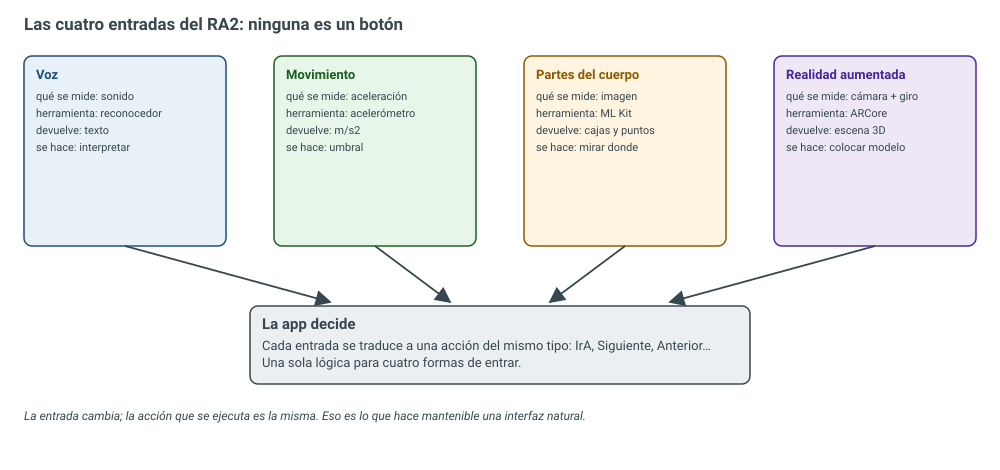
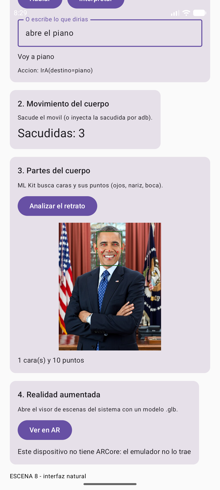

# 7.1 — Interfaces naturales

> **El trabajo de ingeniería:** hacer que la app se maneje **sin botones**. Voz, movimiento del
> cuerpo, partes del cuerpo y realidad aumentada son las cuatro entradas que pide el resultado de
> aprendizaje, y las cuatro se resuelven con la misma idea: <span style="background-color:#a5d6a7;padding:0 3px;border-radius:3px;">la entrada cambia, pero la acción que se
> ejecuta es la misma</span>. El reconocedor devuelve texto; el acelerómetro, números; ML Kit, cajas y
> puntos; ARCore, una escena 3D. Ninguna de esas cosas es una acción: hay que **interpretarlas**. En
> esta unidad se construye la escena 8 del `IsmaelUIKit` con las cuatro entradas funcionando de
> verdad —la voz se interpreta, la sacudida se cuenta, la cara se detecta con sus diez puntos y el
> visor de AR se abre si el móvil lo trae— y se prueba todo con siete pruebas automáticas.

## Resultado de aprendizaje que trabaja esta unidad

<span style="background-color:#a5d6a7;padding:0 3px;border-radius:3px;">**RA2. Genera interfaces naturales de usuario utilizando herramientas visuales**</span> (RD 405/2023,
módulo 0488 *Desarrollo de interfaces*). La unidad lo trabaja **completo**: los seis criterios de
evaluación, de la `a` a la `f`.

| CE | Criterio de evaluación (texto literal del real decreto) | Dónde se trabaja |
| -- | ------------------------------------------------------ | ---------------- |
| RA2 a | Se han identificado las herramientas disponibles para el aprendizaje automático relacionadas con las interfaces de usuario. | §2, tabla de herramientas |
| RA2 b | Se ha creado una interfaz natural de usuario utilizando las herramientas disponibles. | §3, la escena 8 completa |
| RA2 c | Se ha utilizado el reconocimiento de voz para implementar acciones en las interfaces naturales de usuario. | §4, `ComandoVoz` y el reconocedor |
| RA2 d | Se ha incorporado la detección del movimiento del cuerpo para implementar acciones en las interfaces naturales de usuario. | §5, acelerómetro y sacudida |
| RA2 e | Se han integrado elementos de detección de partes del cuerpo para implementar acciones en las interfaces naturales de usuario. | §6, ML Kit y los diez puntos de la cara |
| RA2 f | Se ha integrado la realidad aumentada en los interfaces de usuario. | §7, Scene Viewer y ARCore |

<div style="background-color:#a5d6a7; border-radius:8px; padding:10px 14px; margin:14px 0;">
<strong>🟢 Leyenda de repaso obligatorio:</strong> los textos con <span style="background-color:#a5d6a7;padding:0 3px;border-radius:3px;">este fondo verde</span> son los datos que se preguntan en examen y los que se usan en el trabajo real. Hay que repasarlos cada semana.</div>

## 1. Introducción: qué es «natural» y qué no

Una **interfaz natural** (NUI, *Natural User Interface*) es la que se maneja con algo que el usuario
ya sabe hacer: hablar, moverse, mirar, señalar. La historia corta es esta:

| Época | Interfaz | El usuario tiene que aprender… |
| ----- | -------- | ------------------------------ |
| 1960-1980 | **Línea de órdenes** (CLI) | La sintaxis de cada orden |
| 1980-2010 | **Interfaz gráfica** (GUI) | Dónde está cada menú y cada icono |
| 2010-hoy | **Interfaz natural** (NUI) | Nada nuevo: usa voz, gesto y cámara |

<span style="background-color:#a5d6a7;padding:0 3px;border-radius:3px;">«Natural» no significa «sin aprender nada»</span>: significa que el canal es el que el cuerpo ya
domina. El usuario no aprende a hablar para usar la app; la app aprende a entender lo que dice.

Y hay un detalle de ingeniería que separa un juguete de un producto: **la entrada natural nunca
sustituye a la entrada clásica**. Un botón sigue ahí para quien no pueda hablar, para quien esté en
un sitio con ruido o para quien simplemente prefiera pulsar. En la escena de esta unidad, al lado del
botón «Hablar» hay un campo de texto: si el reconocedor no está o falla, la app sigue siendo usable.

<figure markdown>


<figcaption>Figura 1. Las cuatro entradas del RA2. Cada una mide algo distinto y devuelve algo distinto, pero todas se traducen al mismo vocabulario de acciones: ir a, siguiente, anterior. Esa normalización es lo que hace la interfaz mantenible.</figcaption>
</figure>

## 2. Las herramientas del aprendizaje automático (criterio a)

El criterio pide **identificarlas**. Estas son las que se usan hoy en Android, con lo que devuelve
cada una:

| Herramienta | Qué hace | Qué devuelve | ¿Funciona sin conexión? |
| ----------- | -------- | ------------ | ----------------------- |
| **ML Kit — Face Detection** | Encuentra caras y sus puntos | Caja + 10 puntos (ojos, nariz, boca, orejas, mejillas) | Sí, modelo incluido en la app |
| **ML Kit — Pose Detection** | Encuentra el esqueleto de una persona | 33 puntos del cuerpo | Sí, modelo descargable |
| **ML Kit — Text Recognition** | Lee texto de una imagen | Bloques, líneas y palabras | Sí |
| **ML Kit — Barcode / Objects / Labels** | Códigos, objetos y etiquetas | Valores y categorías | Sí |
| **MediaPipe** | Soluciones de cuerpo, manos y cara en tiempo real | Puntos y gestos | Sí |
| **TensorFlow Lite / LiteRT** | Ejecuta un modelo propio entrenado por ti | Lo que devuelva el modelo | Sí |
| **ARCore** | Coloca objetos 3D en el mundo real | Pose de la cámara y planos | Sí (con el visor instalado) |
| **SpeechRecognizer / RecognizerIntent** | Convierte voz en texto | Texto | Según el servicio de voz |
| **TextToSpeech** | Convierte texto en voz | Audio | Sí (si hay voz instalada) |
| **SensorManager** | Lee acelerómetro, giroscopio, luz, proximidad… | Números con unidades | Sí, es hardware |

<span style="background-color:#a5d6a7;padding:0 3px;border-radius:3px;">La elección no va por «cuál es más moderna», sino por lo que devuelve</span>: si necesitas una acción
concreta, un clasificador que devuelve una etiqueta es mejor que un detector que devuelve cien
puntos. En esta unidad se usan tres: el reconocedor de voz, el acelerómetro y ML Kit Face Detection.
La cuarta entrada, la realidad aumentada, no necesita modelo: la resuelve el sistema.

!!! note "Herramientas «visuales»"
    El enunciado del RA2 dice «utilizando herramientas visuales». En 2026 eso incluye las herramientas
    de **análisis visual** (ML Kit, MediaPipe) y los **visores** (Scene Viewer), no solo los editores
    de pantallas. La interpretación que se usa en esta unidad es esa: herramientas que **ven** (cámara,
    imagen) y herramientas que **muestran** (visor 3D).

## 3. La interfaz natural de la unidad (criterio b)

La escena 8 del `IsmaelUIKit` tiene cuatro tarjetas, una por entrada. Cada una se puede probar sola y
todas conviven en la misma pantalla:

<figure markdown>


<figcaption>Figura 2. La escena 8 en el emulador. En la tarjeta de voz se ha escrito «abre el piano» y la app ha contestado «Voy a piano» con la acción `IrA(destino=piano)`. Debajo, el contador de sacudidas y las tarjetas de cara y AR.</figcaption>
</figure>

| Tarjeta | Entrada | Qué hace la app | Criterio |
| ------- | ------- | --------------- | -------- |
| 1. Voz | Micrófono o texto | Reconoce, interpreta y contesta en voz alta | c |
| 2. Movimiento | Acelerómetro | Cuenta sacudidas | d |
| 3. Partes del cuerpo | Imagen + ML Kit | Dibuja la caja y los diez puntos de la cara | e |
| 4. Realidad aumentada | Cámara + ARCore | Abre el visor de escenas con un `.glb` | f |

<span style="background-color:#a5d6a7;padding:0 3px;border-radius:3px;">Toda la lógica de la escena cabe en una idea</span>: cada entrada produce una `AccionVoz`, y la app
tiene un solo sitio donde se ejecutan las acciones. Si mañana se añade un gesto con la mano, se
traduce a la misma `AccionVoz` y no hay que tocar nada más.

```kotlin title="app/src/main/java/com/example/uikit/demo/MainActivity.kt (escena 8)"
/**
 * Escena 8: interfaz natural (RA2).
 *
 * Cuatro formas de manejar la app sin tocar un boton con el dedo, que es lo que pide el
 * resultado de aprendizaje: voz, movimiento del cuerpo, partes del cuerpo y realidad aumentada.
 * Cada tarjeta es independiente y se puede probar sola.
 */
@Composable
private fun EscenaNatural() {
    val contexto = LocalContext.current
    var frase by rememberSaveable { mutableStateOf("") }
    var accion by remember { mutableStateOf<AccionVoz?>(null) }
    var estadoVoz by remember { mutableStateOf("Pulsa Hablar o escribe un comando") }
    var sacudidas by remember { mutableIntStateOf(0) }
    var ultima by remember { mutableLongStateOf(0L) }
    var imagen by remember { mutableStateOf<ImageBitmap?>(null) }
    var caras by remember { mutableStateOf<List<Cara>>(emptyList()) }
    var estadoRostro by remember { mutableStateOf("Pulsa Analizar para buscar caras") }
    var estadoAR by remember { mutableStateOf("") }

    // --- sintetizador: la app contesta en voz alta ---
    var motor by remember { mutableStateOf<TextToSpeech?>(null) }
    DisposableEffect(contexto) {
        val tts = TextToSpeech(contexto) { }
        tts.language = Locale.forLanguageTag("es-ES")
        motor = tts
        onDispose { tts.stop(); tts.shutdown() }
    }
    fun hablar(texto: String) { motor?.speak(texto, TextToSpeech.QUEUE_FLUSH, null, "respuesta") }

    // --- reconocedor de voz del sistema: devuelve texto, no acciones ---
    val lanzadorVoz = rememberLauncherForActivityResult(ActivityResultContracts.StartActivityForResult()) { resultado ->
        val texto = resultado.data?.getStringArrayListExtra(RecognizerIntent.EXTRA_RESULTS)?.firstOrNull()
        if (texto.isNullOrBlank()) {
            estadoVoz = "Sin resultado: este dispositivo no tiene reconocedor instalado"
        } else {
            frase = texto
            val interpretada = ComandoVoz.interpretar(texto)
            accion = interpretada
            estadoVoz = ComandoVoz.respuesta(interpretada)
            hablar(ComandoVoz.respuesta(interpretada))
        }
    }

    // --- movimiento: el acelerometro avisa de cada sacudida (con freno para no contar 30) ---
    RecordarSacudidas {
        val ahora = System.currentTimeMillis()
        if (ahora - ultima > 700) {          // una sacudida dura varios frames
            ultima = ahora
            sacudidas += 1
        }
    }

    Column(
        modifier = Modifier.fillMaxSize().verticalScroll(rememberScrollState()).padding(20.dp),
        verticalArrangement = Arrangement.spacedBy(16.dp),
    ) {
        Text("Interfaz natural", style = MaterialTheme.typography.headlineSmall)
        Text("Cuatro entradas que no son un boton: voz, movimiento, cara y AR.", style = MaterialTheme.typography.bodySmall)

        // ---------- 1. VOZ ----------
        Card {
            Column(Modifier.padding(16.dp), verticalArrangement = Arrangement.spacedBy(10.dp)) {
                Text("1. Voz", style = MaterialTheme.typography.titleMedium)
                Row(horizontalArrangement = Arrangement.spacedBy(10.dp)) {
                    Button(onClick = {
                        val intent = Intent(RecognizerIntent.ACTION_RECOGNIZE_SPEECH).apply {
                            putExtra(RecognizerIntent.EXTRA_LANGUAGE_MODEL, RecognizerIntent.LANGUAGE_MODEL_FREE_FORM)
                            putExtra(RecognizerIntent.EXTRA_LANGUAGE, "es-ES")
                            putExtra(RecognizerIntent.EXTRA_PROMPT, "Di: siguiente, atras, piano...")
                        }
                        try {
                            lanzadorVoz.launch(intent)      // abre el cuadro de dialogo del sistema
                        } catch (e: ActivityNotFoundException) {
                            estadoVoz = "Este dispositivo no trae reconocedor de voz"
                        }
                    }) { Text("Hablar") }
                    Button(onClick = {
                        val interpretada = ComandoVoz.interpretar(frase)
                        accion = interpretada
                        estadoVoz = ComandoVoz.respuesta(interpretada)
                        hablar(ComandoVoz.respuesta(interpretada))
                    }) { Text("Interpretar") }
                }
                OutlinedTextField(
                    value = frase,
                    onValueChange = { frase = it },
                    label = { Text("O escribe lo que dirias") },
                    modifier = Modifier.fillMaxWidth().testTag("campo-voz"),
                )
                Text(estadoVoz, style = MaterialTheme.typography.bodyMedium, modifier = Modifier.testTag("resultado-voz"))
                accion?.let { Text("Accion: $it", style = MaterialTheme.typography.bodySmall) }
            }
        }

        // ---------- 2. MOVIMIENTO ----------
        Card {
            Column(Modifier.padding(16.dp), verticalArrangement = Arrangement.spacedBy(8.dp)) {
                Text("2. Movimiento del cuerpo", style = MaterialTheme.typography.titleMedium)
                Text("Sacude el movil (o inyecta la sacudida por adb).", style = MaterialTheme.typography.bodySmall)
                Text("Sacudidas: $sacudidas", style = MaterialTheme.typography.headlineSmall, modifier = Modifier.testTag("contador-sacudidas"))
            }
        }

        // ---------- 3. PARTES DEL CUERPO ----------
        Card {
            Column(Modifier.padding(16.dp), verticalArrangement = Arrangement.spacedBy(10.dp)) {
                Text("3. Partes del cuerpo", style = MaterialTheme.typography.titleMedium)
                Text("ML Kit busca caras y sus puntos (ojos, nariz, boca).", style = MaterialTheme.typography.bodySmall)
                Button(onClick = {
                    val mapa = BitmapFactory.decodeStream(contexto.assets.open("retrato.jpg"))
                    imagen = mapa.asImageBitmap()
                    Rostro.analizar(mapa, { lista ->
                        caras = lista
                        val puntos = lista.firstOrNull()?.puntos?.size ?: 0
                        estadoRostro = "${lista.size} cara(s) y $puntos puntos"
                    }, { error -> estadoRostro = "Error: ${error.message}" })
                }) { Text("Analizar el retrato") }
                imagen?.let { mapa ->
                    Canvas(Modifier.fillMaxWidth().height(260.dp).testTag("lienzo-rostro")) {
                        // La foto se dibuja escalada y centrada; las cajas se dibujan en la misma escala.
                        val escala = min(size.width / mapa.width, size.height / mapa.height)
                        val dx = (size.width - mapa.width * escala) / 2f
                        val dy = (size.height - mapa.height * escala) / 2f
                        drawImage(
                            image = mapa,
                            dstOffset = IntOffset(dx.toInt(), dy.toInt()),
                            dstSize = IntSize((mapa.width * escala).toInt(), (mapa.height * escala).toInt()),
                        )
                        caras.forEach { cara ->
                            drawRect(
                                color = Color(0xFF1B5E20),
                                topLeft = Offset(dx + cara.caja.left * escala, dy + cara.caja.top * escala),
                                size = Size(cara.caja.width() * escala, cara.caja.height() * escala),
                                style = Stroke(width = 4f),
                            )
                            cara.puntos.forEach { punto ->
                                drawCircle(
                                    color = Color(0xFFD32F2F),
                                    radius = 5f,
                                    center = Offset(dx + punto.x * escala, dy + punto.y * escala),
                                )
                            }
                        }
                    }
                }
                Text(estadoRostro, style = MaterialTheme.typography.bodyMedium, modifier = Modifier.testTag("resultado-rostro"))
            }
        }

        // ---------- 4. REALIDAD AUMENTADA ----------
        Card {
            Column(Modifier.padding(16.dp), verticalArrangement = Arrangement.spacedBy(10.dp)) {
                Text("4. Realidad aumentada", style = MaterialTheme.typography.titleMedium)
                Text("Abre el visor de escenas del sistema con un modelo .glb.", style = MaterialTheme.typography.bodySmall)
                Button(onClick = {
                    if (RealidadAumentada.haySoporte(contexto)) {
                        estadoAR = "Abriendo el visor de AR..."
                        try {
                            contexto.startActivity(RealidadAumentada.intentEscena(RealidadAumentada.MODELO_EJEMPLO, "Astronauta"))
                        } catch (e: ActivityNotFoundException) {
                            estadoAR = "Hay ARCore pero no hay visor de escenas instalado"
                        }
                    } else {
                        estadoAR = "Este dispositivo no tiene ARCore: el emulador no lo trae"
                    }
                }) { Text("Ver en AR") }
                Text(estadoAR, style = MaterialTheme.typography.bodyMedium, modifier = Modifier.testTag("resultado-ar"))
            }
        }

        Text("ESCENA 8 - interfaz natural", style = MaterialTheme.typography.bodySmall)
    }
}
```

## 4. Voz: del sonido a la acción (criterio c)

### 4.1 Las dos formas de reconocer voz en Android

| | `RecognizerIntent` | `SpeechRecognizer` |
| --- | ------------------ | ------------------ |
| Interfaz | La del sistema (un cuadro de diálogo) | La que hagas tú |
| Permiso | **No hace falta** | `RECORD_AUDIO` |
| Duración | Una frase y se cierra | Continua, tú decides cuándo para |
| Resultado | Lista de textos candidatos | Callbacks con resultados parciales |
| Uso típico | Primer contacto, prototipos, comandos sueltos | Asistentes, dictado, manos libres |

<span style="background-color:#a5d6a7;padding:0 3px;border-radius:3px;">En esta unidad se usa `RecognizerIntent`</span>: no necesita permiso, no hay que dibujar nada y
devuelve el texto en `EXTRA_RESULTS`. Para un asistente continuo habría que pasar a
`SpeechRecognizer`, que sí pide `RECORD_AUDIO`.

### 4.2 El viaje de la frase

<figure markdown>


<figcaption>Figura 3. El viaje de una frase. El reconocedor es del sistema y solo entrega texto; la interpretación es nuestra y es la única parte que se prueba con tests.</figcaption>
</figure>

<span style="background-color:#a5d6a7;padding:0 3px;border-radius:3px;">El reconocedor **no devuelve acciones**: devuelve texto</span>. Y el texto viene como viene: con
mayúsculas, con tildes, con muletillas («oye, ve al piano»). Por eso hay una pieza intermedia que
normaliza e interpreta.

### 4.3 El intérprete de comandos

```kotlin title="ui/src/main/java/com/example/uikit/ComandoVoz.kt"
package com.example.uikit

import java.text.Normalizer

/**
 * Lo que la app entiende cuando el usuario habla.
 *
 * El reconocimiento de voz devuelve TEXTO; interpretarlo es trabajo nuestro.
 * Por eso esta parte es Kotlin puro: se puede probar sin microfono, sin emulador y sin red.
 */
sealed interface AccionVoz {
    /** "abre el piano", "ve a la auditoria"... */
    data class IrA(val destino: String) : AccionVoz
    /** "siguiente", "adelante". */
    data object Siguiente : AccionVoz
    /** "atras", "anterior", "volver". */
    data object Anterior : AccionVoz
    /** "ayuda", "que puedo decir". */
    data object Ayuda : AccionVoz
    /** Cualquier otra cosa: se guarda la frase para poder repetirla o depurarla. */
    data class Desconocida(val frase: String) : AccionVoz
}

/**
 * Traduce una frase dicha en voz alta a una accion de la interfaz.
 *
 * Reglas de la casa:
 *   1. Se normaliza (minusculas y sin tildes) porque el reconocedor no es constante:
 *      unas veces devuelve "atras" y otras "atrás".
 *   2. Se busca por palabra contenida, no por igualdad: la gente dice "oye, ve atras".
 *   3. Si no se entiende, NO se inventa una accion: se devuelve Desconocida.
 */
object ComandoVoz {

    /** Destinos que entiende la app, con las palabras que los activan. */
    private val DESTINOS = mapOf(
        "piano" to "piano",
        "teclado" to "piano",
        "auditoria" to "auditoria",
        "contraste" to "auditoria",
        "catalogo" to "catalogo",
        "inicio" to "catalogo",
        "voz" to "voz",
    )

    /** Minusculas y sin tildes: "Atrás" y "atras" tienen que caer en la misma rama. */
    fun normalizar(frase: String): String =
        Normalizer.normalize(frase.lowercase().trim(), Normalizer.Form.NFD)
            .replace(Regex("\\p{Mn}+"), "")       // quita los acentos ya separados

    /** La funcion que se prueba: texto -> accion. */
    fun interpretar(frase: String): AccionVoz {
        val limpia = normalizar(frase)
        if (limpia.isEmpty()) return AccionVoz.Desconocida(frase)

        if (limpia.contains("siguiente") || limpia.contains("adelante")) return AccionVoz.Siguiente
        if (limpia.contains("atras") || limpia.contains("anterior") || limpia.contains("volver")) {
            return AccionVoz.Anterior
        }
        if (limpia.contains("ayuda") || limpia.contains("que puedo decir")) return AccionVoz.Ayuda

        DESTINOS.entries.firstOrNull { limpia.contains(it.key) }?.let { return AccionVoz.IrA(it.value) }
        return AccionVoz.Desconocida(frase)          // no se adivina: se dice que no se entiende
    }

    /** Frase que se le contesta al usuario (la dice el sintetizador de voz). */
    fun respuesta(accion: AccionVoz): String = when (accion) {
        is AccionVoz.IrA -> "Voy a ${accion.destino}"
        AccionVoz.Siguiente -> "Siguiente"
        AccionVoz.Anterior -> "Atras"
        AccionVoz.Ayuda -> "Puedes decir: siguiente, atras, piano, auditoria o catalogo"
        is AccionVoz.Desconocida -> "No te he entendido"
    }
}
```

Tres decisiones que están en el código y que se preguntan:

1. **Normalizar** (`normalizar`): minúsculas y sin tildes. El reconocedor no es constante: unas veces
   devuelve `atrás` y otras `atras`. Si comparas contra una sola forma, falla la mitad de las veces.
2. **Buscar contenido, no igualdad**: `limpia.contains("piano")` acepta «abre el piano», «pon el
   piano» y «oye, el piano». La gente no habla en comandos exactos.
3. **No inventar**: si no se entiende, se devuelve `Desconocida` y la app contesta «No te he
   entendido». <span style="background-color:#a5d6a7;padding:0 3px;border-radius:3px;">Una interfaz que adivina es peor que una que pregunta</span>.

### 4.4 La respuesta hablada

El sintetizador (`TextToSpeech`) cierra el bucle: la app no solo obedece, **contesta**. Se inicializa
una vez y se libera al salir de la pantalla:

```kotlin
val tts = TextToSpeech(contexto) { }
tts.language = Locale.forLanguageTag("es-ES")
// ...
tts.speak("Voy a piano", TextToSpeech.QUEUE_FLUSH, null, "respuesta")
```

`QUEUE_FLUSH` corta lo que estuviera diciendo: si el usuario da dos órdenes seguidas, no se solapan.
Y `shutdown()` en el `onDispose` es obligatorio: un `TextToSpeech` sin cerrar mantiene el servicio de
voz vivo y consume batería.

### 4.5 Lo que se prueba (y lo que no)

La prueba automática se hace sobre el paso 4, no sobre el micrófono:

```kotlin
assertEquals(AccionVoz.Siguiente, ComandoVoz.interpretar("siguiente"))
assertEquals(AccionVoz.IrA("piano"), ComandoVoz.interpretar("abre el piano"))
assertEquals(ComandoVoz.interpretar("atras"), ComandoVoz.interpretar("Atrás"))
```

<span style="background-color:#a5d6a7;padding:0 3px;border-radius:3px;">Probar el micrófono en un test es frágil; probar la interpretación es determinista</span>: entra
texto, sale acción. Eso es lo que se automatiza.

## 5. Movimiento del cuerpo (criterio d)

### 5.1 Qué mide un acelerómetro

Un acelerómetro devuelve **aceleración en m/s²**, incluida la gravedad. Con el móvil quieto sobre la
mesa marca `(0, 9.8, 0)`; en caída libre, `(0, 0, 0)`. Lo que interesa no es cada eje por separado,
sino la **magnitud** del vector:

`m = √(x² + y² + z²)`

Y la regla es una resta: si la magnitud se aleja de la gravedad más que un umbral, es una sacudida.

| Sensor | Qué devuelve | Unidad | Para qué sirve en una interfaz |
| ------ | ------------ | ------ | ------------------------------ |
| `TYPE_ACCELEROMETER` | Aceleración (con gravedad) | m/s² | Sacudidas, inclinación, pasos |
| `TYPE_GYROSCOPE` | Velocidad de giro | rad/s | Girar, rotar un objeto |
| `TYPE_MAGNETIC_FIELD` | Campo magnético | µT | Brújula |
| `TYPE_PROXIMITY` | Distancia al obstáculo | cm | Apagar la pantalla al acercar la cara |
| `TYPE_LIGHT` | Luz ambiente | lx | Ajustar el brillo |
| `TYPE_STEP_COUNTER` | Pasos desde el arranque | pasos | Poderosis, actividad |
| `TYPE_ROTATION_VECTOR` | Orientación | cuaternión | Realidad aumentada |

### 5.2 El detector y su ciclo de vida

```kotlin title="ui/src/main/java/com/example/uikit/SensorMovimiento.kt"
package com.example.uikit

import android.content.Context
import android.hardware.Sensor
import android.hardware.SensorEvent
import android.hardware.SensorEventListener
import android.hardware.SensorManager
import androidx.compose.runtime.Composable
import androidx.compose.runtime.DisposableEffect
import androidx.compose.runtime.rememberUpdatedState
import androidx.compose.ui.platform.LocalContext
import kotlin.math.abs
import kotlin.math.sqrt

/**
 * Deteccion de sacudida con el acelerometro.
 *
 * Un acelerometro mide aceleracion en m/s2. Con el movil quieto sobre la mesa marca
 * ~9,8 (la gravedad); al sacudirlo aparecen picos de 15 a 30. La regla es simple:
 * si la magnitud se aleja de la gravedad mas de un umbral, es una sacudida.
 *
 * La cuenta va en un objeto aparte para poder probarla sin sensor ni emulador.
 */
object DetectorSacudida {

    /** Cuanto tiene que alejarse de la gravedad para contar como sacudida (m/s2). */
    const val UMBRAL = 6.0f

    /** Longitud del vector de aceleracion: sqrt(x2 + y2 + z2). */
    fun magnitud(x: Float, y: Float, z: Float): Float = sqrt(x * x + y * y + z * z)

    /** true si la magnitud se aleja de la gravedad mas que el umbral. */
    fun esSacudida(magnitud: Float): Boolean =
        abs(magnitud - SensorManager.GRAVITY_EARTH) > UMBRAL
}

/**
 * Registra el acelerometro mientras la pantalla esta viva y avisa en cada sacudida.
 *
 * DisposableEffect es el equivalente a onResume/onPause: registra al entrar en la
 * composicion y da de baja al salir. Si no se da de baja, el sensor sigue consumiendo
 * bateria con la pantalla apagada.
 */
@Composable
fun RecordarSacudidas(onSacudida: () -> Unit) {
    val contexto = LocalContext.current
    val aviso = rememberUpdatedState(onSacudida)     // siempre llama a la ultima lambda

    DisposableEffect(contexto) {
        val gestor = contexto.getSystemService(Context.SENSOR_SERVICE) as SensorManager
        val sensor = gestor.getDefaultSensor(Sensor.TYPE_ACCELEROMETER)
        val escucha = object : SensorEventListener {
            override fun onSensorChanged(evento: SensorEvent) {
                val m = DetectorSacudida.magnitud(evento.values[0], evento.values[1], evento.values[2])
                if (DetectorSacudida.esSacudida(m)) aviso.value()
            }
            override fun onAccuracyChanged(sensor: Sensor?, precision: Int) = Unit
        }
        if (sensor != null) {
            gestor.registerListener(escucha, sensor, SensorManager.SENSOR_DELAY_GAME)
        }
        onDispose { gestor.unregisterListener(escucha) }   // sin esto, fuga de sensor
    }
}
```

Dos cosas que hay que mirar con lupa:

- **La cuenta va aparte** (`DetectorSacudida`): así se prueba sin sensor. La prueba dice que `9.8`
  no es sacudida y que `25` sí.
- **`DisposableEffect`** registra el sensor al entrar en la pantalla y lo da de baja al salir. Si no
  se da de baja, <span style="background-color:#a5d6a7;padding:0 3px;border-radius:3px;">el sensor sigue consumiendo batería con la pantalla apagada</span>. Es el error más
  caro y el más habitual.

### 5.3 El freno de las sacudidas

Una sacudida real dura varios *frames*: el sensor entrega 20-50 eventos en medio segundo. Sin freno,
el contador subiría a 30 con un solo meneo. Por eso la escena guarda la marca de tiempo y descarta
todo lo que llegue en los 700 ms siguientes:

```kotlin
val ahora = System.currentTimeMillis()
if (ahora - ultima > 700) { ultima = ahora; sacudidas += 1 }
```

### 5.4 Cómo se prueba sin agitar el móvil

El emulador permite **inyectar** valores del sensor por consola:

```bash
adb emu sensor set acceleration 0:32:0    # pico de 32 m/s2: sacudida
adb emu sensor set acceleration 0:9.8:0   # vuelta a la gravedad
```

Resultado real en la escena, tras tres inyecciones: **`Sacudidas: 3`**.

!!! warning "Limitación conocida"
    Un acelerómetro solo no distingue una sacudida de una caída libre: ambas se alejan de la
    gravedad. Para separarlas hay que combinar con el giroscopio o con la detección de actividad. La
    prueba lo deja escrito a propósito (`esSacudida(0f)` es `true`).

## 6. Partes del cuerpo: ML Kit y los diez puntos de la cara (criterio e)

### 6.1 Qué devuelve el detector

ML Kit Face Detection devuelve, por cada cara, una **caja** y hasta **diez puntos**:

| Punto | Constante | Código real |
| ----- | --------- | ----------- |
| Boca (abajo) | `MOUTH_BOTTOM` | **0** |
| Boca (izquierda) | `MOUTH_LEFT` | **5** |
| Boca (derecha) | `MOUTH_RIGHT` | **11** |
| Ojo izquierdo | `LEFT_EYE` | **4** |
| Ojo derecho | `RIGHT_EYE` | **10** |
| Oreja izquierda | `LEFT_EAR` | **3** |
| Oreja derecha | `RIGHT_EAR` | **9** |
| Mejilla izquierda | `LEFT_CHEEK` | **1** |
| Mejilla derecha | `RIGHT_CHEEK` | **7** |
| Nariz | `NOSE_BASE` | **6** |

<span style="background-color:#a5d6a7;padding:0 3px;border-radius:3px;">Los códigos no van seguidos</span>: nariz es 6, ojo derecho 10, boca derecha 11. Por eso el código
usa las **constantes** y nunca números sueltos: quien escriba `when (tipo) { 6 -> "nariz" }` está
usando un número mágico que puede cambiar de versión. Los valores de la tabla están comprobados en el
emulador con una prueba que los imprime.

### 6.2 El código

```kotlin title="ui/src/main/java/com/example/uikit/Rostro.kt"
package com.example.uikit

import android.graphics.Bitmap
import android.graphics.Rect
import com.google.mlkit.vision.common.InputImage
import com.google.mlkit.vision.face.FaceDetection
import com.google.mlkit.vision.face.FaceDetector
import com.google.mlkit.vision.face.FaceDetectorOptions
import com.google.mlkit.vision.face.FaceLandmark

/** Un punto caracteristico de la cara (ojo, nariz, boca...) con su posicion en la imagen. */
data class PuntoCara(
    val tipo: Int,      // FaceLandmark.LEFT_EYE, NOSE_BASE, MOUTH_LEFT...
    val x: Float,
    val y: Float,
)

/** Una cara detectada: donde esta y que puntos se han reconocido. */
data class Cara(
    val caja: Rect,                 // rectangulo que la encierra, en pixeles de la imagen
    val puntos: List<PuntoCara>,    // ojos, cejas, nariz, boca, orejas
)

/**
 * Deteccion de caras y de sus partes con ML Kit (modelo incluido en la app, sin conexion).
 *
 * Esto cubre el criterio "deteccion de partes del cuerpo": la cara es una parte del cuerpo,
 * y sus puntos (ojos, nariz, boca, orejas) son los que usa una interfaz natural para saber
 * si miras a la pantalla, si sonries o hacia donde giras la cabeza.
 *
 * El detector se crea UNA vez (es caro) y se reutiliza. El resultado llega por callback
 * porque el proceso es asincrono y no bloquea el hilo de la interfaz.
 */
object Rostro {

    private val detector: FaceDetector by lazy {
        FaceDetection.getClient(
            FaceDetectorOptions.Builder()
                .setPerformanceMode(FaceDetectorOptions.PERFORMANCE_MODE_ACCURATE)
                .setLandmarkMode(FaceDetectorOptions.LANDMARK_MODE_ALL)   // pide los puntos
                .build(),
        )
    }

    /**
     * Analiza una imagen y devuelve sus caras.
     * Si la imagen no tiene personas, devuelve una lista vacia (no es un error).
     */
    fun analizar(
        imagen: Bitmap,
        alTerminar: (List<Cara>) -> Unit,
        alFallar: (Exception) -> Unit = {},
    ) {
        detector.process(InputImage.fromBitmap(imagen, 0))
            .addOnSuccessListener { caras ->
                alTerminar(
                    caras.map { cara ->
                        Cara(
                            caja = cara.boundingBox,
                            puntos = cara.allLandmarks.map { PuntoCara(it.landmarkType, it.position.x, it.position.y) },
                        )
                    },
                )
            }
            .addOnFailureListener { error -> alFallar(error) }
    }

    /**
     * Nombre legible de un tipo de punto.
     *
     * Los codigos NO se inventan: son las constantes de FaceLandmark, y NO van seguidos.
     * Estos son los diez que devuelve ML Kit, comprobados en el emulador:
     *   MOUTH_BOTTOM = 0    MOUTH_RIGHT = 11   MOUTH_LEFT = 5    RIGHT_EYE = 10
     *   LEFT_EYE = 4        RIGHT_EAR = 9      LEFT_EAR = 3      RIGHT_CHEEK = 7
     *   LEFT_CHEEK = 1      NOSE_BASE = 6
     */
    fun nombrePunto(tipo: Int): String = when (tipo) {
        FaceLandmark.MOUTH_BOTTOM -> "boca (abajo)"
        FaceLandmark.MOUTH_RIGHT -> "boca (derecha)"
        FaceLandmark.MOUTH_LEFT -> "boca (izquierda)"
        FaceLandmark.RIGHT_EYE -> "ojo derecho"
        FaceLandmark.LEFT_EYE -> "ojo izquierdo"
        FaceLandmark.RIGHT_EAR -> "oreja derecha"
        FaceLandmark.LEFT_EAR -> "oreja izquierda"
        FaceLandmark.RIGHT_CHEEK -> "mejilla derecha"
        FaceLandmark.LEFT_CHEEK -> "mejilla izquierda"
        FaceLandmark.NOSE_BASE -> "nariz"
        else -> "punto $tipo"
    }
}
```

El detector se crea **una sola vez** (`by lazy`): inicializarlo es caro y se reutiliza. El resultado
llega por *callback* porque el proceso es asíncrono y no puede bloquear el hilo de la interfaz.

### 6.3 El resultado real

<figure markdown>


<figcaption>Figura 4. La detección dibujada sobre la imagen: caja verde y diez puntos rojos. El texto de la tarjeta lo confirma: «1 cara(s) y 10 puntos».</figcaption>
</figure>

La escena dibuja la foto escalada y centrada, y pinta encima con la **misma escala**:

```kotlin
val escala = min(size.width / mapa.width, size.height / mapa.height)
val dx = (size.width - mapa.width * escala) / 2f
drawRect(..., topLeft = Offset(dx + cara.caja.left * escala, dy + cara.caja.top * escala), ...)
```

<span style="background-color:#a5d6a7;padding:0 3px;border-radius:3px;">Si la caja se dibuja sin aplicar la escala, aparece desplazada</span>: es el fallo clásico de las
coordenadas. La imagen está en píxeles (500 × 624) y el lienzo en dp; hay que convertir.

### 6.4 Del rostro al cuerpo entero

Para el cuerpo completo, ML Kit ofrece **Pose Detection**, que devuelve **33 puntos** (hombros,
codos, caderas, rodillas, tobillos…). La estructura del código es la misma: imagen → detector →
lista de puntos → decisión. <span style="background-color:#a5d6a7;padding:0 3px;border-radius:3px;">La diferencia es el número de puntos y el modelo</span>, que en pose
se descarga la primera vez.

## 7. Realidad aumentada (criterio f)

### 7.1 No hace falta un motor 3D

Android trae un **visor de escenas** del sistema (`com.google.ar.core`) al que se le pasa un modelo
por un *intent*. La app no dibuja el modelo: solo construye la URI y el sistema abre la cámara, busca
un plano y coloca el objeto.

| Parte de la URI | Qué significa |
| --------------- | ------------- |
| `intent://arvr.google.com/scene-viewer/1.0` | Esquema `intent` + host del visor |
| `file=https://…/modelo.glb` | El modelo, en una URL pública |
| `mode=ar_preferred` | AR si se puede; 3D si no (`ar_only`, `3d_only`) |
| `title=Astronauta` | Nombre que se muestra |
| `#Intent;scheme=https;package=com.google.ar.core;action=…;end;` | El bloque que lo convierte en intent |

### 7.2 El código

```kotlin title="ui/src/main/java/com/example/uikit/RealidadAumentada.kt"
package com.example.uikit

import android.content.Context
import android.content.Intent
import android.content.pm.PackageManager

/**
 * Realidad aumentada por Scene Viewer.
 *
 * No hace falta meter un motor 3D en la app: Android tiene un visor de escenas del sistema
 * (com.google.ar.core) al que se le pasa un modelo .glb por un intent. La app solo construye
 * la URI; el sistema abre la camara, coloca el modelo y lo mueve.
 *
 * La URI es un "intent URI": no es una URL de navegador, se convierte en Intent con
 * Intent.parseUri(..., URI_INTENT_SCHEME).
 */
object RealidadAumentada {

    /** Modelo de ejemplo publico (glTF binario) para probar sin tener uno propio. */
    const val MODELO_EJEMPLO = "https://modelviewer.dev/shared-assets/models/Astronaut.glb"

    /**
     * Construye la URI del visor de escenas.
     *   file=  modelo .glb alojado en una URL publica
     *   mode=  ar_preferred: realidad aumentada si el movil puede, 3D si no
     *   title=  nombre que se muestra
     * El bloque final (#Intent;...) es el que convierte esto en un intent de Android.
     */
    fun uriEscena(modelo: String, titulo: String): String =
        "intent://arvr.google.com/scene-viewer/1.0" +
            "?file=$modelo&mode=ar_preferred&title=$titulo" +
            "#Intent;scheme=https;package=com.google.ar.core;action=android.intent.action.VIEW;end;"

    /** El intent listo para lanzar. */
    fun intentEscena(modelo: String, titulo: String): Intent =
        Intent.parseUri(uriEscena(modelo, titulo), Intent.URI_INTENT_SCHEME)

    /**
     * true si el movil trae el visor de AR (ARCore instalado y compatible).
     * En el emulador suele ser false: por eso la escena avisa en vez de fallar.
     */
    fun haySoporte(contexto: Context): Boolean = try {
        contexto.packageManager.getPackageInfo("com.google.ar.core", 0)
        true
    } catch (e: PackageManager.NameNotFoundException) {
        false
    }
}
```

La URI **no se lanza con `Intent(ACTION_VIEW, Uri.parse(...))`**: hay que convertirla con
`Intent.parseUri(..., Intent.URI_INTENT_SCHEME)`, que es lo que entiende el bloque `#Intent;…`. Y en
Android 11 o superior hace falta declarar el paquete en el manifiesto para poder preguntar si está:

```xml
<queries>
    <package android:name="com.google.ar.core" />
</queries>
```

### 7.3 Lo que pasa en el emulador (y por qué se dice)

<figure markdown>


<figcaption>Figura 5. El emulador no trae ARCore. La app lo comprueba antes de lanzar nada y avisa en la tarjeta en lugar de cerrarse.</figcaption>
</figure>

<span style="background-color:#a5d6a7;padding:0 3px;border-radius:3px;">Comprobar antes de lanzar es parte del trabajo</span>: `haySoporte()` pregunta por el paquete y, si
no está, la app escribe el motivo. Un `ActivityNotFoundException` sin capturar sería un cierre
inesperado delante del usuario.

!!! note "Dónde sí se ve"
    En un móvil con ARCore instalado (la mayoría de gama media y alta desde 2018) el botón abre el
    visor y el astronauta aparece sobre la mesa. En el emulador, el aviso es la respuesta correcta.

## 8. Lo que se ha probado (23 pruebas)

Las siete pruebas de la unidad van en `src/androidTest` porque tocan ML Kit, intents y el árbol de
Compose:

| Prueba | Qué demuestra | Criterio |
| ------ | ------------- | -------- |
| `laVozSeTraduceAAcciones` | «siguiente», «atrás», «abre el piano» → acción correcta | c |
| `lasTildesYLasMayusculasNoImportan` | «Atrás» y «atras» dan lo mismo | c |
| `loQueNoSeEntiendeNoSeInventa` | Texto raro → `Desconocida`, no una acción al azar | c |
| `elDetectorDistingueQuietoDeSacudida` | 9,8 no es sacudida; 25 sí | d |
| `losDiezPuntosDeLaCaraTienenNombre` | Los diez códigos de ML Kit tienen nombre | e |
| `elDetectorDeCarasArrancaYNoInventaCaras` | Imagen en blanco → 0 caras | e |
| `laUriDeArSeConvierteEnUnIntentDelVisor` | La URI se convierte en intent de `com.google.ar.core` | f |

```kotlin title="ui/src/androidTest/java/com/example/uikit/InterfazNaturalTest.kt"
package com.example.uikit

import android.content.Intent
import android.graphics.Bitmap
import android.graphics.Color as ColorAndroid
import com.google.mlkit.vision.face.FaceLandmark
import org.junit.Assert.assertEquals
import org.junit.Assert.assertFalse
import org.junit.Assert.assertTrue
import org.junit.Test
import java.util.concurrent.CountDownLatch
import java.util.concurrent.TimeUnit

/**
 * Pruebas de la interfaz natural (criterio de evaluacion 2a-2f).
 *
 * Lo que se puede probar sin microfono, sin mover el movil y sin camara:
 *   - que el texto reconocido se traduce a la accion correcta (voz)
 *   - que el detector de sacudidas distingue quieto de sacudida (movimiento)
 *   - que la URI de AR se convierte en un intent valido (realidad aumentada)
 *   - que el detector de caras arranca y no inventa caras donde no las hay (partes del cuerpo)
 */
class InterfazNaturalTest {

    // ---------- 1. VOZ ----------

    @Test
    fun laVozSeTraduceAAcciones() {
        assertEquals(AccionVoz.Siguiente, ComandoVoz.interpretar("siguiente"))
        assertEquals(AccionVoz.Siguiente, ComandoVoz.interpretar("vamos adelante"))
        assertEquals(AccionVoz.Anterior, ComandoVoz.interpretar("vuelve atras"))
        assertEquals(AccionVoz.IrA("piano"), ComandoVoz.interpretar("abre el piano"))
        assertEquals(AccionVoz.IrA("auditoria"), ComandoVoz.interpretar("quiero ver la auditoria"))
        assertEquals(AccionVoz.Ayuda, ComandoVoz.interpretar("que puedo decir"))
    }

    @Test
    fun lasTildesYLasMayusculasNoImportan() {
        // El reconocedor no es constante: unas veces devuelve "atrás" y otras "atras".
        assertEquals(ComandoVoz.interpretar("atras"), ComandoVoz.interpretar("Atrás"))
        assertEquals("atras", ComandoVoz.normalizar("  ATRÁS  "))
    }

    @Test
    fun loQueNoSeEntiendeNoSeInventa() {
        assertEquals(AccionVoz.Desconocida(""), ComandoVoz.interpretar(""))
        val rara = ComandoVoz.interpretar("ponme un cafe con leche")
        assertTrue(rara is AccionVoz.Desconocida)
        // Y la app contesta algo, no se queda muda.
        assertTrue(ComandoVoz.respuesta(rara).isNotEmpty())
    }

    // ---------- 2. MOVIMIENTO ----------

    @Test
    fun elDetectorDistingueQuietoDeSacudida() {
        // Quieto sobre la mesa: la magnitud es la gravedad.
        assertEquals(9.8f, DetectorSacudida.magnitud(0f, 9.8f, 0f), 0.01f)
        assertFalse(DetectorSacudida.esSacudida(9.8f))
        // Sacudida fuerte: pico de 25 m/s2.
        assertTrue(DetectorSacudida.esSacudida(25f))
        // Y una caida libre tambien dispara: es una limitacion conocida del acelerometro solo.
        assertTrue(DetectorSacudida.esSacudida(0f))
    }

    // ---------- 3. REALIDAD AUMENTADA ----------

    @Test
    fun laUriDeArSeConvierteEnUnIntentDelVisor() {
        val uri = RealidadAumentada.uriEscena(RealidadAumentada.MODELO_EJEMPLO, "Astronauta")
        assertTrue(uri.contains("file="))
        assertTrue(uri.contains("mode=ar_preferred"))
        assertTrue(uri.contains("package=com.google.ar.core"))

        val intent = RealidadAumentada.intentEscena(RealidadAumentada.MODELO_EJEMPLO, "Astronauta")
        assertEquals("com.google.ar.core", intent.`package`)
        assertEquals(Intent.ACTION_VIEW, intent.action)
    }

    // ---------- 4. PARTES DEL CUERPO ----------

    @Test
    fun losDiezPuntosDeLaCaraTienenNombre() {
        // Los codigos son las constantes de ML Kit: ni uno solo se queda sin nombre.
        assertEquals("nariz", Rostro.nombrePunto(FaceLandmark.NOSE_BASE))
        assertEquals("ojo izquierdo", Rostro.nombrePunto(FaceLandmark.LEFT_EYE))
        assertEquals("boca (abajo)", Rostro.nombrePunto(FaceLandmark.MOUTH_BOTTOM))
        // No se recorren numeros sueltos: se recorren LAS constantes de ML Kit.
        val codigos = listOf(
            FaceLandmark.MOUTH_BOTTOM, FaceLandmark.MOUTH_RIGHT, FaceLandmark.MOUTH_LEFT,
            FaceLandmark.RIGHT_EYE, FaceLandmark.LEFT_EYE, FaceLandmark.RIGHT_EAR,
            FaceLandmark.LEFT_EAR, FaceLandmark.RIGHT_CHEEK, FaceLandmark.LEFT_CHEEK,
            FaceLandmark.NOSE_BASE,
        )
        codigos.forEach { codigo ->
            println("PUNTO $codigo -> ${Rostro.nombrePunto(codigo)}")
            assertFalse("el punto $codigo no tiene nombre", Rostro.nombrePunto(codigo).startsWith("punto "))
        }
    }

    @Test
    fun elDetectorDeCarasArrancaYNoInventaCaras() {
        // Imagen en blanco: no hay ninguna persona, luego la lista tiene que venir vacia.
        val blanca = Bitmap.createBitmap(120, 120, Bitmap.Config.ARGB_8888)
        blanca.eraseColor(ColorAndroid.WHITE)

        val fin = CountDownLatch(1)
        var resultado: List<Cara>? = null
        Rostro.analizar(blanca, { caras -> resultado = caras; fin.countDown() }, { fin.countDown() })

        assertTrue("el detector no respondio a tiempo", fin.await(30, TimeUnit.SECONDS))
        assertEquals(0, resultado?.size ?: -1)
    }
}
```

Y la salida real, al lanzarlas:

```text title="salida real de am instrument"
com.example.uikit.InterfazNaturalTest:.......
Time: 35.654

OK (23 tests)
```

**23 pruebas en verde** en total (las 16 de las unidades anteriores más las 7 de esta).

<span style="background-color:#a5d6a7;padding:0 3px;border-radius:3px;">La prueba de la cara en blanco es la más importante de todas</span>: demuestra que el detector
arranca de verdad en el emulador (modelo incluido, sin red) y que **no inventa** caras donde no las
hay. Un detector que siempre devuelve una cara no sirve para nada.

## 9. Errores típicos

| Error | Por qué está mal | Qué hacer |
| ----- | ---------------- | --------- |
| Comparar la voz con igualdad exacta | «Atrás» ≠ «atras» ≠ «oye, atrás» | Normalizar y buscar contenido |
| Adivinar una acción cuando no se entiende | El usuario pierde el control | Responder «no te he entendido» |
| No dar de baja el sensor | Batería consumida en segundo plano | `DisposableEffect` + `unregisterListener` |
| Contar cada evento del acelerómetro | Un meneo cuenta 30 sacudidas | Freno por tiempo (700 ms) |
| Usar números mágicos con ML Kit | Los códigos cambian y no son correlativos | Usar `FaceLandmark.*` |
| Dibujar cajas sin escalar | La caja aparece desplazada | Convertir píxeles → dp con la escala |
| Lanzar la URI de AR con `ACTION_VIEW` | No es una URL, es un *intent URI* | `Intent.parseUri(..., URI_INTENT_SCHEME)` |
| No comprobar si hay ARCore | Cierre inesperado en el emulador | `haySoporte()` y aviso |
| Pedir `RECORD_AUDIO` con `RecognizerIntent` | Permiso innecesario que asusta al usuario | Solo se pide con `SpeechRecognizer` |
| Sustituir los botones por voz | No todo el mundo puede o quiere hablar | Mantener siempre la entrada clásica |

## 10. Qué se ha verificado (y cómo repetirlo)

```bash
# 1. compilar e instalar
gradlew :app:assembleDebug :ui:assembleDebugAndroidTest
adb install -r app/build/outputs/apk/debug/app-debug.apk
adb install -r ui/build/outputs/apk/androidTest/debug/ui-debug-androidTest.apk

# 2. pruebas (23)
adb shell am instrument -w com.example.uikit.test/androidx.test.runner.AndroidJUnitRunner

# 3. abrir la escena natural
adb shell am start -n com.example.uikit.demo/com.example.uikit.demo.MainActivity --ei codigo 8

# 4. inyectar una sacudida (sin agitar el móvil)
adb emu sensor set acceleration 0:32:0
adb emu sensor set acceleration 0:9.8:0

# 5. volcar el árbol de accesibilidad y capturar
adb shell uiautomator dump /sdcard/u7.xml && adb pull /sdcard/u7.xml
adb shell screencap -p /sdcard/u7.png && adb pull /sdcard/u7.png
```

| Afirmación de la página | Evidencia |
| ----------------------- | --------- |
| «abre el piano» se interpreta | `resultado-voz` = «Voy a piano» · `Accion: IrA(destino=piano)` |
| La sacudida se detecta | `contador-sacudidas` = «Sacudidas: 3» tras tres inyecciones |
| La cara y sus puntos se detectan | `resultado-rostro` = «1 cara(s) y 10 puntos» + Figura 4 |
| Sin ARCore la app avisa | `resultado-ar` = «Este dispositivo no tiene ARCore: el emulador no lo trae» |
| La URI de AR es válida | `laUriDeArSeConvierteEnUnIntentDelVisor` en verde |
| Los diez puntos tienen nombre | `losDiezPuntosDeLaCaraTienenNombre` en verde |
| 23 pruebas en verde | `OK (23 tests)` · `Time: 35.654` |

## 11. Resumen

- <span style="background-color:#a5d6a7;padding:0 3px;border-radius:3px;">Una interfaz natural es la que usa un canal que el cuerpo ya domina</span>: voz, movimiento,
  mirada. No sustituye a los botones: los acompaña.
- **Herramientas** (criterio a): ML Kit (face, pose, texto, códigos), MediaPipe, TensorFlow Lite,
  ARCore, `SpeechRecognizer`, `TextToSpeech`, `SensorManager`.
- <span style="background-color:#a5d6a7;padding:0 3px;border-radius:3px;">La entrada cambia; la acción es la misma</span>: las cuatro entradas se traducen a un vocabulario
  único (`IrA`, `Siguiente`, `Anterior`).
- **Voz** (c): `RecognizerIntent` no pide permiso y devuelve texto; la interpretación se prueba con
  tests. Normalizar (minúsculas, sin tildes) y no inventar acciones.
- **Movimiento** (d): magnitud `√(x²+y²+z²)` y umbral contra la gravedad. <span style="background-color:#a5d6a7;padding:0 3px;border-radius:3px;">El sensor se registra y se
  da de baja con `DisposableEffect`</span>, y las sacudidas llevan freno.
- **Partes del cuerpo** (e): ML Kit devuelve caja + **10 puntos** con códigos no correlativos
  (`NOSE_BASE = 6`, `RIGHT_EYE = 10`); se usan las constantes, nunca números sueltos.
- **Realidad aumentada** (f): Scene Viewer por *intent URI* con un `.glb`; hay que comprobar ARCore
  antes de lanzar y avisar si no está.
- **Pruebas**: 7 nuevas, <span style="background-color:#a5d6a7;padding:0 3px;border-radius:3px;">23 en total, `Time: 35.654`</span>. Y la más útil: un detector que no
  inventa caras donde no las hay.

## Bibliografía y fuentes

Todo el material del tema se apoya en las documentaciones oficiales de las herramientas que se usan
en clase.

**Voz**

- Android Developers. *RecognizerIntent* — referencia oficial del intent de reconocimiento. <https://developer.android.com/reference/android/speech/RecognizerIntent>
- Android Developers. *SpeechRecognizer*. <https://developer.android.com/reference/android/speech/SpeechRecognizer>
- Android Developers. *TextToSpeech*. <https://developer.android.com/reference/android/speech/tts/TextToSpeech>
- Android Developers. *Permisos en Android* (`RECORD_AUDIO`). <https://developer.android.com/training/permissions/requesting>

**Sensores**

- Android Developers. *Sensores de movimiento* (acelerómetro, giroscopio). <https://developer.android.com/develop/sensors-and-location/sensors/sensors_motion>
- Android Developers. *SensorManager* y `SensorEventListener`. <https://developer.android.com/reference/android/hardware/SensorManager>
- Android Developers. *Emulador: sensores virtuales* (`adb emu sensor`). <https://developer.android.com/studio/run/emulator-console>

**Aprendizaje automático**

- Google ML Kit. *Detección de caras* (cajas, puntos y constantes `FaceLandmark`). <https://developers.google.com/ml-kit/vision/face-detection/android>
- Google ML Kit. *Detección de pose* (33 puntos del cuerpo). <https://developers.google.com/ml-kit/vision/pose-detection/android>
- Google ML Kit. *Guía general y modelos en el dispositivo*. <https://developers.google.com/ml-kit>
- Google AI Edge. *MediaPipe Solutions*. <https://ai.google.dev/edge/mediapipe/solutions/guide>
- TensorFlow. *TensorFlow Lite / LiteRT*. <https://ai.google.dev/edge/litert>

**Realidad aumentada**

- Google ARCore. *Scene Viewer — descripción general*. <https://developers.google.com/ar/develop/scene-viewer>
- Google ARCore. *Scene Viewer — intent y parámetros de la URI*. <https://developers.google.com/ar/develop/scene-viewer/uri-reference>
- Khronos Group. *glTF 2.0 — formato de modelo 3D* (`.glb`). <https://www.khronos.org/gltf/>

**Interfaz y normativa**

- Android Developers. *Compatibilidad de paquetes en Android 11* (`<queries>`). <https://developer.android.com/training/package-visibility>
- W3C. *Web Content Accessibility Guidelines (WCAG) 2.2* — criterio 2.5.8, tamaño del objetivo, aplicable también a los controles por gesto. <https://www.w3.org/TR/WCAG22/>
- **Real Decreto 405/2023, de 29 de mayo** (BOE-A-2023-13221), por el que se establecen los títulos de
  Técnico y Técnico Superior en Sistemas Microinformáticos y Redes y se fijan sus enseñanzas mínimas:
  currículo del módulo 0488 *Desarrollo de interfaces*, **RA2 y sus seis criterios de evaluación**.
