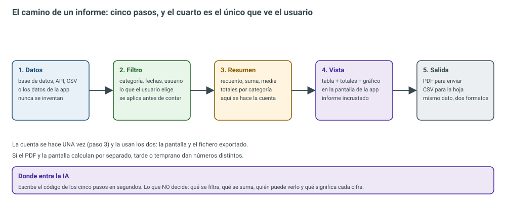
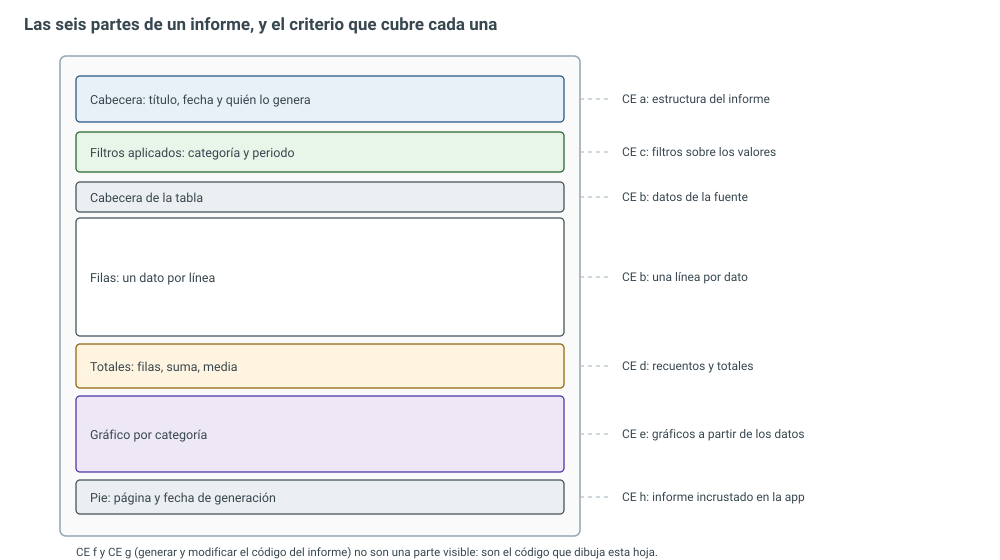
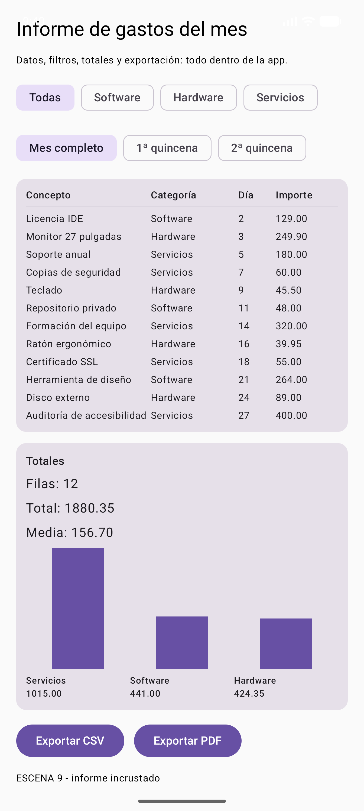
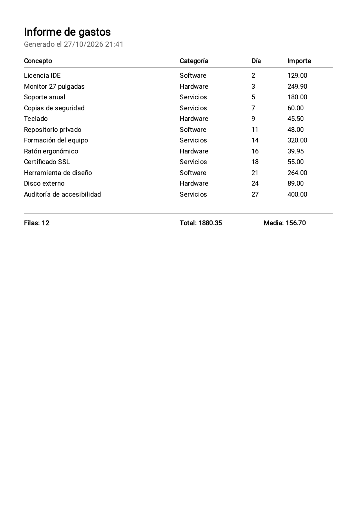

# 8.1 — Confección de informes

> **El trabajo de ingeniería:** convertir datos en una decisión. Un informe no es un adorno al final
> de la app: es la pantalla donde alguien mira cuánto se ha gastado, cuánto se ha vendido o qué está
> fallando. Y tiene una trampa que se lleva por delante a muchos proyectos:
> <span style="background-color:#a5d6a7;padding:0 3px;border-radius:3px;">si la pantalla y el PDF calculan por separado, tarde o temprano dan números distintos</span>. En esta
> unidad se construye el informe del `IsmaelUIKit` —filtros, totales, gráfico y exportación a PDF y
> CSV— con una sola función que hace la cuenta, y se prueba con seis pruebas automáticas.

## Resultado de aprendizaje que trabaja esta unidad

<span style="background-color:#a5d6a7;padding:0 3px;border-radius:3px;">**RA5. Crea informes evaluando y utilizando herramientas gráficas**</span> (RD 405/2023, módulo 0488
*Desarrollo de interfaces*). La unidad lo trabaja **completo**: los ocho criterios, de la `a` a la `h`.

| CE | Criterio de evaluación (texto literal del real decreto) | Dónde se trabaja |
| -- | ------------------------------------------------------ | ---------------- |
| RA5 a | Se ha establecido la estructura del informe. | §2, las siete partes |
| RA5 b | Se han generado informes básicos a partir de diferentes fuentes de datos mediante asistentes. | §3 y §6, de la fuente al asistente |
| RA5 c | Se han establecido filtros sobre los valores a presentar en los informes. | §3, `filtrar()` |
| RA5 d | Se han incluido valores calculados, recuentos y totales. | §4, `resumir()` |
| RA5 e | Se han incluido gráficos generados a partir de los datos. | §5, `GraficoBarras` |
| RA5 f | Se han utilizado herramientas para generar el código correspondiente a los informes de una aplicación. | §6, qué genera un asistente |
| RA5 g | Se ha modificado el código correspondiente a los informes. | §6, `ExportaInforme` |
| RA5 h | Se ha desarrollado una aplicación que incluye informes incrustados. | §7, la escena 9 |

<div style="background-color:#a5d6a7; border-radius:8px; padding:10px 14px; margin:14px 0;">
<strong>🟢 Leyenda de repaso obligatorio:</strong> los textos con <span style="background-color:#a5d6a7;padding:0 3px;border-radius:3px;">este fondo verde</span> son los datos que se preguntan en examen y los que se usan en el trabajo real.</div>

## 1. Qué es un informe (y qué no)

Un **informe** es una vista de datos preparada para que alguien **decida**: lleva un título que dice
qué se está mirando, unos filtros que dicen de qué trozo de la realidad se habla, una tabla con los
datos, unos totales y, si ayuda, un gráfico.

No es un informe:

- una lista de todos los registros sin filtrar (eso es un volcado);
- una pantalla bonita sin cifras (eso es un escaparate);
- un PDF que se genera con otros números que los de la pantalla (eso es un problema).

<span style="background-color:#a5d6a7;padding:0 3px;border-radius:3px;">La regla que ordena toda la unidad: los datos se filtran y se cuentan **una vez**, y ese resultado lo
usan la pantalla, el PDF y el CSV</span>. Si hay dos caminos de cálculo, hay dos verdades.

<figure markdown>


<figcaption>Figura 1. El camino del informe. El paso 3 (resumen) es el único que calcula; el 4 y el 5 solo pintan lo que devuelve.</figcaption>
</figure>

## 2. La estructura del informe (criterio a)

Un informe se lee de arriba abajo, y cada parte responde a una pregunta:

<figure markdown>


<figcaption>Figura 2. Las siete partes de un informe. Las bandas de la izquierda son la hoja; a la derecha, el criterio de evaluación que cubre cada una.</figcaption>
</figure>

| Parte | Qué lleva | La pregunta que responde |
| ----- | --------- | ------------------------ |
| **Cabecera** | Título, fecha y quién lo genera | ¿Qué estoy mirando y de cuándo es? |
| **Filtros** | Categoría, fechas, usuario | ¿De qué trozo de los datos habla? |
| **Cabecera de tabla** | Nombres de las columnas | ¿Qué significa cada número? |
| **Filas** | Un dato por línea | ¿Qué hay dentro? |
| **Totales** | Recuento, suma, media | ¿Cuánto, en total? |
| **Gráfico** | Barras, líneas o tarta | ¿Cómo se reparte? |
| **Pie** | Página y fecha de generación | ¿Se ha cortado alguna hoja? |

<span style="background-color:#a5d6a7;padding:0 3px;border-radius:3px;">Los filtros van escritos en el informe, no solo aplicados</span>. Un PDF con «Total: 1.880,35 €» y sin
decir «solo Servicios, del 1 al 15» es un número sin contexto: quien lo recibe no puede comprobarlo.

!!! note "Los criterios f y g no son una parte visible"
    Generar el código del informe y modificarlo (CE f y g) no se ve en la hoja: es el **código** que
    dibuja la hoja. Se trabaja en el apartado 6.

## 3. De dónde salen los datos y cómo se filtran (criterios b y c)

### 3.1 La fuente

| Fuente | Ejemplo | Cuidado con… |
| ------ | ------- | ------------ |
| Base de datos | PostgreSQL, SQLite, Room | El informe no debe traerse la tabla entera para contar en el móvil |
| API REST | Un endpoint que devuelve JSON | Que el servidor filtre, no el cliente |
| Fichero | CSV de una exportación, Excel | Codificación (UTF-8) y separador (`;` o `,`) |
| La propia app | Los datos que el usuario ha ido guardando | Es la fuente más pequeña y la más fácil de probar |

En esta unidad la fuente es la propia app: una lista de gastos del mes. <span style="background-color:#a5d6a7;padding:0 3px;border-radius:3px;">Da igual de dónde vengan:
el modelo de datos es el mismo</span>, y por eso se puede probar sin servidor.

### 3.2 El modelo y el filtro

```kotlin title="ui/src/main/java/com/example/uikit/Informe.kt"
package com.example.uikit

/**
 * Modelo de un informe: las filas, el filtro que aplica el usuario y los totales del pie.
 *
 * Aquí no hay nada de Android: son funciones puras (entran datos, salen números), y por eso se
 * pueden probar sin emulador. La pantalla solo pinta lo que devuelven estas funciones.
 */

/** Una fila del informe. El día es el día del mes (1..31): suficiente para filtrar por fechas. */
data class FilaInforme(
    val concepto: String,
    val categoria: String,
    val importe: Double,
    val dia: Int,
)

/** Lo que el usuario elige antes de ver el informe. Categoría nula significa "todas". */
data class FiltroInforme(
    val categoria: String? = null,
    val desde: Int = 1,
    val hasta: Int = 31,
)

/** Los totales que van al pie: cuántas filas, cuánto suman, cuánto de media y cuánto por categoría. */
data class ResumenInforme(
    val numero: Int,
    val total: Double,
    val media: Double,
    val porCategoria: Map<String, Double>,
) {
    /**
     * Porcentaje que representa una categoría sobre el total.
     * Si el total es cero devuelve 0: dividir entre cero no es un informe, es un error.
     */
    fun porcentaje(categoria: String): Double {
        if (total == 0.0) return 0.0
        return (porCategoria[categoria] ?: 0.0) * 100.0 / total
    }
}

object Informe {

    /** Aplica categoría y rango de días. Un filtro vacío devuelve todas las filas. */
    fun filtrar(filas: List<FilaInforme>, filtro: FiltroInforme): List<FilaInforme> =
        filas.filter { fila ->
            val deCategoria = filtro.categoria == null || fila.categoria == filtro.categoria
            val deFecha = fila.dia in filtro.desde..filtro.hasta
            deCategoria && deFecha
        }

    /** Recuento, suma, media y suma por categoría. La media se calcula sobre las filas que hay. */
    fun resumir(filas: List<FilaInforme>): ResumenInforme {
        val total = filas.sumOf { it.importe }
        return ResumenInforme(
            numero = filas.size,
            total = total,
            media = if (filas.isEmpty()) 0.0 else total / filas.size,
            porCategoria = filas.groupBy { it.categoria }
                .mapValues { (_, grupo) -> grupo.sumOf { it.importe } },
        )
    }

    /**
     * El informe en CSV, con punto y coma como separador (el que espera una hoja de cálculo en
     * español). Los campos que llevan separador, comillas o salto de línea van entrecomillados.
     */
    fun aCsv(filas: List<FilaInforme>): String {
        val cabecera = "Concepto;Categoría;Importe;Día"
        val cuerpo = filas.joinToString("\n") { fila ->
            listOf(
                escapar(fila.concepto),
                escapar(fila.categoria),
                String.format(java.util.Locale.US, "%.2f", fila.importe),
                fila.dia.toString(),
            ).joinToString(";")
        }
        return cabecera + "\n" + cuerpo + "\n"
    }

    /** Entrecomilla un campo solo si lo necesita, y duplica las comillas que ya lleva dentro. */
    private fun escapar(campo: String): String {
        val necesita = campo.contains(';') || campo.contains('"') || campo.contains('\n')
        if (!necesita) return campo
        return "\"" + campo.replace("\"", "\"\"") + "\""
    }
}
```

Tres decisiones que están en el código y que se preguntan:

1. **El filtro es un dato, no un `if` suelto** (`FiltroInforme`): se puede guardar, mandar al servidor
   o enseñar en el informe. <span style="background-color:#a5d6a7;padding:0 3px;border-radius:3px;">Un filtro que no se puede reconstruir es un filtro que no se puede
   auditar</span>.
2. **Categoría nula significa «todas»**: no hay un valor mágico tipo `"TODAS"` que choque con una
   categoría real.
3. **El rango de días es inclusivo** (`dia in desde..hasta`): del 1 al 15 incluye el 15. Es la fuente
   de la mitad de los errores de los informes de verdad.

## 4. Los cálculos del pie (criterio d)

El resumen no es «sumar una columna»: son cuatro números y una decisión.

| Cálculo | Cómo se hace | Error típico |
| ------- | ------------ | ------------ |
| Recuento | `filas.size` | Contar filas antes de filtrar |
| Suma | `sumOf { it.importe }` | Sumar texto ya formateado con comas |
| Media | `total / numero` | **Media de medias** (ver abajo) |
| Por categoría | `groupBy { categoria }` + `sumOf` | Sumar con `Double` para dinero |

<span style="background-color:#a5d6a7;padding:0 3px;border-radius:3px;">La media de medias está mal</span>: si una categoría tiene 3 filas y otra tiene 30, la media de las
dos medias no es la media del total. Se suma todo y se divide entre **todas** las filas, que es lo que
hace `resumir()`.

Y un aviso de dinero: `Double` sirve para aprender, pero <span style="background-color:#a5d6a7;padding:0 3px;border-radius:3px;">para facturar se usan enteros en céntimos o
`BigDecimal`</span>, porque `0.1 + 0.2` no da exactamente `0.3` en coma flotante.

## 5. El gráfico (criterio e)

Un gráfico de barras es un rectángulo cuya altura es proporcional al valor. Lo único que hay que
calcular bien es la **escala**: el valor mayor ocupa el alto disponible y el resto se reparte.

```kotlin title="ui/src/main/java/com/example/uikit/GraficoBarras.kt (lo esencial)"
// ...
val maximo = datos.maxOfOrNull { it.second } ?: 0.0
// ...
Canvas(modifier = Modifier.fillMaxWidth().height(altura)) {
    if (datos.isEmpty() || maximo <= 0.0) return@Canvas
    // Dos huecos por barra: uno para la barra y otro para separarla de la siguiente.
    val ancho = size.width / (datos.size * 2f)
    datos.forEachIndexed { indice, (_, valor) ->
        val alto = (valor / maximo).toFloat() * (size.height - 2f)
        val x = ancho * (2 * indice + 0.5f)
        drawRect(
            color = color,
            topLeft = Offset(x, size.height - alto),
            size = Size(ancho, alto),
        )
    }
}
```

Dos detalles que separan un gráfico de juguete de uno usable:

- **Las etiquetas son texto, no dibujo**: así se leen en voz alta y crecen con el tamaño de fuente del
  sistema (lo que pedía el RA4).
- **`contentDescription` con los valores**: un gráfico que no se puede leer con un lector de pantalla
  es un gráfico que la mitad de los usuarios no tiene.

<figure markdown>


<figcaption>Figura 3. La escena 9 en el emulador: 12 filas, total 1880.35 y media 156.70. El gráfico reparte Servicios 1015.00, Software 441.00 y Hardware 424.35, que suman exactamente el total.</figcaption>
</figure>

<span style="background-color:#a5d6a7;padding:0 3px;border-radius:3px;">La comprobación que hay que hacer siempre: las barras tienen que sumar el total</span>. Si no suma, o
el gráfico o los totales están mal, y el informe miente.

## 6. Del asistente al código (criterios f y g)

### 6.1 Lo que hace un asistente

Un **asistente** de informes es la pantalla que te lleva de la fuente al informe sin escribir el
código a mano: eliges la conexión, arrastras los campos, pones la agrupación y él genera la consulta y
la plantilla. Es el CE f, y hoy se hace con herramientas de verdad:

| Herramienta | Qué es | Dónde se usa |
| ----------- | ------ | ------------ |
| **JasperReports + Jaspersoft Studio** | Motor de informes Java con asistente visual | Banca, seguros, administración |
| **Power BI** | Cuadros de mando con orígenes de datos | Empresas con Microsoft 365 |
| **Looker Studio** | Informes web conectados a datos | Marketing, analítica |
| **Metabase / Superset** | Consultas y paneles sobre la base de datos | Equipos técnicos pequeños |
| **Apache POI / OpenPDF / iText** | Librerías para escribir Excel y PDF desde código | Cuando el informe lo genera la app |

<span style="background-color:#a5d6a7;padding:0 3px;border-radius:3px;">El asistente genera el esqueleto; el criterio g es saber tocarlo después</span>. Todo lo que genera
lleva consultas, filtros y formato que hay que adaptar: nombres de columnas, importes con dos
decimales, la fila de totales, el pie con la página.

### 6.2 La modificación: el código de la exportación

```kotlin title="ui/src/main/java/com/example/uikit/ExportaInforme.kt"
package com.example.uikit

import android.content.Context
import android.graphics.Canvas
import android.graphics.Paint
import android.graphics.pdf.PdfDocument
import java.io.File
import java.text.SimpleDateFormat
import java.util.Date
import java.util.Locale

/**
 * Exportación del informe: CSV para la hoja de cálculo y PDF para enviar o imprimir.
 *
 * El PDF se dibuja a mano con PdfDocument, que viene dentro de Android: no hay que añadir
 * ninguna librería. Una hoja A4 en puntos mide 595 x 842. Si las filas no caben, se abre otra
 * página.
 */
object ExportaInforme {

    /** Escribe el CSV en la carpeta privada de la app y devuelve el fichero. */
    fun aCsv(contexto: Context, filas: List<FilaInforme>, nombre: String = "informe.csv"): File {
        val fichero = File(contexto.filesDir, nombre)
        fichero.writeText(Informe.aCsv(filas), Charsets.UTF_8)
        return fichero
    }

    /** Genera el PDF del informe y devuelve el fichero escrito. */
    fun aPdf(
        contexto: Context,
        titulo: String,
        filas: List<FilaInforme>,
        nombre: String = "informe.pdf",
    ): File {
        val resumen = Informe.resumir(filas)
        val documento = PdfDocument()
        var numeroPagina = 1
        var pagina = documento.startPage(pagina(numeroPagina))
        var lienzo: Canvas = pagina.canvas
        var y = 60f

        val tinta = Paint().apply { isAntiAlias = true }
        val gris = Paint().apply { isAntiAlias = true; color = 0xFF666666.toInt() }

        // Cabecera: título del informe y fecha de generación.
        tinta.textSize = 18f
        tinta.isFakeBoldText = true
        lienzo.drawText(titulo, 40f, y, tinta)
        y += 18f
        tinta.textSize = 10f
        tinta.isFakeBoldText = false
        val fecha = SimpleDateFormat("dd/MM/yyyy HH:mm", Locale.getDefault()).format(Date())
        lienzo.drawText("Generado el $fecha", 40f, y, gris)
        y += 28f

        // Cabecera de la tabla.
        tinta.textSize = 11f
        tinta.isFakeBoldText = true
        lienzo.drawText("Concepto", 40f, y, tinta)
        lienzo.drawText("Categoría", 300f, y, tinta)
        lienzo.drawText("Día", 420f, y, tinta)
        lienzo.drawText("Importe", 480f, y, tinta)
        tinta.isFakeBoldText = false
        lienzo.drawLine(40f, y + 6f, 555f, y + 6f, gris)
        y += 24f

        // Una línea por fila. Si se acaba el papel, se abre la página siguiente.
        filas.forEach { fila ->
            if (y > 760f) {
                documento.finishPage(pagina)
                numeroPagina += 1
                pagina = documento.startPage(pagina(numeroPagina))
                lienzo = pagina.canvas
                y = 60f
            }
            lienzo.drawText(fila.concepto, 40f, y, tinta)
            lienzo.drawText(fila.categoria, 300f, y, tinta)
            lienzo.drawText(fila.dia.toString(), 420f, y, tinta)
            lienzo.drawText(importe(fila.importe), 480f, y, tinta)
            y += 18f
        }

        // Totales al pie de la última tabla.
        y += 10f
        lienzo.drawLine(40f, y, 555f, y, gris)
        y += 20f
        tinta.isFakeBoldText = true
        lienzo.drawText("Filas: ${resumen.numero}", 40f, y, tinta)
        lienzo.drawText("Total: ${importe(resumen.total)}", 300f, y, tinta)
        lienzo.drawText("Media: ${importe(resumen.media)}", 440f, y, tinta)

        documento.finishPage(pagina)
        val fichero = File(contexto.filesDir, nombre)
        fichero.outputStream().use { documento.writeTo(it) }
        documento.close()
        return fichero
    }

    /** La hoja A4 en puntos: 595 de ancho por 842 de alto. */
    private fun pagina(numero: Int): PdfDocument.PageInfo =
        PdfDocument.PageInfo.Builder(595, 842, numero).create()

    /** Importe con dos decimales y el separador decimal del idioma del móvil. */
    private fun importe(valor: Double): String = String.format(Locale.getDefault(), "%.2f", valor)
}
```

Aquí está el criterio g en estado puro: el PDF no lo hace una librería externa, lo dibuja la app con
`PdfDocument`, que viene en Android.

| Pieza | Para qué |
| ----- | -------- |
| `PdfDocument.PageInfo.Builder(595, 842, n)` | Una hoja A4 en puntos (72 ppp) |
| `Paint` con `textSize` | El «bolígrafo»: tamaño, negrita, color |
| `drawText`, `drawLine` | Escribir y separar secciones |
| `finishPage` + `writeTo` | Cerrar la hoja y escribir el fichero |
| `y > 760f` → página nueva | Paginación: un informe largo no se corta |

## 7. El informe incrustado (criterio h)

Incrustado significa **dentro de la app**, no en un servidor: el usuario filtra, ve el resultado y se
lo lleva. En la escena 9, los dos botones escriben en la carpeta privada de la app:

<figure markdown>


<figcaption>Figura 4. La exportación hecha desde la app: el aviso dice el nombre y el tamaño del fichero generado.</figcaption>
</figure>

<figure markdown>


<figcaption>Figura 5. El PDF que ha escrito la app, abierto en el ordenador: cabecera, doce filas y totales. Es el mismo fichero que se ha sacado del emulador.</figcaption>
</figure>

Y el CSV, tal cual sale del móvil:

```text title="informe.csv (fichero real generado por la app)"
Concepto;Categoría;Importe;Día
Licencia IDE;Software;129.00;2
Monitor 27 pulgadas;Hardware;249.90;3
Soporte anual;Servicios;180.00;5
Copias de seguridad;Servicios;60.00;7
Teclado;Hardware;45.50;9
Repositorio privado;Software;48.00;11
Formación del equipo;Servicios;320.00;14
Ratón ergonómico;Hardware;39.95;16
Certificado SSL;Servicios;55.00;18
Herramienta de diseño;Software;264.00;21
Disco externo;Hardware;89.00;24
Auditoría de accesibilidad;Servicios;400.00;27
```

!!! warning "El CSV y la hoja de cálculo"
    Se usa **punto y coma** porque es el separador que espera una hoja de cálculo en español. Si el
    campo lleva el separador dentro («Curso; avanzado»), va entrecomillado; si lleva comillas, se
    duplican. Sin eso, el fichero se descoloca en cuanto un concepto tiene un `;`.

## 8. Lo que usan las empresas (y qué hace la IA)

| Necesidad | Lo que se usa hoy | Lo que aporta la app |
| --------- | ----------------- | -------------------- |
| Informe para enviar o firmar | JasperReports, iText, OpenPDF | `PdfDocument` |
| Cuadro de mando que se actualiza solo | Power BI, Looker Studio, Metabase | — |
| Datos para Excel | Apache POI, CSV | `Informe.aCsv` |
| Gráfico dentro de la app | Vico, MPAndroidChart, Compose Canvas | `GraficoBarras` |
| Informe grande con miles de filas | Se genera en el servidor, no en el móvil | — |

<span style="background-color:#a5d6a7;padding:0 3px;border-radius:3px;">La IA escribe este código en segundos</span>: la consulta, el `groupBy`, el PDF, el CSV. Lo que la
IA **no** decide es lo que hace útil un informe:

- **qué se filtra** (y qué se deja fuera a propósito);
- **qué significa cada cifra** y quién puede verla;
- **si el dato es correcto**: la IA no sabe que ese «400,00» era una auditoría mal imputada;
- **la estructura**: qué va arriba y qué es lo que el jefe mira primero.

Por eso el examen no pregunta cómo se escribe un `for`: pregunta **qué se cuenta, cómo se filtra y
dónde se comprueba**. Eso no lo escribe la IA.

## 9. Lo que se ha probado (29 pruebas)

Las seis pruebas de la unidad van sobre el modelo, que es donde está la cuenta:

| Prueba | Qué demuestra | Criterio |
| ------ | ------------- | -------- |
| `elFiltroPorCategoriaDejaSoloEsaCategoria` | Filtrar por categoría deja solo esas filas | c |
| `elFiltroPorDiasRecortaElRango` | El rango de días es inclusivo y recorta | c |
| `elResumenCuentaSumaYHaceLaMedia` | Recuento, suma y media sobre lo filtrado | d |
| `losPorcentajesSumanCien` | Los porcentajes de las categorías suman 100 | d, e |
| `elCsvLlevaCabeceraYUnaLineaPorFila` | Cabecera + una línea por fila | g |
| `elCsvEntrecomillaLoQueLlevaSeparador` | Un `;` dentro del campo no descoloca el CSV | g |

Y la salida real, al lanzarlas:

```text title="salida real de am instrument"
com.example.uikit.InformeTest:......
Time: 29.461

OK (29 tests)
```

**29 pruebas en verde** en total (las 23 de las unidades anteriores más las 6 de esta).

<span style="background-color:#a5d6a7;padding:0 3px;border-radius:3px;">La prueba que más vale es `losPorcentajesSumanCien`</span>: si los porcentajes no suman 100, el
gráfico de tarta miente aunque cada barra esté bien calculada.

## 10. Errores típicos

| Error | Por qué está mal | Qué hacer |
| ----- | ---------------- | --------- |
| Calcular en la pantalla y otra vez en el PDF | Dos verdades distintas | Una función de resumen, dos formatos |
| Contar antes de filtrar | «12 filas» cuando se ven 4 | Filtrar primero, resumir después |
| Media de medias | No es la media del total | Sumar todo y dividir entre todas las filas |
| `Double` para dinero | `0.1 + 0.2` no da `0.3` | Enteros en céntimos o `BigDecimal` |
| CSV con comas en español | La hoja descoloca las columnas | Punto y coma + entrecomillar |
| PDF sin paginar | Las filas de abajo desaparecen | Nueva página al pasar del margen |
| Gráfico sin escala | Barras que se salen del lienzo | Dividir por el valor máximo |
| Informe sin filtros escritos | Nadie puede comprobar la cifra | Imprimir los filtros aplicados |
| Gráfico sin descripción | Ilegible con lector de pantalla | `contentDescription` con los valores |

## 11. Resumen

- <span style="background-color:#a5d6a7;padding:0 3px;border-radius:3px;">Un informe sirve para decidir</span>: cabecera, filtros, tabla, totales, gráfico y pie.
- **Estructura** (a): siete partes, y los filtros se **escriben** en el informe, no solo se aplican.
- **Fuentes y filtros** (b, c): el filtro es un dato (`FiltroInforme`), no un `if` suelto.
- **Cálculos** (d): recuento, suma, media y por categoría. <span style="background-color:#a5d6a7;padding:0 3px;border-radius:3px;">Nunca la media de medias</span>.
- **Gráficos** (e): una barra es un rectángulo escalado; las etiquetas, texto accesible.
- **Asistentes y código** (f, g): JasperReports, Power BI, Looker Studio generan el esqueleto;
  `ExportaInforme` lo adapta y lo escribe en PDF y CSV.
- **Incrustado** (h): la app filtra, resume y exporta sin servidor.
- **Pruebas**: 6 nuevas, <span style="background-color:#a5d6a7;padding:0 3px;border-radius:3px;">29 en total, `Time: 29.461`</span>.
- **La IA** escribe el código; las decisiones (qué se cuenta, qué se filtra, qué significa) siguen
  siendo del que hace el informe.

## Bibliografía y fuentes

Todo el material se apoya en la documentación oficial de las herramientas que se usan en clase.

**Informes y PDF en Android**

- Android Developers. *PdfDocument* — crear PDF desde la app. <https://developer.android.com/reference/android/graphics/pdf/PdfDocument>
- Android Developers. *Canvas y DrawScope en Compose*. <https://developer.android.com/develop/ui/compose/graphics/draw/overview>
- Android Developers. *Guardar ficheros en el almacenamiento interno*. <https://developer.android.com/training/data-storage/app-specific>

**Herramientas de informes**

- Eclipse Foundation. *JasperReports* — motor de informes. <https://community.jaspersoft.com/project/jasperreports-library>
- Jaspersoft. *Jaspersoft Studio* — el asistente de diseño. <https://community.jaspersoft.com/project/jaspersoft-studio>
- Microsoft. *Power BI — documentación*. <https://learn.microsoft.com/power-bi/>
- Google. *Looker Studio — ayuda*. <https://support.google.com/looker-studio>
- Metabase. *Documentación oficial*. <https://www.metabase.com/docs/latest/>
- Apache Software Foundation. *Apache POI* — leer y escribir Excel y Word. <https://poi.apache.org/>
- iText. *iText 7 — documentación*. <https://itextpdf.com/products/itext>
- Apache Software Foundation. *Apache PDFBox*. <https://pdfbox.apache.org/>

**Datos y formatos**

- RFC 4180. *Common Format and MIME Type for CSV Files*. <https://www.rfc-editor.org/rfc/rfc4180>
- Unión Europea. *Reglamento (UE) 2016/679 (RGPD)* — datos personales que pueden aparecer en un informe. <https://eur-lex.europa.eu/eli/reg/2016/679/oj>
- W3C. *WCAG 2.2* — alternativas textuales para gráficos (criterio 1.1.1). <https://www.w3.org/TR/WCAG22/>

**Normativa**

- **Real Decreto 405/2023, de 29 de mayo** (BOE-A-2023-13221), por el que se establecen los títulos de
  Técnico y Técnico Superior en Sistemas Microinformáticos y Redes y se fijan sus enseñanzas mínimas:
  currículo del módulo 0488 *Desarrollo de interfaces*, **RA5 y sus ocho criterios de evaluación**.
