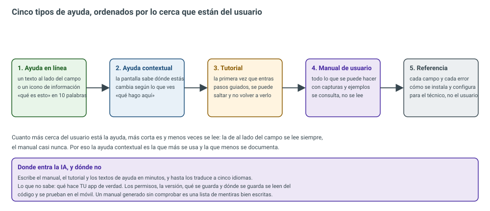
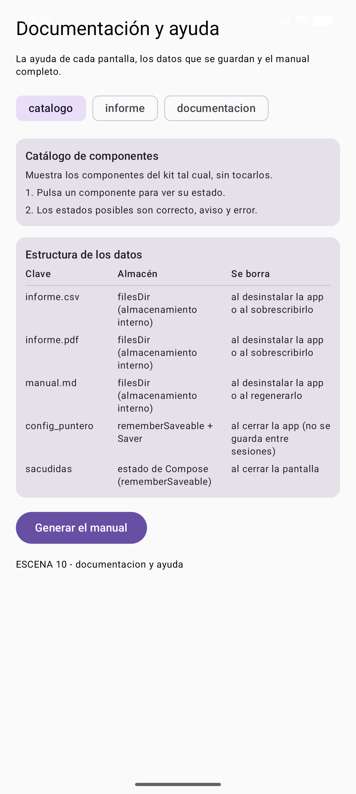
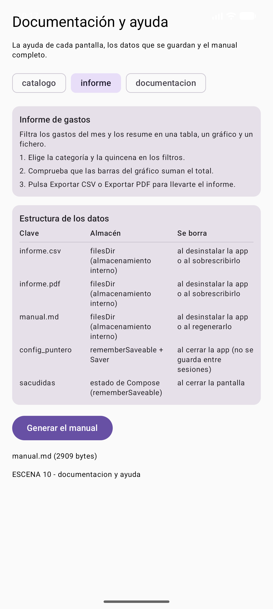
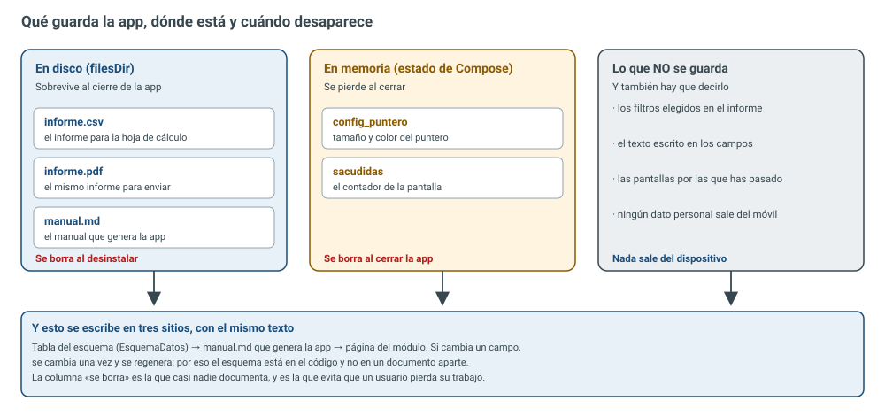
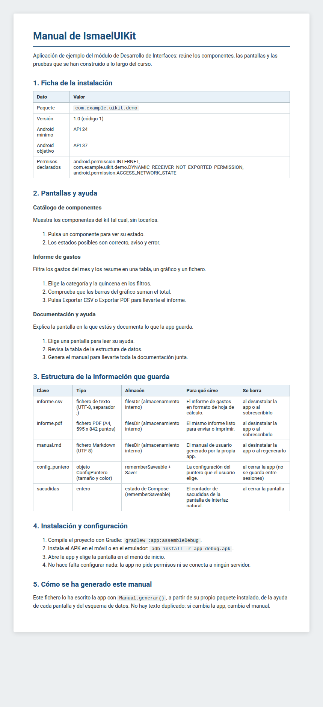

# 9.1 — Documentación y ayudas

> **El trabajo de ingeniería:** que otra persona pueda usar y mantener lo que tú has hecho. La
> documentación no es el PDF que se entrega el último día: es lo que evita que el usuario llame al
> soporte, que el compañero nuevo rompa el proyecto y que dentro de seis meses no te acuerdes de por
> qué filtraste así. Y tiene una trampa clásica:
> <span style="background-color:#a5d6a7;padding:0 3px;border-radius:3px;">un manual escrito a mano se queda viejo el día que cambia un permiso</span>. En esta unidad se
> construye la documentación del `IsmaelUIKit` **desde el propio código** —ayuda contextual, esquema de
> datos y manual generado— y se prueba con seis pruebas automáticas más.

## Resultado de aprendizaje que trabaja esta unidad

<span style="background-color:#a5d6a7;padding:0 3px;border-radius:3px;">**RA6. Documenta aplicaciones seleccionando y utilizando herramientas específicas**</span>
(RD 405/2023, módulo 0488 *Desarrollo de interfaces*). La unidad lo trabaja **completo**: los siete
criterios, de la `a` a la `g`.

| CE | Criterio de evaluación (texto literal del real decreto) | Dónde se trabaja |
| -- | ------------------------------------------------------ | ---------------- |
| RA6 a | Se han identificado sistemas de generación de ayudas. | §2, los cinco tipos y las herramientas |
| RA6 b | Se han generado ayudas en los formatos habituales. | §3, la tabla de formatos |
| RA6 c | Se han generado ayudas sensibles al contexto. | §4, `Ayuda.para()` y la escena 10 |
| RA6 d | Se ha documentado la estructura de la información persistente. | §5, `EsquemaDatos` |
| RA6 e | Se han confeccionado el manual de usuario y la guía de referencia. | §6, `Manual.generar()` |
| RA6 f | Se han confeccionado los manuales de instalación, configuración y administración. | §7, la ficha real de la app |
| RA6 g | Se han confeccionado tutoriales. | §8, el tutorial que sí se lee |

<div style="background-color:#a5d6a7; border-radius:8px; padding:10px 14px; margin:14px 0;">
<strong>🟢 Leyenda de repaso obligatorio:</strong> los textos con <span style="background-color:#a5d6a7;padding:0 3px;border-radius:3px;">este fondo verde</span> son los datos que se preguntan en examen y los que se usan en el trabajo real.</div>

## 1. Qué es documentar (y qué no)

Documentar es **dejar por escrito lo que otra persona necesita para usar, instalar o mantener la
aplicación**. No es contar lo que has hecho ni lo bien que ha quedado.

No es documentación: un comentario que repite lo que ya dice el código (`// suma uno` encima de
`i++`), un manual de 80 páginas que nadie ha abierto, una captura de una versión que ya no existe o un
PDF con los permisos copiados de otro proyecto.

La documentación se divide en tres grupos, y cada uno se escribe distinto:

| Grupo | Qué incluye | Quién lo lee |
| ----- | ----------- | ------------ |
| **Documentación de pruebas** | Los escenarios que se van a probar (*de entrada*) y los informes con los resultados (*de salida*) | El equipo de calidad |
| **Documentación técnica interna** | Los comentarios del código: qué hace cada módulo, cada función y cada dato | Otro programador (o tú en marzo) |
| **Documentación técnica externa** | El manual del programador: arquitectura, dependencias, cómo se compila y se despliega | El que mantiene la app |

<span style="background-color:#a5d6a7;padding:0 3px;border-radius:3px;">La documentación interna no se escribe en un Word aparte: se escribe en el código</span>, con
KDoc en Kotlin o Javadoc en Java, y una herramienta la convierte en una web. Un comentario lejos del
código se queda viejo sin que nadie lo note.

## 2. Los cinco tipos de ayuda (criterio a)

Antes de escribir nada hay que decidir **qué tipo de ayuda** necesita cada cosa. No es lo mismo
explicar un campo que explicar la app entera.



*Figura 1. Los cinco tipos de ayuda y para qué sirve cada uno.*

En el kit: la ayuda en línea son los textos bajo los filtros, la contextual es la tarjeta de la
escena 10, el tutorial son los tres pasos del informe y el manual es el `manual.md` de la §6.

<span style="background-color:#a5d6a7;padding:0 3px;border-radius:3px;">Los sistemas de generación de ayudas son las herramientas que convierten esos textos en algo
consultable</span>: un índice, un buscador y una web. Los que se usan hoy en las empresas:

- **Documentación como código** (docs-as-code): el texto en **Markdown** dentro del mismo repositorio,
  publicado con **MkDocs Material**, **Docusaurus**, **Sphinx** o **VitePress**. Es lo que se usa en
  GitHub y GitLab. Esta misma página es un ejemplo.
- **Generadores de API**: **Dokka** (Kotlin), **Javadoc** (Java), **JSDoc**, **Sphinx**. Leen los
  comentarios del código y escriben la referencia solos.
- **Wikis y bases de conocimiento**: **Confluence**, **Notion**, **BookStack**, para cuando escriben
  también los que no programan.
- **Centros de ayuda de producto**: **Zendesk**, **Intercom**, **Help Scout**, con buscador y
  métricas de qué se consulta.
- **Ayuda dentro de la app**: la de esta unidad. Es la única que el usuario ve sin salir.

<span style="background-color:#a5d6a7;padding:0 3px;border-radius:3px;">La IA escribe los cinco tipos en minutos</span>, y hasta los traduce. Lo que no sabe es qué
hace *tu* app: los permisos, la versión y los datos que se guardan se leen del paquete instalado y se
prueban. Un manual generado sin comprobar es una lista de mentiras bien escritas.

## 3. Los formatos habituales (criterio b)

| Formato | Extensión | Para qué sirve | ¿Se usa hoy? |
| ------- | --------- | -------------- | ------------ |
| Markdown | `.md` | Escribir la documentación y publicarla como web | **Sí, es el estándar** |
| HTML | `.html` | La web de ayuda que ve el usuario | Sí, generado desde Markdown |
| PDF | `.pdf` | Entregar, imprimir, firmar | Sí, para entregas y manuales |
| EPUB | `.epub` | Leer en un ebook | Poco, para manuales largos |
| Texto dentro de la app | Compose | La ayuda contextual | Sí, y es la que más se usa |
| CHM / HLP | `.chm`, `.hlp` | La ayuda de Windows de los 2000 | **No**: retirados |
| JavaHelp | `.hs`, `.jar` | La ayuda de aplicaciones Java de escritorio | Solo en proyectos antiguos |

<span style="background-color:#a5d6a7;padding:0 3px;border-radius:3px;">CHM y HLP se preguntan en examen y no se usan en ningún proyecto nuevo</span>: eran la ayuda
compilada de Windows, con un fichero `.cnt` para el índice y RTF o HTML dentro. Hoy el mismo trabajo
se hace con Markdown y una web, y sale mejor.

La regla práctica: si el usuario está **dentro** de la app, la ayuda va **dentro** de la app; si es
quien instala o mantiene, va un **documento**; si hay que firmar o entregar, PDF. Y el mismo texto no
se escribe dos veces: se escribe en Markdown y se genera lo demás.

## 4. La ayuda sensible al contexto (criterio c)

La ayuda contextual es la que **sabe en qué pantalla está el usuario** y le responde a «¿qué hago
aquí?». No es un manual con un buscador: es un texto corto que cambia según dónde estés.

En el kit se resuelve con una lista de pantallas y una función que devuelve la que toca:

```kotlin title="ui/src/main/java/com/example/uikit/Ayuda.kt"
package com.example.uikit

/**
 * La ayuda de cada pantalla del kit.
 *
 * La ayuda contextual no es un texto único al final del manual: es la respuesta a «¿qué hago
 * aquí?» en la pantalla en la que está el usuario. Por eso cada pantalla tiene su clave, su
 * resumen y sus pasos, y la app pide la ayuda con la misma clave con la que navega.
 */

/** La ayuda de una pantalla: qué es, para qué sirve y qué pasos seguir. */
data class AyudaPantalla(
    val clave: String,
    val titulo: String,
    val resumen: String,
    val pasos: List<String>,
)

object Ayuda {

    /** La ayuda general: se devuelve cuando la pantalla no tiene una propia. */
    val general = AyudaPantalla(
        clave = "general",
        titulo = "Ayuda general",
        resumen = "El kit reúne los componentes y las pantallas que se han construido en el módulo.",
        pasos = listOf(
            "Elige una pantalla en la lista para ver su ayuda.",
            "Cada tarjeta de la pantalla se puede probar por separado.",
            "Los datos que guarda la app están documentados en la estructura de datos.",
        ),
    )

    /** Una entrada por pantalla. La clave es la misma que usa la app para navegar. */
    val pantallas: List<AyudaPantalla> = listOf(
        AyudaPantalla(
            clave = "catalogo",
            titulo = "Catálogo de componentes",
            resumen = "Muestra los componentes del kit tal cual, sin tocarlos.",
            pasos = listOf(
                "Pulsa un componente para ver su estado.",
                "Los estados posibles son correcto, aviso y error.",
            ),
        ),
        AyudaPantalla(
            clave = "informe",
            titulo = "Informe de gastos",
            resumen = "Filtra los gastos del mes y los resume en una tabla, un gráfico y un fichero.",
            pasos = listOf(
                "Elige la categoría y la quincena en los filtros.",
                "Comprueba que las barras del gráfico suman el total.",
                "Pulsa Exportar CSV o Exportar PDF para llevarte el informe.",
            ),
        ),
        AyudaPantalla(
            clave = "documentacion",
            titulo = "Documentación y ayuda",
            resumen = "Explica la pantalla en la que estás y documenta lo que la app guarda.",
            pasos = listOf(
                "Elige una pantalla para leer su ayuda.",
                "Revisa la tabla de la estructura de datos.",
                "Genera el manual para llevarte toda la documentación junta.",
            ),
        ),
    )

    /** La ayuda de una pantalla. Si la clave no existe, devuelve la ayuda general. */
    fun para(clave: String): AyudaPantalla =
        pantallas.firstOrNull { it.clave == clave } ?: general
}
```

Dos decisiones que importan: <span style="background-color:#a5d6a7;padding:0 3px;border-radius:3px;">la clave de la ayuda es la misma que usa la app para navegar</span>
(así no hay dos listas que se desincronicen) y, si la pantalla no tiene ayuda propia, **no se deja
vacío**: se devuelve la ayuda general. Un hueco es peor que una ayuda genérica.

La escena 10 pide la ayuda con la clave elegida (los chips cambian `clave`) y la pinta:

```kotlin title="app/src/main/java/com/example/uikit/demo/MainActivity.kt (extracto de la escena 10)"
private fun EscenaDocumentacion() {
    val contexto = LocalContext.current
    val claves = Ayuda.pantallas.map { it.clave }
    var clave by rememberSaveable { mutableStateOf(claves.first()) }
    var aviso by rememberSaveable { mutableStateOf("") }
    val ayuda = Ayuda.para(clave)

        // ...
        Card(modifier = Modifier.fillMaxWidth().testTag("ayuda-pantalla")) {
            Column(modifier = Modifier.padding(12.dp), verticalArrangement = Arrangement.spacedBy(6.dp)) {
                Text(ayuda.titulo, Modifier.testTag("ayuda-titulo"), style = MaterialTheme.typography.titleSmall)
                Text(ayuda.resumen, style = MaterialTheme.typography.bodySmall)
                ayuda.pasos.forEachIndexed { indice, paso ->
                    Text("${indice + 1}. $paso", Modifier.testTag("ayuda-pasos"), style = MaterialTheme.typography.bodySmall)
                }
            }
        }

```



*Figura 2. La escena 10: selector de pantalla, ayuda contextual, tabla del esquema y botón del manual.*

Al cambiar de chip cambia el texto, sin salir de la pantalla y sin cargar nada:



*Figura 3. La misma escena con otra pantalla elegida: la ayuda es la del informe, con sus tres pasos.*

<span style="background-color:#a5d6a7;padding:0 3px;border-radius:3px;">La ayuda contextual es la que más se usa y la que menos se documenta</span>: el usuario la lee
sin darse cuenta y el equipo casi nunca la escribe porque «ya se entiende». No se entiende.

## 5. La estructura de la información persistente (criterio d)

Este es el criterio que más se suspende, porque se confunde con enseñar las tablas de la base de
datos. Documentar la información persistente es responder, **para cada dato**, a cuatro preguntas:

1. ¿Dónde está? (fichero, base de datos, memoria)
2. ¿De qué tipo es?
3. ¿Para qué sirve?
4. **¿Cuándo se borra?**



*Figura 4. Los datos del kit: en disco, en memoria y lo que no se guarda.*

<span style="background-color:#a5d6a7;padding:0 3px;border-radius:3px;">La cuarta pregunta es la que casi nadie documenta</span> y la que evita que un usuario pierda
su trabajo. En el kit queda en código, para poder generar la tabla:

```kotlin title="ui/src/main/java/com/example/uikit/EsquemaDatos.kt"
package com.example.uikit

/**
 * La estructura de la información que la app guarda (criterio d del RA6).
 *
 * Documentar los datos no es enseñar las tablas de la base de datos: es decir, para cada dato,
 * **dónde está, de qué tipo es, para qué sirve y cuándo desaparece**. Sin la última columna nadie
 * sabe si puede borrarlo, y sin la primera nadie lo encuentra.
 */

/** Un dato que la app guarda: dónde vive, de qué tipo es y cuándo deja de existir. */
data class CampoPersistido(
    val clave: String,
    val tipo: String,
    val almacen: String,
    val descripcion: String,
    val seBorra: String,
)

object EsquemaDatos {

    /** Los datos reales que guarda el kit, con el almacén en el que están. */
    val campos: List<CampoPersistido> = listOf(
        CampoPersistido(
            clave = "informe.csv",
            tipo = "fichero de texto (UTF-8, separador ;)",
            almacen = "filesDir (almacenamiento interno)",
            descripcion = "El informe de gastos en formato de hoja de cálculo.",
            seBorra = "al desinstalar la app o al sobrescribirlo",
        ),
        CampoPersistido(
            clave = "informe.pdf",
            tipo = "fichero PDF (A4, 595 x 842 puntos)",
            almacen = "filesDir (almacenamiento interno)",
            descripcion = "El mismo informe listo para enviar o imprimir.",
            seBorra = "al desinstalar la app o al sobrescribirlo",
        ),
        CampoPersistido(
            clave = "manual.md",
            tipo = "fichero Markdown (UTF-8)",
            almacen = "filesDir (almacenamiento interno)",
            descripcion = "El manual de usuario generado por la propia app.",
            seBorra = "al desinstalar la app o al regenerarlo",
        ),
        CampoPersistido(
            clave = "config_puntero",
            tipo = "objeto ConfigPuntero (tamaño y color)",
            almacen = "rememberSaveable + Saver",
            descripcion = "La configuración del puntero que el usuario elige.",
            seBorra = "al cerrar la app (no se guarda entre sesiones)",
        ),
        CampoPersistido(
            clave = "sacudidas",
            tipo = "entero",
            almacen = "estado de Compose (rememberSaveable)",
            descripcion = "El contador de sacudidas de la pantalla de interfaz natural.",
            seBorra = "al cerrar la pantalla",
        ),
    )

    /** La tabla en Markdown, para pegarla en el manual o en la web del módulo. */
    fun aMarkdown(): String {
        val cabecera = "| Clave | Tipo | Almacén | Para qué sirve | Se borra |\n" +
            "| ----- | ---- | ------- | -------------- | -------- |"
        val filas = campos.joinToString("\n") { campo ->
            "| ${campo.clave} | ${campo.tipo} | ${campo.almacen} | ${campo.descripcion} | ${campo.seBorra} |"
        }
        return cabecera + "\n" + filas + "\n"
    }

    /**
     * El mismo esquema en JSON, para que lo pueda leer otra herramienta.
     * Se construye a mano para no depender de ninguna librería y poder probarlo sin Android.
     */
    fun aJson(): String {
        val objetos = campos.joinToString(",\n") { campo ->
            "    {\n" +
                "      \"clave\": \"${escapar(campo.clave)}\",\n" +
                "      \"tipo\": \"${escapar(campo.tipo)}\",\n" +
                "      \"almacen\": \"${escapar(campo.almacen)}\",\n" +
                "      \"descripcion\": \"${escapar(campo.descripcion)}\",\n" +
                "      \"seBorra\": \"${escapar(campo.seBorra)}\"\n" +
                "    }"
        }
        return "{\n  \"campos\": [\n$objetos\n  ]\n}\n"
    }

    /** Comillas y barras invertidas dentro de un texto rompen el JSON: hay que escaparlas. */
    private fun escapar(texto: String): String =
        texto.replace("\\", "\\\\").replace("\"", "\\\"")
}
```

Y esta es la tabla que produce `aMarkdown()`, tal cual:

| Clave | Tipo | Almacén | Para qué sirve | Se borra |
| ----- | ---- | ------- | -------------- | -------- |
| informe.csv | fichero de texto (UTF-8, separador ;) | filesDir (almacenamiento interno) | El informe de gastos en formato de hoja de cálculo. | al desinstalar la app o al sobrescribirlo |
| informe.pdf | fichero PDF (A4, 595 x 842 puntos) | filesDir (almacenamiento interno) | El mismo informe listo para enviar o imprimir. | al desinstalar la app o al sobrescribirlo |
| manual.md | fichero Markdown (UTF-8) | filesDir (almacenamiento interno) | El manual de usuario generado por la propia app. | al desinstalar la app o al regenerarlo |
| config_puntero | objeto ConfigPuntero (tamaño y color) | rememberSaveable + Saver | La configuración del puntero que el usuario elige. | al cerrar la app (no se guarda entre sesiones) |
| sacudidas | entero | estado de Compose (rememberSaveable) | El contador de sacudidas de la pantalla de interfaz natural. | al cerrar la pantalla |

<span style="background-color:#a5d6a7;padding:0 3px;border-radius:3px;">El mismo esquema se publica en JSON</span> para que lo lea otra herramienta. Se construye a
mano, sin librerías, y por eso se puede probar sin Android: es `aJson()`.

Un detalle que solo se ve mirando la app: **los permisos no son solo los que escribe su autor**. En el
kit aparecen `INTERNET` y `ACCESS_NETWORK_STATE` sin que nadie los pidiera: los añaden las librerías de
AndroidX. Por eso el manual se genera leyendo el paquete instalado.

## 6. El manual de usuario y la guía de referencia (criterio e)

El manual de usuario cuenta **qué se puede hacer y cómo**; la guía de referencia cuenta **qué
significa cada cosa** (cada campo, cada mensaje de error, cada botón). En el kit los dos salen del
mismo sitio: el código.

```kotlin title="ui/src/main/java/com/example/uikit/Manual.kt"
package com.example.uikit

import android.content.Context
import android.content.pm.PackageManager
import java.io.File

/**
 * El manual de usuario y la guía de instalación, generados por la propia app (RA6 e, f y g).
 *
 * No se escribe a mano: se lee de la app instalada (paquete, versión, mínimo de Android y
 * permisos que declara) y de la ayuda y el esquema que ya están en el código. Así el manual no
 * puede quedarse viejo: si cambia un permiso, cambia el manual.
 */
object Manual {

    /** El manual completo en Markdown, con los datos reales de esta instalación. */
    fun generar(contexto: Context): String {
        val paquete = contexto.packageName
        val info = datosDeInstalacion(contexto)
        val lineas = mutableListOf<String>()

        lineas += "# Manual de IsmaelUIKit"
        lineas += ""
        lineas += "Aplicación de ejemplo del módulo de Desarrollo de Interfaces: reúne los componentes,"
        lineas += "las pantallas y las pruebas que se han construido a lo largo del curso."
        lineas += ""

        // 1. Ficha de la instalación: datos leídos del paquete, no escritos a mano.
        lineas += "## 1. Ficha de la instalación"
        lineas += ""
        lineas += "| Dato | Valor |"
        lineas += "| ---- | ----- |"
        lineas += "| Paquete | `$paquete` |"
        lineas += "| Versión | ${info.version} |"
        lineas += "| Android mínimo | ${info.minSdk} |"
        lineas += "| Android objetivo | ${info.targetSdk} |"
        lineas += "| Permisos declarados | ${if (info.permisos.isEmpty()) "ninguno" else info.permisos.joinToString(", ")} |"
        lineas += ""

        // 2. Las pantallas y su ayuda: la misma que ve el usuario en la app.
        lineas += "## 2. Pantallas y ayuda"
        lineas += ""
        Ayuda.pantallas.forEach { pantalla ->
            lineas += "### ${pantalla.titulo}"
            lineas += ""
            lineas += pantalla.resumen
            lineas += ""
            pantalla.pasos.forEachIndexed { indice, paso -> lineas += "${indice + 1}. $paso" }
            lineas += ""
        }

        // 3. La estructura de los datos que guarda.
        lineas += "## 3. Estructura de la información que guarda"
        lineas += ""
        lineas += EsquemaDatos.aMarkdown()

        // 4. Instalación y configuración.
        lineas += "## 4. Instalación y configuración"
        lineas += ""
        lineas += "1. Compila el proyecto con Gradle: `gradlew :app:assembleDebug`."
        lineas += "2. Instala el APK en el móvil o en el emulador: `adb install -r app-debug.apk`."
        lineas += "3. Abre la app y elige la pantalla en el menú de inicio."
        lineas += "4. No hace falta configurar nada: la app no pide permisos ni se conecta a ningún servidor."
        lineas += ""

        // 5. Cómo se ha generado este manual.
        lineas += "## 5. Cómo se ha generado este manual"
        lineas += ""
        lineas += "Este fichero lo ha escrito la app con `Manual.generar()`, a partir de su propio paquete"
        lineas += "instalado, de la ayuda de cada pantalla y del esquema de datos. No hay texto duplicado:"
        lineas += "si cambia la app, cambia el manual."
        lineas += ""
        return lineas.joinToString("\n")
    }

    /** Escribe el manual en la carpeta privada de la app y devuelve el fichero. */
    fun aFichero(contexto: Context, nombre: String = "manual.md"): File {
        val fichero = File(contexto.filesDir, nombre)
        fichero.writeText(generar(contexto), Charsets.UTF_8)
        return fichero
    }

    /** Los datos de la instalación: lo que el móvil sabe de la app, no lo que uno recuerda. */
    private data class Instalacion(
        val version: String,
        val minSdk: String,
        val targetSdk: String,
        val permisos: List<String>,
    )

    @Suppress("DEPRECATION")
    private fun datosDeInstalacion(contexto: Context): Instalacion {
        val paquete = contexto.packageManager.getPackageInfo(
            contexto.packageName,
            PackageManager.GET_PERMISSIONS,
        )
        // applicationInfo puede no venir: si falta, se dice "desconocido" en vez de mentir.
        val aplicacion = paquete.applicationInfo
        return Instalacion(
            version = "${paquete.versionName} (código ${paquete.longVersionCode})",
            minSdk = aplicacion?.minSdkVersion?.let { "API $it" } ?: "desconocido",
            targetSdk = aplicacion?.targetSdkVersion?.let { "API $it" } ?: "desconocido",
            permisos = paquete.requestedPermissions?.toList() ?: emptyList(),
        )
    }
}
```

Lo que hace especial a este manual es de dónde salen sus datos: el **paquete, la versión y el Android
mínimo** se leen con `PackageManager` de la app instalada; los **permisos** son los que declara el APK;
las **pantallas y sus pasos** son los mismos `AyudaPantalla` que ve el usuario; y la **estructura de
datos** es la tabla de `EsquemaDatos`.

<span style="background-color:#a5d6a7;padding:0 3px;border-radius:3px;">Si cambia la app, cambia el manual</span>: no hay dos textos que mantener. El fichero se
escribe en la carpeta privada de la app (`filesDir`) y ocupa menos de 3 KB.



*Figura 5. El `manual.md` de 2.909 bytes que escribió la app, abierto en el navegador.*

Y así se comprueba que existe de verdad, sin salir del móvil:

```bash
adb shell run-as com.example.uikit.demo cat files/manual.md
```

```text
# Manual de IsmaelUIKit

## 1. Ficha de la instalación

| Dato | Valor |
| ---- | ----- |
| Paquete | `com.example.uikit.demo` |
| Versión | 1.0 (código 1) |
| Android mínimo | API 24 |
| Android objetivo | API 37 |
| Permisos declarados | android.permission.INTERNET, ... |
```

## 7. Instalación, configuración y administración (criterio f)

El manual de instalación no se escribe para el usuario: se escribe para **quien tiene que poner la
app en marcha**. Y tiene que responder a lo de siempre, con datos y no con vaguedades:

| Apartado | Qué dice en el kit | De dónde sale |
| -------- | ------------------ | ------------- |
| Requisitos | Android 7.0 o superior (API 24) | `minSdkVersion` del APK |
| Compilación | `gradlew :app:assembleDebug` | El proyecto Gradle |
| Instalación | `adb install -r app-debug.apk` | El APK de depuración |
| Configuración | Ninguna: no hay servidor ni cuenta | El código no tiene ajustes |
| Desinstalación | Borra `informe.csv`, `informe.pdf` y `manual.md` | El esquema de datos |
| Administración | No hay: la app no tiene servidor ni usuarios | El alcance del proyecto |

<span style="background-color:#a5d6a7;padding:0 3px;border-radius:3px;">Un manual de instalación sin los requisitos y sin la desinstalación está a medias</span>: el
que lo usa necesita saber si le vale su móvil y qué se lleva por delante al borrarlo.

## 8. Los tutoriales (criterio g)

Un tutorial no es un manual corto: es **una secuencia de pasos para conseguir algo la primera vez**.
Se escribe en segunda persona, con una tarea concreta y un resultado que se pueda comprobar.

El tutorial del kit, que es también el de la escena 10:

1. Abre la app y elige **Informe de gastos**.
2. Deja la categoría en **Todas** y la quincena en **Todas**.
3. Comprueba que el total del pie coincide con la suma de las filas.
4. Pulsa **Exportar CSV** y abre el fichero en una hoja de cálculo.
5. Vuelve, filtra por **Formación** y comprueba que el total baja.

<span style="background-color:#a5d6a7;padding:0 3px;border-radius:3px;">Un tutorial se prueba haciéndolo con alguien que no lo ha escrito</span>. Si esa persona se
pierde, el tutorial está mal, no la persona.

Y un aviso que vale para los tres documentos: **capturas actualizadas o ninguna**. Una captura de una
versión vieja es peor que un texto, porque el usuario busca un botón que ya no está.

## 9. Lo que usan las empresas (y qué hace la IA)

- **Documentación como código**: el Markdown vive en el repositorio, se revisa en el *pull request* y
  se publica solo con GitHub Pages o GitLab Pages.
- **Referencia de API generada**: Dokka y Javadoc escriben la documentación desde los comentarios.
  <span style="background-color:#a5d6a7;padding:0 3px;border-radius:3px;">Si el comentario falta, la referencia sale vacía: se nota</span>.
- **Bases de conocimiento**: Confluence o Notion para el equipo; Zendesk o Intercom para el cliente.
- **IA**: escribe el borrador, traduce y resume el *changelog*. Lo que **no** hace es comprobar que lo
  que dice sea verdad; por eso en el kit el manual sale de los datos de la app y no de un prompt.

## 10. Lo que se ha probado (35 pruebas)

| Prueba | Qué comprueba | CE |
| ------ | ------------- | -- |
| `cadaPantallaTieneSuAyudaConPasos` | Toda pantalla tiene ayuda y no está vacía | c |
| `unaPantallaDesconocidaDevuelveLaAyudaGeneral` | No hay huecos: sin ayuda propia, la general | c |
| `cadaCampoDelEsquemaDiceDondeEstaYCuandoSeBorra` | Los cinco campos tienen almacén, descripción y borrado | d |
| `elEsquemaEnMarkdownTieneCabeceraYUnaFilaPorCampo` | La tabla tiene una fila por campo, ni una más | d, e |
| `elEsquemaEnJsonLlevaTodosLosCampos` | El JSON es válido y no pierde ningún campo | d |
| `elManualLlevaLaVersionYLosPermisosDeLaAppInstalada` | El manual sale de la app instalada, no de una constante | e, f |

Salida real de la instrumentación en el emulador:

```text
OK (35 tests)
Time: 47.621
```

<span style="background-color:#a5d6a7;padding:0 3px;border-radius:3px;">35 pruebas en verde: las 29 anteriores más las 6 de documentación</span>. Ninguna prueba
comprueba que el texto sea bonito; comprueban que **no falte**.

## 11. Errores típicos

- **Documentar al final.** El manual se escribe el último día, con prisa, y ya no se corresponde con
  la app. Solución: generarlo del código, como en el kit.
- **Confundir el manual de usuario con el de instalación.** El usuario no necesita saber el `minSdk`;
  el técnico no necesita los pasos del informe.
- **Olvidar el «cuándo se borra».** Es la pregunta que hace el usuario cuando ha perdido el trabajo.
- **Copiar los permisos de otro proyecto.** Se leen del APK: en el kit hay dos que nadie escribió.
- **Un manual escrito por la IA sin probar.** Suena perfecto y dice cosas que la app no hace.

## 12. Resumen

- **Documentar** es dejar por escrito lo que otro necesita para usar, instalar o mantener la app.
- **Tipos de ayuda** (a): en línea, contextual, tutorial, manual y referencia; los sistemas actuales
  son docs-as-code (Markdown + MkDocs o Docusaurus), Dokka/Javadoc, wikis y centros de ayuda.
- **Formatos** (b): Markdown y HTML hoy; PDF para entregar; CHM y HLP retirados.
- **Ayuda contextual** (c): `Ayuda.para(clave)`, con la misma clave que usa la navegación y con ayuda
  general de respaldo.
- **Estructura de los datos** (d): `EsquemaDatos`, con almacén, tipo, descripción y borrado, en tabla
  y en JSON.
- **Manual y referencia** (e): `Manual.generar()` lee el paquete instalado, la ayuda y el esquema.
- **Instalación y administración** (f): requisitos, compilación, instalación, permisos y
  desinstalación, con datos reales.
- **Tutoriales** (g): pasos para una tarea concreta, probados con alguien que no los ha escrito.
- **Pruebas**: 6 nuevas, <span style="background-color:#a5d6a7;padding:0 3px;border-radius:3px;">35 en total, `Time: 47.621`</span>.
- **La IA** escribe el borrador en segundos; la verdad sobre la app se lee del código y se prueba.

## Bibliografía y fuentes

Todo el material se apoya en la documentación oficial de las herramientas que se usan en clase.

**Documentación en Android**

- Android Developers. *Guía de documentación de Kotlin (KDoc)*. <https://kotlinlang.org/docs/kotlin-doc.html>
- Kotlin. *Dokka — generador de documentación*. <https://kotlinlang.org/docs/dokka-introduction.html>
- Android Developers. *PackageManager* — versión, permisos y datos de la app instalada. <https://developer.android.com/reference/android/content/pm/PackageManager>
- Android Developers. *Almacenamiento interno de la app (filesDir)*. <https://developer.android.com/training/data-storage/app-specific>
- Android Developers. *Accesibilidad: etiquetas y descripciones*. <https://developer.android.com/guide/topics/ui/accessibility/apps>

**Documentación como código**

- MkDocs. *Documentación oficial de MkDocs*. <https://www.mkdocs.org/>
- Material for MkDocs. *Documentación oficial*. <https://squidfunk.github.io/mkdocs-material/>
- Docusaurus. *Documentación oficial*. <https://docusaurus.io/docs>
- Sphinx. *Documentación oficial*. <https://www.sphinx-doc.org/en/master/>
- Oracle. *Javadoc Tool*. <https://docs.oracle.com/en/java/javase/21/javadoc/>
- GitHub. *GitHub Pages — publicar documentación desde un repositorio*. <https://docs.github.com/pages>

**Herramientas de ayuda y bases de conocimiento**

- Atlassian. *Confluence — documentación oficial*. <https://support.atlassian.com/confluence-cloud/>
- Zendesk. *Documentación de Help Center*. <https://support.zendesk.com/hc/en-us>

**Formatos y estándares**

- John Gruber. *Markdown: sintaxis oficial*. <https://daringfireball.net/projects/markdown/>
- CommonMark. *Especificación de Markdown*. <https://spec.commonmark.org/>
- W3C. *WCAG 2.2* — documentación y ayuda accesibles (criterio 1.1.1). <https://www.w3.org/TR/WCAG22/>

**Normativa**

- **Real Decreto 405/2023, de 29 de mayo** (BOE-A-2023-13221), por el que se establecen los títulos de
  Técnico y Técnico Superior en Sistemas Microinformáticos y Redes y se fijan sus enseñanzas mínimas:
  currículo del módulo 0488 *Desarrollo de interfaces*, **RA6 y sus siete criterios de evaluación**.
