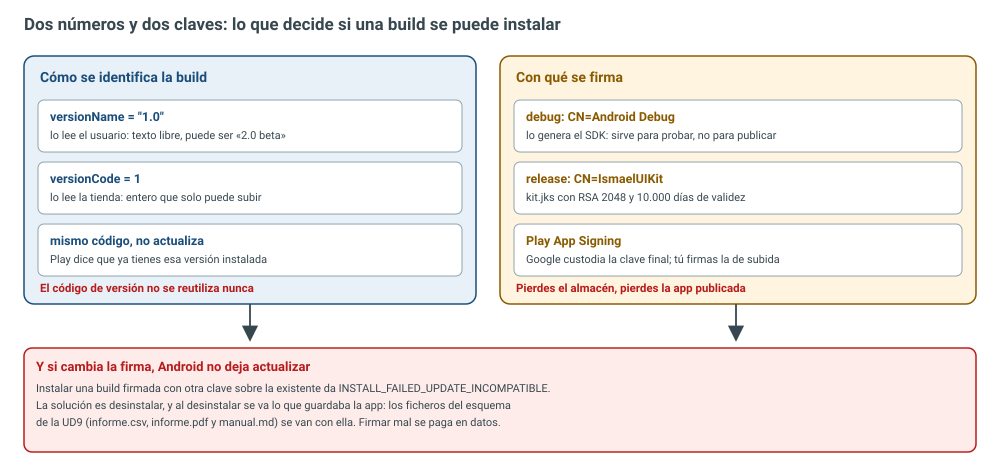
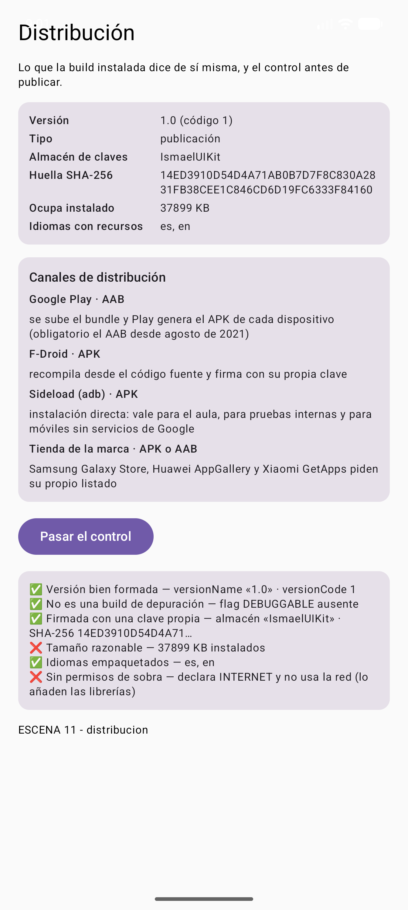
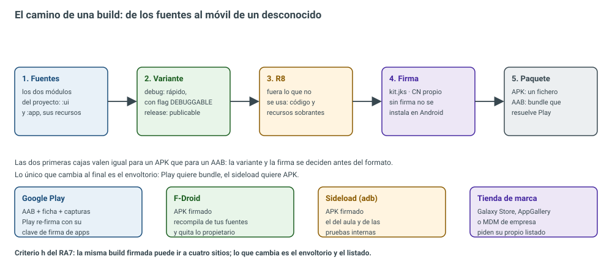
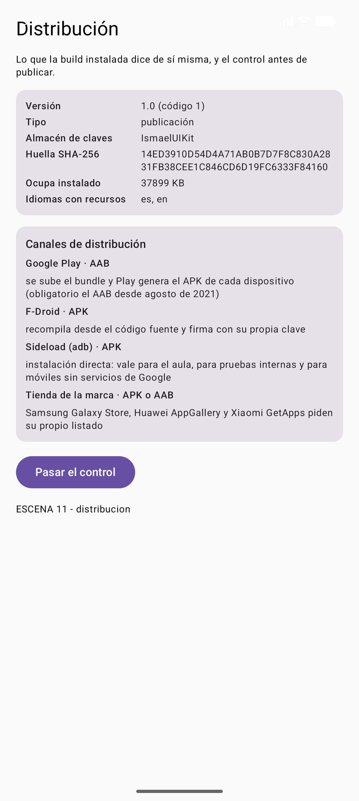
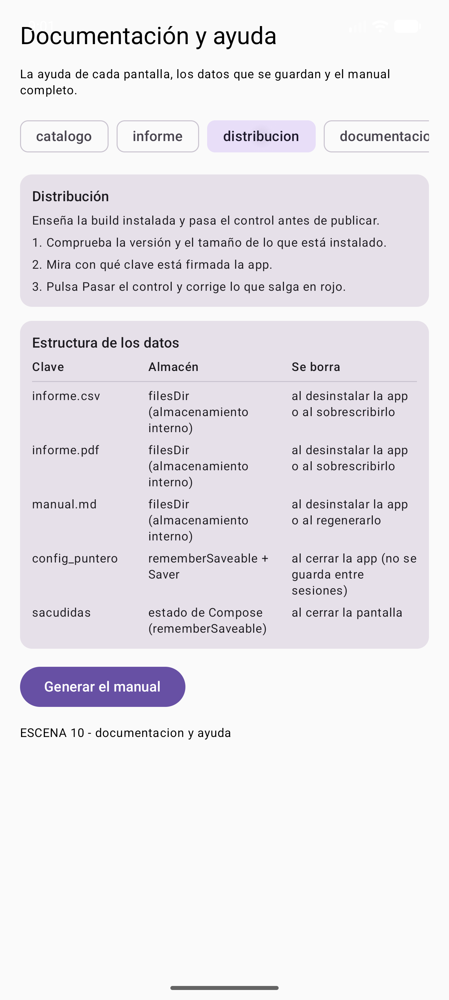

# 10.1 — Distribución y publicación

> **El trabajo de ingeniería:** que lo que funciona en tu emulador funcione en el móvil de un
> desconocido, y que ese móvil sepa de dónde ha venido lo que ha instalado. Hasta ahora la app ha
> vivido en el emulador, instalada por Gradle con la clave de depuración: un confort que tapa
> problemas. Al pulsar **Pasar el control** en la escena 11 de esta unidad, nuestra propia app ha
> suspendido dos de las seis comprobaciones: pesa 37.899 KB y pide un permiso que no usa. Esa es la
> diferencia entre compilar y <span style="background-color:#a5d6a7;padding:0 3px;border-radius:3px;">distribuir</span>.

## 1. Lo que pide el resultado de aprendizaje

El resultado de aprendizaje 7 del currículo de Desarrollo de Interfaces dice, literalmente:

> **7. Prepara aplicaciones para su distribución evaluando y utilizando herramientas específicas.**

Con sus ocho criterios de evaluación:

| Criterio | Qué pide | Dónde se toca en esta unidad |
|---|---|---|
| a | Empaquetar los componentes que requiere la aplicación | §2 y §6: las dos variantes y el envoltorio final |
| b | Personalizar el asistente de instalación | §7: en Android el asistente es la tienda; lo que personalizas es la ficha, el icono y los idiomas |
| c | Generar paquetes de instalación con el entorno de desarrollo | §2 y §6: `assembleRelease` y `bundleRelease` desde Gradle |
| d | Generar paquetes con herramientas externas | §3: `keytool` para el almacén y `apksigner` para comprobar la firma |
| e | Firmar digitalmente las aplicaciones | §3: el almacén `kit.jks` y la huella SHA-256 |
| f | Generar paquetes instalables en modo desatendido | §7: `adb install` y los MDM de empresa, sin nadie pulsando Siguiente |
| g | Preparar la desinstalación correcta | §7: qué se va y qué se queda al desinstalar |
| h | Preparar la app para distintos canales | §7: Play, F-Droid, sideload y tiendas de marca |

Los contenidos básicos que el real decreto enlaza con este apartado son <span style="background-color:#a5d6a7;padding:0 3px;border-radius:3px;">empaquetado,
instaladores, paquetes autoinstalables, firma digital, herramientas de instalación, personalización
del asistente y canales de distribución</span>. En Android casi todo eso se ha comido la tienda, pero los
conceptos siguen ahí y siguen siendo evaluables: el instalador es el gestor de paquetes, el
asistente es la ficha de Play, el paquete autoinstalable es el APK y el asistente desatendido es
`adb install`.

## 2. La misma app en dos versiones: debug y release

Un proyecto Android no compila «la app»: compila **variantes de compilación**. Las dos que se usan
siempre son la de depuración y la de publicación, y se diferencian en cosas que no son cosméticas:

| | debug | release |
|---|---|---|
| Para qué | probar en tu emulador o móvil | entregar al mundo |
| Firma | la clave de depuración del SDK (`CN=Android Debug`) | tu almacén de claves (`CN=IsmaelUIKit`) |
| Flag `DEBUGGABLE` | presente: el sistema la trata como depurable | ausente |
| Optimización | ninguna, para que compile y sea rápido | `isMinifyEnabled = true`: `:app:minifyReleaseWithR8` |
| Versión | la que quieras, no se compara con nada | la que verá la tienda |

Esa distinción es la que justifica el módulo de lógica de esta unidad. `Distribucion.kt` no sabe
nada de Compose ni de Android: recibe una descripción de la build y devuelve una lista de
comprobaciones. Se puede probar sin móvil, sin emulador y sin tienda:

```kotlin title="ui/src/main/java/com/example/uikit/Distribucion.kt"
package com.example.uikit

/**
 * El control de distribución (RA7).
 *
 * Antes de publicar una app hay que comprobar unas cuantas cosas que no se ven en el
 * emulador: con qué clave está firmada, si es una build de depuración, qué pesa, qué
 * idiomas lleva y si pide permisos que no usa. Aquí eso es una lista de comprobación,
 * no una corazonada.
 */

/** La versión que Gradle ha metido en la build, leída de `BuildConfig`. */
data class VersionApp(
    val nombre: String,
    val codigo: Long,
)

/** Los datos de una build ya empaquetada. */
data class ConfigBuild(
    val versionName: String,
    val versionCode: Long,
    val esDepuracion: Boolean,
    val almacen: String,
    val huellaSha256: String,
    val bytesApk: Long,
    val idiomas: List<String>,
    val declaraInternet: Boolean,
    val usaRed: Boolean,
)

/** Un canal de distribución: qué formato pide y qué comprueba antes de publicar. */
data class Canal(
    val nombre: String,
    val formato: String,
    val detalle: String,
)

    // ... los cuatro canales (Play, F-Droid, sideload y tienda de marca) en el apartado 7
/** Una línea del control: qué se comprueba, si pasa y por qué. */
data class Comprobacion(
    val nombre: String,
    val correcta: Boolean,
    val detalle: String,
)

object ControlDistribucion {

    private val HUELLA = Regex("^[0-9A-F]{64}$")
    private val VERSION = Regex("""^\d+\.\d+$""")

    /** El máximo razonable para una app de ejemplo: 20 MB. */
    private const val LIMITE_BYTES = 20_000_000L

    /**
     * Si el certificado es el de depuración del SDK.
     *
     * `keytool` del Android SDK firma con `CN=androiddebugkey`, pero Android Studio usa
     * `CN=Android Debug`: las dos valen, y por eso se compara sin mayúsculas ni espacios.
     */
    private fun esDepuracion(almacen: String): Boolean =
        almacen.lowercase().replace(" ", "").contains("androiddebug")

    /** Las seis comprobaciones, en el orden en que se cuentan en clase. */
    fun verificar(build: ConfigBuild): List<Comprobacion> = listOf(
        Comprobacion(
            nombre = "Versión bien formada",
            correcta = VERSION.matches(build.versionName) && build.versionCode >= 1,
            detalle = "versionName «${build.versionName}» · versionCode ${build.versionCode}",
        ),
        Comprobacion(
            nombre = "No es una build de depuración",
            correcta = !build.esDepuracion,
            detalle = if (build.esDepuracion) {
                "lleva el flag DEBUGGABLE: no se puede publicar"
            } else {
                "flag DEBUGGABLE ausente"
            },
        ),
        Comprobacion(
            nombre = "Firmada con una clave propia",
            correcta = HUELLA.matches(build.huellaSha256) && !esDepuracion(build.almacen),
            detalle = "almacén «${build.almacen}» · SHA-256 ${build.huellaSha256.take(16)}…",
        ),
        Comprobacion(
            nombre = "Tamaño razonable",
            correcta = build.bytesApk in 1..LIMITE_BYTES,
            detalle = "${build.bytesApk / 1024} KB instalados",
        ),
        Comprobacion(
            nombre = "Idiomas empaquetados",
            correcta = build.idiomas.isNotEmpty(),
            detalle = build.idiomas.ifEmpty { listOf("sin recursos") }.joinToString(", "),
        ),
        Comprobacion(
            nombre = "Sin permisos de sobra",
            correcta = !build.declaraInternet || build.usaRed,
            detalle = if (build.declaraInternet && !build.usaRed) {
                "declara INTERNET y no usa la red (lo añaden las librerías)"
            } else {
                "declara lo que usa"
            },
        ),
    )

    /** La ficha y el control en Markdown, para el manual o para la tienda. */
    fun aTexto(build: ConfigBuild): String {
        val ficha = """
            |Versión: ${build.versionName} (código ${build.versionCode})
            |Firma: ${build.almacen} · ${build.huellaSha256}
            |Tamaño: ${build.bytesApk / 1024} KB
            |Idiomas: ${build.idiomas.ifEmpty { listOf("ninguno") }.joinToString(", ")}
        """.trimMargin()
        val control = verificar(build).joinToString("\n") { linea ->
            val marca = if (linea.correcta) "✅" else "❌"
            "$marca ${linea.nombre} — ${linea.detalle}"
        }
        return "## Ficha de la build\n\n$ficha\n\n## Control de distribución\n\n$control\n"
    }
}
```

Fíjate en un detalle de `ControlDistribucion`: el límite de tamaño y el permiso que se perdonan son
<span style="background-color:#a5d6a7;padding:0 3px;border-radius:3px;">criterios propios, escritos como constantes</span>. Un control sin umbrales escritos a la vista es
una opinión disfrazada de código.

## 3. Firmar: el almacén de claves

Android no instala nada que no esté firmado. La firma no cifra el APK: <span style="background-color:#a5d6a7;padding:0 3px;border-radius:3px;">identifica al autor y
garantiza que nadie lo tocó</span> después. Y lo más importante: es la que decide si una actualización
tiene sentido, porque una app instalada solo acepta reemplazos firmados con la misma clave.

El almacén se genera con `keytool`, que trae el propio JDK de Android Studio:

```bash title="crear el almacén de claves de publicación"
keytool -genkeypair -v -keystore app/kit.jks -alias ismaelkit \
  -keyalg RSA -keysize 2048 -validity 10000 \
  -storepass 'la-que-sea' -dname \
  "CN=IsmaelUIKit, OU=DI, O=IES Rafael Alberti, L=Puerto Real, C=ES"
```

Diez mil días de validez son unos veintisiete años: más de los que suele vivir una app. Si el
certificado caduca, la app ya publicada no se puede actualizar. `keytool` lo describe como un
`PrivateKeyEntry` con <span style="background-color:#a5d6a7;padding:0 3px;border-radius:3px;">RSA de 2048 bits y firma SHA384withRSA</span>, y `Owner` e `Issuer` son
idénticos porque el certificado es auto-firmado, como es normal en software de distribución
abierta: no hay una autoridad que avale quién eres, hay una clave que se repite. Eso es
exactamente lo que rompe la jugada siguiente:

```text title="instalar la build de publicación encima de la de depuración"
adb install -r app-release.apk
adb.exe: failed to install .../app-release.apk: Failure [INSTALL_FAILED_UPDATE_INCOMPATIBLE:
Existing package com.example.uikit.demo signatures do not match newer version; ignoring!]
```

El mensaje es largo pero se resume en dos líneas: desinstala la de depuración, pierde los datos,
instala la de publicación. Y no es una molestia teórica: nuestra app guarda `informe.csv`,
`informe.pdf` y `manual.md` en `filesDir`, y al desinstalar se van los tres. La escena 11 avisa del
tamaño y la escena 10 documenta dónde vive cada dato: las dos unidades se tocan.

Para comprobar la firma desde fuera, `apksigner`:

```text title="apksigner verify --print-certs (las dos builds del mismo proyecto)"
=== RELEASE APK ===
Signer #1 certificate DN: CN=IsmaelUIKit, OU=DI, O=IES Rafael Alberti, L=Puerto Real, C=ES
Signer #1 certificate SHA-256 digest: 14ed3910d54d4a71ab0b7d7f8c830a2831fb38cee1c846cd6d19fc6333f84160
Signer #1 certificate SHA-1 digest: 28acc6aa18b06cc81a8b9a2e5147e0209e24b0f6
=== DEBUG APK ===
Signer #1 certificate DN: C=US, O=Android, CN=Android Debug
Signer #1 certificate SHA-256 digest: 4520e9a5131285e5a0dff02a8f9d18ff02093ccfadc962a0d117ca6693ffe63c
Signer #1 certificate SHA-1 digest: 2fed15df22f9ab3c8f8971d18e0b22b53db4b521
```



Dos builds del mismo proyecto, dos DN y dos huellas. En producción la cosa se complica un paso: con
<span style="background-color:#a5d6a7;padding:0 3px;border-radius:3px;">Play App Signing</span> Google custodia la clave definitiva y tú firmas con una clave de subida. La
ventaja es que puedes recuperar el acceso si pierdes tu clave; la obligación es no perder nunca las
dos a la vez. La configuración que genera la build firmada vive en Gradle:

```kotlin title="app/build.gradle.kts (extracto del bloque android)"
    }
    signingConfigs {
        create("kit") {
            storeFile = file("kit.jks")
            storePassword = datosAlmacen.getProperty("storePassword", "sin-contrasena")
            keyAlias = datosAlmacen.getProperty("keyAlias", "ismaelkit")
            keyPassword = datosAlmacen.getProperty("keyPassword", "sin-contrasena")
        }
    }
    buildTypes {
        release {
            isMinifyEnabled = true                    // R8 quita todo lo que no se usa
            isShrinkResources = true                  // y también los recursos sobrantes
            signingConfig = signingConfigs.getByName("kit")
            proguardFiles(
                getDefaultProguardFile("proguard-android-optimize.txt"),
                "proguard-rules.pro",
            )
        }
    }
    androidResources {
        // ...
    }
    androidResources {
        localeFilters.addAll(listOf("es", "en"))       // solo estos dos idiomas viajan en el APK
    }
    buildFeatures {
        compose = true
        buildConfig = true                            // para leer VERSION_NAME en el control
    }
```

`keystore.properties` está en el `.gitignore` de un proyecto de verdad: el almacén y sus contraseñas
no se suben al repositorio. Aquí sí viaja porque esto es un aula, y conviene que el alumnado sepa
que eso, en una empresa, es un incidente.

Lo que la build instalada responde de sí misma lo lee `Firma.kt` del paquete, sin escribir nada a
mano:

```kotlin title="ui/src/main/java/com/example/uikit/Firma.kt"
package com.example.uikit

import android.content.Context
import android.content.pm.ApplicationInfo
import android.content.pm.PackageInfo
import android.content.pm.PackageManager
import android.os.Build
import java.io.File
import java.security.MessageDigest

/**
 * Lo que la app instalada puede decir de sí misma (RA7 a, e y h).
 *
 * La versión, si es de depuración, con qué certificado está firmada, cuánto ocupa y
 * qué idiomas trae se leen del paquete instalado. Nada de esto se escribe a mano: si
 * se escribiera, la primera build de depuración pasaría por la de publicación.
 */
object Firma {

    private const val PERMISO_INTERNET = "android.permission.INTERNET"

    /**
     * Lee la build instalada y la devuelve preparada para el control de distribución.
     *
     * La versión llega por parámetro porque, desde el SDK 36, `PackageInfo` ya no rellena
     * `versionName` ni `longVersionCode` en las apps que apuntan a esa versión: el que de verdad
     * la sabe es `BuildConfig`, que genera Gradle al compilar.
     */
    fun deLaAppInstalada(
        contexto: Context,
        version: VersionApp,
        idiomas: List<String> = listOf("es"),
    ): ConfigBuild {
        val gestor = contexto.packageManager
        val flags = if (Build.VERSION.SDK_INT >= Build.VERSION_CODES.P) {
            PackageManager.GET_SIGNING_CERTIFICATES or PackageManager.GET_PERMISSIONS
        } else {
            PackageManager.GET_SIGNATURES or PackageManager.GET_PERMISSIONS
        }
        val info = gestor.getPackageInfo(contexto.packageName, flags)
        val aplicacion = info.applicationInfo
        val certificado = certificadoDe(info)

        return ConfigBuild(
            versionName = version.nombre,
            versionCode = version.codigo,
            esDepuracion = aplicacion != null &&
                (aplicacion.flags and ApplicationInfo.FLAG_DEBUGGABLE) != 0,
            almacen = almacenDe(certificado),
            huellaSha256 = certificado?.let { huella(it) } ?: "sin firma",
            bytesApk = tamanoInstalado(aplicacion),
            idiomas = idiomas,
            declaraInternet = info.requestedPermissions?.contains(PERMISO_INTERNET) ?: false,
            usaRed = false,             // el kit no abre ni un socket
        )
    }

    /**
     * El certificado con el que está instalado el APK (el primero, si hay varios).
     *
     * `signingInfo` es la forma moderna y `signatures` la vieja: se prueban las dos. Si
     * nada funciona se devuelve null, y la build sale con «sin firma» antes que con una
     * huella inventada.
     */
    private fun certificadoDe(info: PackageInfo): ByteArray? = try {
        val firma = info.signingInfo
        val modernos = firma?.let {
            if (it.hasMultipleSigners()) it.apkContentsSigners else it.signingCertificateHistory
        }
        modernos?.firstOrNull()?.toByteArray() ?: info.signatures?.firstOrNull()?.toByteArray()
    } catch (e: Exception) {
        null
    }

    /** El CN del certificado: el nombre del almacén de claves con el que se firmó. */
    private fun almacenDe(certificado: ByteArray?): String {
        if (certificado == null) return "desconocido"
        val sujeto = try {
            val factoria = java.security.cert.CertificateFactory.getInstance("X.509")
            val cert = factoria.generateCertificate(java.io.ByteArrayInputStream(certificado))
            (cert as java.security.cert.X509Certificate).subjectDN.name
        } catch (e: Exception) {
            return "ilegible"
        }
        return sujeto.substringAfter("CN=", "").substringBefore(",").ifBlank { "sin CN" }
    }

    /** SHA-256 del certificado, en mayúsculas: como lo imprime `apksigner`. */
    private fun huella(certificado: ByteArray): String =
        MessageDigest.getInstance("SHA-256").digest(certificado)
            .joinToString("") { "%02X".format(it) }

    /** Lo que ocupa la app instalada: el APK base más los splits de idioma y densidad. */
    private fun tamanoInstalado(aplicacion: ApplicationInfo?): Long {
        if (aplicacion?.sourceDir == null) return 0L
        val base = File(aplicacion.sourceDir).length()
        val trozos = aplicacion.splitSourceDirs?.sumOf { File(it).length() } ?: 0L
        return base + trozos
    }

}
```

## 4. Versionar: dos números y solo uno manda

El manifiesto generado lleva dos identificadores y es un error clásico confundirlos:

* <span style="background-color:#a5d6a7;padding:0 3px;border-radius:3px;">`versionName`</span> (`"1.0"`): texto libre, lo lee el usuario en la ficha y en el diálogo de
  actualización. Puede ser `"2.0 beta"` o `"Sanjuan 3"`.
* <span style="background-color:#a5d6a7;padding:0 3px;border-radius:3px;">`versionCode`</span> (`1`): un entero sin signo que solo compara la tienda. Para actualizar, tiene
  que ser mayor que el instalado.

Si publicas un cambio y no subes el `versionCode`, Play te lo rechaza o te dice que ya tienes esa
versión. Y el número no se reutiliza: el `versionCode` 17 de hoy ya no volverá a existir nunca,
aunque retires la app. La escena 11 muestra los dos juntos, `1.0 (código 1)`, para que nadie olvide
que son cosas distintas.

## 5. El control antes de publicar

La pantalla de distribución tiene un botón que ejecuta la lista de comprobaciones. Este es el
resultado real de la build de publicación instalada en el emulador:



| Comprobación | Estado | Mensaje que devuelve |
|---|---|---|
| Versión bien formada | ✅ | `versionName «1.0» · versionCode 1` |
| No es una build de depuración | ✅ | `flag DEBUGGABLE ausente` |
| Firmada con una clave propia | ✅ | `almacén «IsmaelUIKit» · SHA-256 14ED3910D54D4A71…` |
| Tamaño razonable | ❌ | `37899 KB instalados` |
| Idiomas empaquetados | ✅ | `es, en` |
| Sin permisos de sobra | ❌ | `declara INTERNET y no usa la red (lo añaden las librerías)` |

Los dos fallos son <span style="background-color:#a5d6a7;padding:0 3px;border-radius:3px;">reales y explicables</span>, y por eso se dejan en el proyecto:

1. **El peso.** Una app Compose mínima pesa lo que pesa la biblioteca de Compose y Material 3, y
   aquí viajan además las cuatro arquitecturas nativas. La salida es el bundle, que se cuenta en el
   apartado 6. Un límite de 20 MB no es un capricho: es el umbral histórico de la tienda.
2. **El permiso.** El manifiesto del proyecto no declara `INTERNET`. Lo añade una librería al
   fusionar manifiestos, y la comprobación lo pilla. En una app que no abre ni un socket, cada
   permiso declarado es una pregunta que te va a hacer el usuario y una línea en la auditoría de
   <span style="background-color:#a5d6a7;padding:0 3px;border-radius:3px;">privacidad</span>.

Las pruebas que sostienen esto son las de siempre, JUnit en el módulo de instrumented:

```kotlin title="ui/src/androidTest/java/com/example/uikit/DistribucionTest.kt"
package com.example.uikit

import android.content.Context
import androidx.test.core.app.ApplicationProvider
import androidx.test.ext.junit.runners.AndroidJUnit4
import org.junit.Assert.assertEquals
import org.junit.Assert.assertTrue
import org.junit.Test
import org.junit.runner.RunWith

/**
 * Pruebas del control de distribución (RA7).
 *
* Se prueba la lógica del control con builds de mentira y, en una sola prueba,
 * que la app instalada
 * dice la verdad de sí misma: versión, firma y tamaño.
 */
@RunWith(AndroidJUnit4::class)
class DistribucionTest {

    /** Una build correcta, para ir rompiéndola un poco en cada prueba. */
    private fun unaBuild(
        esDepuracion: Boolean = false,
        almacen: String = "IsmaelUIKit",
        huella: String = "A".repeat(64),
        bytes: Long = 3_200_000,
        idiomas: List<String> = listOf("en"),
        internet: Boolean = false,
        usaRed: Boolean = false,
    ) = ConfigBuild("1.0", 1, esDepuracion, almacen, huella, bytes, idiomas, internet, usaRed)

    private fun comprobacion(lista: List<Comprobacion>, principio: String) =
        lista.first { it.nombre.startsWith(principio) }

    @Test
    fun unaBuildListaPasaElControlEntero() {
        val lista = ControlDistribucion.verificar(unaBuild())
        assertEquals(6, lista.size)
        lista.forEach { assertTrue("falla: ${it.nombre} — ${it.detalle}", it.correcta) }
    }

    @Test
    fun unaBuildDeDepuracionNoSePuedePublicar() {
        val lista = ControlDistribucion.verificar(unaBuild(esDepuracion = true))
        assertTrue(comprobacion(lista, "No es").let { !it.correcta })
    }

    @Test
    fun laFichaEnTextoLlevaVersionFirmaYTamano() {
        val texto = ControlDistribucion.aTexto(unaBuild())
        assertTrue(texto.contains("1.0 (código 1)"))
        assertTrue(texto.contains("3125 KB"))
        assertTrue(texto.contains("Idiomas: en"))
    }

    @Test
    fun laAppInstaladaDiceSuVersionSuFirmaYSuTamano() {
        val contexto = ApplicationProvider.getApplicationContext<Context>()
        val build = Firma.deLaAppInstalada(contexto, VersionApp("1.0", 1), listOf("es", "en"))
        assertEquals("1.0", build.versionName)
        assertEquals(1L, build.versionCode)
        assertTrue("huella rara: ${build.huellaSha256}",
            Regex("^[0-9A-F]{64}$").matches(build.huellaSha256))
        assertTrue("la app no puede ocupar 0", build.bytesApk > 100_000)
        assertTrue("sin almacén", build.almacen.isNotBlank())
    }
}
```

*(Se han dejado fuera dos pruebas de la lista: la del almacén de depuración y la del
permiso de sobra, que son las dos comprobaciones que se ven suspendidas en la captura.)*

La última prueba es la importante para este RA: no comprueba una build de mentira, sino <span style="background-color:#a5d6a7;padding:0 3px;border-radius:3px;">la app
instalada de verdad</span>, y por eso falla si el día menos pensado se cuela una clave de depuración en
la build de publicación.

```text title="la instrumentación sobre el móvil, con la build final"
adb shell am instrument -w com.example.uikit.test/androidx.test.runner.AndroidJUnitRunner
Time: 18.957
OK (41 tests)
```

## 6. APK o AAB, y cuánto pesa cada cosa

El <span style="background-color:#a5d6a7;padding:0 3px;border-radius:3px;">APK</span> es el paquete de toda la vida: un fichero, una arquitectura, todos los idiomas, todas
las densidades. El <span style="background-color:#a5d6a7;padding:0 3px;border-radius:3px;">AAB o Android App Bundle</span> es el formato que pide Google Play: subes todos
los recursos y la tienda genera el APK que necesita cada dispositivo. Los tres artefactos que ha
producido este proyecto, medidos en disco:

```text title="los tres artefactos que ha producido este proyecto"
app/build/outputs/apk/debug/app-debug.apk        51.386.451 bytes   (48,99 MB)
app/build/outputs/apk/release/app-release.apk    38.809.364 bytes   (37,00 MB)
app/build/outputs/bundle/release/app-release.aab 21.303.705 bytes   (20,32 MB)
```

Del APK de depuración al bundle hay <span style="background-color:#a5d6a7;padding:0 3px;border-radius:3px;">un 58 % menos</span>. No hay truco: el bundle no contiene menos
cosas, pero lo que descarga cada móvil sí. Y el APK de release ya viene recortado por la etapa
`minifyReleaseWithR8`, que queda código y recursos inalcanzables.

Lo que el sistema ve del paquete final se comprueba con `aapt2`, que viene en las *build-tools*:

```text title="aapt2 dump badging app-release.apk (lo que ve el sistema del paquete)"
application-label:'Kit de interfaces'
application-label-en:'Interface Kit'
application-label-es:'Kit de interfaces'
launchable-activity: name='com.example.uikit.demo.MainActivity'  label='' icon=''
locales: '--_--' 'en' 'es'
native-code: 'arm64-v8a' 'armeabi-v7a' 'x86' 'x86_64'
```

Dos cosas interesantes en esa salida. La primera: `locales: '--_--' 'en' 'es'`, que es el efecto de
`localeFilters`. Sin ese filtro viajarían los recursos de traducción de todas las bibliotecas,
docenas de idiomas que nadie va a usar. La segunda: `native-code` con cuatro arquitecturas. En el
bundle, cada dispositivo recibe la suya.

Los idiomas que la app declara, y que muestra la escena 11 como `es, en`, se declaran en un fichero
aparte desde Android 13, que es el que alimenta el ajuste de idioma por aplicación:

```xml title="app/src/main/res/xml/locale_config.xml (los idiomas que la app declara)"
<?xml version="1.0" encoding="utf-8"?>
<!-- Los idiomas que la app declara soportar: los que ofrece el ajuste de idioma por app. -->
<locale-config xmlns:android="http://schemas.android.com/apk/res/android">
    <locale android:name="es" />
    <locale android:name="en" />
</locale-config>
```

Y el manifiesto apunta a ese fichero:

```xml title="app/src/main/AndroidManifest.xml (el application, al completo)"
<application
    android:allowBackup="true"
    android:icon="@mipmap/ic_launcher"
    android:roundIcon="@mipmap/ic_launcher"
    android:label="@string/app_name"
    android:localeConfig="@xml/locale_config"
    android:theme="@android:style/Theme.Material.Light.NoActionBar">
    <activity
        android:name=".MainActivity"
        android:exported="true">
        <intent-filter>
            <action android:name="android.intent.action.MAIN" />
            <category android:name="android.intent.category.LAUNCHER" />
        </intent-filter>
    </activity>
</application>
```

## 7. Los canales y la ficha del producto

La escena 11 lista los cuatro salidas que tiene hoy una app Android, y son las mismas que exige el
criterio h:



| Canal | Formato | Qué espera de ti |
|---|---|---|
| Google Play | AAB | Ficha, icono de 512 px, capturas reales y descripción: el «asistente» del criterio b es la ficha del producto |
| F-Droid | APK | Recompila desde tus fuentes y firma con su clave: exige proyecto abierto y sin piezas propietarias |
| Sideload (`adb install`) | APK | El modo desatendido del criterio f: un script y un APK, sin nadie pulsando Siguiente |
| Tiendas de marca y MDM | APK o AAB | Galaxy Store, AppGallery, GetApps o el gestor de la empresa: mismo APK firmado, otro papeleo |

Sobre la **desinstalación limpia** (criterio g): al desinstalar se va el APK y todo `filesDir`,
incluido el `manual.md` que generamos en la unidad 9. Lo que se queda es lo que la app haya escrito
en un proveedor de contenido o en la tarjeta SD explícitamente. Es la conversación que hay que tener
con el cliente antes de decidir dónde guardar cada dato.

El icono también es distribución: un icono <span style="background-color:#a5d6a7;padding:0 3px;border-radius:3px;">adaptativo</span> con capa de primer plano y de fondo,
exportado a las densidades que pide el sistema, es lo que hace que la app se vea bien en una lanzadera
con máscara de círculo, cuadrado o gota. Aquí se generó desde un SVG con `rsvg-convert` para mdpi,
hdpi, xhdpi, xxhdpi y xxxhdpi.

## 8. La pantalla de distribución de la aplicación

La escena 11 no pinta una lista fija: lee el paquete instalado y pregunta al control.

```kotlin title="app/src/main/java/com/example/uikit/demo/MainActivity.kt (extracto de la escena 11)"
// ... (el encabezado y la tarjeta con los seis campos de la ficha)
        Button(onClick = {
            control = ControlDistribucion.verificar(build).joinToString("\n") { linea ->
                val marca = if (linea.correcta) "✅" else "❌"
                "$marca ${linea.nombre} — ${linea.detalle}"
            }
        }) { Text("Pasar el control") }

        if (control.isNotEmpty()) {
            Card(modifier = Modifier.fillMaxWidth().testTag("control-lista")) {
                Text(control, Modifier.padding(12.dp), style = MaterialTheme.typography.bodySmall)
            }
        }

        Text("ESCENA 11 - distribucion", style = MaterialTheme.typography.bodySmall)
    }
}

/** Una fila de la ficha de la build: clave a la izquierda, valor a la derecha. */
@Composable
```



La escena aparece en los cuatro sitios donde la unidad 9 prometió que aparecería: el catálogo de
componentes, la ayuda filtrable, la estructura de datos y el manual generado. Este es el filtro
`distribucion` de la pantalla de ayuda, con la tarjeta de la pantalla nueva ya dentro:



No es un adorno: <span style="background-color:#a5d6a7;padding:0 3px;border-radius:3px;">documentar y distribuir son la misma responsabilidad</span>, la de entregar algo que
otra persona puede usar sin llamarte.

## 9. Repaso, errores típicos y tareas

**Qué hay que saberse de memoria**

1. Debug y release se firman con claves distintas y una actualización solo acepta la misma clave.
2. `versionCode` sube siempre y no se reutiliza; `versionName` es decoración.
3. Play exige AAB para apps nuevas; el APK sigue siendo el formato del sideload y de F-Droid.
4. `apksigner verify --print-certs` y `aapt2 dump badging` son las dos formas de no fiarse de la
   memoria.
5. Un control de distribución que no falla nunca no está controlando nada.

**Errores que se cometen siempre**

* Subir a Play el APK de depuración: pasa una vez, y la tienda o el usuario se enteran.
* Perder el `kit.jks` con la app publicada: la única salida es cambiar de nombre de paquete.
* Olvidar `versionCode` y publicar el mismo entero: la actualización no llega a nadie.
* Dejar los recursos de traducción de las bibliotecas: dos megas de idiomas que nadie activará.
* Declarar permisos «por si acaso»: cada uno es una pregunta del usuario y una línea de auditoría.

**Tareas**

1. Genera tu propio almacén, publícalo en el repositorio con un nombre de alias que no sea `android`
   y explica en el README por qué las contraseñas van fuera del control de versiones.
2. Pasa el control de la escena 11 con la build de depuración y con la de publicación, y explica las
   cuatro diferencias que salen.
3. Reduce el tamaño del APK de release: quita una de las cuatro arquitecturas con un `ndk` `abiFilters`
   y mide antes y después con `dir`.
4. Escribe la ficha de Play de tu app (título, descripción corta, descripción larga y tres capturas)
   usando el manual que genera la escena 10.
5. Desinstala la app de depuración, instala la de publicación y justifica con qué criterio del RA7
   estás trabajando cuando cuentas qué ha pasado con los ficheros.

## Bibliografía y documentación oficial

* Variantes de compilación: <https://developer.android.com/build/build-variants>
* Firmar la aplicación y Play App Signing: <https://developer.android.com/studio/publish/app-signing>
* Android App Bundle: <https://developer.android.com/guide/app-bundle>
* La herramienta `apksigner`: <https://developer.android.com/tools/apksigner>
* Publicar en Google Play (ficha y requisitos): <https://developer.android.com/studio/publish>
* Subir un bundle a la consola: <https://support.google.com/googleplay/android-developer/answer/9859455>
* Generar APKs por dispositivo (splits): <https://developer.android.com/studio/build/gradle-tips#configure-device-specific-apks>
* Iconos adaptativos: <https://developer.android.com/develop/ui/views/launch/icon_design_adaptive>
* Idioma por aplicación (Android 13): <https://developer.android.com/about/versions/13/features>
* Manifiesto y fusión de manifiestos: <https://developer.android.com/guide/topics/manifest/manifest-intro>
* Permisos: <https://developer.android.com/guide/topics/permissions/overview>
* Tamaños y densidades: <https://developer.android.com/guide/practices/page-sizes>
* Vigilancia de rendimiento en producción: <https://developer.android.com/topic/performance/vitals>
* `keytool`, del JDK: <https://docs.oracle.com/en/java/javase/21/docs/specs/man/keytool.html>
* F-Droid y su proceso de compilación: <https://f-droid.org/en/docs/>
* Real Decreto 405/2023, currículo de Desarrollo de Interfaces: <https://www.boe.es/buscar/act.php?id=BOE-A-2023-13221>
