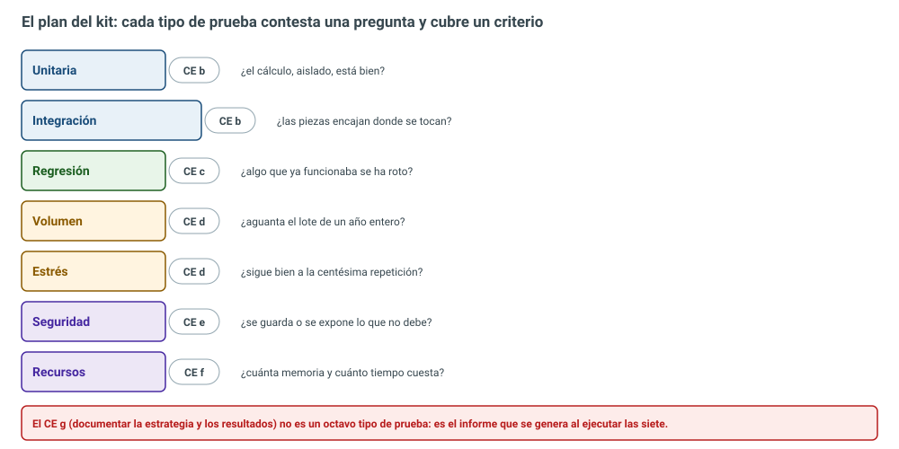
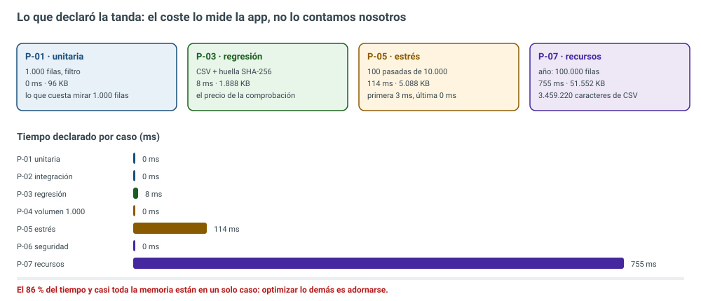
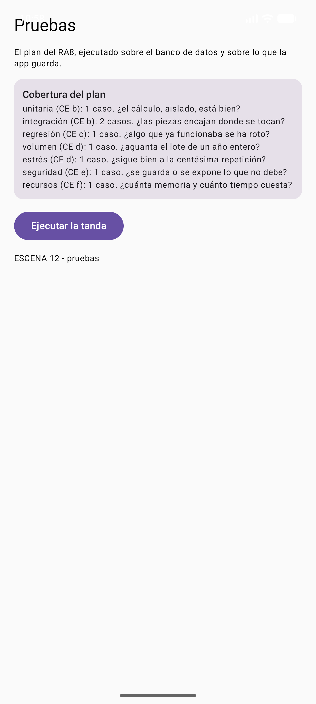
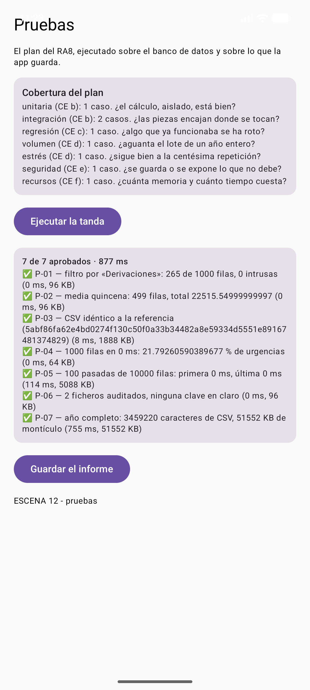
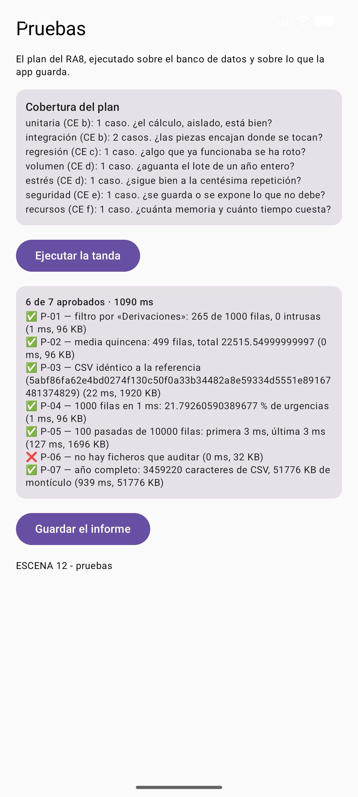
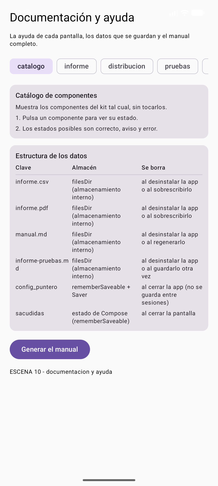

# UD11. Evalúa el funcionamiento de la aplicación: pruebas

Unidad 11 del módulo **Desarrollo de Interfaces** (ciclo DAM, RD 405/2023, BOE 29 de mayo de 2023). Es la última unidad del módulo y la que decide si todo lo anterior de este curso se puede enseñar a otra persona sin tener que estar detrás.

El resultado de aprendizaje del que sale todo esto es, literal del BOE:

> <span style="background-color:#a5d6a7">8. Evalúa el funcionamiento de aplicaciones diseñando y ejecutando pruebas.</span>

Y sus siete criterios de evaluación:

| Criterio | Qué hay que poder demostrar | Dónde se ve en el kit |
|---|---|---|
| a | Se ha establecido una estrategia de pruebas | `Pruebas.kt`: el plan está escrito como datos |
| b | Se han realizado pruebas de integración de los distintos elementos | P-02, filtrar + resumir, y el pase de la tanda |
| c | Se han realizado pruebas de regresión | P-03, huella SHA-256 del CSV contra línea base |
| d | Se han realizado pruebas de volumen y estrés | P-04 y P-05 sobre el banco sintético |
| e | Se han realizado pruebas de seguridad | P-06, auditoría de lo que la app escribe en el teléfono |
| f | Se han realizado pruebas de uso de recursos por parte de la aplicación | P-07, memoria del montículo y tiempo del lote grande |
| g | Se ha documentado la estrategia de pruebas y los resultados obtenidos | el informe Markdown que escribe la propia app |

El bloque de contenidos que el real decreto dedica a esta parte del módulo también es literales, y conviene leerlo antes de montar nada:

- <span style="background-color:#a5d6a7">Objetivo, importancia y limitaciones del proceso de prueba. Estrategias.</span>
- <span style="background-color:#a5d6a7">Pruebas de integración: ascendentes y descendentes.</span>
- <span style="background-color:#a5d6a7">Pruebas de sistema: configuración, recuperación, entre otras.</span>
- <span style="background-color:#a5d6a7">Pruebas de uso de recursos.</span>
- <span style="background-color:#a5d6a7">Pruebas de seguridad.</span>
- <span style="background-color:#a5d6a7">Pruebas manuales y automáticas. Herramientas software para la realización de pruebas.</span>

El módulo completo tiene <span style="background-color:#a5d6a7">80 horas</span>, y esta unidad se lleva las últimas cinco o seis de esas ochenta: no es relleno, es el filtro por el que pasa todo lo que se ha construido en las diez unidades anteriores.

***

## 1. Probar no es pulsar cosas hasta que funcione

La diferencia entre un desarrollador que prueba y un usuario que trastalla está en la palabra **antes**. El usuario pulsa y mira. El desarrollador escribe qué preguntas hay que contestar, con qué se contesta cada una y quién la firma, y solo después pulsa.

El criterio **a)** dice «se ha establecido una estrategia de pruebas», y una estrategia que está en la cabeza de alguien no se puede auditar ni heredar: se va del proyecto cuando se va esa persona. En el kit la estrategia está escrita en el código, en una lista:

=== "Pruebas.kt: el plan, sus presupuestos"
```kotlin title="ui/src/main/java/com/example/uikit/Pruebas.kt"
object Estrategia {

    /** Los niveles de volumen que se prueban, en filas del informe. */
    val niveles = listOf(1_000, 10_000, 100_000)

    /** El tiempo máximo aceptable para el lote grande, en milisegundos. */
    const val LIMITE_MILISEGUNDOS = 4_000L

    /** Lo que se acepta como memoria extra antes de considerar que la app se hincha. */
    const val LIMITE_KILOBYTES = 200_000L
```
<span style="background-color:#a5d6a7">Los tres presupuestos del plan</span>: los niveles de volumen que se prueban (1.000, 10.000 y 100.000 filas), el tiempo máximo aceptable para el lote grande (4.000 ms) y la memoria extra que se tolera antes de considerar que la aplicación se hincha (200.000 KB, unos 200 MB). Un plan sin presupuestos es una opinión: «va rápido» no lo aprueba ni lo suspende nada.

=== "Pruebas.kt: los ocho casos del plan"
```kotlin title="ui/src/main/java/com/example/uikit/Pruebas.kt"
        CasoPrueba(
            id = "P-01",
            pregunta = "El filtro por categoría deja fuera lo que no es de esa categoría",
            tipo = TipoPrueba.Unitaria,
            como = "JUnit en el módulo :ui",
        ),
        CasoPrueba(
            id = "P-02",
            pregunta = "Las totales del pie cuadran con la suma de las filas filtradas",
            tipo = TipoPrueba.Integracion,
            como = "InformeTest sobre filtrar + resumir",
        ),
        CasoPrueba(
            id = "P-03",
            pregunta = "El CSV generado es idéntico al aprobado (no hay regresión)",
            tipo = TipoPrueba.Regresion,
            como = "huella SHA-256 del CSV normalizado",
        ),
        CasoPrueba(
            id = "P-04",
            pregunta = "Un año de registros se filtra y se resume en un tiempo útil",
            tipo = TipoPrueba.Volumen,
            como = "SuitePruebas.volumen con 1.000, 10.000 y 100.000 filas",
        ),
        CasoPrueba(
            id = "P-05",
            pregunta = "Doscientas repeticiones seguidas no degradan ni revientan la app",
            tipo = TipoPrueba.Estres,
            como = "SuitePruebas.estres con el lote mediano",
        ),
        CasoPrueba(
            id = "P-06",
            pregunta = "Los ficheros que escribe la app no llevan credenciales en claro",
            tipo = TipoPrueba.Seguridad,
            como = "SuitePruebas.seguridad sobre lo que hay en filesDir",
        ),
        CasoPrueba(
            id = "P-07",
            pregunta = "El lote grande no pide más memoria de la que admite el presupuesto",
            tipo = TipoPrueba.Recursos,
            como = "SuitePruebas.recursos midiendo el montículo antes y después",
        ),
        CasoPrueba(
            id = "P-08",
            pregunta = "La pantalla del informe se entiende sin explicaciones",
            tipo = TipoPrueba.Integracion,
            como = "revisión en pantalla, con dos compañeros",
            manual = true,
        ),
    )
```
Fíjate en tres decisiones que están dentro de esa lista y que no son decorativas:

- <span style="background-color:#a5d6a7">La pregunta de cada caso va en singular</span>: un caso que pregunta dos cosas no sabe decir cuál ha fallado, y un fallo que no se puede señalar es un fallo que no se puede arreglar.
- <span style="background-color:#a5d6a7">El campo `manual` existe</span>: el caso P-08 (que la pantalla del informe se entienda) no lo puede juzgar ninguna máquina. Marcarlo como manual y dejarlo sin ejecutar en el informe es más honesto que simular que alguien lo ha comprobado.
- <span style="background-color:#a5d6a7">Los casos viven en el código</span>: el informe del criterio g) se genera desde esa lista, así que nadie puede escribir a mano un «todo correcto» que no se corresponda con nada ejecutado.

El objeto también lleva la contabilidad de la estrategia: cuántos casos hay de cada tipo, cuáles faltan por ejecutar, cuántos pasan y cuánto ha costado todo eso.

=== "Pruebas.kt: cobertura, pendientes, aprobados y coste"
```kotlin title="ui/src/main/java/com/example/uikit/Pruebas.kt"
/** Cuántos casos hay de cada tipo: la foto de la estrategia antes de ejecutar nada. */
    fun cobertura(): Map<TipoPrueba, Int> = casos.groupingBy { it.tipo }.eachCount()

    /** Los casos que aún no tienen resultado: lo que falta por ejecutar. */
    fun pendientes(ejecutados: List<Resultado>): List<CasoPrueba> {
        val hechas = ejecutados.map { it.id }.toSet()
        return casos.filter { it.id !in hechas }
    }

    /** Cuántos casos pasan. */
    fun aprobados(ejecutados: List<Resultado>): Int = ejecutados.count { it.correcta }

    /** Cuánto cuesta lo ejecutado en total, en milisegundos. */
    fun costeTotal(ejecutados: List<Resultado>): Long = ejecutados.sumOf { it.milisegundos }
```



*Cada tipo de prueba contesta una pregunta y cubre un criterio. El criterio g) no es un octavo tipo: es el informe que sale de ejecutar los otros siete.*

***

## 2. Dónde se ejecuta cada prueba (y por qué importa)

En Android hay dos mundos, y una prueba mal puesta en uno de los dos cuesta minutos de más en cada ejecución o, peor, no prueba lo que dice probar.

| Mundo | Dónde corre | Qué puede tocar | Cuánto tarda |
|---|---|---|---|
| De JVM (`:ui/src/test`) | el portátil, sin Android | lógica pura: filtros, cálculos, generadores | segundos |
| Instrumentada (`:ui/src/androidTest`) | el emulador o el móvil, con Android de verdad | contexto, ficheros, Compose, permisos | decenas de segundos |

Las siete pruebas del plan están en el segundo mundo: se compilan contra la aplicación instalada y se lanzan con `adb shell am instrument`. El comando, desde la raíz del proyecto:

```bat
gradlew.bat assembleDebug :ui:assembleDebugAndroidTest
adb install -r app\build\outputs\apk\debug\app-debug.apk
adb install -r -t ui\build\outputs\apk\androidTest\debug\ui-debug-androidTest.apk
adb shell am instrument -w com.example.uikit.test/androidx.test.runner.AndroidJUnitRunner
```

El detalle que más veces se atraganta en clase: <span style="background-color:#a5d6a7">el APK de instrumentación vive en el módulo `:ui`, no en `:app`</span>, porque las pruebas están en `:ui`. Se instalan los dos APK y luego se lanza la instrumentación. La salida de una tanda completa, tal cual salió por consola:

```text
com.example.uikit.PruebasSistemaTest:.......
Tests run: 48, Failures: 0, Errors: 0, Skipped: 0

OK (48 tests)

Time: 37.96
```

Las siete pruebas nuevas de esta unidad se suman a las 41 que había al final de la UD10. Que las 41 anteriores sigan verdes después de tocar la escena de documentación, el esquema de datos y la pantalla nueva <span style="background-color:#a5d6a7">es la primera prueba de regresión del día</span>, y no hay que ejecutarla: la ejecuta el propio `gradlew`.

***

## 3. Pruebas unitarias y de integración (criterio b)

La unidad mínima es la <span style="background-color:#a5d6a7">prueba unitaria</span>: una pieza de lógica, aislada, sin pantalla ni ficheros, contestando una pregunta. La nuestra es la del filtro del informe, y necesita algo que filtrar: el banco de datos.

=== "EjecutaPruebas.kt: P-01, la unitaria"
```kotlin title="ui/src/main/java/com/example/uikit/EjecutaPruebas.kt"
/** P-01: el filtro por categoría, aislado, sobre el banco de datos. */
    fun unitaria(banco: List<FilaInforme>): Resultado = ejecuta(caso("P-01")) {
        val categoria = banco.first().categoria
        val filtradas = Informe.filtrar(banco, FiltroInforme(categoria = categoria))
        val intrusas = filtradas.count { it.categoria != categoria }
        assert(filtradas.isNotEmpty()) { "el filtro ha dejado el informe vacío" }
        assert(intrusas == 0) { "$intrusas filas de otra categoría han colado" }
        "filtro por «$categoria»: ${filtradas.size} de ${banco.size} filas, 0 intrusas"
```
La pregunta es tan simple que casi da vergüenza: <span style="background-color:#a5d6a7">¿el filtro mete filas que no son de su categoría?</span>. Eso es exactamente lo que se persigue en una prueba unitaria. No se prueba «el filtro funciona», que no se puede afirmar ni negar con una máquina.

Lo que rodea a la prueba también es contenido del BOE: los dobles de prueba. Aquí el doble es el banco sintético: un sustituto del dato real, barato, rápido y sobre todo previsible.

=== "BancoPruebas.kt: generador congruencial lineal, determinista"
```kotlin title="ui/src/main/java/com/example/uikit/BancoPruebas.kt"
object BancoPruebas {

    /** Las categorías del kit de demostración: las mismas que usa la pantalla de informe. */
    private val categorias = listOf("Consultas", "Urgencias", "Derivaciones", "Vacunación")

    /** Semilla congelada: cambiarla es cambiar el banco, y por tanto la línea base. */
    const val SEMILLA = 20261028L

    /**
     * Genera `cuantas` filas con un generador congruencial lineal.
     *
     * No se usa `Random(semilla)` de la biblioteca para que el banco sea idéntico en la JVM del
     * portátil, en el emulador y en el móvil del alumno: si la secuencia depende de la
     * implementación, la regresión se vuelve una lotería.
     */
    fun filas(cuantas: Int, semilla: Long = SEMILLA): List<FilaInforme> {
        var estado = semilla
        val salida = ArrayList<FilaInforme>(cuantas)
        for (numero in 1..cuantas) {
            estado = estado * 6364136223846793005L + 1442695040888963407L
            val primero = (estado ushr 33) and 0x7FFFFFFFL
            estado = estado * 6364136223846793005L + 1442695040888963407L
            val segundo = (estado ushr 33) and 0x7FFFFFFFL
```
Hay una decisión de proyecto dentro de ese comentario y es de examen: <span style="background-color:#a5d6a7">no se usa el `Random(semilla)` de la biblioteca</span>. Su algoritmo es correcto, pero es de la implementación concreta de la JDK; un cambio de versión de Java y el banco es otro, y entonces la regresión salta sin que nadie haya tocado nada. Con un generador propio de cuarenta líneas, la secuencia es idéntica en la JVM del portátil, en el emulador y en el móvil del alumno. <span style="background-color:#a5d6a7">Una regresión debe acusar un cambio de código, no el azar</span>.

La prueba de integración sube un peldaño: ya no se mira una función, se mira <span style="background-color:#a5d6a7">la costura</span>. Nuestro caso P-02 comprueba que lo que filtra el filtro y lo que suma el pie del informe son el mismo número de filas y la misma cantidad de dinero.

=== "EjecutaPruebas.kt: P-02, la integración"
```kotlin title="ui/src/main/java/com/example/uikit/EjecutaPruebas.kt"
/** P-02: filtrar y resumir encajan: el total del pie es la suma de lo que se ha filtrado. */
    fun integracion(banco: List<FilaInforme>): Resultado = ejecuta(caso("P-02")) {
        val filtradas = Informe.filtrar(banco, FiltroInforme(desde = 1, hasta = 15))
        val resumen = Informe.resumir(filtradas)
        val sumaDirecta = filtradas.sumOf { it.importe }
        assert(resumen.numero == filtradas.size) {
            "el pie cuenta ${resumen.numero}, no ${filtradas.size}"
        }
        assert(kotlin.math.abs(resumen.total - sumaDirecta) < 0.01) { "el pie no cuadra" }
        "media quincena: ${resumen.numero} filas, total ${resumen.total}"
```
El BOE pide explícitamente integración <span style="background-color:#a5d6a7">ascendente y descendente</span>. Significa esto: ascendente es probar de abajo hacia arriba (primero el filtro, luego filtro + pie, luego todo el informe), y descendente es empezar por el informe completo y sustituir por dobles las piezas de abajo. Nuestro plan hace las dos cosas sin drama: P-01 y P-02 son ascendentes (una pieza, luego dos), y la tanda `todas()` —que ejecuta el informe completo sobre un banco doblado— es descendente. En un proyecto mediano esto se decide por presupuesto: la ascendente es más barata de mantener; la descendente avisa antes de que el fallo esté arriba del todo.

***

## 4. Regresión: congelar la salida buena (criterio c)

"Se han realizado pruebas de regresión" significa, en la práctica, tener una <span style="background-color:#a5d6a7">línea base</span>: una salida buena, aprobada, congelada, contra la que comparar cada vez que alguien toca algo. En el sector eso se llama **<span style="background-color:#a5d6a7">golden file</span>**: hay un fichero de referencia y el test compara la salida actual contra él, total o parcialmente.

Aquí la comparación es por huella: se genera el CSV del banco, se normaliza (fuera comentarios y marcas de tiempo, que cambian sin que cambie el código) y se saca su SHA-256.

=== "EjecutaPruebas.kt: P-03, la regresión"
```kotlin title="ui/src/main/java/com/example/uikit/EjecutaPruebas.kt"
/** Quita cabeceras y marcas de tiempo: lo ajeno al código no puede ser regresión. */
    fun normaliza(csv: String): String =
        csv.lines().filterNot { it.isBlank() || it.startsWith("#") }.joinToString("\n")

/** P-03: la huella del CSV contra la referencia congelada. */
    fun regresion(banco: List<FilaInforme>): Resultado = ejecuta(caso("P-03")) {
        val observada = huella(normaliza(Informe.aCsv(banco)))
        assert(observada == LINEA_BASE_CSV) {
            "regresión: la huella es $observada, la referencia termina en " +
                LINEA_BASE_CSV.takeLast(8)
        }
        "CSV idéntico a la referencia ($observada)"
```
La constante `LINEA_BASE_CSV` tiene <span style="background-color:#a5d6a7">64 dígitos hexadecimales</span>, que es lo que devuelve SHA-256, y la prueba de estilo `laLineaBaseTienePintaDeHuellaSha256` exige un `Regex("^[0-9a-f]{64}$")` para que nadie ponga de referencia la palabra `TODO` y se quede tan ancho.

Cómo se obtuvo esa constante es la parte que más vale de esta unidad, porque es lo que pasa de verdad. Escribí la constante con un marcador, lancé la tanda y el fallo devolvió la huella de la ejecución real:

```text
casos caídos: [P-03: regresión: la huella es
5abf86fa62e4bd0274f130c50f0a33b34482a8e59334d5551e89167481374829,
la referencia termina en capturar]
```

Ese es el procedimiento honesto: <span style="background-color:#a5d6a7">la línea base se captura, no se inventa</span>. Se mira la salida de una ejecución controlada, se congela, y a partir de ahí cualquier cambio en el exportador o en el modelo salta solo. Cuando el cambio es legítimo, se recalcula a mano y se explica en el commit. <span style="background-color:#a5d6a7">Actualizar la referencia para que la prueba pase es la forma más elegante de mentir</span>, y en una empresa se audita por el historial del fichero.

Y la prueba que impide que la línea base sea decorativa:

=== "PruebasSistemaTest.kt: la regresión tiene que morder"
```kotlin title="ui/src/androidTest/java/com/example/uikit/PruebasSistemaTest.kt"
    @Test
    fun unCambioEnLosDatosSaltaComoRegresion() {
        val limpio = BancoPruebas.filas(1_000)
        val tocado = limpio.mapIndexed { i, fila ->
            if (i == 0) fila.copy(importe = fila.importe + 0.01) else fila
        }
        val resultado = EjecutaPruebas.regresion(tocado)
        assertTrue("un céntimo de más no debería colarse", !resultado.correcta)
        assertTrue("el fallo debería decir la huella: ${resultado.detalle}",
            resultado.detalle.contains("regresión"))
```
Un céntimo de más en el primer asiento y la prueba debe caer. Si la comparación estuviera mal escrita (por ejemplo, comparando solo la longitud del CSV), ese céntimo se colaría y todos contentos.

***

## 5. Volumen y estrés: el lote grande y la centésima repetición (criterio d)

Las dos pruebas van juntas en el criterio pero preguntan cosas distintas. <span style="background-color:#a5d6a7">Volumen</span> pregunta si la aplicación aguanta el lote que le va a tocar en producción. <span style="background-color:#a5d6a7">Estrés</span> pregunta si, después de muchas repeticiones seguidas, sigue igual de bien: si se hincha, si se degrada o si revienta.

=== "EjecutaPruebas.kt: P-04, volumen por niveles"
```kotlin title="ui/src/main/java/com/example/uikit/EjecutaPruebas.kt"
/** P-04: el mismo cálculo con lotes cada vez más grandes. */
    fun volumen(niveles: List<Int> = Estrategia.niveles): List<Resultado> =
        niveles.map { nivel ->
            val banco = BancoPruebas.filas(nivel)
            ejecuta(caso("P-04")) {
                val inicio = System.nanoTime()
                val resumen = Informe.resumir(Informe.filtrar(banco, FiltroInforme()))
                val ms = (System.nanoTime() - inicio) / 1_000_000L
                assert(resumen.numero == nivel) {
                    "con $nivel filas el pie cuenta ${resumen.numero}"
                }
                assert(ms < Estrategia.LIMITE_MILISEGUNDOS) {
                    "$nivel filas tardan $ms ms, presupuesto ${Estrategia.LIMITE_MILISEGUNDOS} ms"
                }
                "$nivel filas en $ms ms: ${resumen.porcentaje("Urgencias")} % de urgencias"
```
=== "EjecutaPruebas.kt: P-05, estrés"
```kotlin title="ui/src/main/java/com/example/uikit/EjecutaPruebas.kt"
/** P-05: cien pasadas del informe completo buscando degradación o fugas. */
    fun estres(filas: Int = 10_000, pasadas: Int = 100): Resultado = ejecuta(caso("P-05")) {
        val banco = BancoPruebas.filas(filas)
        var primerPaso = -1.0
        var ultimaPaso = 0.0
        for (p in 0 until pasadas) {
            val t0 = System.nanoTime()
            val resumen = Informe.resumir(Informe.filtrar(banco, FiltroInforme()))
            val ms = (System.nanoTime() - t0) / 1_000_000.0
            if (primerPaso < 0) primerPaso = ms
            ultimaPaso = ms
            assert(resumen.numero == filas) { "la pasada $p ha perdido filas" }
        }
        assert(ultimaPaso < primerPaso * 5 + 50) {
            "degradación: la pasada final cuesta ${ultimaPaso.toLong()} ms y la primera " +
                primerPaso.toLong()
        }
        "$pasadas pasadas de $filas filas: primera ${primerPaso.toLong()} ms, " +
```
La comprobación del estrés tiene trampa si se hace mal: un pico suelto en la pasada 60 no es nada, y una degradación que va subiendo de a poco sí es algo. Por eso se comparan primera y última pasada con un margen, no dos pasadas cualesquiera: <span style="background-color:#a5d6a7">la última no puede costar más de cinco veces la primera más 50 ms</span>. Una fuga de memoria o una cachorra que se va llenando se ven ahí mucho antes de que las vea el usuario.

Lo que la app declaró al ejecutar la tanda en el emulador, palabra por palabra del informe que ella misma escribió:

| Caso | Qué hizo | Tiempo | Memoria |
|---|---|---|---|
| P-04 | 1.000 filas filtradas y resumidas | 0 ms | 64 KB |
| P-05 | 100 pasadas de un lote de 10.000 filas (primera 0 ms, última 0 ms) | 114 ms | 5.088 KB |
| P-07 | año completo: 100.000 filas, CSV de 3.459.220 caracteres | 755 ms | 51.552 KB |

Los niveles del plan son 1.000, 10.000 y 100.000 filas; la tanda solo ejecuta uno de ellos (un `take(1)` en `todas()`, <span style="background-color:#a5d6a7">el de 1.000</span>) y deja los otros dos para la tanda larga, porque ejecutar los tres cada vez que uno cambia una línea es la forma más rápida de conseguir que nadie ejecute las pruebas. En un proyecto real eso se resuelve con dos perfiles: tanda rápida en cada commit, tanda completa cada noche.




*Cuatro casos representativos y las barras de tiempo. El 86 % del tiempo y casi toda la memoria están en el lote grande.*

***

## 6. Seguridad: lo que la app deja en el teléfono (criterio e)

En este módulo la prueba de seguridad no es un escáner de penetración: es algo mucho más barato y mucho más olvidado. <span style="background-color:#a5d6a7">Se trata de mirar qué escribe la aplicación fuera de su propia memoria y comprobar que no se está dejando allí lo que no debe</span>. En Android, ese fuera es `filesDir`, que cualquier herramienta con permisos de depuración puede leer del teléfono raiz.

=== "EjecutaPruebas.kt: P-06, auditoría de ficheros"
```kotlin title="ui/src/main/java/com/example/uikit/EjecutaPruebas.kt"
    /** Las claves que no deben aparecer nunca en un fichero que escribe la app. */
    private val Sospechosas = listOf("password", "passwd", "token", "secreto", "api-key",
        "apikey")

/** P-06: lo que la app escribe en el teléfono no puede llevar credenciales en claro. */
    fun seguridad(ficheros: List<Pair<String, String>>): Resultado = ejecuta(caso("P-06")) {
        val sucios = mutableListOf<String>()
        for ((nombre, contenido) in ficheros) {
            val bajo = contenido.lowercase()
            val encontradas = Sospechosas.filter { bajo.contains(it) }
            if (encontradas.isNotEmpty()) sucios += "$nombre (${encontradas.joinToString(", ")})"
        }
        assert(ficheros.isNotEmpty()) { "no hay ficheros que auditar" }
        assert(sucios.isEmpty()) { "credenciales en claro en ${sucios.joinToString("; ")}" }
        val unidad = if (ficheros.size == 1) "fichero auditado" else "ficheros auditados"
        "${ficheros.size} $unidad, ninguna clave en claro"
```
La lista de palabras sospechosas es corta a propósito: <span style="background-color:#a5d6a7">password, passwd, token, secreto, api-key, apikey</span>. Es un filtro tonto y funciona: un fichero que dice `password: sietecabras` no pasa, y eso es un fallo real que en producción se paga en reunión. Lo que no pretende es ser un análisis estático de verdad, y en la empresa esta prueba se complementa con la revisión del manifiesto, los permisos y el almacenamiento cifrado.

Hay dos decisiones didácticas dentro del caso que conviene explicar:

- <span style="background-color:#a5d6a7">La prueba protesta si no hay nada que auditar</span>: `no hay ficheros que auditar`. Una prueba que pasa porque no ha encontrado nada es peor que no tener prueba, así que un informe limpio con cero ficheros es un fallo, no un aprobado.
- <span style="background-color:#a5d6a7">Se auditan solo ficheros de texto</span> (`.csv` y `.md`). Un PDF no es un sitio donde buscar palabras sueltas, y fingir que sí produce falsos negativos.

La tanda de esta unidad auditó <span style="background-color:#a5d6a7">dos ficheros</span>: `informe.csv` (el exportador de la UD8) y `informe-pruebas.md` (el de esta unidad). Que una prueba de seguridad revise los ficheros que la propia app escribe es la parte de <span style="background-color:#a5d6a7">pruebas de sistema: configuración y recuperación</span> que pide el BOE, y es la razón por la que la escena espera a que existan esos ficheros.

=== "PruebasSistemaTest.kt: el doble limpio y el caso sucio"
```kotlin title="ui/src/androidTest/java/com/example/uikit/PruebasSistemaTest.kt"
/** Dos ficheros limpios, como los que la app deja en filesDir. */
    private fun ficherosLimpios(): List<Pair<String, String>> = listOf(
        "informe.csv" to "concepto,categoria,importe,dia\nasiento-000001,Consultas,12.5,3\n",
        "manual.md" to "# Manual del Kit de interfaces\n\nVersión 1.0 (código 1).\n",
    )

    @Test
    fun unSecritoEnUnFicheroSeDetecta() {
        val sucios = listOf("manual.md" to "# Manual\n\npassword: sietecabras\n")
        val resultado = EjecutaPruebas.seguridad(sucios)
        assertTrue("había una contraseña en claro", !resultado.correcta)
        assertTrue("el detalle debería nombrar el fichero: ${resultado.detalle}",
            resultado.detalle.contains("manual.md"))
```
***

## 7. Uso de recursos: memoria y tiempo (criterio f)

Las diez unidades anteriores han consumido memoria sin mirarla. Esta unidad la mira. La medida es la de siempre y está en la propia app: `Runtime.getRuntime()` da la memoria total reservada por el proceso y la libre, y la diferencia es lo que está ocupado. Se mide antes y después del trabajo, con un `gc()` previo para no imputar al lote lo que ya estaba pendiente de recoger.

=== "EjecutaPruebas.kt: la medidora común de tiempo y memoria"
```kotlin title="ui/src/main/java/com/example/uikit/EjecutaPruebas.kt"
    private fun memoriaKb(): Long {
        val runtime = Runtime.getRuntime()
        return (runtime.totalMemory() - runtime.freeMemory()) / 1024L
    }

/** Ejecuta un bloque midiendo tiempo y memoria; un fallo es un resultado negativo. */
    fun ejecuta(caso: CasoPrueba, bloque: () -> String): Resultado {
        val runtime = Runtime.getRuntime()
        runtime.gc()
        val antes = memoriaKb()
        val inicio = System.nanoTime()
        return try {
            val detalle = bloque()
            val ms = (System.nanoTime() - inicio) / 1_000_000L
            Resultado(caso.id, true, detalle, ms, kotlin.math.max(0L, memoriaKb() - antes))
```
<span style="background-color:#a5d6a7">La medidora es la misma para los siete casos</span> y eso no es estética: si cada caso midiera su tiempo a su manera, el total del informe no se podría sumar, y un total que no se puede sumar es un dato que no sirve para decidir.

=== "EjecutaPruebas.kt: P-07, recursos"
```kotlin title="ui/src/main/java/com/example/uikit/EjecutaPruebas.kt"
/** P-07: el lote grande contra el presupuesto de memoria del plan. */
    fun recursos(): Resultado = ejecuta(caso("P-07")) {
        val runtime = Runtime.getRuntime()
        runtime.gc()
        val antes = memoriaKb()
        val banco = BancoPruebas.filas(BancoPruebas.ANIO_COMPLETO)
        val resumen = Informe.resumir(Informe.filtrar(banco, FiltroInforme()))
        val csv = Informe.aCsv(banco)
        val gastado = kotlin.math.max(0L, memoriaKb() - antes)
        assert(resumen.numero == BancoPruebas.ANIO_COMPLETO) { "el lote no se ha procesado" }
        assert(gastado < Estrategia.LIMITE_KILOBYTES) {
            "un año pide ${gastado} KB, presupuesto ${Estrategia.LIMITE_KILOBYTES} KB"
        }
        "año completo: ${csv.length} caracteres de CSV, ${gastado} KB de montículo"
```
El resultado real: un año completo de registros pide <span style="background-color:#a5d6a7">51.552 KB de montículo</span> (unos 50 MB) y produce un CSV de <span style="background-color:#a5d6a7">3.459.220 caracteres</span>. Contra el presupuesto del plan (200 MB) va sobrado, pero hay dos cosas que este número dice y que no se ven en ninguna otra pantalla:

- El caso P-07 <span style="background-color:#a5d6a7">se lleva el 86 % del tiempo de la tanda</span> (755 ms de 877 ms) y casi toda la memoria (51.552 KB de 58.624 KB). Optimizar lo demás es adornarse.
- <span style="background-color:#a5d6a7">El coste es lineal con el número de filas</span>: lo sabemos porque el mismo cálculo con 1.000 filas cuesta 0 ms y con 100.000, 755 ms. Si algún día los 100.000 cuestan 9.000 ms, el problema no es Android: es que alguien ha metido algo cuadrático en el filtro.

En un proyecto Android de verdad, esta prueba se complementa con el profiler de Android Studio (memoria, CPU, red, frames), con LeakCanary en depuración para detectar Activitys que no se liberan, y con el `gfxinfo` o `meminfo` por adb para ver qué está ocupando el proceso desde fuera.

***

## 8. Documentar la estrategia y los resultados (criterio g)

El último criterio del RA8 es el que convierte una tanda de pruebas en un entregable. Y tiene una trampa: es el criterio que más fácil se cumple mintiendo, porque un informe escrito a mano siempre dice lo que quien lo escribe quiere que diga.

La regla del kit: <span style="background-color:#a5d6a7">el informe se genera, no se redacta</span>. La función `informe()` recibe los resultados ejecutados y escupe el Markdown con el plan, los resultados, lo que queda pendiente y el coste total.

=== "Pruebas.kt: el generador del informe"
```kotlin title="ui/src/main/java/com/example/uikit/Pruebas.kt"
    /**
     * El informe de pruebas en Markdown (CE g): la estrategia, los resultados y el veredicto.
     *
     * Se genera desde los datos ejecutados, no escrito a mano: un informe copiado y pegado
     * envejece fatal en cuanto cambia una línea de código.
     */
    fun informe(ejecutados: List<Resultado>, aparato: String = "emulador"): String {
        val base = StringBuilder()
        base.append("# Informe de pruebas del Kit de interfaces\n\n")
        base.append("Estrategia ejecutada en ").append(aparato).append(". ")
        base.append(casos.size).append(" casos planificados, ").append(ejecutados.size)
        base.append(" ejecutados, ").append(aprobados(ejecutados)).append(" aprobados.\n\n")
        base.append("## Plan\n\n")
        base.append("| Caso | Pregunta | Tipo | CE | Cómo |\n|---|---|---|---|---|\n")
        for (caso in casos) {
            base.append("| ").append(caso.id).append(" | ").append(caso.pregunta)
            base.append(" | ").append(caso.tipo.etiqueta).append(" | ").append(caso.tipo.criterio)
            base.append(" | ").append(caso.como)
            if (caso.manual) base.append(" (manual)")
            base.append(" |\n")
        }
        base.append("\n## Resultados\n\n")
        base.append("| Caso | Estado | Detalle | ms | KB |\n|---|---|---|---|---|\n")
        for (r in ejecutados) {
            base.append("| ").append(r.id).append(" | ")
            base.append(if (r.correcta) "✅" else "❌").append(" | ").append(r.detalle)
            base.append(" | ").append(r.milisegundos).append(" | ")
            base.append(r.kilobytes).append(" |\n")
        }
        val falta = pendientes(ejecutados)
        if (falta.isNotEmpty()) {
            base.append("\nSin ejecutar: ")
            base.append(falta.joinToString(", ") { it.id })
            base.append(".\n")
        }
        base.append("\nCoste total de la tanda: ").append(costeTotal(ejecutados)).append(" ms.\n")
```
Esto conecta con la UD9: allí la documentación era la ayuda de cada pantalla y el manual generado; aquí se añade un fichero más al mismo esquema de persistencia (`informe-pruebas.md`, en `filesDir`, se borra al desinstalar o al guardarlo otra vez), y la escena de documentación lo lista en la tabla igual que los demás.

Esto es lo que la aplicación escribió en el teléfono. Es el fichero tal cual, sacado con `adb exec-out run-as com.example.uikit.demo cat files/informe-pruebas.md`:

```markdown
# Informe de pruebas del Kit de interfaces

Estrategia ejecutada en emulador. 8 casos planificados, 7 ejecutados, 7 aprobados.

## Plan

| Caso | Pregunta | Tipo | CE | Cómo |
|---|---|---|---|---|
| P-01 | El filtro por categoría deja fuera lo que no es de esa categoría | unitaria | b | JUnit en el módulo :ui |
```

Y las filas de resultados del informe, que son las mismas que se ven en la captura de la escena:

```text
| P-01 | El filtro por categoría deja fuera lo que no es de esa categoría | unitaria | b | JUnit en el módulo :ui |
| P-02 | Las totales del pie cuadran con la suma de las filas filtradas | integración | b | InformeTest sobre filtrar + resumir |
| P-03 | El CSV generado es idéntico al aprobado (no hay regresión) | regresión | c | huella SHA-256 del CSV normalizado |
| P-04 | Un año de registros se filtra y se resume en un tiempo útil | volumen | d | SuitePruebas.volumen con 1.000, 10.000 y 100.000 filas |
| P-05 | Doscientas repeticiones seguidas no degradan ni revientan la app | estrés | d | SuitePruebas.estres con el lote mediano |
| P-06 | Los ficheros que escribe la app no llevan credenciales en claro | seguridad | e | SuitePruebas.seguridad sobre lo que hay en filesDir |
| P-07 | El lote grande no pide más memoria de la que admite el presupuesto | recursos | f | SuitePruebas.recursos midiendo el montículo antes y después |
| P-08 | La pantalla del informe se entiende sin explicaciones | integración | b | revisión en pantalla, con dos compañeros (manual) |
| P-01 | ✅ | filtro por «Derivaciones»: 265 de 1000 filas, 0 intrusas | 0 | 96 |
| P-02 | ✅ | media quincena: 499 filas, total 22515.54999999997 | 0 | 96 |
| P-03 | ✅ | CSV idéntico a la referencia (5abf86fa62e4bd0274f130c50f0a33b34482a8e59334d5551e89167481374829) | 8 | 1888 |
| P-04 | ✅ | 1000 filas en 0 ms: 21.79260590389677 % de urgencias | 0 | 64 |
| P-05 | ✅ | 100 pasadas de 10000 filas: primera 0 ms, última 0 ms | 114 | 5088 |
| P-06 | ✅ | 2 ficheros auditados, ninguna clave en claro | 0 | 96 |
| P-07 | ✅ | año completo: 3459220 caracteres de CSV, 51552 KB de montículo | 755 | 51552 |
Sin ejecutar: P-08.

Coste total de la tanda: 877 ms.
```

El detalle honesto del informe, y que conviene que los alumnos lean: aparece <span style="background-color:#a5d6a7">«Sin ejecutar: P-08»</span>. La revisión en pantalla de la que habla el plan es manual y nadie la ha firmado: el informe lo dice en lugar de inflar el porcentaje de aprobados.

***

## 9. La escena 12: la app se prueba a sí misma

La escena 12 existe para que las pruebas se puedan enseñar sin abrir Android Studio: es una pantalla más, con un botón, que ejecuta la tanda y escribe el informe. Sirve de demo en clase y, en un proyecto real, de pantalla interna de diagnóstico para soporte.

=== "MainActivity.kt: qué se audita desde la escena"
```kotlin title="app/src/main/java/com/example/uikit/demo/MainActivity.kt"
    // Solo se auditan los ficheros de texto: un PDF no es un sitio donde buscar palabras.
    fun ficherosDeTexto(): List<Pair<String, String>> {
        val ficheros = contexto.filesDir.listFiles() ?: return emptyList()
        return ficheros.filter { it.name.endsWith(".csv") || it.name.endsWith(".md") }.map {
            it.name to (runCatching { it.readText() }.getOrDefault(""))
        }
    }
```
=== "MainActivity.kt: el botón que ejecuta la tanda"
```kotlin title="app/src/main/java/com/example/uikit/demo/MainActivity.kt"
        Button(onClick = {
            val resultados = EjecutaPruebas.todas(ficherosDeTexto())
            recuento = "${Estrategia.aprobados(resultados)} de ${resultados.size} aprobados" +
                " · ${Estrategia.costeTotal(resultados)} ms"
            lineas = resultados.joinToString("\n") { resultado ->
                val marca = if (resultado.correcta) "✅" else "❌"
                "$marca ${resultado.id} — ${resultado.detalle} " +
                    "(${resultado.milisegundos} ms, ${resultado.kilobytes} KB)"
            }
            informe = Estrategia.informe(resultados)
        }) { Text("Ejecutar la tanda") }
```
La cobertura se pinta antes de ejecutar nada, para que se pueda ver el plan sin tener que confiar en la palabra de nadie:




*Los siete tipos del plan, su criterio y su pregunta, con el botón de ejecutar debajo. La escena 10 lista ya el informe de pruebas en la tabla de persistencia.*

Y esto es lo que pinta después de pulsar:




*Siete de siete, con el detalle, el tiempo y la memoria de cada caso. El recuento es de 877 ms, que es exactamente la suma de los tiempos declarados: 0 + 0 + 8 + 0 + 114 + 0 + 755.*

Pulsar **Guardar el informe** escribe `informe-pruebas.md` en el almacenamiento interno:




*El aviso de guardado y la escena de documentación enseñando el fichero nuevo.*


La escena de documentación (UD9 y UD10) ya lo conoce y lo enseña en su tabla de persistencia junto a `informe.csv`, `informe.pdf` y `manual.md`:




*La tabla de persistencia ha crecido con el fichero de esta unidad. Los chips de encima son claves de filtro, no prosa: «catalogo» o «distribucion» sin tilde porque son las cadenas con las que el código compara.*

***

## 10. Manuales, automáticas y las herramientas del sector

El BOE cierra el bloque de contenidos con «pruebas manuales y automáticas, herramientas software para la realización de pruebas». La clasificación es fácil, pero hay que saber dónde está la frontera:

|  | Automáticas | Manuales |
|---|---|---|
| Qué sirve | cálculos, ficheros, huellas, volúmenes, tiempos, memoria | usabilidad, comprensión, aspecto, sensaciones |
| Cuándo | en cada commit, todas las veces que haga falta | antes de enseñar a nadie, y en cada versión grande |
| Quién las ejecuta | la máquina (JUnit, Espresso, Gradle, CI) | dos personas distintas de quien las ha escrito |
| Qué producen | un informe que se puede releer | un listado de impresiones, que hay que convertir en casos para la próxima vez |

<span style="background-color:#a5d6a7">Lo manual se planifica, no se improvisa</span>: el caso P-08 del plan dice «con dos compañeros», que es la forma barata de una prueba con usuarios. Y lo que those dos compañeros digan se convierte en casos nuevos para la siguiente tanda, que es como un plan de pruebas deja de ser un documento decorativo.

Lo que hay que conocer del entorno profesional, con su nombre, para poder leer una oferta de trabajo o un `build.gradle` ajeno:

| Herramienta | Para qué | Dónde encaja con lo que hemos hecho |
|---|---|---|
| **JUnit 4** (`org.junit`) — [docs](https://junit.org/junit4/) | esqueleto de las pruebas y aserciones | todo `PruebasSistemaTest` |
| **AndroidX Test / `AndroidJUnitRunner`** — [docs](https://developer.android.com/training/testing) | lanzar pruebas dentro del dispositivo | el `am instrument` de arriba |
| **Compose UI Test** (`createAndroidComposeRule`) — [docs](https://developer.android.com/develop/ui/compose/testing) | pulsar, escribir y comprobar nodos por `testTag` | los `testTag` que ya están puestos en la escena 12 |
| **Espresso** — [docs](https://developer.android.com/training/testing/espresso) | interacción en vistas clásicas y sincronización con la interfaz | heredero natural de lo anterior si el proyecto usa Views |
| **Robolectric** — [docs](https://robolectric.org/) | pruebas de Android sin dispositivo, en la JVM | aceleraría los casos que no necesitan pantalla |
| **MockK** — [docs](https://mockk.io/) | dobles de objetos (el banco de datos, el almacén) | sustituiría a nuestro `BancoPruebas` en proyectos con dependencias |
| **Paparazzi** — [docs](https://square.github.io/paparazzi/) | pruebas de captura de pantalla sin emulador | detecta cambios visuales, que es lo que P-08 hace a mano |
| **Roborazzi** — [docs](https://github.com/takahirom/roborazzi) | lo mismo sobre Robolectric | la alternativa cuando el proyecto ya usa Robolectric |
| **LeakCanary** — [docs](https://square.github.io/leakcanary/) | fugas de memoria en depuración | compañero natural del caso P-07 |
| **Android Profiler** — [docs](https://developer.android.com/studio/profile) | memoria, CPU, red, frames | la versión gráfica y continua de nuestra medidora |
| **Firebase Test Lab** — [docs](https://firebase.google.com/docs/test-lab) | la tanda en granjas de dispositivos reales | el paso siguiente a nuestro emulador |
| **Android Lint** / **detekt** — [docs1](https://developer.android.com/studio/write/lint) · [docs2](https://github.com/detekt/detekt) | análisis estático del código, no ejecuta nada | complementan, no sustituyen: un análisis estático no sabe si el pie del informe cuadra |

Una advertencia final sobre las herramientas: en este módulo se confunde **prueba** con **análisis estático**. El lint y detekt no ejecutan la aplicación, así que no pueden decir si el total del informe cuadra; y nuestras pruebas no pueden decir si el código está bien escrito. Las dos cosas se hacen y se documentan aparte.

***

## 11. Lo que se rompe casi siempre (y cómo se ve)

- <span style="background-color:#a5d6a7">La línea base se actualiza para que la prueba pase</span>. Síntoma: la prueba de regresión lleva tres meses sin fallar y el CSV ha cambiado dos veces. Diagnóstico: mira el historial de la constante.
- <span style="background-color:#a5d6a7">Una prueba que pasa con cero elementos</span>. Nuestro P-06 protesta si no hay ficheros; si el directorio estuviera vacío, sin ese `assert` el informe diría «ninguna clave en claro» y sería mentira por vacío.
- Probar dos cosas en un caso. Cuando falla, no sabes cuál, y pierdes la mañana en el depurador.
- Dobles con datos aleatorios sin semilla. La prueba falla a veces: es la forma más eficaz de conseguir que el equipo aprenda a ignorar el rojo.
- Medir el tiempo sin congelar el montículo (sin `gc()` previo) y con el portátil de fondo. El número sale y no significa nada; es mejor declarar un presupuesto y comprobarlo.
- Meterlo todo en pruebas instrumentadas. Cuesta medio minuto por tanda y se deja de ejecutar; la lógica pura va a la JVM, que es gratis.
- <span style="background-color:#a5d6a7">Olvidar el criterio g</span>. Es el único criterio que alguien puede cumplir sin haber probado nada, y el primero que se pide en una auditoría.
- Confiar en que «en mi móvil va bien». El caso P-07 existe porque el lote que importa no es el de la demo.

***

## 12. Resumen de la unidad

1. Una estrategia de pruebas es un documento que dice **qué preguntas** se contestan, con **qué** y con **qué presupuesto**. En el kit está en `Pruebas.kt`, como datos (CE a).
2. Pruebas unitarias y de integración (CE b): la unitaria mira una pieza aislada, la de integración mira una costura. El BOE distingue ascendente y descendente.
3. Regresión (CE c): congelar una salida buena (golden file) y compararla por huella. La referencia se captura de una ejecución real y se cambia a mano y explicado.
4. Volumen y estrés (CE d): el lote que tocará en producción y la centésima repetición. Presupuestos de tiempo y margen de degradación.
5. Seguridad (CE e): auditar lo que la app escribe fuera, protestar si no hay nada que auditar.
6. Uso de recursos (CE f): medir memoria y tiempo con la misma medidora para todos los casos.
7. Documentación (CE g): el informe se genera desde los resultados ejecutados, incluye lo manual como pendiente, y se guarda en el esquema de persistencia de la UD9.

***

## 13. Ejercicios

1. **Añade un caso al plan.** Escribe P-09 para el botón de compartir de la UD8 (pregunta única, tipo, herramienta y si es manual), ejecútalo y comprueba que aparece en el informe sin tocar el generador.
2. **Rompe la línea base a mano.** Cambia el ancho de columna del CSV en `Informe.aCsv` y anota la huella que devuelve el fallo. Vuelve a dejarla como estaba y explica, en el mensaje de commit, por qué se actualiza (o no) `LINEA_BASE_CSV`.
3. **Sube un nivel de volumen.** Quita el `take(1)` de `todas()` para que la tanda ejecute los tres niveles, mide y apunta los tres tiempos. ¿El crecimiento es lineal? Justifica con tus números.
4. **Endurece la prueba de seguridad.** Añade la palabra `secret` a la lista de sospechosas y añade un caso nuevo que escriba un fichero con una clave y exija que la tanda caiga. Piensa: ¿no debería caer **la tanda** y no solo el caso?
5. **Casilla de verificación del criterio g.** Entrega el `informe-pruebas.md` de tu ejecución y, junto a él, media cara explicando qué haría falta para que ese informe lo pudiera leer alguien que no estaba en clase (fecha, aparato, versión, quién ejecuta).

***

## Para saber más

Documentación oficial de las herramientas que se han usado o se han citado en la unidad, y la norma del real decreto:

- Real Decreto 405/2023, de 29 de mayo, del módulo Desarrollo de Interfaces — [BOE](https://www.boe.es/eli/es/rd/2023-05-29/405/con)
- Fundamentos de las pruebas en Android — [developer.android.com](https://developer.android.com/training/testing)
- Pruebas de interfaz en Compose (`createAndroidComposeRule`, `onNodeWithContentDescription`) — [developer.android.com](https://developer.android.com/develop/ui/compose/testing)
- Espresso — [developer.android.com](https://developer.android.com/training/testing/espresso)
- Pruebas instrumentadas y `adb shell am instrument` — [developer.android.com](https://developer.android.com/training/testing/instrumented-tests)
- Android Profiler (memoria, CPU, energía, red) — [developer.android.com](https://developer.android.com/studio/profile)
- Depuración de memoria — [developer.android.com](https://developer.android.com/studio/profile/memory-profiler)
- Android Lint — [developer.android.com](https://developer.android.com/studio/write/lint)
- JUnit 4 — [junit.org](https://junit.org/junit4/)
- `MessageDigest` y SHA-256 (clase de la JDK) — [docs.oracle.com](https://docs.oracle.com/en/java/javase/17/docs/api/java.base/java/security/MessageDigest.html)
- `java.util.Random` y su generador congruencial — [docs.oracle.com](https://docs.oracle.com/en/java/javase/17/docs/api/java.base/java/util/Random.html)
- FIPS 180-4, la norma que define SHA-256 — [csrc.nist.gov](https://csrc.nist.gov/pubs/fips/180-4/final/)
- LeakCanary — [square.github.io](https://square.github.io/leakcanary/)
- Paparazzi — [square.github.io](https://square.github.io/paparazzi/)
- Roborazzi — [github.com/takahirom/roborazzi](https://github.com/takahirom/roborazzi)
- MockK — [mockk.io](https://mockk.io/)
- Robolectric — [robolectric.org](https://robolectric.org/)
- detekt — [github.com/detekt/detekt](https://github.com/detekt/detekt)
- Firebase Test Lab — [firebase.google.com](https://firebase.google.com/docs/test-lab)
