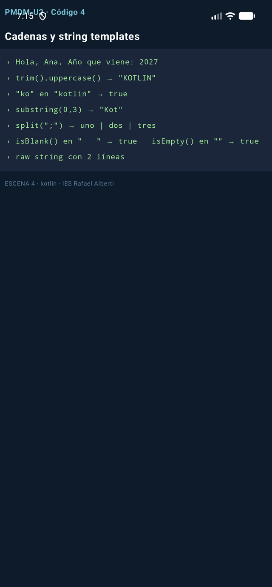
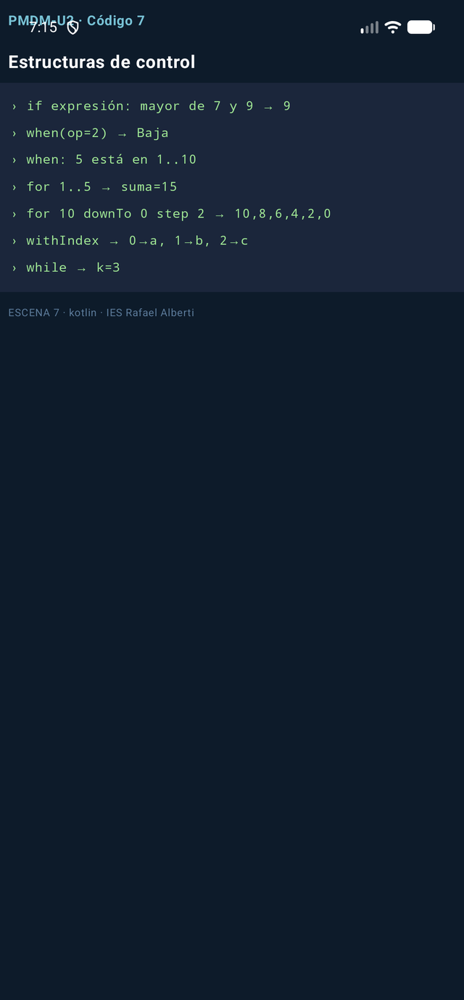
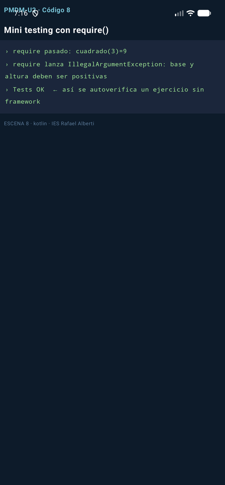
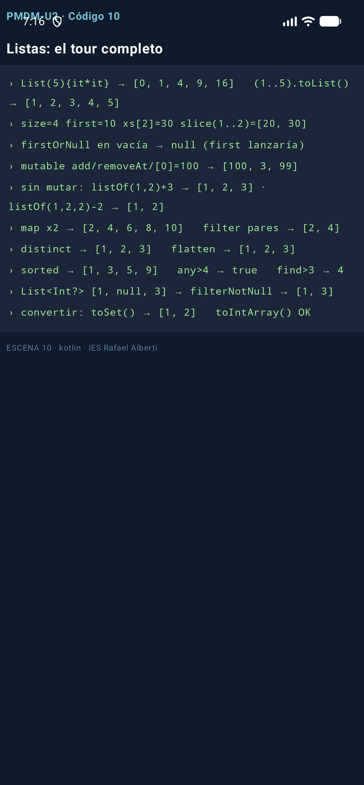

# PM-U2.1 - Fundamentos del lenguaje Kotlin

Note: Tema 2.1: los fundamentos de Kotlin que toda la app usará. Cada bloque se ejecutó de verdad: 14 capturas, cero pseudocódigo.

---

## 0. Por qué Kotlin y no seguir en Java

Note: Comparativa Java/Kotlin: preguntar a quien venga de DAM1 cuál odiaba más y anclar la ventaja al dolor vivido.

- la nulabilidad se declara en el tipo (String?), lo que elimina de raíz el error más caro de Java: el NullPointerException sorpresa


### Captura ejecutada


Note: Comparativa Java/Kotlin: preguntar a quien venga de DAM1 cuál odiaba más y anclar la ventaja al dolor vivido.

---

## 1. Estructura de un programa Kotlin

Note: Los tipos y val/var: repasar que la inferencia no es tipado dinámico, es el compilador trabajando.

- Un programa Kotlin es una sucesión de sentencias u operadores, cada uno en su línea (el punto y coma es opcional). El ejecutable arranca siempre en…
- kotlin fun main() { // punto de entrada del programa println("Hola, mundo") // imprime una línea en la salida estándar…
- | Elemento | Descripción | | -------- | ----------- | | Palabras clave | Palabras especiales del lenguaje: val, fun, if | | Identificadores | Nombres…

---

## 2. Variables y constantes: var y val

Note: Null-safety es EL argumento de venta de Kotlin: aquí es donde el que viene de Java se convierte.

- Regla de oro Kotlin: declara todo con val y solo cambia a var cuando demuestres que necesitas reasignar. El compilador te avisa si te…
- | | val | var | | --- | --- | --- | | Palabra del lenguaje | value | variable | | Cambiables tras la asignación | No | Sí | | Equivalente Java |…
- kotlin val msg: String = "Hello, World" // inmutable var count: Int = 0 // mutable count += 1 // var: se puede reasignar val x = 10 // inferencia: el…


### Escena - Código 1

```kotlin
fun esc01(): List<String> = consola {
    // Un programa Kotlin arranca en main(); aquí simulamos ese cuerpo.
    println("Hola, Kotlin")                        // salida estándar
    val pi = 3.14                                 // val: inmutable, Double inferido
    var contador: Int = 0                         // var: mutable, tipo anotado
    contador += 1                                 // los var sí se reasignan
    println("pi=$pi   contador=$contador")
    // En Kotlin no hace falta punto y coma al final de línea
    println("regla de oro: val por defecto; var solo si hace falta")
}
```


Note: Null-safety es EL argumento de venta de Kotlin: aquí es donde el que viene de Java se convierte.

### Captura ejecutada


Note: Pedir siempre primero la predicción del resultado antes de mostrar la captura.

---

## 3. Null-safety: el fin del NullPointerException

Note: Operadores y cadenas: la interpolación y los raw strings se aprenden escribiendo; que propongan frases con ${} en voz alta.

- el sistema de tipos distingue String (nunca null) de String? (nullable): si una función puede devolver null, está *obligada* a decirlo en su firma,…


### Escena - Código 2

```kotlin
fun puedeSerNulo(caso: Int): String? = if (caso % 2 == 0) "par" else null

fun esc02(): List<String> = consola {
    val s: String? = puedeSerNulo(3)              // String? admite null
    val len = s?.length ?: 0                      // safe call + elvis: si null, 0
    println("s=$s  →  s?.length ?: 0  da $len")
    val t: String? = puedeSerNulo(4)              // ahora sí trae valor
    println("t=$t  →  longitud ${t?.length ?: 0}")
    val forzado = t!!                             // !! afirma que no es null (NPE si miente)
    println("con !! (sabiendo que t no es null): \"$forzado\"")
    println("Java usaba ternarios y NPEs sorpresa; Kotlin lo declara en el tipo")
}
```


Note: Operadores y cadenas: la interpolación y los raw strings se aprenden escribiendo; que propongan frases con ${} en voz alta.

### Captura ejecutada


Note: Pedir siempre primero la predicción del resultado antes de mostrar la captura.

---

## 4. Tipos básicos

Note: Funciones: poner ejemplos del propio tema como argumentos. Insistir en unit expressions.

- Todos los tipos son objetos (nada de primitivos sueltos a lo Java) y las conversiones numéricas son explícitas: no existe la coerción…
- | Tipo | Tamaño | Rango | | ---- | ------ | ----- | | Long | 64 bits | -2⁶³ … 2⁶³-1 | | Int | 32 bits | -2³¹ … 2³¹-1 | | Short | 16 bits | -32768 ……
- kotlin val maximo: Int = Int.MAX_VALUE // 2147483647 val minimo: Int = Int.MIN_VALUE // -2147483648 val grande: Long = 150_000_000_000 // sufijo…

---

## 5. Operadores

Note: Lambdas: el momento de mayor confusión — que traduzcan un listener Java a lambda Kotlin en 10 segundos.

- == compara contenidos (equivale al .equals() de Java); para comparar referencias se usa ===


### Escena - Código 3

```kotlin
fun esc03(): List<String> = consola {
    val a = 10                                    // Int inferido
    val b = 3
    val ratio = a.toDouble() / b                  // conversión EXPLÍCITA: sin ella, 3
    println("10/3 entero=3, pero toDouble()/3 = $ratio")
    var x = 5
    x++                                           // incremento postfijo
    val ok = (10 % 3 == 1) && (2 * 2 == 4)        // % resto, && lógico
    println("x tras x++ → $x     ok=$ok")
    val n: Long = 7
    val d = n.toFloat()                           // sin coerción implícita: toFloat()
    println("Long $n → Float $d (Kotlin NO convierte tipos sin preguntar)")
    val dos: Int = 'A'.code                       // Char → su código
    println("'A'.code = $dos   y comparar == compara CONTENIDO, no referencia")
}
```


Note: Lambdas: el momento de mayor confusión — que traduzcan un listener Java a lambda Kotlin en 10 segundos.

### Captura ejecutada


Note: Pedir siempre primero la predicción del resultado antes de mostrar la captura.

---

## 6. Cadenas de caracteres

Note: Control de flujo: when con rangos y expresiones. Trampa de examen: when sin else en exhaustividad.

- Las String son inmutables: cada operación devuelve una cadena nueva; la original no se toca. La interpolación $variable y ${expresión} sustituye a la…
- kotlin val nombre = "Ana" val s = "Hola, $nombre. Dentro de un año: ${2026 + 1}" //…
- val multilinea = """ Multilínea "literal" sin escapar comillas """.trimIndent() // raw string +…


### Escena - Código 4

```kotlin
fun esc04(): List<String> = consola {
    val nombre = "Ana"
    println("Hola, $nombre. Año que viene: ${2026 + 1}")      // interpolación + expresión
    val s = " Kotlin "
    val t = s.trim().uppercase()                              // las String son inmutables: devuelven nuevas
    println("""trim().uppercase() → "$t"""")
    val ok = "ko" in t.lowercase()                            // in = contains, case-sensitive
    println("\"ko\" en \"${t.lowercase()}\" → $ok")
    val sub = "Kotlin".substring(0, 3)                        // subcadena [0,3)
    println("substring(0,3) → \"$sub\"")
    val partes = "uno;dos;tres".split(";")                    // partir
    println("split(\";\") → ${partes.joinToString(" | ")}")   // unir con joinToString
    println("isBlank() en \"   \" → ${"   ".isBlank()}   isEmpty() en \"\" → ${"".isEmpty()}")
    val multi = """
        Multilínea "literal"
        sin escapar comillas
    """.trimIndent()
    println("raw string con ${multi.lines().size} líneas")
}
```


Note: Control de flujo: when con rangos y expresiones. Trampa de examen: when sin else en exhaustividad.

### Captura ejecutada




Note: Pedir siempre primero la predicción del resultado antes de mostrar la captura.

---

## 7. Funciones

Note: require/check: cuándo falla rápido es mejor que seguir contaminado.

- Una función es un bloque de código que resuelve una tarea. La sintaxis mínima: fun nombre(param: Tipo): Retorno =…
- kotlin fun suma(a: Int, b: Int): Int = a + b // cuerpo-expresión: return implícito fun maxDe(a: Int, b: Int) = if (a > b) a else b // el tipo de…
- Parámetros con nombre, en el orden que quieras, y por…


### Escena - Código 5

```kotlin
fun suma(a: Int, b: Int): Int = a + b             // cuerpo-expresión, sin return

fun sumaConReturn(a: Int, b: Int): Int { return a + b }  // forma clásica, equivalente

fun media(vararg notas: Double) = notas.average() // vararg: N argumentos

fun <T> primero(lista: List<T>): T? = lista.firstOrNull()   // genérica

fun procesar(nums: List<Int>): Int {              // local function
    fun esPar(n: Int) = n % 2 == 0                //   solo visible aquí dentro
    return nums.filter(::esPar).sum()
}

fun saludar(nombre: String, titulo: String = "Sr./Sra.") =
    println("Hola, $titulo $nombre")              // parámetro por defecto

fun esc05(): List<String> = consola {
    println("suma(2,3) = ${suma(2, 3)}   sumaConReturn(2,3) = ${sumaConReturn(2, 3)}")
    println("media(1.0, 2.0, 3.0) = ${media(1.0, 2.0, 3.0)}")
    println("primero(listOf(7,9)) = ${primero(listOf(7, 9))}   primero(vacía) = ${primero(emptyList<Int>())}")
    println("procesar([1..6]) = ${procesar(listOf(1, 2, 3, 4, 5, 6))}   ← usó la función local esPar")
    saludar("Ana")                                // usa el valor por defecto
    saludar(nombre = "Ana", titulo = "Dra.")      // argumentos NOMBREADOS (orden libre)
    saludar(titulo = "Dr.", nombre = "Luis")
}
```


Note: require/check: cuándo falla rápido es mejor que seguir contaminado.

### Escena - Código 6

```kotlin
fun aplicaDosVeces(x: Int, f: (Int) -> Int): Int = f(f(x))   // HOF: recibe una función

fun esParNum(n: Int) = n % 2 == 0

fun esc06(): List<String> = consola {
    val cuadrado = { n: Int -> n * n }            // lambda con parámetro tipado
    println("aplicaDosVeces(2, cuadrado) = ${aplicaDosVeces(2, cuadrado)}   ← (2²)² = 16")
    println("aplicaDosVeces(3) { it + 1 } = ${aplicaDosVeces(3) { it + 1 }}   ← trailing lambda + it")
    val nums = listOf(1, 2, 3, 4)
    println("nums.filter(::esParNum) = ${nums.filter(::esParNum)}   ← referencia a función")
    val transformador: (Int) -> String = { n -> "n=$n" }      // una función es un VALOR
    println("lambda en variable: ${transformador(42)}")
    println("tipos de función: (Int) -> Int · (String, String) -> Boolean · () -> Unit")
}
```


Note: Pedir siempre primero la predicción del resultado antes de mostrar la captura.

### Captura ejecutada


Note: Pedir siempre primero la predicción del resultado antes de mostrar la captura.

### Captura ejecutada


Note: Pedir siempre primero la predicción del resultado antes de mostrar la captura.

---

## 8. Estructuras de control

Note: Arrays y colecciones: mutabilidad es la decisión, no el tipo de dato.

- Se ejecuta el primer caso que coincida; los when que devuelven valor obligan a else, y si el sujeto es un enum no hace falta porque el compilador c…


### Escena - Código 7

```kotlin
fun esc07(): List<String> = consola {
    val a = 7; val b = 9
    val mayor = if (a > b) a else b               // if como EXPRESIÓN que devuelve valor
    println("if expresión: mayor de $a y $b → $mayor")
    val op = 2
    val mensaje = when (op) {                     // when: el primer caso que encaja gana
        1 -> "Alta"; 2 -> "Baja"; 3 -> "Consulta"
        else -> "opción inválida"
    }
    println("when(op=$op) → $mensaje")
    val x = 5
    val y: Any = "hola"
    when {                                        // when sin sujeto: rangos y smart cast
        x in 1..10 -> println("when: $x está en 1..10")
        y is String -> println("smart cast: kotlin lo trata como String, len=${y.length}")
        else -> println("otro caso")
    }
    var suma = 0
    for (i in 1..5) suma += i                     // rango inclusivo
    println("for 1..5 → suma=$suma")
    println("for 10 downTo 0 step 2 → " + (10 downTo 0 step 2).joinToString(","))
    val items = listOf("a", "b", "c")
    println("withIndex → " + items.withIndex().joinToString { (i, v) -> "$i→$v" })
    var k = 0
    while (k < 3) k++                             // while/do-while/break/continue: como en Java
    println("while → k=$k")
}
```


Note: Arrays y colecciones: mutabilidad es la decisión, no el tipo de dato.

### Captura ejecutada




Note: Pedir siempre primero la predicción del resultado antes de mostrar la captura.

---

## 9. Practica: mini-testing con require()

Note: Listas: preguntar por qué Collections.unmodifiableList no convence a nadie en Kotlin moderno.

- require(condición) { "mensaje" } lanza IllegalArgumentException si la condición falla: es la forma más rápida de autoverificar un ejercicio sin…
- Ejercicio resuelto (mejorado sobre el PDF): implementa areaTriangulo y cuadrado, y autoverifícate con…
- fun areaTriangulo(base: Double, altura: Double): Double { require(base > 0 && altura > 0) { "base y altura deben ser positivas" } // precondición…


### Escena - Código 8

```kotlin
fun cuadrado(n: Int) = n * n

fun areaTriangulo(base: Double, altura: Double): Double {
    require(base > 0 && altura > 0) { "base y altura deben ser positivas" }  // precondición
    return base * altura / 2
}

fun esc08(): List<String> = consola {
    require(cuadrado(3) == 9) { "3² debe ser 9" } // si falla: IllegalArgumentException
    println("require pasado: cuadrado(3)=${cuadrado(3)}")
    try {
        areaTriangulo(-2.0, 3.0)                  // precondición rota a propósito
    } catch (e: IllegalArgumentException) {
        println("require lanza IllegalArgumentException: ${e.message}")
    }
    println("Tests OK  ← así se autoverifica un ejercicio sin framework")
}
```


Note: Listas: preguntar por qué Collections.unmodifiableList no convence a nadie en Kotlin moderno.

### Captura ejecutada




Note: Pedir siempre primero la predicción del resultado antes de mostrar la captura.

---

## 10. Arrays

Note: Mapas: entries y destructuring, el pan de cada día al parsear JSON en el tema 3.

- Un Array es una colección ordenada de tamaño fijo (se crea con un tamaño o con literales) pero de contenido mutable. Hay variantes primitivas…
- kotlin val a = arrayOf(1, 2, 3) // Array val b = Array(3) { i -> i * 2 } // [0, 2, 4] — inicializado por lambda val c = IntArray(3) { it * 2 } //…
- | Operación | Array | List | | --------- | ----- | ---- | | Cambiar tamaño | ✗ | ✓ | | Cambiar contenido | ✓ | en MutableList, ✓ | |…


### Escena - Código 9

```kotlin
fun esc09(): List<String> = consola {
    val a = arrayOf(1, 2, 3)                      // Array<Int>: tamaño FIJO, contenido mutable
    a[0] = 10
    println("arrayOf → ${a.contentToString()} (a[0]=10)  → a.toList() = ${a.toList()}")
    val b = IntArray(3) { it * 2 }                // primitivo especializado, sin boxing
    println("IntArray(3) { it*2 } = ${b.contentToString()}")
    val nums = listOf(5, 2, 8, 2)                 // colección inmutable
    val paresOrdenados = nums.filter { it % 2 == 0 }.sorted()   // funcional: NO muta
    println("filter+sorted → $paresOrdenados   original intacto: $nums")
    println("inmutables: List/Set/Map · mutables: MutableList/MutableSet/MutableMap")
}
```


Note: Mapas: entries y destructuring, el pan de cada día al parsear JSON en el tema 3.

### Captura ejecutada


Note: Pedir siempre primero la predicción del resultado antes de mostrar la captura.

---

## 11. Colecciones: el mapa mental

Note: Enums: el modelo de dominios pequeños, sin crear librerías.

- Una colección es un contenedor de elementos para almacenar, recuperar y procesar datos. Kotlin divide las cabeceras en inmutables (interfaz de solo…
- | Interfaz | Qué es | Crear | Mutar | | -------- | ------ | ----- | ----- | | List | Ordenada, duplicados permitidos | listOf(...), List(5){...} |…
- Y sobre cualquiera funcionan las operaciones funcionales (devuelven resultados nuevos, no tocan el original): filter, map, sorted, distinct, any/all,…

---

## 12. Listas: el tour completo

Note: POO: data classes frente a POJO — el antes/después de 60 líneas a 1.

- Crear: listOf(1,2,3) · mutableListOf(...) · List(5) { it*it } (tamaño + lambda) ·…
- Acceder: size, first()/last() (y sus variantes OrNull que no revientan), xs[2], getOrNull(9), slice(1..2), take(2),…
- Mutar (solo MutableList): add(4), removeAt(0), xs[0] = 100, remove(2), clear() —y +=/-= que devuelven listas nuevas incluso en las…


### Escena - Código 10

```kotlin
fun esc10(): List<String> = consola {
    println("List(5){it*it} → ${List(5) { it * it }}   (1..5).toList() → ${(1..5).toList()}")
    val xs = listOf(10, 20, 30, 40)
    println("size=${xs.size} first=${xs.first()} xs[2]=${xs[2]} slice(1..2)=${xs.slice(1..2)}")
    println("firstOrNull en vacía → ${emptyList<Int>().firstOrNull()} (first lanzaría)")
    val ms = mutableListOf(1, 2, 3)               // MutableList: sí se modifica
    ms.add(99); ms.removeAt(0); ms[0] = 100
    println("mutable add/removeAt/[0]=100 → $ms")
    println("sin mutar: listOf(1,2)+3 → ${listOf(1, 2) + 3} · listOf(1,2,2)-2 → ${listOf(1, 2, 2) - 2}")
    val ns = listOf(1, 2, 3, 4, 5)
    println("map x2 → ${ns.map { it * 2 }}   filter pares → ${ns.filter { it % 2 == 0 }}")
    println("distinct → ${listOf(1, 2, 2, 3).distinct()}   flatten → ${listOf(listOf(1, 2), listOf(3)).flatten()}")
    println("sorted → ${listOf(5, 3, 9, 1).sorted()}   any>4 → ${ns.any { it > 4 }}   find>3 → ${ns.find { it > 3 }}")
    val conNulos: List<Int?> = listOf(1, null, 3) // nullabilidad en DOS niveles
    println("List<Int?> $conNulos → filterNotNull → ${conNulos.filterNotNull()}")
    println("convertir: toSet() → ${listOf(1, 2, 2).toSet()}   toIntArray() OK")
}
```


Note: POO: data classes frente a POJO — el antes/después de 60 líneas a 1.

### Captura ejecutada




Note: Pedir siempre primero la predicción del resultado antes de mostrar la captura.

---

## 13. Mapas

Note: Colecciones de objetos: la lista de la libreta del 2.3 nace aquí.

- Las claves son únicas; pedir una clave inexistente con corchetes devuelve null (no excepción) en los mapas inmutables, y getOrDefault/getOrElse te …


### Escena - Código 11

```kotlin
fun esc11(): List<String> = consola {
    val precios = mutableMapOf("pan" to 1.2, "leche" to 1.1)
    precios["leche"] = 1.25                       // actualizar con corchetes
    println("mutableMapOf → $precios")
    println("\"huevos\" in precios → ${"huevos" in precios}   containsKey(pan) → ${precios.containsKey("pan")}")
    val x1: Double? = precios["huevos"]           // clave inexistente → null, NO excepción
    println("m[clave inexistente] → $x1   getOrDefault → ${precios.getOrDefault("huevos", 0.0)}")
    println("getOrElse (cálculo diferido) → ${precios.getOrElse("huevos") { 0.0 * 99 }}")
    println("total = values.sum() → ${precios.values.sum()}")
    val mZip = listOf("A", "B", "C").zip(listOf(1, 2, 3)).toMap()
    println("zip().toMap() → $mZip")
    for ((k, v) in precios) println("destructuring: $k ⇒ $v")
    println("mapOf devuelve LinkedHashMap: conserva el ORDEN de inserción")
}
```


Note: Colecciones de objetos: la lista de la libreta del 2.3 nace aquí.

### Captura ejecutada


Note: Pedir siempre primero la predicción del resultado antes de mostrar la captura.

---

## 14. Enumeraciones

Note: Cierre: todo lo visto son los ladrillos del mini-proyecto. Repaso semanal: el verde del 2.1 entra en el examen del 2.2 también.

- Un enum class define un conjunto cerrado de constantes con nombre: estados, roles, tipos. Cada constante es un singleton y puede llevar propiedades y…
- enum class Nivel(val prioridad: Int) { // con datos BAJO(1), MEDIO(2), ALTO(3); // el punto y coma abre el cuerpo fun esCritico() = this == ALTO }…
- enum class Nivel(val prioridad: Int) { // enum con propiedad y función BAJO(1), MEDIO(2), ALTO(3); // el punto y coma abre el cuerpo fun esCritico()…


### Escena - Código 12

```kotlin
enum class Rol { ADMIN, EDITOR, LECTOR }

enum class Nivel(val prioridad: Int) {            // enum con propiedad y función
    BAJO(1), MEDIO(2), ALTO(3);                   //  el punto y coma abre el cuerpo
    fun esCritico() = this == ALTO
}

fun esc12(): List<String> = consola {
    val r = Rol.ADMIN
    println("role=$r  name=\"${r.name}\"  ordinal=${r.ordinal}")
    println("Nivel.ALTO.prioridad=${Nivel.ALTO.prioridad}   esCritico()=${Nivel.ALTO.esCritico()}")
    println("todas las constantes: ${Nivel.entries.joinToString { "${it.name}(${it.prioridad})" }}")
    val permiso = when (r) {                      // when EXHAUSTIVO sobre enum: sin else
        Rol.ADMIN -> "puede todo"
        Rol.EDITOR -> "escribir"
        Rol.LECTOR -> "solo leer"
    }
    println("when sobre enum (sin else): ADMIN → $permiso")
    println("cada constante es un singleton: útil para estados, roles y tipos cerrados")
}
```


Note: Cierre: todo lo visto son los ladrillos del mini-proyecto. Repaso semanal: el verde del 2.1 entra en el examen del 2.2 también.

### Captura ejecutada


Note: Pedir siempre primero la predicción del resultado antes de mostrar la captura.

---

## 15. Programación orientada a objetos

Note: Tema 2.1: los fundamentos de Kotlin que toda la app usará. Cada bloque se ejecutó de verdad: 14 capturas, cero pseudocódigo.

- todo es final y no heredable por defecto; hay que marcar open en la base y override en la derivada


### Escena - Código 13

```kotlin
class Usuario(val id: Int, var nombre: String)    // constructor primario en la cabecera

class Producto(val id: Int, val nombre: String, var precio: Double) {
    init { require(precio >= 0) { "Precio negativo" } }        // bloque de validación
    constructor(id: Int, nombre: String) : this(id, nombre, 0.0)  // secundario → delega
}

class Rectangulo(var ancho: Int, var alto: Int) {
    val area: Int get() = ancho * alto            // propiedad CALCULADA
    fun escalar(k: Int) { ancho *= k; alto *= k } // método miembro
}

class PersonaNormal(val nombre: String, var edad: Int)          // clase al uso

data class Persona(val nombre: String, var edad: Int)           // data: añade mucho gratis

open class Animal(open val nombre: String) { open fun sonido() = "..." }

class Perro(override val nombre: String) : Animal(nombre) {     // herencia: open/override
    override fun sonido() = "guau"
}

interface Volador { fun volar(): String }

class Pajaro(override val nombre: String) : Animal(nombre), Volador {
    override fun volar() = "aleteo"
}

fun esc13(): List<String> = consola {
    val u = Usuario(1, "Ana")
    u.nombre = "Ana María"                        // var sí, val no
    println("Usuario → ${u.nombre} (val id inmutable, var nombre editable)")
    val p = Producto(1, "Teclado")                // usa el constructor secundario
    println("secundario delega en primario: precio=${p.precio}")
    val r = Rectangulo(2, 3); r.escalar(2)
    println("Rectangulo(2,3).escalar(2) → area=${r.area}  (get() calcula al leer)")
    val a1 = PersonaNormal("Ana", 30); val a2 = PersonaNormal("Ana", 30)
    println("class normal: a == b → ${a1 == a2}   toString → ${a1.javaClass.simpleName}@${a1.hashCode().toString(16)}")
    val b1 = Persona("Ana", 30); val b2 = Persona("Ana", 30)
    println("data class: b == b → ${b1 == b2}   toString → $b1")
    val copia = b1.copy(edad = 31)                // copia cambiando un campo
    val (n, e) = b1                               // desestructuración por componentN()
    println("copy(edad=31) → $copia   y (n,e) → $n, $e")
    println("herencia: Perro → ${Perro("Luna").sonido()}   Pajaro → ${Pajaro("Pio").sonido()}/${Pajaro("Pio").volar()}")
    println("Kotlin es final por defecto: hereda solo de open/abstract")
}
```


Note: Tema 2.1: los fundamentos de Kotlin que toda la app usará. Cada bloque se ejecutó de verdad: 14 capturas, cero pseudocódigo.

### Captura ejecutada


Note: Pedir siempre primero la predicción del resultado antes de mostrar la captura.

---

## 16. Colecciones de objetos: el CRUD completo

Note: Tema 2.1: los fundamentos de Kotlin que toda la app usará. Cada bloque se ejecutó de verdad: 14 capturas, cero pseudocódigo.

- La técnica que vais a usar en cada práctica: una data class como modelo y MutableList como almacén, más las consultas funcionales del…
- kotlin data class Libro(val id: Int, val titulo: String, val paginas: Int, val autor:…
- fun esc14(): List = consola { val libros = mutableListOf( Libro(1, "Kotlin 101", 180, "Ana"), Libro(2, "Compose", 220, "Luis"), ) libros += Libro(3,…


### Escena - Código 14

```kotlin
data class Libro(val id: Int, val titulo: String, val paginas: Int, val autor: String)

fun esc14(): List<String> = consola {
    val libros = mutableListOf(
        Libro(1, "Kotlin 101", 180, "Ana"),
        Libro(2, "Compose", 220, "Luis"),
    )
    libros += Libro(3, "Coroutines", 200, "Ana")  // += en mutableList
    libros[0] = libros[0].copy(paginas = 190)     // data class: copiar corregida
    println("${libros.size} libros · el 1º con ${libros[0].paginas} págs (tras copy)")
    println("filtrar por autor → ${libros.filter { it.autor == "Ana" }.map { it.titulo }}")
    println("primero >200 págs → ${libros.firstOrNull { it.paginas > 200 }?.titulo}")
    println("any con Compose → ${libros.any { it.titulo.contains("Compose") }}")
    println("indexOfFirst Coroutines → ${libros.indexOfFirst { it.titulo == "Coroutines" }} (o -1)")
    println("sortedBy págs → ${libros.sortedBy { it.paginas }.joinToString { it.titulo }}")
    val orden = libros.sortedWith(compareBy<Libro> { it.autor }.thenBy { it.titulo })
    println("autor↑ título↑ → ${orden.joinToString { "${it.autor}:${it.titulo}" }}")
    libros.sortByDescending { it.paginas }        // en sitio (solo MutableList)
    println("sortByDescending en sitio → ${libros.joinToString { it.titulo }}")
    println("total páginas → ${libros.sumOf { it.paginas }}")
}
```


Note: Tema 2.1: los fundamentos de Kotlin que toda la app usará. Cada bloque se ejecutó de verdad: 14 capturas, cero pseudocódigo.

### Captura ejecutada


Note: Pedir siempre primero la predicción del resultado antes de mostrar la captura.

---

## 17. Buenas prácticas de estilo

Note: Tema 2.1: los fundamentos de Kotlin que toda la app usará. Cada bloque se ejecutó de verdad: 14 capturas, cero pseudocódigo.

- | Aspecto | Convención | Ejemplo | | ------- | ----------- | ------- | | Nombre de variables | sustantivo, minúsculas, camelCase | velocidad,…

---

## 18. Errores frecuentes

Note: Tema 2.1: los fundamentos de Kotlin que toda la app usará. Cada bloque se ejecutó de verdad: 14 capturas, cero pseudocódigo.

- | Error | Síntoma | Arreglo | | ----- | ------- | ------- | | Confundir ? con !! | NPE pese al ? | el ? protege; el !! apuesta | | filter esperando…

---

## 19. Test de autoevaluación

Note: Tema 2.1: los fundamentos de Kotlin que toda la app usará. Cada bloque se ejecutó de verdad: 14 capturas, cero pseudocódigo.

- 1. ¿Qué imprime val x: Int? = null; println(x?.toString() ?: "nada")? 2. Diferencia entre sortedBy y sortBy: ¿cuál existe en una List inmutable? 3.…
- !!! info "Respuestas" 1. nada (safe call → null; Elvis activa el rescate). 2. sortedBy devuelve una copia ordenada —existe en inmutables—; sortBy…

---

## 20. Para terminar

Note: Tema 2.1: los fundamentos de Kotlin que toda la app usará. Cada bloque se ejecutó de verdad: 14 capturas, cero pseudocódigo.

- Este tema es la base de todo lo que viene: cada tema de la UD3 (actividades, Compose, Room…) usa estos mismos fundamentos. El repaso semanal del…
- Siguiente: Tema 3.1 - Ciclo de vida de las aplicaciones (próxima unidad) — dónde vive realmente una app Android y qué pasa cuando alguien te llama…
- Recursos: [Sintaxis](https://kotlinlang.org/docs/basic-syntax.html) · [Null-safety](https://kotlinlang.org/docs/null-safety.html) ·…
