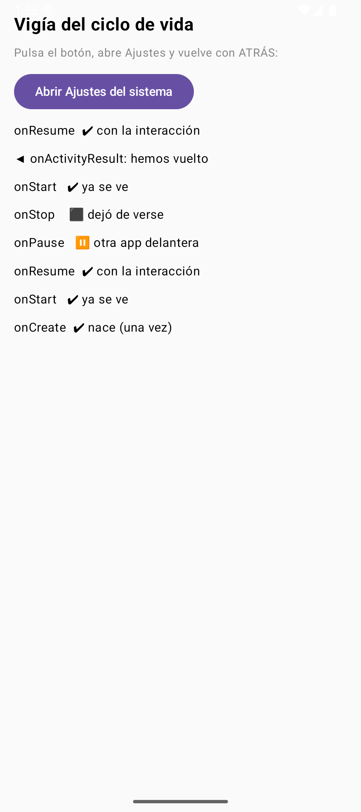
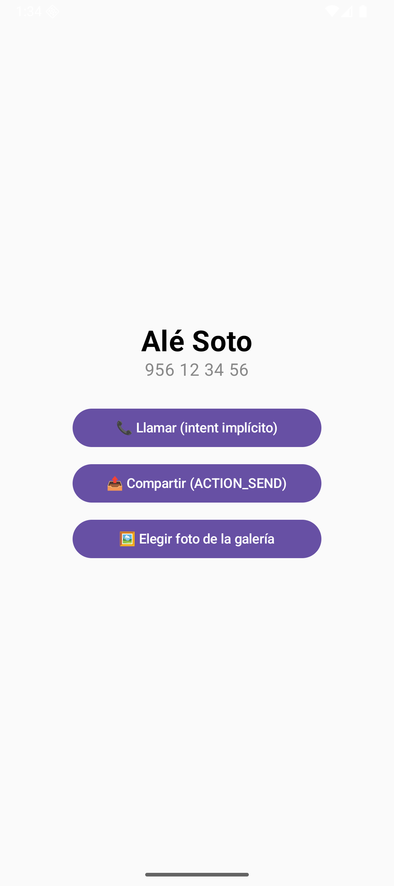

# PM-U2.2 - Actividades e Intents

Note: Presentamos el tema 2.2: la app por dentro del `setContent`. Todo lo que veréis está ejecutado en un emulador: podéis pedirme que repita cualquier escena en vivo.

---

## 1. ¿Qué es una Activity?

Note: Aviso de la primera línea: exported=true/false es seguridad, no decoración. Preguntar: «¿qué pantalla de vuestra app debería estar exported y por qué?»

- exported="true" significa "cualquier app (o el launcher o el navegador) puede lanzar esta Activity"; exported="false" significa "solo yo misma"


### Código 1 - El Manifest que declara nuestras tres pantallas

```xml
<?xml version="1.0" encoding="utf-8"?>
    <manifest xmlns:android="http://schemas.android.com/apk/res/android">

        <application                                          // la app entera
            android:label="FumetoContactos"                   // el nombre que ve el usuario
            android:icon="@mipmap/ic_launcher"                // su icono
            android:theme="@style/Theme.MyApplication">       // su tema base

            <activity
                android:name=".MainActivity"                  // pantalla 1: la libreta
                android:exported="true"                       // el launcher (de fuera) puede arrancarla
                android:windowSoftInputMode="adjustResize">   // el teclado no tapa el formulario
                <intent-filter>                               // POR QUÉ aparece en el cajón
                    <action android:name="android.intent.action.MAIN" />      <!-- la entrada principal -->
                    <category android:name="android.intent.category.LAUNCHER" /> <!-- la pinta en el launcher -->
                </intent-filter>
            </activity>

            <activity android:name=".FichaActivity"           // pantalla 2: la ficha de un contacto
                android:exported="false" />                   <!-- solo mi app la abre: no la ve nadie -->

            <activity android:name=".FichaWebActivity"         // pantalla 3: contesta a mi URL
                android:exported="true">                       <!-- la abrirá el navegador: de fuera -->
                <intent-filter>
                    <action android:name="android.intent.action.VIEW" />                <!-- "ver esto" -->
                    <category android:name="android.intent.category.DEFAULT" />          <!-- obligatoria en VIEW -->
                    <category android:name="android.intent.category.BROWSABLE" />        <!-- desde navegador -->
                    <data android:scheme="https" android:host="fumeto.dev" />            <!-- mi dominio -->
                </intent-filter>
            </activity>

        </application>
    </manifest>
```


Note: Aviso de la primera línea: exported=true/false es seguridad, no decoración. Preguntar: «¿qué pantalla de vuestra app debería estar exported y por qué?»

---

## 2. El ciclo de vida: las siete estaciones

Note: La pregunta fija del examen. Que un alumno pase a la pizarra las siete estaciones; el resto corrige. Hacer hincapié en que onDestroy no está garantizado.

- y pregunta fija de examen — es:
- onPause salta cuando dejas el primer plano pero sigues visible (Activity translúcida encima, multiventana); onStop solo si dejas de ser visible. Un AlertDialog propio NO pausa
- Android puede matar tu proceso sin avisar desde onStop; todo lo guardable se guarda ANTES de que te pregunten


### Código 2 - Vigía del ciclo de vida (escena `--ei escena 2`)

```kotlin
@Composable
    fun EscenaCiclo() {                                         // pantallita que apunta TODO lo del ciclo
        val eventos = remember { mutableStateListOf<String>() } // el diario de a bordo
        val lanzador = androidx.activity.compose.rememberLauncherForActivityResult(
            ActivityResultContracts.StartActivityForResult()    // lanzamos y esperamos la vuelta
        ) { eventos.add("◀ onActivityResult: hemos vuelto") }   // al volver se anota
        val observador = LifecycleEventObserver { _, ev ->      // micro que escucha eventos del ciclo
            if (ev.event == Lifecycle.Event.ON_CREATE) eventos.add("onCreate  ✔ nace (una vez)")
            if (ev.event == Lifecycle.Event.ON_START)  eventos.add("onStart   ✔ ya se ve")
            if (ev.event == Lifecycle.Event.ON_RESUME) eventos.add("onResume  ✔ con la interacción")
            if (ev.event == Lifecycle.Event.ON_PAUSE)  eventos.add("onPause   ⏸ otra app delante")
            if (ev.event == Lifecycle.Event.ON_STOP)   eventos.add("onStop    ⬛ dejó de verse")
        }
        val dueno = LocalLifecycleOwner.current                 // la actividad que nos aloja
        DisposableEffect(dueno) {                               // suscripción mientras exista el composable
            dueno.lifecycle.addObserver(observador)             // nos enganchamos al ciclo
            onDispose { dueno.lifecycle.removeObserver(observador) } // y nos desenganchamos al morir
        }
        Column(Modifier.fillMaxSize().padding(16.dp), Arrangement.spacedBy(8.dp)) {
            Text("Vigía del ciclo de vida", fontWeight = FontWeight.Bold, fontSize = 20.sp)
            Text("Pulsa el botón, abre Ajustes y vuelve con ATRÁS:", color = Color.Gray, fontSize = 13.sp)
            Button(onClick = {                                  // intent IMPLÍCITO: quien abra Ajustes da igual
                lanzador.launch(Intent(Settings.ACTION_SETTINGS))   // el sistema busca quién responde
            }) { Text("Abrir Ajustes del sistema") }
            eventos.reversed().forEach {                        // lo más nuevo arriba
                Text(it, fontSize = 14.sp)                      // cada línea, una estación del ciclo
            }
        }
    }
```


Note: La pregunta fija del examen. Que un alumno pase a la pizarra las siete estaciones; el resto corrige. Hacer hincapié en que onDestroy no está garantizado.

### Panel del vigía del ciclo de vida con los eventos apuntados 




Note: Repásalo con los alumnos: que expliquen ellos lo que muestra la pantalla antes de que lo expliques tú.

---

## 3. Sobrevivir a la rotación: `remember` no es suficiente

Note: La sorpresa de la clase: girar y ver que remember NO salva la rotación. Pedir hipótesis ANTES de girar. El tope del Bundle (1 MB compartido; recomendado < 50 KB) se queda grabado con el ejemplo de la foto de 3 MB. En Compose la solución directa es rememberSaveable (usa ese Bundle) o un ViewModel (tema 3).

- el Bundle es para el estado de la INTERFAZ (scroll, texto a medio teclear, un contador) y tiene límite (1 MB compartido; recomendado < 50 KB); los datos van a disco
- en Compose: rememberSaveable guarda en el Bundle sin escribir onSaveInstanceState; el ViewModel sobrevive al giro, pero no a que maten el proceso


### Código 3 - Dos contadores, el mismo destino (escena `--ei escena 3`)

```kotlin
@Composable
    fun EscenaRotador() {                                       // demuestra remember con dos contadores
        var sinRecordar by mutableStateOf(0)                    // SIN remember: nace en cada recomposición
        var conRecordar by remember { mutableStateOf(0) }       // CON remember: sobrevive a recomposiciones
        Column(Modifier.fillMaxSize().padding(16.dp), Arrangement.spacedBy(10.dp)) {
            Text("Gira el emulador (Ctrl+↑) y mira quién sobrevive", color = Color.Gray)
            Button(onClick = { sinRecordar++; conRecordar++ }) { Text("Sumar a los dos") }
            Text("Sin remember: $sinRecordar", fontSize = 22.sp)   // se reinicia al girar (se recrea TODO)
            Text("Con remember: $conRecordar", fontSize = 22.sp, fontWeight = FontWeight.Bold) // también se recrea…
            Text("⚠ remember NO sobrevive a la rotación: la Activity se recrea de cero. " +
                 "Para eso está onSaveInstanceState (siguiente escena).", fontSize = 12.sp, color = Color.Gray)
        }
    }
```


Note: La sorpresa de la clase: girar y ver que remember NO salva la rotación. Pedir hipótesis ANTES de girar. El tope del Bundle (1 MB compartido; recomendado < 50 KB) se queda grabado con el ejemplo de la foto de 3 MB.

### Código 4 - El Bundle que sube al ático (Activity dedicada, escena `--ei escena 4`)

```kotlin
class EscenaGuardaActivity : ComponentActivity() {    // Activity dedicada: tiene onSaveInstanceState

        private var visitas by mutableStateOf(0)          // SE RECREA a cero en cada rotación…
        private var guardado = 0                          // …pero ESTO lo devuelve el Bundle

        companion object { private const val CLAVE = "visitas_guardadas" }  // clave del Bundle

        override fun onCreate(savedInstanceState: Bundle?) {
            super.onCreate(savedInstanceState)
            // si el sistema nos devuelve Bundle, es que venimos de una rotación
            guardado = savedInstanceState?.getInt(CLAVE) ?: 0   // null = arranque limpio
            visitas = guardado                                   // y recuperamos el dato
            setContent {
                MaterialTheme {
                    Column(Modifier.fillMaxSize().padding(16.dp), Arrangement.spacedBy(10.dp)) {
                        Text("Guardar estado al girar", fontWeight = FontWeight.Bold, fontSize = 20.sp)
                        Button(onClick = { visitas++; guardado++ }) { Text("Sumar (las dos)") }
                        Text("visible ahora mismo: $visitas", fontSize = 22.sp)
                        Text("recuperado del Bundle: $guardado", fontSize = 22.sp, fontWeight = FontWeight.Bold)
                        Text("Gira (Ctrl+↑): si el Bundle funciona, el segundo NO baja a 0.",
                             fontSize = 12.sp, color = androidx.compose.ui.graphics.Color.Gray)
                    }
                }
            }
        }

        // EL MOMENTO CLAVE: el sistema avisa de que va a matarnos → guardamos lo que importa
        override fun onSaveInstanceState(outState: Bundle) {   // el Bundle que sube al ático
            super.onSaveInstanceState(outState)
            outState.putInt(CLAVE, guardado)                    // solo lo mínimo: no serialices el mundo
        }
    }
```


Note: Repásalo con los alumnos: que expliquen ellos lo que muestra la pantalla antes de que lo expliques tú.

### Dos contadores a 3 antes de rotar


Note: Repásalo con los alumnos: que expliquen ellos lo que muestra la pantalla antes de que lo expliques tú.

### Tras rotar, ambos contadores vuelven a 0: la Activity se rec


Note: Repásalo con los alumnos: que expliquen ellos lo que muestra la pantalla antes de que lo expliques tú.

---

## 4. Intents: el correo postal de Android

Note: Insistir en el vocabulario: action=verbo, data=URI, categories=requisitos. Un alumno describe en voz alta el intent del marcador con esas tres piezas.

- un intent EXPLÍCITO nombra a quién se lo mandas (una clase de Activity tuya); un intent IMPLÍCITO solo describe la acción y deja que el sistema bus…

---

## 5. Intent explícito: tu pantalla llama a la tuya

Note: Demo en vivo: adb shell am start sin extras y ver el "Desconocido". De ahí sale la regla de oro: toda extra se lee con nulabilidad.

- viajan tipos primitivos yParcelable (el heredero moderno de Serializable, serializado de verdad); y se leen SIEMPRE con nulabilidad obligada — getS…


### Código 5 - El sobre (emisor) y la carta (receptor)

```kotlin
// — EMISOR: en la lista, la tarjeta entera es pulsable —
    Card(                                           // tarjeta Material con sombra
        modifier = Modifier                         // el traje de la tarjeta:
            .fillMaxWidth()                         // ancha como la pantalla
            .clickable { alAbrir(c) }               // y pulsable por TODO: abre la ficha
    ) { /* fila con nombre, teléfono, switch y papelera (ver 2.3) */ }

    // — y en EscenaCasa, el callback que dispara el envío —
    alAbrir = { c ->                            // C5: intent EXPLÍCITO a mi propia Activity
        contexto.startActivity(                 // "quién" lo arreglo yo, sin preguntas
            Intent(contexto, FichaActivity::class.java)   // destino: clase concreta
                .putExtra(FichaActivity.EXTRA_NOMBRE, c.nombre)     // extra del nombre
                .putExtra(FichaActivity.EXTRA_TELEFONO, c.telefono) // extra del teléfono
        )
    },

    // — RECEPTOR: FichaActivity lee las extras en su onCreate —
    val nombre = intent.getStringExtra(EXTRA_NOMBRE) ?: "Desconocido" // null → "Desconocido"
    val telefono = intent.getStringExtra(EXTRA_TELEFONO) ?: "sin número"

    companion object {                                    // claves públicas: las usa el emisor
        const val EXTRA_NOMBRE = "nombre"                 // string de clave, el de verdad
        const val EXTRA_TELEFONO = "telefono"             // y el del teléfono
    }
```


Note: Demo en vivo: adb shell am start sin extras y ver el "Desconocido". De ahí sale la regla de oro: toda extra se lee con nulabilidad.

### FichaActivity mostrando el nombre y teléfono recibidos por e




Note: Repásalo con los alumnos: que expliquen ellos lo que muestra la pantalla antes de que lo expliques tú.

---

## 6. Intent implícito: que lo haga quien sepa

Note: Dialer y chooser en directo. Diferencia DIAL (sin permiso) vs CALL (permiso runtime): preguntad qué app de su móvil pedía permisos para marcar.

- FichaActivity tiene tres botones que no saben qué app los…
- Figura 7. ACTION_DIAL: nuestro intent decía «marcador con este número»; el Dialer del emulador se ofreció y lo abrió. Ojo: DIAL no llama, deja el…
- kotlin Button(onClick = alLlamar, modifier = Modifier.fillMaxWidth(0.7f)) { Text("📞 Llamar (intent implícito)") // ACTION_DIAL } // …y alLlamar, en…


### Código 6 - Llamar sin conocer al marcador

```kotlin
Button(onClick = alLlamar, modifier = Modifier.fillMaxWidth(0.7f)) {
        Text("📞 Llamar (intent implícito)")           // ACTION_DIAL
    }
    // …y alLlamar, en el onCreate de FichaActivity:
    alLlamar = {                          // INTENT IMPLÍCITO con dato:
        startActivity(Intent(Intent.ACTION_DIAL, Uri.parse("tel:$telefono")))
    },                                    // quien responda (el marcador) decide
```


Note: Dialer y chooser en directo. Diferencia DIAL (sin permiso) vs CALL (permiso runtime): preguntad qué app de su móvil pedía permisos para marcar.

### Código 7 - Compartir (ACTION_SEND + chooser)

```kotlin
alCompartir = {                       // ACTION_SEND: compartimos la ficha
        val i = Intent(Intent.ACTION_SEND).apply {   // construimos el intent
            type = "text/plain"                       // MIME: texto plano
            putExtra(Intent.EXTRA_TEXT,               // el contenido a compartir
                "Ficha de $nombre — $telefono (FumetoContactos)")
        }
        startActivity(Intent.createChooser(i, "Compartir ficha con…")) // nuestro chooser
    },
```


Note: Repásalo con los alumnos: que expliquen ellos lo que muestra la pantalla antes de que lo expliques tú.

### Código 8 - Galería: el sistema elige, nosotros pintamos

```kotlin
// en FichaActivity: lanzador registrado ANTES de que la Activity esté creada (así lo exige el ciclo)
    private val pickImagen = registerForActivityResult(
        ActivityResultContracts.GetContent()              // "dame contenido de un fichero"
    ) { uri -> if (uri != null) rutaFoto = uri }          // si no cancela, guardamos el Uri

    // el botón:
    alGaleria = { pickImagen.launch("image/*") }          // "cualquier imagen vale"

    // y en el composable Ficha, pintar lo elegido:
    if (foto != null) {                               // si ya hay foto elegida…
        Spacer(Modifier.height(16.dp))
        val ctx = androidx.compose.ui.platform.LocalContext.current      // el Context real de la pantalla
        val bitmap = remember(foto) {                 // la decodificamos UNA vez por Uri
            ctx.contentResolver.openInputStream(foto)?.use { input ->    // abrimos el content://
                BitmapFactory.decodeStream(input)     // stream → Bitmap
            }
        }
        bitmap?.let {                                 // si se pudo leer:
            Image(                                    // la pintamos en Compose
                bitmap = it.asImageBitmap(),          // Bitmap del sistema → ImageBitmap
                contentDescription = "Foto de $nombre",  // accesibilidad: qué es la imagen
                modifier = Modifier.size(180.dp)      // tamaño fijo, cuadradita
            )
        }
    }
```


Note: Repásalo con los alumnos: que expliquen ellos lo que muestra la pantalla antes de que lo expliques tú.

### Marcador del sistema abierto con el número del contacto list


Note: Repásalo con los alumnos: que expliquen ellos lo que muestra la pantalla antes de que lo expliques tú.

### Diálogo Compartir ficha con… mostrando las apps capaces de r


Note: Repásalo con los alumnos: que expliquen ellos lo que muestra la pantalla antes de que lo expliques tú.

---

## 7. Intent filter: cuando el mundo te llama a ti

Note: El filtro como páginas amarillas: dos apps con el mismo dominio pelean en chooser. Mencionar que el QR del bar dispara exactamente este mecanismo.

- un filtro coincide si la action, las categories y el data del intent encajan TODOS; la categoría DEFAULT es obligatoria en filtros que no sean MAIN…
- desde Android 12 un enlace https solo abre la app si es App Link verificado (autoVerify + assetlinks.json); si no, se abre el navegador. Sin dominio: esquema propio o adb


### Código 9 - Recibir una URL y interpretarla

```kotlin
class FichaWebActivity : ComponentActivity() {    // registrada en el Manifest con intent-filter
        override fun onCreate(savedInstanceState: Bundle?) {
            super.onCreate(savedInstanceState)
            val uri = intent.data                              // la URL que nos trajeron: https://fumeto.dev/…
            val secciones = uri?.pathSegments ?: listOf("(sin ruta)") // /ficha/nerea → [ficha, nerea]
            setContent {
                MaterialTheme {
                    Surface(Modifier.fillMaxSize()) {          // superficie Material vacía
                        Column(Modifier.padding(20.dp), Arrangement.spacedBy(8.dp)) {
                            Text("🌐 ¡Me han abierto con una URL!", fontWeight = FontWeight.Bold, fontSize = 20.sp)
                            Text("URL recibida: $uri", fontSize = 14.sp)          // tal cual
                            Text("Ruta interpretada:", color = androidx.compose.ui.graphics.Color.Gray, fontSize = 13.sp)
                            secciones.forEachIndexed { i, s ->                    // segmento a segmento
                                Text("  segmento $i → $s", fontSize = 14.sp)      // cada trozo de la ruta
                            }
                            Text("Este lo contesta SOLO mi app: lo dice mi intent-filter.",
                                 fontSize = 12.sp, color = androidx.compose.ui.graphics.Color(0xFF008248))
                        }
                    }
                }
            }
        }
    }
```


Note: El filtro como páginas amarillas: dos apps con el mismo dominio pelean en chooser. Mencionar que el QR del bar dispara exactamente este mecanismo.

---

## 8. PendingIntent: un intent con reserva

Note: PendingIntent = "testigo en una carrera de relevos". La flag IMMUTABLE se justifica con un ejemplo: un receptor que reescriba el intent de otro.

- Desde Android 12 hay que declarar FLAG_IMMUTABLE o FLAG_MUTABLE en cada PendingIntent; FLAG_IMMUTABLE es la opción segura: nadie puede reescribir el intent


### Código 10 - Notificación con testigo (escena `--ei escena 5`)

```kotlin
val notificar = {                                     // lambda con todo el ritual de notificar
        val nm = contexto.getSystemService(NotificationManager::class.java) // el sistema de notifs
        val canal = NotificationChannel("fumeto_tap",      // id del canal (el que sea, estable)
            "Canal Fumeto",                               // nombre que ve el usuario en Ajustes
            NotificationManager.IMPORTANCE_DEFAULT)       // importancia: silbato normal
        nm.createNotificationChannel(canal)               // idempotente: crearlo cada vez no molesta
        val destino = Intent(contexto, MainActivity::class.java)  // qué abrirá al tocar
            .putExtra("escena", 6)                        // escena 6 = la pantalla de "te hemos traído"
            .addFlags(Intent.FLAG_ACTIVITY_CLEAR_TOP)     // si ya existía, traemos su pila arriba
        // el PendingIntent: "este intent lo disparará OTRO (el sistema al tocar)"
        val tap = PendingIntent.getActivity(              // getActivity = abrirá una Activity
            contexto, 0,                                  // contexto + código de petición
            destino,                                      // el intent a disparar
            PendingIntent.FLAG_UPDATE_CURRENT or PendingIntent.FLAG_IMMUTABLE) // actualiza y no deja que otro lo mutile
        nm.notify(42, NotificationCompat.Builder(contexto, "fumeto_tap")  // id 42: re-notify = reemplaza
            .setSmallIcon(android.R.drawable.ic_dialog_info)              // iconito blanco del sistema
            .setContentTitle("Toca esto")                                 // línea gruesa
            .setContentText("Su PendingIntent abre la escena 6")          // línea fina
            .setContentIntent(tap)                                        // ⭐ su PendingIntent
            .setAutoCancel(true)                                          // al tocar, se quita sola
            .build())                                                     // a la calle
        Unit
    }
```


Note: PendingIntent = "testigo en una carrera de relevos". La flag IMMUTABLE se justifica con un ejemplo: un receptor que reescriba el intent de otro.

### Notificación desplegada «Toca esto» creada por la escena 5


Note: Repásalo con los alumnos: que expliquen ellos lo que muestra la pantalla antes de que lo expliques tú.

### Escena 6 de bienvenida: llegada desde la notificación


Note: Repásalo con los alumnos: que expliquen ellos lo que muestra la pantalla antes de que lo expliques tú.

---

## 9. Autoevaluación

Note: Cierre: que cada alumno escriba en 3 líneas qué haría Pause y qué Stop al abrir WhatsApp un vídeo de YouTube. Recoger y corregir dos en voz alta.

- > [!] Pregunta 1 — ¿Qué callbacks saltan al abrir una Activity translúcida encima de la tuya? ¿Y con un AlertDialog propio? >> [!answer] >> Solo onPause; con el AlertDialog, ninguno
- > [!] Pregunta 2 — Rotas con 400 KB de texto en el Bundle y una foto de 4 MB en otra extra. ¿Qué revienta y por qué? >> [!answer] >> La foto (1 MB de búfer compartido); y 400 KB ya es demasiado (recomendado < 50 KB)
- > [!] Pregunta 3 — ¿Qué dos cosas le faltan a este filtro para que tu app aparezca como opción del navegador? >> [!answer] >> Las categorías DEFAULT…
