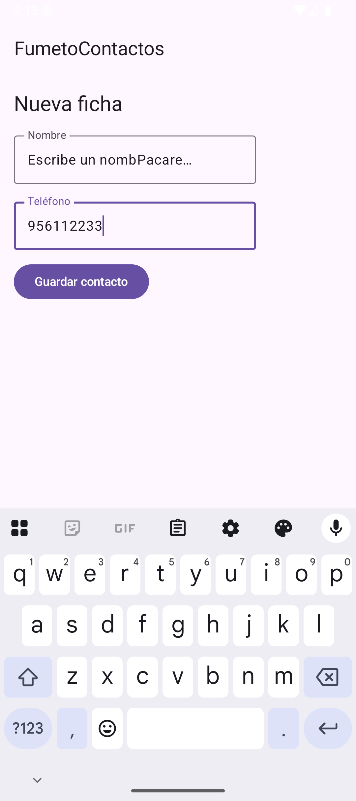

# PM-U2.3 - La app Compose: Scaffold, listas y formulario

Note: Recordar la frontera con DI: aquí la mirada está en la app; la estética de la interfaz ya la cuida la otra asignatura. Este tema es donde ambas se dan la mano.

---

## 1. Scaffold: el andamio estándar de una pantalla Android

Note: El PaddingValues del lambda es el fallo nº1 de los principiantes: fila tapada por la barra. Pedir que expliquen el FAB con un estado interno vs Activity.

- el lambda de contenido recibe un PaddingValues (el hueco que ocupan barra y FAB) que ESTÁ OBLIGADO aplicarse; si lo ignoras, tu primera fila nace e…
- añadir o borrar un elemento recompongo solo las filas afectadas — no un List normal dentro de un var, que no avisa a nadie
- el dueño del estado es la pantalla (y tras rotación… ya sabéis quién manda: el Bundle del 2.2)
- Multi-pantalla con Activities = tema 2.2; modos dentro de la misma Activity = esta app. La frontera la marca si la pantalla nueva merece su propia …


### Código 1 - La pantalla de casa (función completa, tal cual compila)

```kotlin
@OptIn(ExperimentalMaterial3Api::class)                  // TopAppBar es API experimental en M3
@Composable
fun EscenaCasa() {                                          // la home de la app: estructura Scaffold
    var nombreFormulario by remember { mutableStateOf("Escribe un nombre…") } // texto del campo (C12)
    var telefonoFormulario by remember { mutableStateOf("") }                 // teléfono (C12)
    val lista = remember { mutableStateListOf(*contactosIniciales.toTypedArray()) } // lista mutable en memoria
    var escena by remember { mutableStateOf(0) }            // 0 = lista | 1 = alta
    val contexto = LocalContext.current                     // para lanzar otras Activities

    Scaffold(                                               // andamio Material: barra + contenido + FAB
        topBar = {                                          // la barra de arriba
            TopAppBar(                                      // barra de título Material 3
                title = { Text("FumetoContactos") }         // nombre que ve el usuario
            )
        },
        floatingActionButton = {                            // el botón redondo flotante
            FloatingActionButton(                           // FAB de Material
                onClick = { escena = if (escena == 0) 1 else 0 }   // alterna lista ⇄ formulario
            ) {                                             // dentro del botón va su contenido
                Text(text = if (escena == 0) "+" else "✕",   // "+" para alta, "✕" para volver
                     fontSize = 28.sp)                        // grande y centrado
            }
        }
    ) { margen ->                                           // 'margen' = huecos que dejan barra y FAB
        when (escena) {
            1 -> FormularioAlta(                            // la pantalla de alta (C12)
                nombre = nombreFormulario,                  // estado del campo nombre
                telefono = telefonoFormulario,              // estado del campo teléfono
                onNombre = { nombreFormulario = it },        // el formulario NO posee el dato
                onTelefono = { telefonoFormulario = it },   // solo informa de cambios (hoisting)
                alGuardar = {                               // al pulsar Guardar:
                    lista.add(0, Contacto(nombreFormulario, telefonoFormulario)) // nuevo arriba
                    nombreFormulario = "Escribe un nombre…"  // limpiamos campos
                    telefonoFormulario = ""                  // y volvemos a la lista
                    escena = 0                               // pantalla de lista otra vez
                },
                margen = margen                             // respetamos el hueco de la barra
            )
            else -> ListaContactos(                         // la libreta (C10 y C11)
                lista = lista,                              // la pintamos desde el estado
                alMarcar = { i -> lista[i] = lista[i].copy(favorita = !lista[i].favorita) }, // toggle estrella
                alBorrar = { i -> lista.removeAt(i) },      // borrar de la lista = desaparece
                alAbrir = { c ->                            // C5: intent EXPLÍCITO a mi propia Activity
                    contexto.startActivity(                 // "quién" lo arreglo yo, sin preguntas
                        Intent(contexto, FichaActivity::class.java)   // destino: clase concreta
                            .putExtra(FichaActivity.EXTRA_NOMBRE, c.nombre)     // extra del nombre
                            .putExtra(FichaActivity.EXTRA_TELEFONO, c.telefono) // extra del teléfono
                    )
                },
                margen = margen
            )
        }
    }
}
```


Note: El PaddingValues del lambda es el fallo nº1 de los principiantes: fila tapada por la barra. Pedir que expliquen el FAB con un estado interno vs Activity.

### Pantalla de casa de FumetoContactos con TopAppBar, tarjetas 


Note: Que expliquen ellos lo que muestra la pantalla antes de que lo expliques tú.

---

## 2. LazyColumn: la lista que no se lo traga todo

Note: Ejercicio de escala: 6 contactos no prueban nada. Preguntar qué pasaría con 6.000 filas en una Column con scroll hasta la respuesta: 6.000 composiciones.

- key = { it.telefono } identifica cada fila entre recomposiciones: sin clave, al borrar una fila el sistema "descoloca" los estados internos (switch…
- la clave debe ser ÚNICA: dos contactos con el mismo teléfono cierran la app; en una app real, un id propio
- un hijo clicable consume el evento antes que el padre — por eso el Switch hace su onCheckedChange sin abrir la ficha de rebote


### Código 2 - La libreta Lazy (función completa)

```kotlin
@Composable
fun ListaContactos(
    lista: List<Contacto>,                                  // desde fuera: solo lectura
    alMarcar: (Int) -> Unit,                                // callback: "me han marcado la i"
    alBorrar: (Int) -> Unit,                                // callback: "han borrado la i"
    alAbrir: (Contacto) -> Unit,                            // callback: "quiero la ficha de este"
    margen: PaddingValues                                   // el margen del Scaffold
) {
    LazyColumn(                                             // LA lista: pinta solo lo que cabe en pantalla
        modifier = Modifier.fillMaxSize().padding(margen),  // ocupa todo + respeta barra/FAB
        contentPadding = PaddingValues(12.dp),              // aire alrededor del contenido
        verticalArrangement = Arrangement.spacedBy(8.dp)    // separación entre tarjetas
    ) {
        items(items = lista, key = { it.telefono }) { c ->  // una fila por contacto; clave = teléfono
            Card(                                           // tarjeta Material con sombra
                modifier = Modifier                         // el traje de la tarjeta:
                    .fillMaxWidth()                         // ancha como la pantalla
                    .clickable { alAbrir(c) }               // y pulsable por TODO: abre la ficha
            ) {
                Row(                                        // dentro: fila nombre+teléfono | acciones
                    modifier = Modifier.padding(12.dp),     // aire interior de la tarjeta
                    verticalAlignment = Alignment.CenterVertically // centrado vertical
                ) {
                    Column(Modifier.weight(1f)) {           // columna que ocupa el espacio que sobra
                        Text(c.nombre, fontWeight = FontWeight.Bold)          // nombre en negrita
                        Text(c.telefono, color = Color.Gray, fontSize = 13.sp) // teléfono discreto
                    }
                    Switch(                                 // la estrella en modo interruptor
                        checked = c.favorita,               // refleja el estado del dato
                        onCheckedChange = { alMarcar(lista.indexOf(c)) }      // avisa a la dueña del estado
                    )
                    Button(onClick = { alBorrar(lista.indexOf(c)) }) {        // botón borrar
                        Text("🗑")                                            // papelera, sin letra
                    }
                }
            }
        }
    }
}
```


Note: Ejercicio de escala: 6 contactos no prueban nada. Preguntar qué pasaría con 6.000 filas en una Column con scroll hasta la respuesta: 6.000 composiciones.

### Lista de contactos con tarjetas, switches y botones papelera


Note: Que expliquen ellos lo que muestra la pantalla antes de que lo expliques tú.

### Tras pulsar switches y una papelera: una tarjeta desaparecid


Note: Que expliquen ellos lo que muestra la pantalla antes de que lo expliques tú.

---

## 3. Formulario: validar en una línea, habilitar en otra

Note: El switch y la papelera en directo: borrar una fila SIN key y ver los estados saltar. Es la demo más visual del tema, no te la saltes.

- isError en el campo + enabled en el botón es la pareja canónica de validación: el campo informa, el botón decide. Nunca un Toast que grita cuando a…
- es lo que hace que el teclado no tape el botón. Es configuración de la Activity — territorio PMDM, no de DI


### Código 3 - El formulario de alta (función completa)

```kotlin
@Composable
fun FormularioAlta(
    nombre: String,                                         // el texto actual del campo
    telefono: String,                                       // el texto del teléfono
    onNombre: (String) -> Unit,                             // "el usuario ha tecleado X"
    onTelefono: (String) -> Unit,                           // ídem teléfono
    alGuardar: () -> Unit,                                  // pulsar Guardar
    margen: PaddingValues
) {
    val telefonoValido = telefono.length >= 9               // validación de una frase: 9 dígitos mínimo
    Column(                                                 // campos apilados
        modifier = Modifier.fillMaxSize().padding(margen).padding(16.dp)
            .verticalScroll(rememberScrollState()),         // por si el teclado tapa algo
        verticalArrangement = Arrangement.spacedBy(12.dp)   // respiro entre campos
    ) {
        Text("Nueva ficha", style = MaterialTheme.typography.headlineSmall) // cabecera del alta
        OutlinedTextField(                                  // campo con borde, estilo Material
            value = nombre,                                 // controlado por el estado de fuera
            onValueChange = onNombre,                       // cada tecla avisa
            label = { Text("Nombre") },                     // flotante por defecto
            isError = nombre.isBlank()                      // rojo si está vacío (sin sermones)
        )
        OutlinedTextField(
            value = telefono,
            onValueChange = onTelefono,
            label = { Text("Teléfono") },
            isError = telefono.isNotEmpty() && !telefonoValido // solo riñe si han escrito algo mal
        )
        Button(                                             // el disparo del alta
            onClick = alGuardar,                            // pide permiso a la dueña de la lista
            enabled = nombre.isNotBlank() && telefonoValido // sin nombre o teléfono corto: apagado
        ) { Text("Guardar contacto") }
    }
}
```


Note: El switch y la papelera en directo: borrar una fila SIN key y ver los estados saltar. Es la demo más visual del tema, no te la saltes.

### Formulario de alta con nombre tecleado, teléfono corto marca




Note: Que expliquen ellos lo que muestra la pantalla antes de que lo expliques tú.

---

## 4. Lo que este tema NO es de Desarrollo de Interfaces

Note: isError+enabled como pareja canónica. Repasar el teclado: enableEdgeToEdge() + Modifier.imePadding() (desde Android 15 adjustResize ya no basta); es configuración de la ventana de la Activity, territorio PMDM.

- | Pregunta | Territorio DI | Territorio PMDM (este tema) | |---|---|---| | ¿Dónde encaja un Button en una Row? | ✔ DI | — | | ¿Qué pasa en el proceso…

---

## 5. Autoevaluación

Note: La tabla de la frontera DI/PMDM: proyectarla y pedir un ejemplo propio por fila. Siguiente parada: el mini-proyecto, dos sesiones, defensa oral incluida.

- > [!] Pregunta 1 — Borras una fila del medio y, sin key, los switches "saltan" de contacto. Explica en dos líneas por qué. >> [!answer] >> Sin clave,…
- > [!] Pregunta 2 — ¿Por qué el botón de Guardar usa enabled en vez de validar en onClick con un mensaje? >> [!answer] >> Porque el botón apagado ES…
- > [!] Pregunta 3 — El FAB podría abrir la pantalla de alta como Activity. ¿Cuándo lo harías así? >> [!answer] >> Cuando la pantalla nueva deba tener…
