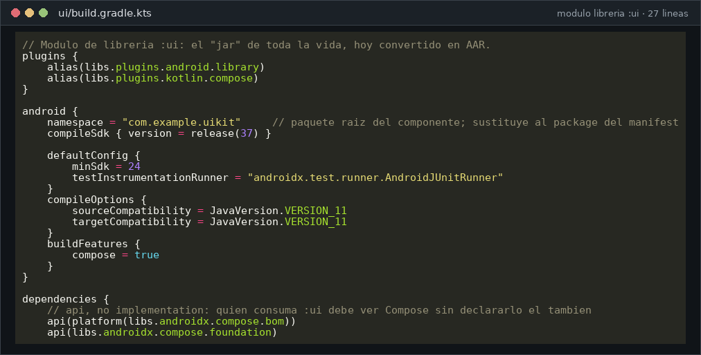
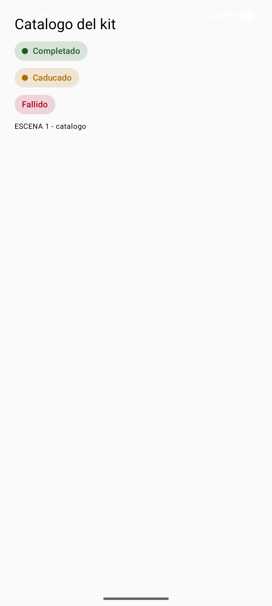

# DI · Unidad 4 — Creación de componentes visuales

<style>
.reveal .cc pre{width:63%;float:left;margin:0;font-size:.42em}
.reveal .cc pre code{max-height:500px}
.reveal .cc p:has(img){float:right;width:34%;margin:0}
.reveal .cc img{max-height:480px;margin:0}
.reveal table{font-size:.5em;margin:0 auto}
</style>

Note: Presentación-resumen de la teoría del Tema 4, en su mismo orden. Todo el tema se trabaja en el proyecto IsmaelUIKit: un módulo :ui con el kit de componentes y una app de demostración. Idea que deben llevarse: **dejar de usar componentes y empezar a fabricarlos, con propiedades, eventos, pruebas, documentación y paquete**.

---

## Del uso a la fabricación

- Hasta ahora **usabas** componentes: `Button`, `TextField`, `Card`
- Ahora los **fabricas**: los que la librería estándar no trae
- Mismo trabajo de ingeniería que con JavaBeans y Swing…
- …con herramientas de 2026: **Compose, módulo de librería y pruebas**

Note: El trabajo es el de siempre: crear una pieza, darle propiedades, probarla, documentarla y empaquetarla para reutilizarla. Lo que cambia son las herramientas. En Swing era un JavaBean, Graphics y un JAR en la paleta de Eclipse; hoy es una función @Composable, DrawScope y un AAR.


### RA3 y sus criterios

| CE | Criterio | Dónde se trabaja |
|---|---|---|
| a | Herramientas para diseñar y probar componentes | Previews y herramientas |
| b | Crear componentes visuales | `BadgeEstado`, `LienzoFiguras` |
| c | Propiedades con valores por defecto | Parámetros con defecto |
| d | Eventos y acciones asociadas | `SelectorMes`, caso del abono |
| e | Pruebas unitarias de los componentes | `BadgeEstadoTest` |
| f | Documentar los componentes | KDoc y previews |
| g | Empaquetar componentes | Módulo `:ui` y su AAR |
| h | Aplicaciones que usan los componentes | App de demostración |

Note: El tema está ordenado por los ocho criterios del RA3. Cada uno tiene su apartado y su código ejecutado, así que pueden usar esta tabla como índice de estudio.


### Índice (I)

- 1. Introducción y contextualización práctica
- 2. Desarrollo de software en componentes
- 3. Concepto de componente y características
- 4. Propiedades y atributos
- 5. El proyecto `IsmaelUIKit`
- 6. Crear componentes: `BadgeEstado` y `SelectorMes`
- 7. Herramientas para diseñar y probar

Note: Primera mitad: qué es un componente, qué se le exige y cómo se traducen las propiedades de JavaBean a parámetros de Compose. Después, los dos primeros componentes del kit.


### Índice (II)

- 8. Integración y empaquetado
- 9. Dibujar: de `Graphics` a `DrawScope`
- 10. Imágenes en el componente
- 11. Caso práctico 1: recarga del abono
- 12. Pruebas unitarias
- 13. Documentar componentes
- 14. Caso práctico 2 · 15. Errores típicos · 16. Resumen

Note: Segunda mitad: empaquetar el kit, dibujar a mano, imágenes, los dos casos prácticos, pruebas y documentación. Termina con la tabla de errores típicos, que es la que más se pregunta.

---

## 1. Introducción y contextualización práctica

 <!-- .element height="45%" -->

- ¿Componente o copiar y pegar?
- Aparece **dos veces** igual → componente
- Cambia color, texto o tamaño pero no la estructura → componente **con parámetros**
- Lo necesita **otro equipo u otro proyecto** → **módulo de librería** aparte

Note: La regla práctica para decidir cuándo merece la pena crear un componente. Escribirlo una vez y reutilizarlo diez veces es todo el sentido del tema.


### 💡 Idea central del tema

- Un componente es **código probado y reutilizable**
- Se comunica por su **interfaz pública**:
- **parámetros** de entrada
- **eventos** de salida
- Todo lo demás es interno y puede cambiar sin romper a nadie

Note: Esta es la diapositiva que tienen que recordar. **Parámetros que entran y eventos que salen.** Si algo no está en esa interfaz pública, es un detalle interno.

---

## 2. Desarrollo de software en componentes

| Ventaja | En el día a día |
|---|---|
| Reutilización | Se escribe una vez y se usa en todas las pantallas |
| Fiabilidad | Ya se probó; no se prueba desde cero |
| Coste y plazo | Montar pantallas pasa de "escribir" a "componer" |
| Consistencia | Un solo botón de "aceptar", igual en toda la app |
| Mantenimiento | Cambiar un color es tocar una línea, no veinte pantallas |

Note: Programar en componentes es ensamblar piezas hechas. Las ventajas son siempre las mismas; insistir en el mantenimiento: cambiar el verde de "Completado" es una línea.


### Antes y ahora

| Java / Swing | En 2026 |
|---|---|
| JavaBean en un `.jar` | `@Composable` en un **módulo de librería** |
| Añadir el JAR a la paleta | `implementation(project(":ui"))` |
| `.jar` (solo clases) | **`.aar`** (clases + recursos + manifiesto) |
| Copiar el JAR a un compañero | Publicar en un repositorio **Maven** |

Note: La tabla de traducción del empaquetado. El AAR es el JAR de Android: además de clases lleva recursos y manifiesto.

---

## 3. Concepto de componente y características

1. **Interfaz pública clara**
2. **Valores por defecto sensatos**: `BadgeEstado(Estado.OK)`
3. **Sin efectos sorpresa**: no escribe ficheros ni lanza red
4. **Comunicación por eventos**: lambdas como `onSeleccion`
5. **Aislado y portable**: no depende de una Activity
6. **Documentado y probado**

Note: Seis exigencias para que una pieza merezca llamarse componente. En Compose un componente **es una función @Composable**: no se hereda de ninguna clase base ni se registra en ninguna paleta.

---

## 4. Propiedades y atributos

| JavaBean | Compose | Ejemplo del tema |
|---|---|---|
| Propiedad con getter/setter | Parámetro | `style: TextStyle` |
| Valor por defecto en el setter | Valor por defecto del parámetro | `texto: String = estado.etiqueta` |
| Propiedad booleana opcional | `Boolean` con defecto | `conPunto: Boolean = true` |
| Color calculado | Expresión en el defecto | `estado.acento.copy(alpha = 0.15f)` |
| `paintComponent(...)` | Cuerpo de la `@Composable` | El `Row` de la píldora |
| `ActionListener` | Parámetro lambda | `onSeleccion: (Int) -> Unit` |

Note: En Compose **las propiedades son parámetros de la función** y el valor por defecto es el del parámetro. No hay una instancia viva a la que ponerle valores: cuando cambia un dato, la función se vuelve a ejecutar.


### Tres detalles de examen

- **`modifier: Modifier = Modifier`** siempre, primer parámetro opcional
- Un parámetro con defecto **es documentación**: dice qué es opcional
- Lo que se calcula de otra propiedad, **se calcula en el defecto**

Note: El modifier es lo que permite a quien te llama colocar y dar tamaño a tu componente sin tocarte el código. Sin él, el componente se pone donde tú quisiste.


### JavaBean: la idea se queda, la sintaxis no

```kotlin
// 1) JavaBean clásico: 8 líneas para un dato
public class Badge {
    private String texto;
    public String getTexto() { return texto; }
    public void setTexto(String t) { texto = t; }
}
// 2) Kotlin: propiedad, getter y setter en una línea
class Badge { var texto: String = "" }
// 3) Compose: la propiedad es un parámetro de la función que dibuja
@Composable fun Badge(texto: String = "") { /* ... */ }
```

Note: De JavaBean nos queda la idea: datos públicos bien definidos, constructor sencillo y comportamiento predecible. Kotlin genera getters y setters solo, y en Compose ni siquiera hacen falta.

---

## 5. El proyecto `IsmaelUIKit`

- Módulo **`:app`**: la aplicación de demostración
- Módulo **`:ui`**: el kit de componentes
- `BadgeEstado` · `SelectorMes` · `LienzoFiguras` · `Estado`
- Pruebas: `BadgeEstadoTest`

```kotlin
// settings.gradle.kts
rootProject.name = "IsmaelUIKit"
include(":app")   // la aplicación de demostración
include(":ui")    // el kit de componentes
```

Note: Dos módulos: el equivalente moderno a "proyecto de componente + proyecto de aplicación". El settings.gradle.kts y el build del módulo :ui son lo que hoy hace de "añadir a la paleta".


### El módulo de librería

 <!-- .element height="70%" -->

Note: De estas 27 líneas sale el AAR reutilizable (CE g). Señalar el plugin android.library y las dependencias api de Compose; se explican en el apartado 8.

---

## 6. Crear un componente: `BadgeEstado`

- Una píldora de estado con **punto de color** y **texto**
- Se parte de piezas existentes: `Row`, `Text`, `Box`
- Las propiedades viajan **dentro del estado** (`enum`)

```kotlin
enum class Estado(val etiqueta: String, val acento: Color, val mensaje: String) {
    OK("Completado", Color(0xFF1B5E20L), "Todo en orden"),
    AVISO("Revisa", Color(0xFFB26A00L), "Hay algo que conviene mirar"),
    ERROR("Fallido", Color(0xFFB00020L), "Algo no ha funcionado"),
}
```

Note: El enum trae las propiedades puestas: color y mensaje viven dentro del estado, no repartidos por las pantallas. Cambiar el verde de "Completado" es tocar una línea.


### Código 1 · `BadgeEstado`
<!-- .slide: class="cc" -->

```kotlin
@Composable
fun BadgeEstado(
    estado: Estado,
    texto: String = estado.etiqueta,
    modifier: Modifier = Modifier,
    conPunto: Boolean = true,
    relleno: Color = estado.acento.copy(alpha = 0.15f),
) {
    Row(
        modifier = modifier
            .testTag("badge_" + estado.name)       // nombre estable para las pruebas
            .clip(RoundedCornerShape(percent = 50)) // forma de pastilla
            .background(relleno)
            .padding(horizontal = 12.dp, vertical = 6.dp),
        verticalAlignment = Alignment.CenterVertically,
        horizontalArrangement = Arrangement.spacedBy(8.dp),
    ) {
        if (conPunto) Box(Modifier.size(10.dp).clip(CircleShape)
            .background(estado.acento))
        Text(texto, color = estado.acento,
             style = MaterialTheme.typography.labelLarge)
    }
}
// … (código completo en la teoría)
```



Note: Un solo dato obligatorio, el estado; todo lo demás tiene defecto. En la captura: la primera píldora usa todos los defectos, la segunda solo cambia el texto y la tercera apaga el punto con conPunto = false.


### Un componente sin estado propio

- No sabe en qué pantalla está
- No sabe qué idioma habla
- **No crea estado propio**: solo dibuja lo que le cuentan
- El estado lo decide **quien lo usa**

Note: Un componente sin estado propio es más fácil de reutilizar. Esta idea vuelve en el caso práctico del abono.


### Componente con evento: `SelectorMes`

- El `JMonthChooser` de Swing, escrito por nosotros
- Estado **interno** solo para lo interno: si el menú está abierto
- **Devuelve información** a la pantalla con un evento
- `onSeleccion` propaga el **número** de mes, no el nombre

Note: En Swing se compraba un componente de terceros y se añadía a la paleta. Aquí lo escribimos y la diferencia con el badge es que **avisa al exterior** con un evento.


### Código 2 · `SelectorMes`
<!-- .slide: class="cc" -->

```kotlin
@Composable
fun SelectorMes(
    mesSeleccionado: Int?,
    onSeleccion: (Int) -> Unit,      // el evento
    modifier: Modifier = Modifier,
    textoVacio: String = "Elige un mes",
) {
    var abierto by remember { mutableIntStateOf(0) } // estado interno
    Box(modifier) {
        OutlinedButton(onClick = { abierto = 1 },
            modifier = Modifier.testTag("selector_mes")) {
            Text(mesSeleccionado?.let { MESES[it - 1] } ?: textoVacio)
        }
        DropdownMenu(expanded = abierto == 1,
                     onDismissRequest = { abierto = 0 }) {
            MESES.forEachIndexed { indice, nombre ->
                DropdownMenuItem(text = { Text(nombre) }, onClick = {
                    abierto = 0
                    onSeleccion(indice + 1)  // la pantalla decide qué hacer
                })
            }
        }
    }
}
// … (código completo en la teoría)
```


Note: El control es "controlado": manda quien lo usa, que le pasa el mes seleccionado. El componente solo guarda si el menú está abierto y dispara onSeleccion con el número del mes (CE d).


### Un `@Preview` por estado

```kotlin
class ProveedorEstado : PreviewParameterProvider<Estado> {
    override val values = sequenceOf(Estado.OK, Estado.AVISO, Estado.ERROR)
}

@Preview(name = "BadgeEstado · parametrizado")
@Composable
private fun VistaPreviaParametrizada(
    @PreviewParameter(ProveedorEstado::class) estado: Estado,
) {
    BadgeEstado(estado = estado)   // una preview por cada valor
}
```

Note: Costumbre que separa un componente bien hecho de uno aceptable: una preview por estado. Cuando los estados salen de una lista, @PreviewParameter genera una preview por cada valor sin arrancar el emulador.

---

## 7. Herramientas para diseñar y probar (CE a)

| Herramienta | Qué hace |
|---|---|
| `@Preview` y variantes | Dibuja el componente sin arrancar el móvil |
| `@PreviewParameter` | Una preview por cada valor de prueba |
| `uiMode = UI_MODE_NIGHT_YES` | Preview en tema oscuro |
| Layout Inspector | Árbol real de la interfaz: medidas y colores |
| `createComposeRule` | Pruebas automáticas por `testTag` o texto |
| lint / Detekt | Avisos de estilo y errores típicos |
| Figma, Inkscape, Vector Asset Studio | Material gráfico que pasa a `ImageVector` |

Note: Los editores de imágenes de manual siguen sirviendo para crear el material gráfico. Para diseñar y probar el componente en sí, estas son las herramientas actuales.


### El ciclo de un componente

 <!-- .element height="55%" -->

Note: Diseñar, previsualizar, ejecutar, medir y probar. Ninguna de las cuatro primeras fases necesita un dispositivo.

---

## 8. Integración y empaquetado (CE g)

- Módulo **`:ui`** con `com.android.library` → genera un **`.aar`**
- Quien lo usa: `implementation(project(":ui"))` y listo
- Dentro del kit, Compose va con **`api`**, no `implementation`
- `api` **filtra** la dependencia a quien te usa; `implementation` la **esconde**
- Para otro proyecto: publicar en un repositorio **Maven**

Note: La paleta de hoy es el bloque dependencies de Gradle. Insistir en api frente a implementation: un kit de UI usa api para Compose porque quien lo consume también compila contra Compose.


### Publicar el kit

```kotlin
plugins { id("maven-publish") }

publishing {
    publications {
        create<MavenPublication>("release") {
            groupId = "com.example"
            artifactId = "uikit"
            version = "1.0.0"                 // mayor.menor.parche
            from(components["release"])       // el AAR del módulo
        }
    }
}
// ./gradlew :ui:publishToMavenLocal
// En el otro proyecto: implementation("com.example:uikit:1.0.0")
```

Note: Con maven-publish el kit se publica en Maven Local, GitHub Packages o cualquier repositorio Maven, y otro proyecto lo consume con una sola línea.

---

## 9. Dibujar: de `Graphics` a `DrawScope`

| Java `Graphics` | Compose `DrawScope` |
|---|---|
| `paint(Graphics g)` | `Canvas { }` / `Modifier.drawBehind { }` |
| `g.setColor(...)` | `color = ...` en cada figura |
| `g.fillOval(150, 70, 50, 70)` | `drawOval(color, Offset(150f, 70f), Size(50f, 70f))` |
| `g.fillRect(350, 70, 50, 70)` | `drawRect(color, Offset(350f, 70f), Size(50f, 70f))` |
| `g.fillPolygon(xs, ys, 3)` | `Path` + `drawPath(...)` |
| `g.drawImage(...)` | `drawImage(...)` |
| Pluma gruesa | `Stroke(width, cap = StrokeCap.Round)` y `Brush` |

Note: java.awt.Graphics sigue siendo la idea de referencia: un lienzo, un color, coordenadas y figuras. No hay repaint(): al cambiar el estado se vuelve a dibujar. El color es un argumento de cada figura, no un estado del pincel.


### Código 3 · `LienzoFiguras`
<!-- .slide: class="cc" -->

```kotlin
@Composable
fun LienzoFiguras(modifier: Modifier = Modifier) {
    Canvas(modifier.fillMaxSize().background(Color.White)) {
        drawOval(Color(0xFF2E7D32L), Offset(150f, 70f), Size(50f, 70f))
        drawRect(Color(0xFFF9A825L), Offset(350f, 70f), Size(50f, 70f))
        val triangulo = Path().apply {
            moveTo(250f, 200f); lineTo(300f, 270f)
            lineTo(200f, 270f); close()
        }
        drawPath(triangulo, color = Color(0xFFEF6C00L))
        val via = Path().apply { moveTo(60f, 360f); lineTo(320f, 360f) }
        drawPath(via,
            brush = Brush.linearGradient(listOf(Color(0xFF0277BDL),
                Color(0xFF4FC3F7L)), Offset(60f, 360f), Offset(320f, 360f)),
            style = Stroke(width = 10f, cap = StrokeCap.Round))
        // … estaciones: círculos blancos con borde
    }
}
// … (código completo en la teoría)
```


Note: Mismas cifras que el ejercicio clásico de AWT: óvalo verde en (150, 70) de 50x70, rectángulo amarillo 200 píxeles a la derecha y triángulo naranja con un Path. Además, una línea de metro con degradado y trazo redondeado.

---

## 10. Imágenes en el componente

| Caso | Cómo |
|---|---|
| Icono o logo **vectorial** | `ImageVector` (desde SVG) o Vector Asset Studio |
| Imagen **incluida** (PNG, WebP) | `Image(painterResource(R.drawable.x))` |
| Imagen **remota** | Carga asíncrona: Coil `AsyncImage` |

- `contentDescription = null` **solo** en imágenes decorativas
- Si la imagen informa de algo, el texto es **obligatorio** (RA4)

Note: Tres casos y una herramienta para cada uno. La imagen incluida viaja dentro del AAR; la remota necesita hueco mientras carga y aviso si falla. Y accesibilidad: sin contentDescription en una imagen que informa, el componente no pasa la revisión.

---

## 11. Caso práctico 1: recarga del abono
<!-- .slide: class="cc" -->

```kotlin
@Composable
private fun EscenaAbono() {
    var mes by remember { mutableStateOf<Int?>(null) } // estado de la PANTALLA
    Column(Modifier.fillMaxSize().padding(24.dp)) {
        Text("Recarga del abono")
        SelectorMes(
            mesSeleccionado = mes,
            onSeleccion = { elegido -> mes = elegido }, // el evento sube
        )
        Card {
            Text(if (mes == null) "Selecciona el mes que quieres recargar"
                 else "Recargado: ${MESES[mes!! - 1]} · 20,00 EUR")
            BadgeEstado(
                estado = if (mes == null) Estado.AVISO else Estado.OK,
                texto = if (mes == null) "Falta el mes" else Estado.OK.etiqueta,
            )
        }
    }
}
// … (código completo en la teoría)
```


Note: La pantalla no dibuja nada a mano: compone piezas del kit. Al elegir un mes, el evento cambia el estado y la tarjeta pasa a "Recargado: Marzo · 20,00 EUR" con el badge verde.


### El detalle con nota

- **El componente no sabe qué es un abono**
- `SelectorMes` solo sabe de meses
- El precio y la confirmación son de la **pantalla**
- Por eso el mismo desplegable sirve en una cita, una reserva o una matrícula

Note: Este reparto es lo que permite reutilizar el componente. Si SelectorMes supiera de abonos, no serviría para nada más.

---

## 12. Pruebas unitarias del componente (CE e)

- No se comprueba "que el código se ejecuta"
- Se comprueba **que el usuario ve lo correcto**
- `createComposeRule`: se monta el componente
- Se busca por **`testTag`** o por texto y se afirma sobre lo visible

Note: Una prueba de componente afirma sobre lo que se ve. El testTag es un nombre estable que no cambia con el idioma.


### Código 4 · `BadgeEstadoTest`

```kotlin
class BadgeEstadoTest {
    @get:Rule val regla = createComposeRule()

    @Test fun muestraLaEtiquetaDeSuEstado() {
        regla.setContent { BadgeEstado(estado = Estado.OK) }
        regla.onNodeWithTag("badge_OK").assertIsDisplayed()
        regla.onNodeWithText("Completado").assertIsDisplayed()
    }

    @Test fun elTextoPersonalizadoGanaALaEtiqueta() {
        regla.setContent { BadgeEstado(estado = Estado.ERROR, texto = "Caducado") }
        regla.onNodeWithText("Caducado").assertIsDisplayed()
        regla.onNodeWithText("Fallido").assertDoesNotExist()
    }
}
// Resultado:  com.example.uikit.BadgeEstadoTest:..   OK (2 tests)
```

Note: Cada punto de la salida es una prueba que pasa; una F sería un fallo. Que "Fallido" no aparezca cuando se sustituye el texto demuestra que la propiedad funciona: **afirmar la ausencia es más útil que contar píxeles**.

---

## 13. Documentar componentes (CE f)

1. **KDoc** con `@param` en cada propiedad: la ayuda del autocompletado
2. **Previews como documentación viva**: una por estado
3. **Dokka**: exporta los KDoc a HTML o Markdown (el Javadoc de Kotlin)

```kotlin
/**
 * Componente: chivato de estado con punto de color y texto.
 * @param estado único dato obligatorio
 * @param texto sustituye la etiqueta sin crear otro componente
 * @param conPunto apaga el punto en listas donde sobra
 */
```

Note: Los dos primeros niveles no cuestan trabajo porque ya los están escribiendo. Documentar el componente, no la app.

---

## 14. Caso práctico 2: formas básicas

| Swing | Compose |
|---|---|
| Sobrescribir `paint` | Abrir `Canvas { }` |
| Llamar a `super.paint(g)` | `Modifier.background(Color.White)` |
| Verde y `fillOval(150, 70, 50, 70)` | `drawOval(...)` |
| Amarillo y `fillRect(350, 70, 50, 70)` | `drawRect(...)` |
| Naranja y `fillPolygon` | `Path` + `drawPath(...)` |

Note: El caso práctico clásico de Swing se resuelve con el Código 3, con las mismas cifras. El resultado es la captura del apartado 9.

---

## 15. Errores típicos al crear componentes

| Error | Solución |
|---|---|
| No aceptar `modifier` | `modifier: Modifier = Modifier` aplicado al contenedor raíz |
| Meter `padding` "porque queda bien" | El espacio exterior lo pone el llamador |
| Guardar estado que no es tuyo | Estado interno solo para lo interno; lo demás, parámetro + evento |
| `implementation` donde toca `api` | `api` para la interfaz pública del kit |
| Sin `testTag` | `testTag` estables en las pruebas |
| Depender de una clase de la app | El kit no importa nada de `:app` |

Note: Esta tabla es la que más se pregunta. Que identifiquen cada error por su síntoma: un componente que no se puede colocar, que se descoloca, que "se acuerda" de cosas al girar o un módulo :ui que no compila solo.

---

## 16. Resumen del tema

- **Componente** = `@Composable` con parámetros de entrada y eventos de salida
- **Propiedades** = parámetros con **valor por defecto**; `modifier` siempre
- **Diseño y prueba sin móvil**: `@Preview`, `@PreviewParameter`, Layout Inspector
- **Pruebas** con `createComposeRule` sobre lo visible
- **Dibujo**: `Canvas` y `DrawScope` son el `Graphics` de hoy
- **Empaquetado**: módulo `:ui` → `.aar`; `api` filtra, `implementation` esconde
- **Documentación**: KDoc + una preview por estado + Dokka

Note: Cerrar repasando los ocho criterios del RA3 con cada línea del resumen. El objetivo: **fabricar componentes con el mismo rigor que un fabricante de componentes**.


### Bibliografía y fuentes

- Android Developers — *Jetpack Compose*, *Previews*, *Layout Inspector*
- Android Developers — *Compose Testing* · *Graphics: DrawScope*
- Android Developers — *Android library (AAR)* · Gradle — *maven-publish*
- JetBrains — *Dokka* · Oracle — *JavaBeans*, *java.awt.Graphics*
- RD 405/2023 — módulo 0488, **RA3**

Note: Todo el código del tema está en la web del módulo, comentado línea a línea y con sus capturas. Las fuentes son la documentación oficial de Android, Gradle y JetBrains, y la especificación clásica de JavaBeans como referencia histórica.


### ¡Gracias por vuestra colaboración!

- Próxima parada: explotación de componentes (eventos, estado y pruebas)
- Material completo en la web del módulo
- ¡A fabricar componentes!

Note: Cierre: dudas individuales al salir. En la unidad 5 los componentes que han fabricado reciben eventos de verdad y se prueban como parte de una aplicación.
