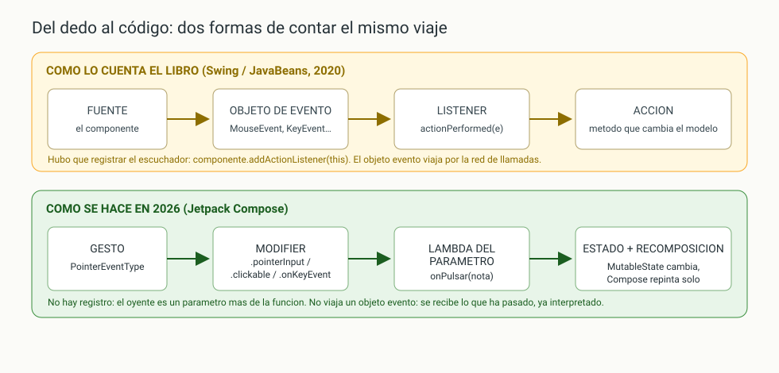
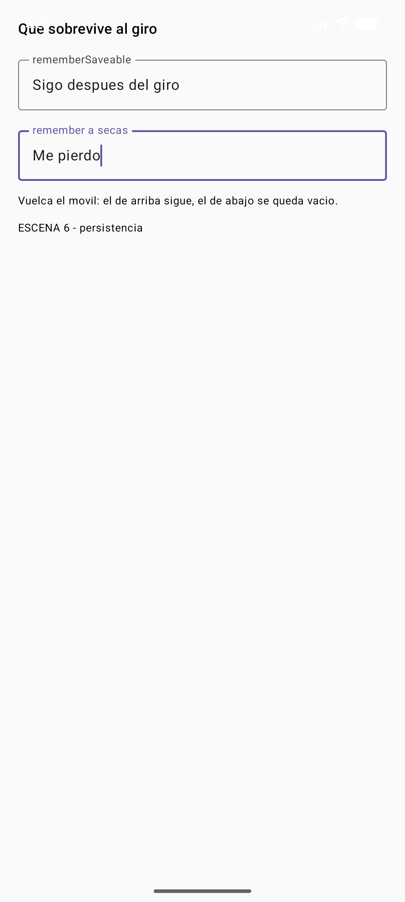
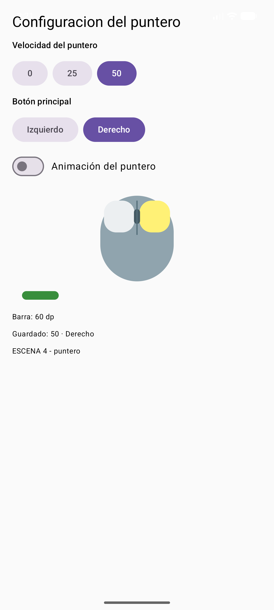
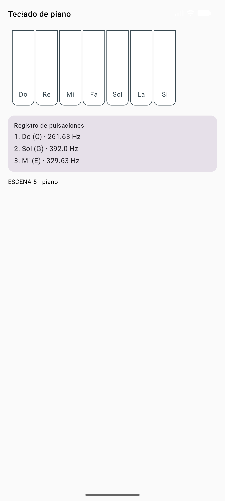

# DI · Unidad 5 — Explotación de componentes visuales

<style>
.reveal .cc pre{width:63%;float:left;margin:0;font-size:.42em}
.reveal .cc pre code{max-height:500px}
.reveal .cc p:has(img){float:right;width:34%;margin:0}
.reveal .cc img{max-height:480px;margin:0}
.reveal table{font-size:.5em;margin:0 auto}
</style>

Note: Presentación-resumen de la teoría del Tema 5, en su mismo orden. Se trabaja sobre el proyecto IsmaelUIKit de la UD4, ampliado con dos componentes nuevos: PanelPuntero y Tecla. Idea que deben llevarse: **un componente explotado responde, recuerda, se deja inspeccionar y tiene pruebas**.

---

## De fabricar a explotar

- En la UD4 **fabricaste** componentes
- Ahora los **explotas**: que respondan, recuerden y se prueben
- Swing: `MouseListener`, `KeyListener`, `ActionListener`, JUnit
- 2026: `Modifier` de gesto, `rememberSaveable` + `Saver`, Compose Testing

Note: El trabajo es el mismo que en Swing: decidir a qué eventos responde cada pieza, conectarles la acción, guardar el estado, probarlo y documentarlo. Cambian las herramientas.


### Criterios que trabaja

| CE | Criterio | Dónde |
|---|---|---|
| RA3 d | Eventos del componente y sus acciones | Tabla de eventos, `Tecla`, casos prácticos |
| RA3 e | Pruebas unitarias de los componentes | Tres clases de prueba |
| RA1 g | Asociar acciones a los eventos | Flujo de asociación |
| RA3 c | Propiedades con valores por defecto | `ConfigPuntero` inmutable |
| RA3 h | Aplicaciones que usan los componentes | Escenas nuevas de la app |

Note: Dos criterios del RA3 que en la UD4 quedaron abiertos se cierran aquí, más uno del RA1: asociar acciones a eventos.


### Índice

- 1-2. El componente explotado: introspección y persistencia
- 3. Pruebas unitarias e instrumentadas
- 4-6. Eventos: tabla de eventos, listeners de Swing, ratón, foco y teclado
- 7. Asociación de acciones a eventos
- 8. Propiedades en un componente con estado
- 9-10. Casos prácticos: configuración del puntero y teclado de piano
- 11-13. Errores típicos, verificación y resumen

Note: Primero las cuatro características del componente explotado; después eventos y acciones, que es el núcleo del tema; y los dos casos prácticos clásicos traducidos a Compose.

---

## 1. El componente explotado cumple cuatro cosas

1. **Responde**: a los eventos que le interesan, con una acción concreta
2. **Recuerda**: su estado sobrevive al giro de pantalla
3. **Se deja mirar**: Layout Inspector, `uiautomator`, lector de pantalla
4. **Se prueba**: pruebas que fallan si algo se rompe

Note: Las cuatro cosas, no dos. Esta lista es el esquema de todo el tema.


### El mismo viaje, dos épocas

 <!-- .element height="55%" -->

Note: Arriba el modelo de Swing: fuente, objeto de evento, listener y acción. Abajo el de Compose: gesto, Modifier, lambda y estado. En los dos, un componente detecta, avisa y alguien actúa.

---

## 2.1. Introspección: el árbol de semántica

- Antes: `Introspector.getBeanInfo(clase)` y reflexión
- Hoy: el **árbol de semántica** que Compose mantiene en paralelo
- Lo leen **TalkBack**, las **pruebas** y **`uiautomator`**
- Cada nodo declara rol, contenido, estado, foco…

```kotlin
Box(modifier = Modifier.semantics { testTagsAsResourceId = true }) {
    // los testTag salen como resource-id en uiautomator
}
```

Note: Lo que un examinador entiende hoy por introspección de una interfaz es el árbol de semántica. Con una línea en la raíz, los testTag de las pruebas aparecen como resource-id en el volcado de uiautomator, desde fuera del proceso.


### Lo que se ve desde fuera

```xml
<node resource-id="velocidad-50" clickable="true"
      bounds="[476,288][670,432]" />
<node resource-id="animacion" checkable="true" checked="false"
      bounds="[60,744][216,888]" />
<node resource-id="tecla-Do" content-desc="Tecla Do"
      bounds="[72,180][204,630]" />
```

- **Nombre estable** para las pruebas (no depende del idioma)
- **Caja de toque** (mínimo 48 dp de lado)
- **Estado accesible**: `checkable`, `checked`, `content-desc`

Note: Volcado real con adb shell uiautomator dump. Un componente sin contentDescription en lo que informa de algo es invisible para un usuario con lector de pantalla. En los botones lo aporta el Text hijo; la tecla se pinta a sí misma y lo necesita.

---

## 2.2. Persistencia del componente

- Al girar, Android **destruye y recrea** la actividad
- `remember` vive mientras vive la **composición**
- `rememberSaveable` sobrevive porque viaja en el **`Bundle`**
- Tipos propios: un **`Saver`** que los reduce y los reconstruye

```kotlin
var sobrevive by rememberSaveable { mutableStateOf("") } // pasa por el Bundle
var sePierde by remember { mutableStateOf("") }          // solo la composición
```

Note: El Saver es el papel que jugaba Serializable o persistState en AWT, pero escrito una vez junto al tipo de dato. En el Bundle solo va lo que el usuario ha puesto o elegido, no lo que se puede volver a pedir.


### Comprobado en el emulador

 <!-- .element height="40%" -->
 <!-- .element height="40%" -->

Note: Antes del giro los dos campos tienen texto. Después, la actividad se ha recreado: el campo con rememberSaveable sigue entero y el de remember ha vuelto a nacer vacío. Se giró con adb shell settings put system user_rotation 1.

---

## 3. Pruebas: dónde se escriben

| | JVM (`src/test`) | Instrumentadas (`src/androidTest`) |
|---|---|---|
| Dónde corren | En el portátil | En el dispositivo o emulador |
| Velocidad | Milisegundos | Segundos |
| Qué tocan | Lógica pura, validaciones | Interfaz real, gestos, semántica |
| En el tema | `ConfigPunteroTest` | `TeclaEventosTest`, `PanelPunteroTest` |

- Si la prueba necesita **ver o tocar**, va a `androidTest`
- Si solo necesita **pensar**, va a `test`

Note: El esquema de JUnit no ha cambiado; cambian la ubicación y el alcance. Por eso el Saver y el parser deVelocidad son funciones normales: se pueden probar en la JVM sin dispositivo.


### El vocabulario de Compose Testing

| Quiero | Cómo |
|---|---|
| Montar el componente | `regla.setContent { Tecla(...) }` |
| Buscarlo sin depender del texto | `onNodeWithTag("tecla-Do")` |
| Comprobar que se ve | `.assertIsDisplayed()` |
| Hacer un clic | `.performClick()` |
| Hacer un gesto real | `.performTouchInput { click() }` |
| Leer la semántica | `.fetchSemanticsNode().config[...]` |

Note: Las anotaciones y aserciones son las de siempre: @Test, @Before, assertEquals, assertThrows. Lo nuevo es este vocabulario.


### Código 7 · Pruebas (extracto)

```kotlin
@Test fun alPulsarLaTeclaSeDisparaElEventoConSuNota() {
    var tocada: Nota? = null
    regla.setContent { Tecla(ESCALA.first(), presionada = false,
                             onPulsar = { tocada = it }, onSoltar = { }) }
    regla.onNodeWithTag("tecla-Do").performTouchInput { click() }
    assertEquals("Do", tocada?.nombre)
}

@Test fun rechazaUnaVelocidadQueNoExiste() {
    val error = assertThrows(IllegalArgumentException::class.java) {
        ConfigPuntero.deVelocidad("75")
    }
    assertEquals("Velocidad no admitida: 75", error.message)
}
// … (código completo en la teoría)
```

Note: Tres detalles que valen punto: la regla createComposeRule levanta la composición; se afirma sobre la etiqueta y el estado, no sobre píxeles; y assertThrows también prueba el mensaje de error.

---

## 4. Eventos: fuente, objeto y listener

- Tres piezas: **fuente**, **objeto de evento** y **listener**
- En Compose no se registran escuchadores
- El listener es un **parámetro de la función**
- El contrato se declara en la **firma**:

```kotlin
fun PanelPuntero(configuracion: ConfigPuntero,
                 onCambio: (ConfigPuntero) -> Unit, ...)
```

Note: Con esa firma está dicho todo: el componente no cambia nada por dentro, devuelve la configuración completa cuando el usuario toca, y no sabe qué hará el llamador con ella.


### 4.1. Qué eventos tiene cada componente

| Componente | Eventos | Acción razonable |
|---|---|---|
| `Button` | `onClick` | Emitir el evento propio |
| `Switch` | `onCheckedChange` | Copiar la configuración con el booleano |
| `OutlinedTextField` | `onValueChange` | Validar y escribir si es válido |
| `Slider` | `onValueChange`, `onValueChangeFinished` | Previsualizar y confirmar al soltar |
| `Tecla` (propio) | `onPulsar`, `onSoltar` | Sonar y pintar la tecla hundida |
| `FiguraRaton` (propio) | **ninguno: solo recibe** | Pintar lo que le pasan |

Note: La fila de FiguraRaton es la importante: un componente de dibujo no necesita eventos. Cuanta más lógica de presentación esté en componentes que solo reciben parámetros, menos pruebas hacen falta y menos fallos hay.

---

## 5. Los listeners de Swing, traducidos

| Swing | Compose |
|---|---|
| `ActionListener.actionPerformed` | `onClick = { ... }` |
| `KeyListener` | `Modifier.onPreviewKeyEvent` / `onKeyEvent` |
| `MouseListener` | `Modifier.clickable`, `hoverable` |
| `MouseMotionListener` | `pointerInput { detectDragGestures { } }` |
| `FocusListener` | `Modifier.onFocusEvent`, `FocusRequester` |
| `ChangeListener` (`JSpinner`) | `onValueChange` |
| `ItemListener` (`JComboBox`) | `onClick` en cada opción |

Note: Esta tabla cae en las dos direcciones del examen. Todo evento en Compose se gestiona igual: **un Modifier que observa y una lambda que actúa**. Lo único que cambia es el Modifier.


### Código 4 · `Tecla` con `pointerInput`
<!-- .slide: class="cc" -->

```kotlin
@Composable
fun Tecla(nota: Nota, presionada: Boolean,
          onPulsar: (Nota) -> Unit, onSoltar: (Nota) -> Unit,
          modifier: Modifier = Modifier) {
    Box(
        modifier = modifier.width(44.dp).height(150.dp)
            .background(if (presionada) Color(0xFFFFF176) else Color.White)
            .semantics { contentDescription = "Tecla ${nota.nombre}" }
            .testTag("tecla-${nota.nombre}")
            .pointerInput(nota) {
                awaitEachGesture {
                    awaitFirstDown(requireUnconsumed = false) // mousePressed
                    onPulsar(nota)
                    waitForUpOrCancellation()                 // mouseReleased
                    onSoltar(nota)
                }
            },
    ) { Text(nota.nombre) }
}
// … (código completo en la teoría)
```


Note: Tecla no tiene un JButton debajo, así que el gesto se caza a mano: es el MouseListener de 2026 en versión suspend. El bloque se pausa sin bloquear la interfaz. Y la clave de pointerInput(nota): si la nota cambia, el bloque se reinicia; sin clave, el gesto responde con datos viejos.

---

## 6. Ratón, foco y teclado físico

```kotlin
Box(Modifier
    .onFocusEvent { evento -> foco = evento.hasFocus } // focusGained/Lost
    .onPreviewKeyEvent { evento ->                     // antes que el hijo
        if (evento.key == Key.Enter && evento.type == KeyEventType.KeyUp) {
            onPulsar(nota); true                       // me lo quedo
        } else false                                   // que siga subiendo
    })
```

- `FocusRequester` pide el foco; el orden sigue al **orden de declaración**
- Sin `contentDescription` ni foco, el componente es invisible para media clase

Note: En móvil el ratón casi no se usa, pero el foco sí: teclado Bluetooth, mando y accesibilidad. Devolver true es quedarse el evento; false, dejar que siga subiendo.

---

## 7. Asociación de acciones a eventos

| Paso | Swing | Compose |
|---|---|---|
| 1. Registrar | `addChangeListener(...)` | `onClick` en el componente |
| 2. Averiguar qué pasó | `e.getSource()` | El valor llega por la lambda |
| 3. Validar | `try { parseInt } catch` | `deVelocidad(texto)` con `require` |
| 4. Cambiar el modelo | Mutar campos del `JFrame` | `config = config.copy(...)` |
| 5. Refrescar | `repaint()` a mano | Nada: Compose observa el estado |

Note: El error de concepto que hay que arrancar: **la acción de un evento no repinta, cambia el estado**. Quien repinta es el sistema de composición.


### Cuatro antipatrones de examen

- Mutar una lista en el `@Composable` sin `mutableStateListOf`
- Guardar en el evento el valor anterior "para poder volver"
- Red o disco dentro de la lambda del clic
- Un `when` de 12 ramas dentro del componente

Note: Compose no se entera de la lista mutada; dos copias de la verdad se desincronizan al girar; la red se lanza en una corrutina o un LaunchedEffect; y la decisión de qué hacer se saca al llamador para que el componente siga siendo reutilizable.

---

## 8. Propiedades en un componente con estado

```kotlin
configuracion.copy(velocidad = 50)   // objeto NUEVO; el anterior intacto
```

- Objetos **inmutables**: el evento entrega la configuración **completa**
- Sin ambigüedad sobre qué cambió ni quién lo cambió
- El `Saver` serializa el objeto entero de golpe
- `data class`: `equals`, `copy` y `toString` gratis

Note: Criterio RA3 c: en la UD4 se resolvió con un enum; aquí la propiedad es un objeto de dominio y se cambia de forma inmutable. equals además deja a Compose comparar y no repintar de más.

---

## 9. Caso práctico 1: configuración del puntero

| Swing | Compose |
|---|---|
| `JSpinner` 0/25/50 | Tres botones |
| `ChangeListener` | `onClick` de cada botón |
| `JComboBox` izquierdo/derecho | Dos botones |
| `g.fillRect` rojo/naranja/verde | `drawRoundRect` en `FiguraRaton`, en **dp** |
| `repaint()` al final | Nada |
| Campos privados del `JFrame` | `ConfigPuntero` inmutable |

Note: Mismo planteamiento, mismos números y mismos dos eventos. En móvil un spinner es un dolor de dedos: tres opciones se eligen de un toque y el valor entra ya validado.


### Código 1 · `ConfigPuntero` y su `Saver`

```kotlin
data class ConfigPuntero(
    val velocidad: Int = 25,
    val principal: BotonRaton = BotonRaton.IZQUIERDO,
    val animacion: Boolean = true,
)

val SaverConfigPuntero = Saver<ConfigPuntero, IntArray>(
    save = { c -> intArrayOf(c.velocidad,
        if (c.principal == BotonRaton.IZQUIERDO) 0 else 1,
        if (c.animacion) 1 else 0) },
    restore = { g -> ConfigPuntero(g[0],
        if (g[1] == 0) BotonRaton.IZQUIERDO else BotonRaton.DERECHO,
        g[2] == 1) },
)
// … (código completo en la teoría)
```

Note: Propiedades con valor por defecto (25, izquierdo, animación activada) y un Saver que reduce el objeto a un IntArray para el Bundle y lo reconstruye tras el giro.


### Código 2 · `PanelPuntero`
<!-- .slide: class="cc" -->

```kotlin
@Composable
fun PanelPuntero(configuracion: ConfigPuntero,
                 onCambio: (ConfigPuntero) -> Unit,
                 modifier: Modifier = Modifier) {
    Column(modifier) {
        Row {
            listOf(0, 25, 50).forEach { v ->
                Button(onClick = { onCambio(configuracion.copy(velocidad = v)) },
                       modifier = Modifier.testTag("velocidad-$v")) { Text("$v") }
            }
        }
        Row {
            BotonRaton.entries.forEach { b ->
                Button(onClick = { onCambio(configuracion.copy(principal = b)) },
                       modifier = Modifier.testTag("boton-${b.name}")) {
                    Text(b.etiqueta)
                }
            }
        }
        Switch(checked = configuracion.animacion, onCheckedChange = { a ->
            onCambio(configuracion.copy(animacion = a)) })
        FiguraRaton(configuracion)   // solo recibe: pinta el estado
    }
}
// … (código completo en la teoría)
```



Note: Cada control dispara el mismo evento onCambio con la configuración completa. FiguraRaton dibuja con DrawScope el ratón y la barra: 0 → 20 dp rojo, 25 → 40 naranja, 50 → 60 verde.

---

## 10. Caso práctico 2: teclado de piano

- Swing: siete `JButton` y JFugue con `player.play("C4")`
- Aquí: el componente **`Tecla`** distingue **pulsar** y **soltar**
- `TecladoPiano` esconde "qué tecla está abajo"
- El sonido: onda senoidal con `AudioTrack` en **un hilo aparte**

Note: Un piano sin "nota soltada" no es un piano. El componente no sabe que suena nada: avisa por sus eventos y la pantalla decide. Android no trae un sintetizador de notas sueltas, así que se calcula la onda y se manda a AudioTrack sin bloquear la interfaz.


### La escena del piano
<!-- .slide: class="cc" -->

```kotlin
@Composable
private fun EscenaPiano() {
    val registro = remember { mutableStateListOf<String>() }
    Column {
        TecladoPiano(onTocar = { nota ->
            registro.add("${registro.size + 1}. ${nota.nombre} " +
                         "(${nota.inglesa}) · ${nota.frecuenciaHz} Hz")
            tocarNota(nota.frecuenciaHz)   // sonido real
        })
        Card {
            if (registro.isEmpty()) Text("Toca una tecla")
            registro.takeLast(4).forEach { Text(it) }
        }
    }
}
// … (código completo en la teoría)
```



Note: El registro es la prueba visible del evento, porque el sonido no sale en una captura. Tres toques reales: Do, Sol y Mi, el arpegio de Do mayor.

---

## 11. Errores típicos al explotar componentes

| Error | Solución |
|---|---|
| `remember` donde tocaba `rememberSaveable` | Lo que escribió el usuario, a `rememberSaveable` |
| `Saver` que no reconstruye un campo | Probar el giro, no solo el arranque |
| Evento que muta el parámetro del padre | Emitir un objeto nuevo |
| Clave equivocada en `pointerInput` | La clave es lo que cambia: `pointerInput(nota)` |
| Pruebas por texto literal | `testTag` estables |
| Probar la interfaz en `src/test` | La interfaz va en `src/androidTest` |

Note: Que identifiquen cada error por su síntoma: la pantalla se limpia al girar, falta media configuración, el gesto responde con datos del elemento anterior o la prueba no ve nada.

---

## 12. Qué se ha verificado

```text
com.example.uikit.BadgeEstadoTest:..
com.example.uikit.ConfigPunteroTest:...
com.example.uikit.PanelPunteroTest:...
com.example.uikit.TeclaEventosTest:...
Time: 13.919
OK (11 tests)
```

- `testTag` como `resource-id` en `uiautomator`
- `content-desc="Tecla Do"` en el volcado
- El estado guardado sobrevive al giro

Note: Once pruebas en cuatro clases, todas en verde. Detalle que rompe la mitad de las pruebas: el APK de pruebas de una librería está en androidTest/debug; instalar la ruta equivocada da "Unable to find instrumentation info".

---

## 13. Resumen del tema

- Un componente explotado **responde, recuerda, se deja inspeccionar y se prueba**
- **Introspección** = árbol de semántica (`testTagsAsResourceId`, `uiautomator`)
- **Persistencia**: `rememberSaveable` + `Saver` para tipos propios
- **Eventos**: el listener es un **parámetro**; el `Modifier` de gesto hace de registro
- **Acciones**: un evento **cambia el estado**; Compose repinta
- **Pruebas**: lógica en `src/test`, interfaz en `src/androidTest`

Note: Cerrar con la regla de oro: un evento cambia el estado y el sistema repinta, nunca al revés.


### Bibliografía y fuentes

- Android Developers — *Semantics*, *Gestures and pointer input*, *Focus*
- Android Developers — *Save UI state* (`rememberSaveable`, `Saver`)
- Android Developers — *Testing your Compose layout* · *AudioTrack*
- Oracle — *Writing Event Listeners* (Swing) · JUnit 4
- RD 405/2023 — módulo 0488, **RA3** y **RA1**

Note: Todo el código está en la web del módulo, comentado y con sus capturas del emulador.


### ¡Gracias por vuestra colaboración!

- Próxima parada: usabilidad y accesibilidad
- Material completo en la web del módulo
- ¡A probar vuestros componentes!

Note: Cierre: en la unidad 6 la semántica y los testTag que han usado aquí se convierten en la base de la auditoría de accesibilidad.
