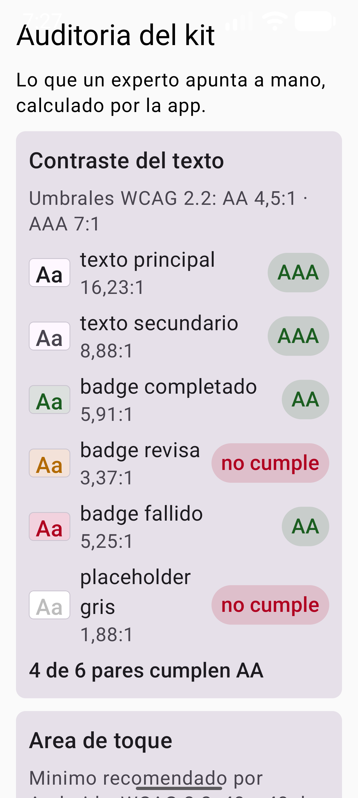
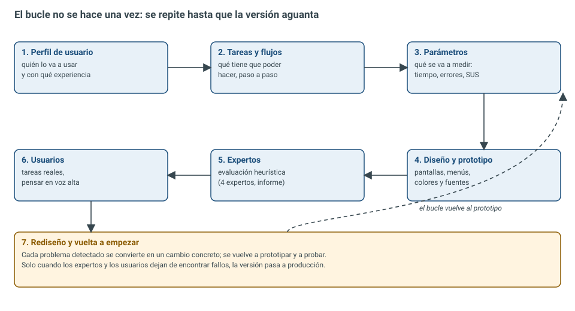

# DI · Unidad 6 — Usabilidad y accesibilidad

<style>
.reveal .cc pre{width:63%;float:left;margin:0;font-size:.42em}
.reveal .cc pre code{max-height:500px}
.reveal .cc p:has(img){float:right;width:34%;margin:0}
.reveal .cc img{max-height:480px;margin:0}
.reveal table{font-size:.5em;margin:0 auto}
</style>

Note: Presentación-resumen de la teoría del Tema 6, en su mismo orden. Se trabaja auditando el propio kit IsmaelUIKit: la app calcula el contraste y el área de toque y encuentra dos defectos reales. Idea que deben llevarse: **la usabilidad y la accesibilidad se miden con números, no se opinan**.

---

## Usable y accesible

- **Usable**: el usuario consigue su objetivo sin pelearse con la herramienta
- **Accesible**: lo consigue **cualquier** usuario, con o sin limitaciones
- Las reglas salen de normas: **ISO**, **WCAG**, **EN 301 549**
- Android las traduce a **dp**, **sp** y **etiquetas de accesibilidad**

Note: El tema completa el RA4. No hay una sola norma: hay tres familias que se complementan, y Android las convierte en reglas que se programan.


### RA4 y sus criterios

| CE | Criterio | Dónde |
|---|---|---|
| a | Estándares de usabilidad y accesibilidad | Los estándares, uno por uno |
| b | Importancia de los estándares | Definición oficial |
| c | Menús que siguen los estándares | ISO 9241-14, menús |
| d | Acciones en menús, barras y botones | Distribución coherente |
| e | Distribución de los controles | 48 dp, auditoría |
| f | Control más apropiado en cada caso | Adaptadores y formatos |
| g | Colores y fuentes legibles | Contraste, fuente al 200 % |
| h | Mensajes adecuados y claros | Mensajes de error |
| i | Pruebas de usabilidad y accesibilidad | Automáticas, expertos y usuarios |

Note: Nueve criterios, todos del RA4. Pueden usar esta tabla como índice de estudio.


### Índice

- 1. Introducción: eficacia, eficiencia y satisfacción
- 2. Los estándares: ISO 9241, 25010, WCAG 2.2, EN 301 549, Android
- 3-4. Perfiles funcionales, adaptadores y formatos alternativos
- 5. Contraste: la fórmula
- 6-7. Área de toque y la pantalla de auditoría
- 8. Escalar la letra al 200 %
- 9-10. Pruebas automáticas, con expertos y con usuarios
- 11-13. Errores típicos, verificación y resumen

Note: Primero las normas; después, a quién le falla la interfaz; y luego lo que se mide de verdad: contraste, área de toque y escalado del texto. Termina con cómo se prueba.

---

## 1. Las tres medidas de la usabilidad

| Medida | Qué es | Cómo se mide |
|---|---|---|
| **Eficacia** | Se consigue el objetivo | ¿Termina la tarea? ¿Cuántos? |
| **Eficiencia** | Con pocos recursos | Tiempo, toques, pasos de más |
| **Satisfacción** | El usuario queda a gusto | Cuestionario SUS, entrevista |

Note: Si una de las tres falla, la interfaz no es usable. Una app donde todos terminan la tarea pero tardan diez minutos no es usable.


### De dónde sale cada regla

 <!-- .element height="55%" -->

Note: Las ISO dicen qué es la ergonomía del diálogo; las WCAG y la EN 301 549 dicen qué es accesible y con qué umbrales; Android lo traduce a dp, sp y etiquetas.

---

## 2. Los estándares, uno por uno

- **ISO 9241**: ergonomía de la interacción
- 9241-11: **definición de usabilidad**
- 9241-14: **menús** · 9241-17: **formularios**
- **ISO 25010** (heredera de la 9126): la accesibilidad es parte de la usabilidad
- **ISO 9241-210** sustituye a la 13407: no se cita la 13407 como vigente

Note: Para el criterio c, los menús, se cita la 9241-14; para formularios, la 9241-17. Que la accesibilidad sea una subcaracterística de la usabilidad, y no un extra, es el dato que hay que retener de la 25010.


### La definición de memoria (ISO 9241-11:2018)

> **Usabilidad**: grado en que un sistema puede ser utilizado por **usuarios específicos** para lograr **objetivos concretos** con **eficacia, eficiencia y satisfacción** en un **contexto de uso especificado**.

- Quién · para qué · con qué resultado · a qué coste · a gusto · en qué circunstancias

Note: Las piezas de la definición son las preguntas de cualquier auditoría. Si una auditoría no responde a todas, no es una auditoría: es una opinión.


### WCAG 2.2: cuatro principios, tres niveles

| Principio | Significa | Ejemplo |
|---|---|---|
| **Perceptible** | Se percibe con algún sentido | 1.4.3 contraste |
| **Operable** | Se maneja con algún dispositivo | 2.5.8 tamaño del objetivo |
| **Comprensible** | Se entiende | 3.3.1 identificación de errores |
| **Robusto** | Funciona con tecnologías de apoyo | 4.1.2 nombre, función, valor |

- Niveles **A**, **AA** y **AAA**: el objetivo realista y legal es **AA**

Note: AAA se persigue en textos críticos. La EN 301 549 y el RD 1112/2018 convierten AA en obligación legal en el sector público: la accesibilidad ya no es buena voluntad.


### Los criterios con números

| Criterio | Nivel | Qué exige |
|---|---|---|
| 1.4.3 Contraste mínimo | AA | **4,5:1** texto normal; **3:1** grande |
| 1.4.6 Contraste mejorado | AAA | **7:1** texto normal; **4,5:1** grande |
| 1.4.11 Contraste no textual | AA | **3:1** iconos y controles |
| 1.4.4 Redimensionar texto | AA | Ampliar al **200 %** sin perder contenido |
| 1.4.10 Reflow | AA | Sin scroll horizontal a 320 px |
| 2.5.8 Tamaño del objetivo | AA | 24 × 24 px como mínimo |

Note: Texto grande en WCAG es 18 pt, o 14 pt en negrita, no "el que a mí me parece grande".


### Lo que añade Android

| Regla | Cómo se cumple en Compose |
|---|---|
| **48 × 48 dp** de área de toque | `minimumInteractiveComponentSize()` |
| Texto en **sp**, no en dp | `fontSize = 16.sp`, tipografía del tema |
| `contentDescription` en lo que no tiene texto | `Modifier.semantics { ... }` |
| Rol y estado accesible | `role = Role.Button`, `stateDescription` |
| Nada **solo por color** | Icono + texto, además del color |
| Orden de foco lógico | Orden de composición |

Note: Esto es lo que se programa. Y la prueba objetiva: si algo no aparece en el volcado de uiautomator, TalkBack no lo ve.

---

## 3. Perfiles funcionales

| Limitación | Barrera típica | Qué hace la app |
|---|---|---|
| **Visual** | Texto pequeño, poco contraste | sp, contraste AA, `contentDescription` |
| **Daltonismo** | Información solo por color | Color **+** icono **+** texto |
| **Auditiva** | Avisos solo con sonido | Vibración, aviso visual, subtítulos |
| **Motriz** | Botones pequeños, gestos obligatorios | 48 dp, alternativas a gestos |
| **Cognitiva** | Lenguaje enrevesado | Lenguaje claro, consistencia, ayudas |

Note: Las limitaciones son permanentes, temporales o situacionales: un brazo escayolado o el sol en la pantalla también cuentan.


### Los adaptadores por su nombre

- **TalkBack**: lector de pantalla
- **Switch Access**: uno o dos pulsadores externos
- **Control por voz**, **teclado / D-pad**
- **Lupa**, **fuente grande**, **alto contraste**
- **Línea braille** por Bluetooth o USB

Note: Ninguno necesita código especial si la app está bien etiquetada: funcionan sobre el árbol de semántica.

---

## 4. Formatos alternativos

| Contenido | Alternativa |
|---|---|
| Imagen con información | **Texto alternativo** (`contentDescription`) |
| Imagen decorativa | `contentDescription = null` |
| Audio o vídeo | **Subtítulos** y **transcripción** |
| Gráfico de datos | Tabla de datos equivalente |
| Aviso de color | Icono + texto ("Completado", no solo verde) |
| Mensaje de error | Qué pasó + cómo se arregla |

Note: Un badge que solo cambia de color es invisible para un lector de pantalla y para un daltónico. Por eso el BadgeEstado lleva texto además del color.


### Mensajes: extensión y claridad (criterio h)

| Mal | Bien |
|---|---|
| `Error 500` | "No se ha podido guardar el abono. Comprueba la conexión y vuelve a intentarlo." |
| `Campo inválido` | "El teléfono debe tener 9 cifras. Has escrito 7." |
| `Operación no permitida` | "No puedes cambiar la fecha de un turno ya cerrado. Pide el cambio a tu supervisor." |

Note: Un buen mensaje dice qué ha pasado y cómo se arregla, sin códigos internos.

---

## 5. Contraste: la fórmula se calcula

1. **Canal a luz lineal**: `C / 12,92` si `C ≤ 0,03928`; si no, `((C + 0,055) / 1,055)^2,4`
2. **Luminancia**: `L = 0,2126·R + 0,7152·G + 0,0722·B`
3. **Ratio**: `(L_claro + 0,05) / (L_oscuro + 0,05)`

- Va de **1:1** (mismo color) a **21:1** (negro sobre blanco)

Note: La pantalla aplica corrección gamma y la norma la deshace. El verde pesa mucho más que el azul porque así lo percibe el ojo. El más 0,05 evita dividir por cero con el negro puro.


### Código · `Contraste.kt`

```kotlin
object Contraste {
    private fun canalLineal(valor: Float): Double {
        val v = valor.toDouble()
        return if (v <= 0.03928) v / 12.92 else ((v + 0.055) / 1.055).pow(2.4)
    }

    fun luminancia(color: Color): Double =
        0.2126 * canalLineal(color.red) +
        0.7152 * canalLineal(color.green) +   // el que más aporta
        0.0722 * canalLineal(color.blue)

    fun ratio(fondo: Color, texto: Color): Double {
        val a = luminancia(fondo); val b = luminancia(texto)
        return (max(a, b) + 0.05) / (min(a, b) + 0.05)
    }
}
// … (código completo en la teoría)
```

Note: Las dos fórmulas de la especificación, en Kotlin. El orden de los argumentos no cambia el resultado: el más luminoso siempre va arriba.


### La trampa del alfa

- El fondo del badge es el acento **al 15 % de opacidad**
- Medido tal cual: **1,00:1** en los tres badges → falso
- Un color translúcido se ve **mezclado** con lo de debajo:

`C = C_capa · α + C_base · (1 − α)`

- Bien compuesto: **5,91:1**, **3,37:1** y **5,25:1**

Note: El número era correcto y la conclusión falsa: copy(alpha) conserva los canales RGB, así que comparar el color consigo mismo da 1:1. Regla de memoria: antes de medir un color translúcido, se compone sobre el fondo real de la pantalla.

---

## 6. Área de toque: 48 dp

- WCAG: **24 × 24** (AA) y **44 × 44** (AAA)
- Android es más exigente: **48 × 48 dp**
- Se mide la **zona que responde**, no el dibujo
- El icono puede ser pequeño y la zona grande

Note: Confundir el área de toque con el dibujo es un error típico. Un icono de 24 dp con una zona táctil de 48 dp cumple.

---

## 7. La pantalla de auditoría
<!-- .slide: class="cc" -->

```kotlin
@Composable
private fun EscenaAuditoria() {
    val pares = listOf(
        ParContraste("texto principal",
            colorScheme.surface, colorScheme.onSurface),
        ParContraste("badge revisa",
            Contraste.sobre(colorScheme.surface,
                Estado.AVISO.acento.copy(alpha = 0.15f)),
            Estado.AVISO.acento),
        ParContraste("placeholder gris",
            Color.White, Color(0xFFBDBDBD)),  // falla a propósito
        // …
    )
    val controles = listOf(
        ControlToque("tecla Do (piano)", 44.dp, 150.dp),
        ControlToque("boton Material 3", 48.dp, 48.dp),
    )
    Column {
        PanelContraste(pares)
        PanelToques(controles)
    }
}
// … (código completo en la teoría)
```


Note: Lo que un experto apunta a mano, calculado por la propia app. Arriba los pares fondo y texto con su ratio y veredicto; abajo el área de toque de dos controles.


### Los resultados, tal como salen

| Par | Ratio | Veredicto |
|---|---|---|
| Texto principal | 16,23:1 | AAA |
| Texto secundario | 8,88:1 | AAA |
| Badge completado | 5,91:1 | AA |
| **Badge revisa** | **3,37:1** | **No cumple** |
| Badge fallido | 5,25:1 | AA |
| Placeholder gris | 1,88:1 | No cumple (a propósito) |
| **Tecla Do** | **44 × 150 dp** | **Corto** |

Note: Los dos "no cumple" y el "corto" no son ejemplos inventados: son defectos reales del kit de las unidades anteriores.


### Los dos defectos reales

- **Badge "revisa"**: 3,37:1 < 4,5 → ámbar más oscuro para el texto o tinte al 20-25 %
- **Tecla del piano**: 44 dp < 48 → `Box` de 48 dp con el dibujo de 44 dentro
- Ahora hay **un número** que lo demuestra y **una prueba** que avisará si vuelve

Note: Una auditoría que no encuentra nada casi siempre es una auditoría mal hecha. Encontrar dos defectos en un kit propio es lo normal.

---

## 8. Escalar la letra al 200 %

| Unidad | Escala con la fuente del sistema | Se usa para |
|---|---|---|
| `dp` | No | Tamaños, márgenes, áreas de toque |
| `sp` | **Sí** | Todo texto |

 <!-- .element height="45%" -->

Note: Con font_scale 2.0 las tarjetas crecen, las etiquetas pasan a dos líneas y nada se corta ni se solapa. El 200 % es la configuración de muchísima gente mayor.

---

## 9. Pruebas automáticas (criterio i)

| Prueba | Qué demuestra |
|---|---|
| `elRatioDaLosValoresConocidosDeLaNorma` | 21:1 y 1:1 exactos |
| `elAlfaSeComponeAntesDeMedir` | El fallo del alfa no vuelve |
| `losUmbralesSonLosDeWCAG` | 4,5 y 7 donde dice la norma |
| `elDetectorDeToquesMarcaCortaLaTeclaDelPiano` | 44 dp no cumple; 48 sí |
| `elPanelEnsenyaElVeredictoDeCadaPar` | La pantalla pinta ratio y resumen |

Note: Una prueba de accesibilidad no comprueba "que se ve bien": comprueba un número. Con las de las unidades anteriores, 16 pruebas en verde.

---

## 10. Pruebas con expertos y con usuarios

- **Menús (ISO 9241-14)**: 7 ± 2 opciones por nivel, 2-3 niveles como máximo
- Acciones **donde se esperan**: lo destructivo, separado y confirmado
- **Coherencia** entre pantallas y siempre una **salida**

Note: En una app táctil el menú suele ser una barra inferior o un NavigationBar; los criterios son los mismos.


### Las diez heurísticas de Nielsen

| # | Heurística | # | Heurística |
|---|---|---|---|
| 1 | Visibilidad del estado | 6 | Reconocer antes que recordar |
| 2 | Lenguaje del usuario | 7 | Flexibilidad y eficiencia |
| 3 | Control y libertad | 8 | Diseño minimalista |
| 4 | Consistencia | 9 | Recuperación de errores |
| 5 | Prevención de errores | 10 | Ayuda y documentación |

- Gravedad de **0** (no es problema) a **4** (catastrófico)

Note: La evaluación heurística la hacen expertos revisando la interfaz contra estas diez reglas, y cada problema se puntúa: 3 se arregla antes de publicar y 4 bloquea la publicación.


### Pruebas con usuarios y SUS

- **Cinco usuarios** encuentran ~85 % de los problemas de un flujo
- **SUS**: diez afirmaciones, escala de 1 a 5, resultado de 0 a 100
- **68** es la media del sector; > 80, excelente; < 51, inaceptable

 <!-- .element height="35%" -->

Note: No hacen falta cien usuarios: hacen falta cinco que se parezcan al real. El resultado de evaluar siempre es un rediseño, y el bucle se repite hasta que deja de encontrar fallos.

---

## 11. Errores típicos al auditar

| Error | Qué hacer |
|---|---|
| Medir el contraste "a ojo" | Calcular con la fórmula |
| Medir un color con alfa sin componer | Componer sobre el fondo real |
| Confundir área de toque con dibujo | Medir la zona que responde |
| Texto en `dp` | `sp` siempre |
| Información solo por color | Color + icono + texto |
| `contentDescription` en lo decorativo | `null` en lo decorativo |
| Arreglar sin volver a medir | Repetir la auditoría |

Note: Y uno de actitud: confundir accesible con feo. Se puede ser accesible y bonito; son criterios distintos.

---

## 12-13. Verificado y resumen

- Usable = **eficacia + eficiencia + satisfacción** (ISO 9241-11)
- WCAG 2.2: **4 principios** y **3 niveles**; el objetivo es **AA**
- Contraste: **4,5:1** texto normal, **3:1** grande; se calcula con la fórmula
- Un color con **alfa** se compone antes de medir
- **48 dp** de toque, texto en **sp**, nada **solo por color**
- Los números van en **pruebas automáticas**: 16 en verde
- La auditoría encontró **dos defectos reales** del kit

Note: Cerrar con la idea del tema: la usabilidad y la accesibilidad se miden con números y se demuestran con pruebas.


### Bibliografía y fuentes

- ISO 9241-11:2018 · ISO 9241-14 · ISO/IEC 25010 · ISO 9241-210
- W3C — *WCAG 2.2*
- ETSI — *EN 301 549* · RD 1112/2018
- Android Developers — *Accessibility*, *Semantics*, *Touch target size*
- Nielsen — *10 Usability Heuristics* · Brooke — *SUS*
- RD 405/2023 — módulo 0488, **RA4**

Note: Las normas y la documentación oficial de Android son la fuente de cada umbral que se ha usado en el tema.


### ¡Gracias por vuestra colaboración!

- Próxima parada: interfaces naturales (voz, sensores, visión)
- Material completo en la web del módulo
- ¡A auditar vuestras apps!

Note: Cierre: que pasen la auditoría a su propia práctica. En la unidad 7 la interfaz deja de depender solo del dedo: voz, movimiento y cámara.
