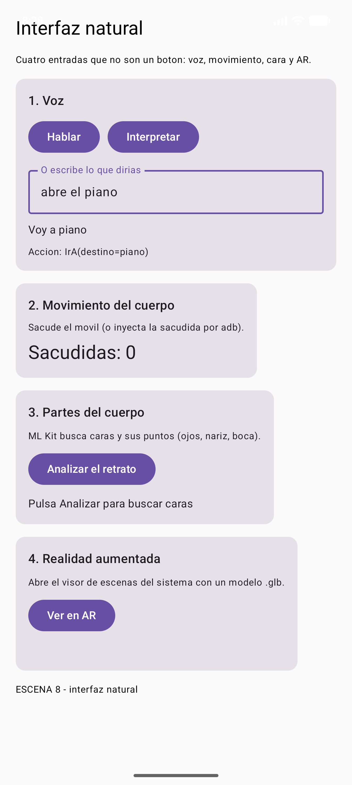
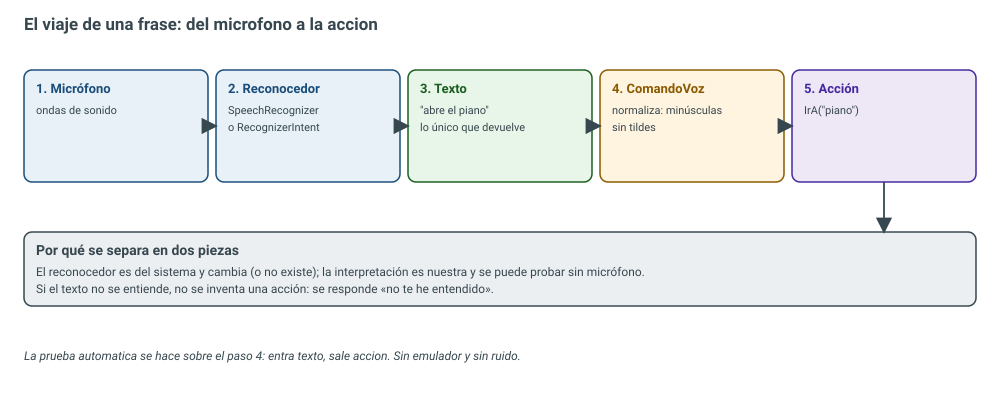
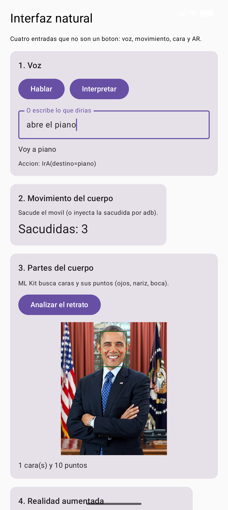

# DI · Unidad 7 — Interfaces naturales

<style>
.reveal .cc pre{width:63%;float:left;margin:0;font-size:.42em}
.reveal .cc pre code{max-height:500px}
.reveal .cc p:has(img){float:right;width:34%;margin:0}
.reveal .cc img{max-height:480px;margin:0}
.reveal table{font-size:.5em;margin:0 auto}
</style>

Note: Presentación-resumen de la teoría del Tema 7, en su mismo orden. Cuatro entradas naturales en una sola escena del kit: voz, movimiento, cara y realidad aumentada. Idea que deben llevarse: **la entrada cambia, pero la acción que se ejecuta es la misma**.

---

## Del ratón al cuerpo

| Época | Interfaz | El usuario tiene que aprender… |
|---|---|---|
| 1960-1980 | Línea de órdenes (CLI) | La sintaxis de cada orden |
| 1980-2010 | Interfaz gráfica (GUI) | Dónde está cada menú e icono |
| 2010-hoy | **Interfaz natural (NUI)** | Nada nuevo: voz, gesto y cámara |

Note: Natural no significa sin aprender nada: significa que el canal es el que el cuerpo ya domina.


### RA2 y sus criterios

| CE | Criterio | Dónde |
|---|---|---|
| a | Herramientas de aprendizaje automático | Tabla de herramientas |
| b | Crear una interfaz natural | La escena 8 completa |
| c | Reconocimiento de voz | `ComandoVoz` |
| d | Detección del movimiento del cuerpo | Acelerómetro y sacudida |
| e | Detección de partes del cuerpo | ML Kit: los diez puntos de la cara |
| f | Realidad aumentada | Scene Viewer y ARCore |

Note: El tema cubre el RA2 completo, un criterio por entrada natural.


### Índice

- 1. Introducción: qué es "natural"
- 2. Herramientas del aprendizaje automático
- 3. La interfaz natural de la unidad
- 4. Voz: del sonido a la acción
- 5. Movimiento del cuerpo
- 6. Partes del cuerpo: ML Kit
- 7. Realidad aumentada
- 8-11. Pruebas, errores típicos, verificación y resumen

Note: Un apartado por criterio, del a al f, y al final las pruebas que demuestran cada uno.

---

## 1. Cuatro entradas, un vocabulario

 <!-- .element height="50%" -->

- Cada entrada mide algo distinto…
- …pero todas se traducen a **ir a**, **siguiente**, **anterior**

Note: Esa normalización es lo que hace la interfaz mantenible: la pantalla no sabe si la orden vino de la voz o de una sacudida.

---

## 2. Herramientas del aprendizaje automático (a)

| Herramienta | Qué devuelve |
|---|---|
| **ML Kit — Face Detection** | Caja + 10 puntos de la cara |
| **ML Kit — Pose Detection** | 33 puntos del cuerpo |
| **ML Kit — Text / Barcode / Labels** | Texto, códigos, etiquetas |
| **MediaPipe** | Cuerpo, manos y cara en tiempo real |
| **TensorFlow Lite / LiteRT** | Lo que devuelva tu modelo |
| **ARCore** | Pose de la cámara y planos |
| **RecognizerIntent / SpeechRecognizer** | Texto a partir de voz |
| **TextToSpeech** · **SensorManager** | Voz · números con unidades |

Note: Casi todas funcionan sin conexión. La elección no va por cuál es más moderna, sino por lo que devuelve y lo que necesita la acción.

---

## 3. La interfaz natural de la unidad (b)

| Tarjeta | Entrada | Qué hace | CE |
|---|---|---|---|
| 1. Voz | Micrófono o texto | Reconoce, interpreta y contesta | c |
| 2. Movimiento | Acelerómetro | Cuenta sacudidas | d |
| 3. Cuerpo | Imagen + ML Kit | Caja y diez puntos de la cara | e |
| 4. AR | Cámara + ARCore | Visor de escenas con un `.glb` | f |

 <!-- .element height="40%" -->

Note: En la tarjeta de voz se ha escrito "abre el piano" y la app ha contestado "Voy a piano" con la acción IrA(destino=piano). Cada entrada produce una AccionVoz y la pantalla solo sabe ejecutar acciones.

---

## 4. Voz: dos formas de reconocer (c)

| | `RecognizerIntent` | `SpeechRecognizer` |
|---|---|---|
| Interfaz | La del sistema | La que hagas tú |
| Permiso | **No hace falta** | `RECORD_AUDIO` |
| Duración | Una frase | Continua |
| Uso típico | Comandos sueltos | Asistentes, dictado |

Note: En la unidad se usa RecognizerIntent: no necesita permiso ni dibujar nada. Pedir RECORD_AUDIO con RecognizerIntent es un error: un permiso innecesario que asusta al usuario.


### El viaje de la frase

 <!-- .element height="45%" -->

- El reconocedor **no devuelve acciones**: devuelve **texto**
- Interpretar el texto es trabajo **nuestro**, y es lo que se prueba

Note: El reconocedor es del sistema; la interpretación es nuestra y es la única parte que se prueba con tests, sin micrófono.


### Código · `ComandoVoz`

```kotlin
sealed interface AccionVoz {
    data class IrA(val destino: String) : AccionVoz
    data object Siguiente : AccionVoz
    data object Anterior : AccionVoz
    data object Ayuda : AccionVoz
    data class Desconocida(val frase: String) : AccionVoz
}

fun interpretar(frase: String): AccionVoz {
    val limpia = normalizar(frase)          // minúsculas y sin tildes
    if (limpia.contains("siguiente")) return AccionVoz.Siguiente
    if (limpia.contains("atras") || limpia.contains("volver")) return AccionVoz.Anterior
    DESTINOS.entries.firstOrNull { limpia.contains(it.key) }
        ?.let { return AccionVoz.IrA(it.value) }
    return AccionVoz.Desconocida(frase)     // no se adivina
}
// … (código completo en la teoría)
```

Note: Tres decisiones que se preguntan: normalizar, porque el reconocedor devuelve unas veces "atrás" y otras "atras"; buscar contenido y no igualdad, porque la gente dice "oye, ve atrás"; y no inventar: una interfaz que adivina es peor que una que pregunta.


### La respuesta hablada

```kotlin
val tts = TextToSpeech(contexto) { }
tts.language = Locale.forLanguageTag("es-ES")
tts.speak("Voy a piano", TextToSpeech.QUEUE_FLUSH, null, "respuesta")
// y en onDispose: tts.shutdown()
```

- La app no solo obedece: **contesta**
- `QUEUE_FLUSH`: dos órdenes seguidas no se solapan
- `shutdown()` al salir: si no, el servicio de voz sigue vivo

Note: Probar el micrófono en un test es frágil; probar la interpretación es determinista: entra un texto y sale una acción.

---

## 5. Movimiento del cuerpo (d)

| Sensor | Devuelve | Para qué |
|---|---|---|
| `TYPE_ACCELEROMETER` | m/s² | Sacudidas, inclinación |
| `TYPE_GYROSCOPE` | rad/s | Girar un objeto |
| `TYPE_PROXIMITY` | cm | Apagar la pantalla |
| `TYPE_LIGHT` | lx | Ajustar el brillo |
| `TYPE_ROTATION_VECTOR` | Cuaternión | Realidad aumentada |

- Quieto sobre la mesa: **~9,8 m/s²** (la gravedad)
- Sacudida: magnitud `√(x² + y² + z²)` lejos de la gravedad

Note: Al sacudir aparecen picos de 15 a 30 m/s². Si la magnitud se aleja de la gravedad más que un umbral, es una sacudida.


### Código · `SensorMovimiento`

```kotlin
object DetectorSacudida {
    const val UMBRAL = 6.0f
    fun magnitud(x: Float, y: Float, z: Float) = sqrt(x * x + y * y + z * z)
    fun esSacudida(m: Float) = abs(m - SensorManager.GRAVITY_EARTH) > UMBRAL
}

@Composable
fun RecordarSacudidas(onSacudida: () -> Unit) {
    DisposableEffect(contexto) {
        val escucha = object : SensorEventListener { /* … */ }
        gestor.registerListener(escucha, sensor, SensorManager.SENSOR_DELAY_GAME)
        onDispose { gestor.unregisterListener(escucha) }  // sin esto, fuga
    }
}
// … (código completo en la teoría)
```

Note: La cuenta va en un objeto aparte para probarla sin sensor: 9,8 no es sacudida y 25 sí. DisposableEffect registra al entrar y da de baja al salir; olvidarlo deja el sensor gastando batería con la pantalla apagada.


### El freno de las sacudidas

```kotlin
val ahora = System.currentTimeMillis()
if (ahora - ultima > 700) { ultima = ahora; sacudidas += 1 }
```

- Una sacudida real son **20-50 eventos** en medio segundo
- Sin freno, un meneo cuenta 30 sacudidas
- En el emulador se **inyectan** valores del sensor por consola

Note: El freno por tiempo descarta todo lo que llegue en los 700 ms siguientes. Y no hace falta agitar el móvil: el emulador acepta valores del acelerómetro por consola.

---

## 6. Partes del cuerpo: ML Kit (e)

- **Face Detection**: una caja y **diez puntos** por cara
- Ojos, orejas, mejillas, nariz y boca (izquierda, derecha y abajo)
- Los códigos **no son correlativos**: nariz 6, ojo derecho 10, boca derecha 11
- Se usan las constantes `FaceLandmark.*`, nunca números mágicos

Note: La cara es una parte del cuerpo y sus puntos son los que usa una interfaz natural para saber si miras la pantalla, si sonríes o hacia dónde giras la cabeza.


### Código · `Rostro` y el resultado
<!-- .slide: class="cc" -->

```kotlin
data class PuntoCara(val tipo: Int, val x: Float, val y: Float)
data class Cara(val caja: Rect, val puntos: List<PuntoCara>)

object Rostro {
    private val detector: FaceDetector by lazy {   // se crea UNA vez
        FaceDetection.getClient(
            FaceDetectorOptions.Builder()
                .setPerformanceMode(
                    FaceDetectorOptions.PERFORMANCE_MODE_ACCURATE)
                .setLandmarkMode(
                    FaceDetectorOptions.LANDMARK_MODE_ALL) // los puntos
                .build())
    }
    // detectar(bitmap) { caras -> … }: asíncrono, por callback
}
// … (código completo en la teoría)
```



Note: El detector es caro y se crea una sola vez. El resultado llega por callback para no bloquear la interfaz. Si la caja se dibuja sin aplicar la escala de píxeles a dp, aparece desplazada.


### Del rostro al cuerpo entero

- **Pose Detection**: 33 puntos del esqueleto
- Mismo esquema: imagen → modelo → **lista de puntos** → decisión
- Cambian el número de puntos y el modelo

Note: Lo aprendido con la cara se aplica tal cual al cuerpo entero con Pose Detection.

---

## 7. Realidad aumentada (f)

- No hace falta un motor 3D: **Scene Viewer** del sistema
- La app solo construye una **URI** con un modelo `.glb`
- `mode=ar_preferred`: AR si se puede, 3D si no

```kotlin
fun uriEscena(modelo: String, titulo: String) =
    "intent://arvr.google.com/scene-viewer/1.0" +
    "?file=$modelo&mode=ar_preferred&title=$titulo" +
    "#Intent;scheme=https;package=com.google.ar.core;" +
    "action=android.intent.action.VIEW;end;"

val intent = Intent.parseUri(uriEscena(m, t), Intent.URI_INTENT_SCHEME)
```

Note: La URI es un intent URI, no una URL de navegador: se convierte con Intent.parseUri, no con ACTION_VIEW. En Android 11 o superior hay que declarar el paquete com.google.ar.core en queries para poder preguntar si está.


### Comprobar antes de lanzar

 <!-- .element height="45%" -->

- `haySoporte()` pregunta por el paquete `com.google.ar.core`
- Sin ARCore, la app **avisa en la tarjeta** en lugar de cerrarse

Note: El emulador no trae ARCore. Comprobar antes de lanzar es parte del trabajo: un cierre inesperado es peor que un aviso.

---

## 8. Lo que se ha probado (23 pruebas)

| Prueba | Demuestra | CE |
|---|---|---|
| `laVozSeTraduceAAcciones` | "abre el piano" → acción correcta | c |
| `lasTildesYLasMayusculasNoImportan` | "Atrás" = "atras" | c |
| `loQueNoSeEntiendeNoSeInventa` | Texto raro → `Desconocida` | c |
| `elDetectorDistingueQuietoDeSacudida` | 9,8 no; 25 sí | d |
| `losDiezPuntosDeLaCaraTienenNombre` | Los diez códigos de ML Kit | e |
| `elDetectorDeCarasArrancaYNoInventaCaras` | Imagen en blanco → 0 caras | e |
| `laUriDeArSeConvierteEnUnIntentDelVisor` | URI → intent de ARCore | f |

Note: Siete pruebas nuevas, 23 en total en verde. La más importante es la de la imagen en blanco: un detector que no inventa caras.

---

## 9. Errores típicos

| Error | Qué hacer |
|---|---|
| Comparar la voz con igualdad exacta | Normalizar y buscar contenido |
| Adivinar cuando no se entiende | Responder "no te he entendido" |
| No dar de baja el sensor | `DisposableEffect` + `unregisterListener` |
| Contar cada evento del acelerómetro | Freno por tiempo (700 ms) |
| Números mágicos con ML Kit | Constantes `FaceLandmark.*` |
| Lanzar la URI de AR con `ACTION_VIEW` | `Intent.parseUri(..., URI_INTENT_SCHEME)` |
| No comprobar si hay ARCore | `haySoporte()` y aviso |
| Sustituir los botones por voz | Mantener siempre la entrada clásica |

Note: El último es de accesibilidad y conecta con la unidad 6: no todo el mundo puede o quiere hablar.

---

## 10-11. Verificado y resumen

- Interfaz natural = canal que el cuerpo ya domina
- **La entrada cambia; la acción es la misma**
- **Voz** (c): texto → normalizar → acción; no inventar
- **Movimiento** (d): magnitud contra la gravedad, freno y baja del sensor
- **Cuerpo** (e): ML Kit, caja + 10 puntos, constantes `FaceLandmark`
- **AR** (f): Scene Viewer por intent URI y comprobar ARCore
- **23 pruebas** en verde

Note: Cerrar con la idea del tema: cuatro entradas, un solo vocabulario de acciones.


### Bibliografía y fuentes

- Google — *ML Kit: Face Detection*, *Pose Detection*
- Android Developers — *RecognizerIntent*, *TextToSpeech*, *Sensors overview*
- Google — *ARCore: Scene Viewer*
- Google — *MediaPipe* · *LiteRT (TensorFlow Lite)*
- RD 405/2023 — módulo 0488, **RA2**

Note: Todo el código está en la web del módulo, con sus capturas y los volcados de uiautomator.


### ¡Gracias por vuestra colaboración!

- Próxima parada: informes (filtros, totales, gráficos, PDF y CSV)
- Material completo en la web del módulo
- ¡A hablarle a vuestra app!

Note: Cierre: en la unidad 8 la app genera informes con los datos, los gráficos y la exportación a PDF y CSV.
