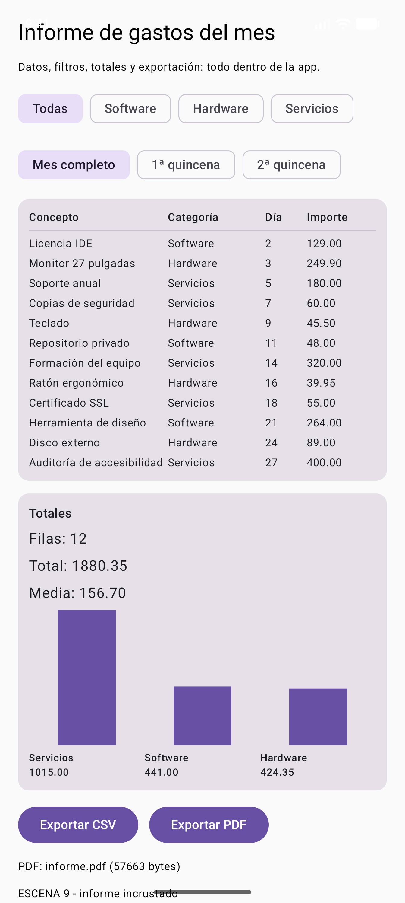

# DI · Unidad 8 — Confección de informes

<style>
.reveal .cc pre{width:63%;float:left;margin:0;font-size:.42em}
.reveal .cc pre code{max-height:500px}
.reveal .cc p:has(img){float:right;width:34%;margin:0}
.reveal .cc img{max-height:480px;margin:0}
.reveal table{font-size:.5em;margin:0 auto}
</style>

Note: Presentación-resumen de la teoría del Tema 8, en su mismo orden. La app del kit genera un informe de gastos del mes con filtros, totales, gráfico y exportación a PDF y CSV. Idea que deben llevarse: **los datos se filtran y se cuentan una vez, y ese resultado lo usan la pantalla, el PDF y el CSV**.

---

## Qué es un informe

- Una vista de datos preparada para que alguien **decida**
- Título, filtros, tabla, totales y, si ayuda, gráfico
- **No** es un volcado sin filtrar
- **No** es una pantalla bonita sin cifras
- **No** es un PDF con números distintos de la pantalla

Note: Si hay dos caminos de cálculo, hay dos verdades. Esa es la regla que ordena toda la unidad.


### RA5 y sus criterios

| CE | Criterio | Dónde |
|---|---|---|
| a | Estructura del informe | Las siete partes |
| b | Informes desde diferentes fuentes con asistentes | De la fuente al asistente |
| c | Filtros sobre los valores | `filtrar()` |
| d | Valores calculados, recuentos y totales | `resumir()` |
| e | Gráficos generados a partir de los datos | `GraficoBarras` |
| f | Herramientas que generan el código del informe | Qué genera un asistente |
| g | Modificar el código del informe | `ExportaInforme` |
| h | Aplicación con informes incrustados | La escena 9 |

Note: El tema cubre el RA5 completo, un apartado por criterio.


### El camino del informe

 <!-- .element height="50%" -->

Note: El paso del resumen es el único que calcula; la pantalla y la exportación solo pintan lo que devuelve.

---

## 2. La estructura del informe (a)

| Parte | Lleva | Responde a |
|---|---|---|
| **Cabecera** | Título, fecha, autor | ¿Qué miro y de cuándo es? |
| **Filtros** | Categoría, fechas | ¿De qué trozo de los datos habla? |
| **Cabecera de tabla** | Nombres de columnas | ¿Qué significa cada número? |
| **Filas** | Un dato por línea | ¿Qué hay dentro? |
| **Totales** | Recuento, suma, media | ¿Cuánto en total? |
| **Gráfico** | Barras, líneas, tarta | ¿Cómo se reparte? |
| **Pie** | Página y fecha | ¿Se ha cortado alguna hoja? |

Note: Los filtros van escritos en el informe, no solo aplicados. Un total sin los filtros que lo producen no se puede comprobar.


### Las siete partes en la hoja

 <!-- .element height="55%" -->

Note: A la izquierda las bandas de la hoja; a la derecha, el criterio de evaluación que cubre cada una.

---

## 3. Fuentes y filtros (b y c)

| Fuente | Cuidado con… |
|---|---|
| Base de datos (PostgreSQL, Room) | No traer la tabla entera para contar en el móvil |
| API REST | Que filtre el servidor, no el cliente |
| Fichero CSV o Excel | Codificación UTF-8 y separador |
| La propia app | La más pequeña y fácil de probar |

Note: En la unidad la fuente es la propia app: una lista de gastos del mes. Da igual de dónde vengan los datos: el filtro y el resumen son los mismos.


### Código · el modelo y el filtro

```kotlin
data class FilaInforme(val concepto: String, val categoria: String,
                       val importe: Double, val dia: Int)

data class FiltroInforme(val categoria: String? = null,  // null = todas
                         val desde: Int = 1, val hasta: Int = 31)

object Informe {
    fun filtrar(filas: List<FilaInforme>, filtro: FiltroInforme) =
        filas.filter { fila ->
            (filtro.categoria == null || fila.categoria == filtro.categoria) &&
            fila.dia in filtro.desde..filtro.hasta
        }
}
// … (código completo en la teoría)
```

Note: El filtro es un dato, no un if suelto: se puede guardar, mandar al servidor o imprimir en el informe. Un filtro que no se puede reconstruir no se puede auditar. Y son funciones puras: se prueban sin emulador.

---

## 4. Los cálculos del pie (d)

```kotlin
fun resumir(filas: List<FilaInforme>): ResumenInforme {
    val total = filas.sumOf { it.importe }
    return ResumenInforme(
        numero = filas.size,
        total = total,
        media = if (filas.isEmpty()) 0.0 else total / filas.size,
        porCategoria = filas.groupBy { it.categoria }
            .mapValues { (_, g) -> g.sumOf { it.importe } },
    )
}
```

- **Nunca la media de medias**: se suma todo y se divide entre **todas** las filas
- Dinero: `Double` para aprender; **céntimos enteros o `BigDecimal`** para facturar

Note: Si una categoría tiene 3 filas y otra 30, la media de las dos medias no es la media del total. Y 0.1 + 0.2 no da exactamente 0.3 en coma flotante.

---

## 5. El gráfico (e)
<!-- .slide: class="cc" -->

```kotlin
val maximo = datos.maxOfOrNull { it.second } ?: 0.0
Canvas(Modifier.fillMaxWidth().height(altura)) {
    if (datos.isEmpty() || maximo <= 0.0) return@Canvas
    val ancho = size.width / (datos.size * 2f)  // barra + hueco
    datos.forEachIndexed { i, (_, valor) ->
        val alto = (valor / maximo).toFloat() * (size.height - 2f)
        drawRect(
            color = color,
            topLeft = Offset(ancho * (2 * i + 0.5f), size.height - alto),
            size = Size(ancho, alto),
        )
    }
}
// … (código completo en la teoría)
```


Note: Las barras se escalan dividiendo por el máximo. La comprobación que hay que hacer siempre: Servicios 1015,00, Software 441,00 y Hardware 424,35 suman exactamente el total, 1880,35.


### Un gráfico usable

- Las **etiquetas son texto**, no dibujo: se leen en voz alta y crecen con la fuente
- **`contentDescription` con los valores**
- Las barras tienen que **sumar el total**

Note: Un gráfico que no se puede leer con lector de pantalla es un gráfico que una parte de los usuarios no tiene. Conecta con el RA4.

---

## 6. Del asistente al código (f y g)

| Herramienta | Dónde se usa |
|---|---|
| **JasperReports + Jaspersoft Studio** | Banca, seguros, administración |
| **Power BI** | Empresas con Microsoft 365 |
| **Looker Studio** | Marketing, analítica |
| **Metabase / Superset** | Equipos técnicos pequeños |
| **Apache POI / OpenPDF / iText** | El informe lo genera la app |

Note: Un asistente te lleva de la fuente al informe: eliges la conexión, arrastras campos y agrupas, y genera la consulta y la plantilla. El criterio g es saber tocar después lo que genera.


### Código · `ExportaInforme`

```kotlin
object ExportaInforme {
    fun aCsv(contexto: Context, filas: List<FilaInforme>): File =
        File(contexto.filesDir, "informe.csv")
            .apply { writeText(Informe.aCsv(filas), Charsets.UTF_8) }

    fun aPdf(contexto: Context, titulo: String, filas: List<FilaInforme>): File {
        val resumen = Informe.resumir(filas)          // el MISMO resumen
        val documento = PdfDocument()
        var pagina = documento.startPage(
            PdfDocument.PageInfo.Builder(595, 842, 1).create())  // A4
        // drawText y drawLine; si y > 760f, página nueva
        // finishPage + writeTo(fichero)
    }
}
// … (código completo en la teoría)
```

Note: PdfDocument viene dentro de Android: no hay que añadir ninguna librería. Una A4 en puntos mide 595 por 842; si las filas no caben, se abre otra página. El PDF usa el mismo resumir() que la pantalla.

---

## 7. El informe incrustado (h)

 <!-- .element height="40%" -->
 <!-- .element height="40%" -->

Note: La exportación se hace desde la app y el aviso dice el nombre y el tamaño del fichero. El PDF es el mismo fichero que se sacó del emulador: cabecera, doce filas y totales.


### El CSV generado

```text
Concepto;Categoría;Importe;Día
Licencia IDE;Software;129.00;2
Monitor 27 pulgadas;Hardware;249.90;3
Soporte anual;Servicios;180.00;5
Teclado;Hardware;45.50;9
Auditoría de accesibilidad;Servicios;400.00;27
…
```

- **Punto y coma**: el separador que espera una hoja de cálculo en español
- Campo con `;` → **entre comillas**; comillas dentro → **duplicadas**

Note: Sin entrecomillar, el fichero se descoloca en cuanto un concepto lleva un punto y coma.

---

## 8. Lo que usan las empresas (y la IA)

- La IA escribe la consulta, el `groupBy`, el PDF y el CSV en segundos
- Lo que **no** decide:
- **qué se filtra** y qué se deja fuera
- **qué significa cada cifra** y quién puede verla
- **si el dato es correcto**
- **la estructura**: qué mira primero quien decide

Note: Por eso el examen no pregunta cómo se escribe un for: pregunta qué se cuenta, cómo se filtra y dónde va cada cosa. Informes de miles de filas se generan en el servidor, no en el móvil.

---

## 9. Lo que se ha probado (29 pruebas)

| Prueba | Demuestra | CE |
|---|---|---|
| `elFiltroPorCategoriaDejaSoloEsaCategoria` | Filtrar por categoría | c |
| `elFiltroPorDiasRecortaElRango` | Rango de días inclusivo | c |
| `elResumenCuentaSumaYHaceLaMedia` | Recuento, suma y media | d |
| `losPorcentajesSumanCien` | Las categorías suman 100 % | d, e |
| `elCsvLlevaCabeceraYUnaLineaPorFila` | Estructura del CSV | g |
| `elCsvEntrecomillaLoQueLlevaSeparador` | Un `;` no descoloca el CSV | g |

Note: Seis pruebas nuevas, 29 en total. La que más vale es la de los porcentajes: si no suman 100, el gráfico miente.

---

## 10. Errores típicos

| Error | Qué hacer |
|---|---|
| Calcular en la pantalla y otra vez en el PDF | Una función de resumen, dos formatos |
| Contar antes de filtrar | Filtrar primero, resumir después |
| Media de medias | Sumar todo y dividir entre todas las filas |
| `Double` para dinero | Céntimos enteros o `BigDecimal` |
| CSV con comas en español | Punto y coma + entrecomillar |
| PDF sin paginar | Página nueva al pasar del margen |
| Gráfico sin escala | Dividir por el valor máximo |
| Informe sin filtros escritos | Imprimir los filtros aplicados |

Note: El primero es el más grave: dos caminos de cálculo son dos verdades.

---

## 11. Resumen del tema

- Un informe sirve para **decidir**: cabecera, filtros, tabla, totales, gráfico y pie
- **Filtro** (c) = un dato que se puede guardar e imprimir
- **Cálculos** (d): recuento, suma, media y por categoría; nunca media de medias
- **Gráfico** (e): escalado, etiquetas como texto, suma igual al total
- **Exportación** (g): `PdfDocument` y CSV con punto y coma
- **Un solo resumen** para pantalla, PDF y CSV
- **29 pruebas** en verde

Note: Cerrar con la regla del tema: se filtra y se cuenta una vez.


### Bibliografía y fuentes

- Android Developers — *PdfDocument*, *Canvas*, *App-specific files*
- RFC 4180 — *Common Format for CSV Files*
- Jaspersoft Studio · Power BI · Looker Studio · Metabase
- Apache POI · OpenPDF
- RD 405/2023 — módulo 0488, **RA5**

Note: Todo el código está en la web del módulo, con el PDF y el CSV reales generados por la app.


### ¡Gracias por vuestra colaboración!

- Próxima parada: documentación y ayudas
- Material completo en la web del módulo
- ¡A generar vuestros informes!

Note: Cierre: en la unidad 9 la app se documenta a sí misma con ayuda contextual, esquema de datos y un manual generado.
